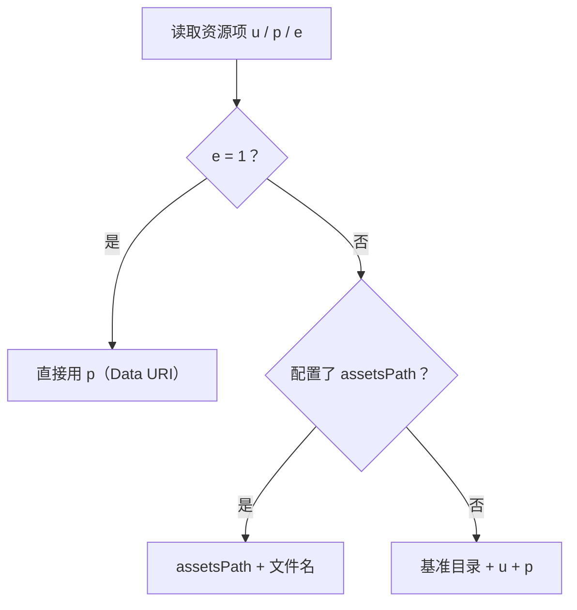

import { Canvas, Controls, Meta } from '@storybook/addon-docs/blocks';
import * as AnimationDataStories from './animation-data.stories';

<Meta of={AnimationDataStories} name="Docs" />

# 动画数据管理

数据能播之后，工程化问题集中在三件事：**资源引用**——JSON 里 assets 引用的图片按什么规则找到；**预加载与缓存**——数据何时取、取完能否复用；**多实例管理**——同屏多个动画如何创建、销毁与清理。path 与 animationData 的基础选择属于加载入口，见[获取动画素材](?path=/docs/getting-assets--docs)；`destroy()` 的清理细节与生命周期事件见[事件与生命周期](?path=/docs/events-lifecycle--docs)，本课只讲数据与实例的工程决策。下方实例用滑杆控制同屏实例数（1–4）：每次拖动都会先销毁现有实例再重建，「最近一次销毁残留」读数会验证 destroy 是否把渲染节点清理干净。

| 对象 / 参数 | 是什么 | 回查要点 |
| --- | --- | --- |
| `assets` 数组 | 动画引用的资源表（图片、预合成等） | 图层用 `refId` 按 `id` 引用资源；纯矢量动画为空数组 |
| `assets[].u` / `.p` | 资源目录 / 文件名 | 实际地址按加载方式解析，见「路径按什么解析」 |
| `assets[].e` | 内嵌标记 | `1` 表示 `p` 已内嵌为 Data URI，不再发请求 |
| `assetsPath`（loadAnimation 参数） | 资源路径前缀 | 配置后取代 `u`，按 `assetsPath + 文件名` 拼地址 |
| `name`（loadAnimation 参数） | 实例注册名 | 全局 `play` / `pause` / `destroy` 等传同名只作用于匹配实例 |
| `lottie.getRegisteredAnimations()` | 全部注册实例的数组 | 没有按名取实例的 API，按 `name` 在这里过滤 |
| `destroy()` | 销毁并注销实例 | 移除自己渲染的 DOM、退出注册表；可传 `name` 按名销毁 |

## 资源引用

动画 JSON 不只描述图层：顶层 `assets` 数组集中存放可复用资源——位图图片、预合成（嵌套动画）、音频等。图层不内嵌资源本体，而是用 `refId` 指向 assets 中的一项。所以部署动画时，JSON 与它引用的资源文件必须一起到位，而「资源文件在哪」由一套固定的路径解析规则决定。

### 图片资源的 u / p / e 三元组

图片资源是最常出工程问题的一类，lottie-docs 定义的字段如下：

```json
{
  "assets": [
    {
      "id": "image_0",
      "w": 320,
      "h": 240,
      "u": "images/",
      "p": "logo.png",
      "e": 0
    }
  ]
}
```

| 字段 | 含义 |
| --- | --- |
| `id` | 资源唯一标识，图层以 `refId` 引用它 |
| `w` / `h` | 图片宽高 |
| `u` | 资源所在目录，可以为空 |
| `p` | 文件名；资源内嵌时是完整 Data URI |
| `e` | 内嵌标记：`1` 表示 `p` 已内嵌，无需再请求 |

边界一句：预合成资源的 assets 项带 `layers` 数组而非 `u` / `p`，属于 JSON 结构问题，见[JSON 结构概览](?path=/docs/json-structure--docs)；音频等资源同样按 `u` / `p` 定位，本课不展开。

### 路径按什么解析

lottie-web 取资源地址的规则只有三条（`AnimationItem.getAssetsPath` 源码）：



三条规则里真正的变量是第三条的「基准目录」，它由加载方式决定：

- **path 加载**：基准是 path 参数去掉文件名后的目录。JSON 在 `https://cdn.example.com/anims/data.json`，资源就相对 `https://cdn.example.com/anims/` 解析——资源目录与 JSON 同处部署即可正常显示。
- **animationData 内联**：基准是空字符串，`u + p` 变成相对页面 URL 的路径。原来与 JSON 一起部署的 images 目录失去基准，页面换了路由或部署目录，图片就会请求失败。

资源与 JSON 不在一起、或数据要内联时，用 loadAnimation 的 `assetsPath` 显式指定前缀，不再依赖位置推导：

```js
lottie.loadAnimation({
  container,
  renderer: 'svg',
  path: 'https://cdn.example.com/anims/data.json',
  // 显式资源前缀：无论 JSON 从哪加载，图片都来这里取
  assetsPath: 'https://cdn.example.com/anims/images/',
});
```

`assetsPath` 分支只拼文件名：`p` 带有 `images/` 这类目录前缀时会被剥掉，只取最后一段文件名，所以前缀要写到目录级别。

### 内联资源：Data URI

把资源直接编进 JSON：`e` 设为 `1`，`p` 放完整 Data URI。bodymovin 导出时勾选资源内嵌（data URL）即可自动生成：

```json
{
  "id": "image_0",
  "w": 64,
  "h": 64,
  "u": "",
  "p": "data:image/png;base64,iVBORw0KGgo...",
  "e": 1
}
```

取舍很直给：资源内嵌后 JSON 自包含，拷一个文件就能走，彻底没有路径解析问题；代价是 JSON 体积膨胀（base64 约比原文件大三分之一），且换图要重新导出。资源小而少时内嵌，大图或更新频繁的资源用外置文件加 `assetsPath`。

## 预加载与缓存

这一节回答「数据何时取、取完能否复用」。lottie-web 提供的机制很朴素：数据要么你递给它（animationData），要么它现场取（path）；取回来不缓存，图片按实例各自预加载。

### 先 fetch 再 animationData

path 模式把取数时机完全交给 loadAnimation。要可控时机（路由预取、空闲加载）、失败重试或多个动画共用一次请求，就自己 fetch，再把结果交给 animationData：

```js
async function preloadAnimation(url) {
  const response = await fetch(url);
  if (!response.ok) {
    throw new Error(`动画加载失败：${response.status}`);
  }
  return response.json();
}

// 时机由应用决定：预取、重试、共享请求结果都好做
preloadAnimation('/anims/data.json')
  .then((data) => {
    lottie.loadAnimation({ container, renderer: 'svg', animationData: data });
  })
  .catch(showFallback);
```

### lottie-web 的内置缓存

源码核对结论：**没有跨实例的数据缓存**。path 模式每次 loadAnimation 都重新发起 XHR（`asset_loader.js`）；图片由每个实例自带的 ImagePreloader 各自加载，实例之间不共享。

| 层面 | 有无缓存 | 第二次加载的表现 |
| --- | --- | --- |
| JSON 数据 | 无 | path 重新发 XHR；命中浏览器 HTTP 缓存时不产生真实流量，但请求仍发生 |
| 图片资源 | 仅实例内 | 新实例仍会发起图片请求，浏览器图片缓存可命中 |

所以「第二次加载同一动画」不会自动复用第一次的数据。要复用，应用层自己做：fetch 一次、把解析结果存住，之后每个实例从这份结果创建。

### 同一数据创建多个实例

同一份数据创建多个实例时要注意共享引用：标准构建中 lottie-web 不克隆传入的 animationData——装配时它原地补齐数据（关键帧处理、预合成挂接）并标记 `__complete`，第二次传同一对象时看到标记直接跳过。结果是：多个实例的 `animationData` 指向同一个对象。

只读播放没有问题；改数据会串——改实例 A 的 `animationData.layers`，实例 B 同步变化。要各自动画独立，创建时给每个实例一份独立拷贝：

```js
// 动画数据是纯 JSON，structuredClone 或 JSON.parse(JSON.stringify(...)) 均可
const animation = lottie.loadAnimation({
  container,
  renderer: 'svg',
  animationData: structuredClone(sharedData),
});
```

下方范例创建每个实例时都独立 `JSON.parse` 一份，用的就是这个姿势。

## 多实例管理

每次 loadAnimation 都会创建一个独立实例并登记进 lottie-web 的全局注册表；所有播放中的实例由同一个全局帧循环驱动。实例的生命周期完全由你的代码负责：创建要持有引用，销毁要调用 `destroy()`，容器要一人一个。

### 创建与销毁节奏

持有 loadAnimation 返回值，重建前先销毁旧的：

```js
const animations = [];

function showSpinners(count) {
  animations.forEach((anim) => anim.destroy());
  animations.length = 0;
  for (let i = 0; i < count; i += 1) {
    const wrapper = document.createElement('div');
    document.body.appendChild(wrapper);
    animations.push(
      lottie.loadAnimation({
        container: wrapper, // 每个实例独占容器：destroy 会清空整个容器
        renderer: 'svg',
        loop: true,
        autoplay: true,
        animationData: JSON.parse(dataText),
      }),
    );
  }
}
```

两个贴着本点的边界：

- **每个实例独占容器。** destroy 会清空容器里的全部内容（SVG 渲染器的实现是清空 wrapper），两个实例共用一个容器时，销毁一个会把另一个一起抹掉。
- **重复 destroy 是安全的**：已销毁的实例再次调用直接返回，适合写在统一的清理函数里。

### name 注册与按名控制

不想自己维护实例表时，给实例起名：loadAnimation 的 `name` 参数把名字注册到实例上。全局控制方法都接受可选的 name 参数，广播到注册表里的每个实例，只有名字匹配的才执行：

```js
lottie.loadAnimation({ container, renderer: 'svg', name: 'header-logo', animationData: data });

lottie.pause('header-logo'); // 只暂停 header-logo
lottie.goToAndStop(0, true, 'header-logo');
lottie.destroy('header-logo'); // 只销毁 header-logo
```

边界：lottie-web 没有按名取实例的 `getByName`，要拿实例引用就用 `lottie.getRegisteredAnimations()` 按 `name` 过滤；name 也不做唯一性校验，重名实例会被同一次按名调用同时命中。所以 name 适合广播式控制（暂停、销毁某个具名动画），实例引用自管仍是主线。

### 路由切换时的清理

路由切换、组件卸载时，在清理钩子里销毁属于该页面的全部实例（清理动作见[事件与生命周期](?path=/docs/events-lifecycle--docs)）。销毁过的实例会自动从 lottie-web 注册表移除，但你的引用要自己释放。排查页面里还挂着几个动画，`lottie.getRegisteredAnimations().length` 是最直接的读数。

下方实例把「创建—销毁」节奏做成可操作的证据：拖动滑杆改变同屏实例数，观察读数验证 destroy 的清理。

<Canvas of={AnimationDataStories.MultiInstance} />
<Controls of={AnimationDataStories.MultiInstance} />

| 读者操作 | 可观察证据 |
| --- | --- |
| 把「同屏实例数」从 2 拖到 4 | 「当前实例数」与「动画渲染节点」同步变为 4，四个动画并排播放 |
| 再拖回 1 | 「最近一次销毁残留」为 0 个（已清理）：被销毁实例的 svg 节点已全部移出 DOM |
| 打开 Show code | 看到 rebuild() 先 destroy 全部旧实例再创建的节奏，与每个实例独立 JSON.parse 的数据拷贝 |

## 常见问题

- 动画里的图片不显示，控制台也不报错
  按「e 是否为 1 → 是否配置 assetsPath → path 还是 animationData 加载」核对实际请求地址：内联加载后基准从 JSON 目录变成页面 URL，`u + p` 大概率指错位置，补一个 `assetsPath` 前缀是最直接的修复。图片请求失败时 lottie-web 不会报错——imagePreloader 加载出错会回落成一张透明图并照常走完加载流程，所以要用 Network 面板核对图片请求。另外 canvas 渲染器以跨域匿名方式（`crossOrigin = anonymous`）请求图片，图片服务必须允许 CORS，否则同样不显示（svg 渲染器无此要求）。
- 多个实例播放同一份 JSON，改了一个实例的数据，另一个也变了
  它们共享同一个数据对象：lottie-web 装配时原地补齐传入的 animationData，不做克隆。给每个实例 `structuredClone`（或 `JSON.parse(JSON.stringify(...))`）一份独立数据即可，见「同一数据创建多个实例」。
- 路由切换后动画还在播，或页面里“多出”看不见的动画
  实例引用丢了就无处调用 destroy。把 loadAnimation 返回值存进组件作用域，在卸载钩子里逐个销毁；排查时先看 `lottie.getRegisteredAnimations().length`——destroy 过的实例会移出注册表，还挂在里面就是漏销毁，也可用 `lottie.destroy(name)` 按名兜底。
- 第二次加载同一个动画时没有网络请求，是 lottie-web 缓存了数据吗
  不是，lottie-web 没有数据缓存：path 模式每次创建实例都会重新发 XHR。「没走网络」是浏览器 HTTP 缓存命中（Network 面板该请求的 Size 列显示 memory cache / disk cache）；勾选 Disable cache 后每次都能看到完整请求。要在应用层复用就自己 fetch 一次、缓存解析结果，之后用 animationData 创建。

## 总结回顾

摘要：

本课把「动画数据能播之后」的工程问题收拢为三件事。资源引用上，assets 数组集中存放 JSON 引用的图片等资源，图层用 `refId` 按 `id` 引用，实际地址由 `e`、`assetsPath` 与加载方式共同决定——path 加载时相对 JSON 的 URL 目录解析，animationData 内联后基准变成页面 URL，`assetsPath` 提供显式前缀，`e: 1` 的 Data URI 让 JSON 自包含。预加载与缓存上，lottie-web 没有内置数据缓存：path 每次都重新请求，图片按实例各自预加载；可控时机与复用要靠「自己 fetch 一次 + animationData 加载」，同一份数据创建多实例时对象引用共享、改动会串，要独立就深拷贝。多实例管理上，实例生命周期完全由代码负责：创建持有引用、每个实例独占容器、重建先销毁旧的；`name` 注册配合全局按名控制方法可做广播式操作，路由切换时在清理钩子里销毁并释放引用。

一句话：

> lottie-web 只负责播，不管家：资源路径要给对基准，数据复用要自己拷贝，实例的创建与销毁要自己记账。

知识要点：

- assets 数组里图片资源的 `id`、`u`、`p`、`e` 各是什么？实际请求地址按什么规则拼出来？
- path 与 animationData 两种加载方式下，资源路径的解析基准有什么不同？`assetsPath` 如何覆盖？
- lottie-web 对数据与图片有没有内置缓存？第二次加载同一动画时网络表现如何？
- 同一份数据创建多个实例为什么会互相影响？怎样让每个实例的数据独立？
- 全局 `lottie.play` 等方法的 `name` 参数怎样筛选实例？如何按名拿到实例引用？
- 路由切换时多实例应如何清理？如何验证 destroy 已把渲染节点清理干净？

## 参考资料

- [lottie-web 仓库 README](https://github.com/airbnb/lottie-web)
  loadAnimation 的 path / animationData / assetsPath / name 参数与全局控制方法清单。
- [AnimationItem.js 源码](https://github.com/airbnb/lottie-web/blob/master/player/js/animation/AnimationItem.js)
  `getAssetsPath` 的三分支路径解析、`name` 参数与按名过滤、`destroy` 的清理动作与重复调用安全性。
- [AnimationManager.js 源码](https://github.com/airbnb/lottie-web/blob/master/player/js/animation/AnimationManager.js)
  全局注册表、按名广播与 `getRegisteredAnimations` 的实现。
- [DataManager.js 源码](https://github.com/airbnb/lottie-web/blob/master/player/js/utils/DataManager.js)
  `completeData` 原地补齐数据并标记 `__complete`、path 加载无内置缓存的证据。
- [imagePreloader.js 源码](https://github.com/airbnb/lottie-web/blob/master/player/js/utils/imagePreloader.js)
  每实例独立的图片预加载、加载失败回落透明图、canvas 渲染器的 `crossOrigin`。
- [Lottie 格式文档：Assets](https://lottiefiles.github.io/lottie-docs/assets/)
  assets 各字段（id、w、h、u、p、e）与图片、音频、预合成资源的语义。
