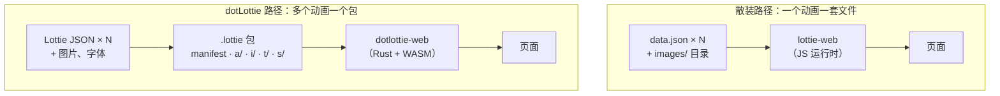

import { Meta } from '@storybook/addon-docs/blocks';

<Meta id="dotlottie-runtime" title="交互与生态/dotLottie 与新运行时" name="Docs" />

# dotLottie 与新运行时

入门到现在，我们面对的一直是同一个形状：一个 `data.json`，一行 `loadAnimation` 播它。这个形态在项目里只有一个动画时足够轻，数量涨到几十个就会露出疲态——几十份明文 JSON、一堆 `images/` 目录、图片在动画之间互相重复、每次替换都要重新导出再逐个改名。dotLottie 是 LottieFiles 给出的规模化答案：把多个动画、图片、字体，连同交互状态机和主题，一起装进一个扩展名为 `.lottie` 的压缩包，用新一代运行时 dotlottie-web（Rust + WASM）播放。本课是概念课，讲清四件事：`.lottie` 包里有什么、新运行时强在哪、哪些能力是 lottie-web 单 JSON 形态没有的、什么时候值得迁移。播放器组件的具体用法由「播放器组件」一课展开，本课不含内嵌实例。



本课对象定位（回查入口）：

| 对象 | 一句话定位 |
| --- | --- |
| `.lottie` | ZIP 压缩的动画包：清单 + 动画 + 共享资源，可选主题与状态机 |
| `manifest.json` | 包清单：版本、动画列表、初始加载项 |
| dotlottie-web | Rust + WASM 运行时，核心包 `@lottiefiles/dotlottie-web` |
| dotlottie-wc | 框架无关的 Web Component 播放器 `<dotlottie-wc>` |
| 状态机 / 主题 | 打进包内的交互状态图与换肤规则，lottie-web 单 JSON 形态没有 |

## .lottie 格式

`.lottie` 不是一种新动画格式，而是新的**打包形态**：里面的动画仍然是标准 Lottie JSON，外面套一层 ZIP 容器（Deflate 压缩，MIME 类型 `application/zip+dotlottie`）。官方对它的定位是 "one open, compressed file"——一个开放的压缩文件：动画内容不加密、不改写格式，散装 JSON 能表达的它都能表达，多出来的只是「包」的组织能力。理解了这一点，`.lottie` 的三个卖点就都顺理成章：体积（压缩与共享资源）、组织（多动画进一个文件）、一致（一个渲染引擎处处画得一样）。

### 容器结构

按 dotLottie v2 规范，ZIP 包内的目录布局是固定的：

```text
manifest.json   # 必需：包清单
a/              # 必需：Lottie JSON 动画，至少一个
i/              # 可选：图片资源
f/              # 可选：字体文件
s/              # 可选：状态机
t/              # 可选：主题
```

- 动画放在 `a/` 目录，内容仍是符合 Lottie JSON 规范的普通动画文件；文件名（去掉 `.json`）就是它在包内的 ID。
- 图片、字体集中在 `i/`、`f/`，多个动画共享同一份资源是规范推荐的组织方式——共享资源正是体积优势的主要来源。
- 只有 `manifest.json` 和至少一个动画是必需的，其余目录按需出现；`s/` 与 `t/` 是 v2 新增的，对应本章后面的状态机与主题。

### manifest.json

manifest 是规范所称的包「骨架」（backbone）：播放器打开 `.lottie` 先读它，再决定加载哪个动画、有哪些主题和状态机可用。最小可用清单：

```json
{
  "version": "2",
  "generator": "dotLottie-cli",
  "animations": [{ "id": "idle" }, { "id": "success" }]
}
```

| 字段 | 必需 | 含义 |
| --- | --- | --- |
| `version` | 是 | 规范版本，v2 固定为 `"2"` |
| `generator` | 否 | 生成工具与版本，如 `dotLottie-cli@v2.0` |
| `animations` | 是 | 动画元数据数组，`id` 对应 `a/` 里的文件名 |
| `themes` | 否 | 包内主题列表 |
| `stateMachines` | 否 | 包内状态机列表（注意是驼峰拼写） |
| `initial` | 否 | 指定首个加载的动画或状态机；不写时默认加载第一个动画 |

### 与散装 JSON 对比

同样是「把动画跑起来」，两种形态的组织成本差别在动画数量越大时越明显：

| 维度 | 散装 JSON + images/ | `.lottie` 包 |
| --- | --- | --- |
| 传输体积 | JSON 明文，图片常被 base64 内嵌进一步膨胀 | Deflate 压缩 + 多动画共享资源，官方称远小于散装或内嵌 JSON |
| 请求数 | 每个动画一次 JSON 请求，每张图片再各一次 | 整包一次请求 |
| 资源组织 | `u` / `p` 相对路径，目录一改名就断链 | 包内固定路径，随包整体更新 |
| 缓存粒度 | 单动画可独立缓存与替换 | 整包缓存，适合按版本发布 |
| 交互与换肤 | 依赖页面侧 JS 组合（如 lottie-interactivity） | 状态机与主题可打进包内 |

边界也要说清：散装形态不是被淘汰的旧物。单动画、或需要按「动画数据管理」一课的方式精细控制资源加载路径时，直接拿 JSON 反而更直接。`.lottie` 的优势始于「多个动画要一起管」。

## dotlottie-web 运行时

### Rust + WASM 定位

dotlottie-web 是 LottieFiles 的官方新一代 Web 播放器：核心是 Rust 写成的渲染实现编译为 WASM，图形绘制基于 ThorVG 图形库，提供 Canvas2D（软件渲染）、WebGL2 和 WebGPU（实验性）三种渲染后端。它与 lottie-web 是两套**独立**运行时，不是谁升级成谁的关系：

| | lottie-web | dotlottie-web |
| --- | --- | --- |
| 实现语言 | JavaScript | Rust 编译为 WASM，绘制基于 ThorVG |
| 渲染目标 | SVG / Canvas / HTML | Canvas2D / WebGL2 / WebGPU（实验性） |
| 加载内容 | 单个 Lottie JSON | `.json` 与 `.lottie` 都可加载 |
| 高级能力 | 靠页面 JS 组合（交互库等） | 状态机、主题、多动画为文件级内建 |
| 跨端一致性 | 仅 Web | 底层引擎 dotlottie-rs 与 iOS / Android 等端同源 |

「跨端一致」值得单独说一句：dotlottie-web 的引擎与官方 iOS、Android、Flutter 等播放器同源（dotlottie-rs），同一份动画在各端由同一套实现绘制，不会出现「Web 上和 App 里长得不一样」。

### 包矩阵

dotlottie-web 是一个包家族，按使用场景选：

| 包 | 定位 |
| --- | --- |
| `@lottiefiles/dotlottie-web` | 核心库：`DotLottie` / `DotLottieWorker` 类，直接操作 canvas |
| `@lottiefiles/dotlottie-wc` | 框架无关 Web Component `<dotlottie-wc>`，一行 HTML 即可用 |
| `@lottiefiles/dotlottie-react` | React 封装 |
| `@lottiefiles/dotlottie-vue` | Vue 3 封装 |
| `@lottiefiles/dotlottie-svelte` | Svelte 封装 |
| `@lottiefiles/dotlottie-solid` | Solid 封装 |

框架封装都是核心库的薄壳，属性与事件概念一脉相承。Web Component 的完整用法由「播放器组件」一课展开（它也是已归档 lottie-player 的官方继任者）。

### 核心 API 概览

核心库的主类是 `DotLottie`：构造时给它一个 canvas 和动画来源，之后全部操作都发生在实例上。

```js
import { DotLottie } from '@lottiefiles/dotlottie-web';

const dotLottie = new DotLottie({
  canvas: document.querySelector('canvas'),
  src: 'bundle.lottie', // .json 或 .lottie 都可以
  autoplay: true,
  loop: true,
});
```

方法按职责分三组（列名与用途，细节以官方文档为准）。

播放控制——与 lottie-web 的使用习惯基本对得上：

| 方法 / 属性 | 用途 |
| --- | --- |
| `play()` / `pause()` / `stop()` | 播放、暂停、停止 |
| `setFrame(frame)` | 跳到指定帧 |
| `setSpeed(speed)` / `setLoop(loop)` | 速度与循环 |
| `setSegment(start, end)` / `setMarker(name)` | 播放区间与命名标记 |
| `freeze()` / `unfreeze()` | 冻结 / 恢复渲染循环，离屏时省开销 |

.lottie 能力——只有拿到包才用得上的方法与配置：

| 方法 / 配置 | 用途 |
| --- | --- |
| `loadAnimation(animationId)` | 切换包里的另一个动画 |
| `setTheme(themeId)` | 应用 manifest 里声明的主题（如 `'dark'`） |
| `setThemeData(data)` | 运行时直接注入主题规则 |
| 配置项 `animationId` | 构造时指定加载包内哪个动画 |
| 配置项 `stateMachineId` | 构造时启动包内状态机 |

观测与事件：

| 方法 / 属性 | 用途 |
| --- | --- |
| `currentFrame` / `totalFrames` / `duration` | 进度类只读属性 |
| `isLoaded` / `isPlaying` / `isPaused` | 状态类只读属性 |
| `addEventListener` / `removeEventListener` | `play`、`pause`、`frame`、`complete`、`load` 等类型化事件 |

两个工程相关的边界：`DotLottieWorker` 是同名接口的离主线程版本，所有方法返回 Promise，可让渲染不占主线程；`DotLottie.preload()` 可在应用启动时提前拉取 WASM 引擎（约 500 KB），避免首个动画的加载被引擎下载阻塞。

## 状态机与主题

v2 给 `.lottie` 包新增的 `s/` 与 `t/` 两个目录，对应它最有辨识度的两个能力。共同点是把过去写在页面 JS 里的逻辑搬进动画文件本身——这是 lottie-web 单 JSON 形态给不了的能力。

### 状态机

状态机是打进包内的交互状态图：用「状态 + 事件 + 转移」描述「点击后播放、播完停在末帧、悬停回到起点」这类行为，播放器直接执行——官方的说法是 "no JS glue required"，页面不用写胶水代码。运行时可通过 `stateMachineStart`、`stateMachineTransition`、`stateMachineStateEntered` 等类型化事件观察它的运转。

与[交互式动画](?path=/docs/interactivity--docs)一课对比着看：lottie-interactivity 在页面侧把滚动、悬停、点击接到播放器上，交互逻辑属于页面；状态机把这套逻辑挪进文件，动画从「只描述运动」升级为「描述运动 + 行为」，拷到任何端行为都一致。状态机如何定义与配置不在本课展开。

### 主题

主题是打进包内的换肤规则：基于 Lottie Slots 把动画里的颜色、渐变、文本、图片等属性映射成可切换的插槽，包内可同时携带多套主题（`t/` 目录，manifest 里声明）。官方给的场景是 "Dark mode, brand swaps, and localization without re-exporting animation files"——暗色模式、品牌换色、本地化都不用回 AE 重新导出。使用入口就是上一节的 `setTheme('dark')`（应用包内主题）与 `setThemeData(...)`（运行时注入）。主题规则支持哪些类型、如何制作，不在本课展开。

## 迁移判断

两套运行时不是非此即彼，判断只看三个信号：动画数量、体积压力、是否需要文件级交互与换肤。

值得迁 dotLottie：

- **动画多。** 几十个动画的项目，整包一次请求、资源共享、按包版本化，组织成本骤降。
- **体积敏感。** Deflate 压缩加共享资源，对移动端与弱网直接见效。
- **需要文件级交互与换肤。** 状态机与主题是格式能力，没有「在 lottie-web 上调参数」的等价替代。

留在 lottie-web：

- **就一个动画。** 一个 `data.json` 直接 `loadAnimation` 是最短路径，打包反而多一道工序。
- **深度依赖 lottie-web 特有 API。** 直接操纵 SVG 图层、renderer 特化配置等既有代码是真实的迁移成本。
- **兼容性保守。** WASM 依赖现代浏览器，WebGPU 后端仍是实验性；老环境下 lottie-web 更稳。

两者也可以在同一页面**并存**：不同动画各用各的运行时，互不影响。渐进路径因此顺理成章——存量动画留在 lottie-web，新动画从 `.lottie` 起步。

## 总结回顾

摘要：

dotLottie 用一个 ZIP 容器回应散装 JSON 规模化使用的三个痛点：`.lottie` 包以 `manifest.json` 为清单（声明版本、动画与初始加载项），`a/` 放动画、`i/` 与 `f/` 集中共享资源，`s/` 与 `t/` 携带状态机与主题；Deflate 压缩加共享资源让整包远小于散装或 base64 内嵌的 JSON，多动画一次请求、整包按版本缓存。dotlottie-web 是配套的新一代运行时：Rust + WASM 核心基于 ThorVG 绘制，Canvas2D / WebGL2 / WebGPU 三种后端，包家族覆盖核心库、`<dotlottie-wc>` Web Component 与 React / Vue / Svelte / Solid 封装；`DotLottie` 实例的播放控制方法与 lottie-web 习惯相近，另有一组只有加载 `.lottie` 包才用得上的能力——`loadAnimation` 切动画、`setTheme` / `setThemeData` 换主题、`stateMachineId` 启动状态机。状态机与主题把交互行为和换肤规则搬进文件本身，是单 JSON 形态没有的能力。迁移与否只看动画数量、体积压力和文件级交互与换肤需求；单动画、深绑 lottie-web API 或环境保守的项目不必动，两套运行时可并存渐进。

一句话：

> dotLottie 不是要立刻替代 lottie-web，而是「多动画、体积敏感、需要文件级交互与主题」时的下一代部署形态。

知识要点：

- `.lottie` 包里有什么？`manifest.json` 管什么，`a/`、`i/`、`f/`、`s/`、`t/` 各放什么？
- dotlottie-web 的渲染核心是什么？它与 lottie-web 在实现语言、渲染目标、能力边界上有何不同？
- 官方包矩阵有哪些成员？框架无关的组件包是哪个？
- `DotLottie` 实例的播放控制方法有哪些？哪些方法与配置只有加载 `.lottie` 包才用得上？
- 状态机与主题分别解决什么问题？为什么说 lottie-web 单 JSON 形态没有这种能力？
- 什么时候值得迁 dotLottie？什么时候留在 lottie-web？两者能否并存？

## 参考资料

- [dotLottie 官网](https://dotlottie.io)
  格式动机与能力总览："one open, compressed file"、压缩与共享资源的体积优势、状态机与主题的场景描述。
- [dotLottie 格式规范 v2.0](https://dotlottie.io/spec/2.0/)
  ZIP 目录布局（`manifest.json`、`a/`、`i/`、`f/`、`s/`、`t/`）与 manifest 字段定义。
- [dotlottie-web 仓库](https://github.com/lottiefiles/dotlottie-web)
  README：Rust + WASM 定位、ThorVG 与渲染后端、包矩阵、DotLottie 配置项与事件。
- [DotLottie 类源码（dotlottie.ts）](https://github.com/lottiefiles/dotlottie-web/blob/main/packages/web/src/dotlottie.ts)
  实例方法与只读属性的权威清单（play、pause、setFrame、setTheme、loadAnimation 等）。
- [LottieFiles 开发者文档：Runtimes](https://docs.lottiefiles.com/en/runtimes)
  各端 dotLottie 运行时总览，多端同源实现的说明。
