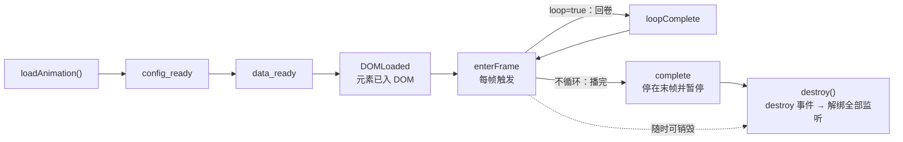

import { Canvas, Controls, Meta } from '@storybook/addon-docs/blocks';
import * as EventsLifecycleStories from './events-lifecycle.stories';

<Meta of={EventsLifecycleStories} name="Docs" />

# 事件与生命周期

lottie-web 是事件驱动的播放器：`loadAnimation` 返回的动画实例会按固定次序走过加载、播放、结束三个阶段，最后由 `destroy()` 收尾，每个阶段都有对应的事件。加载阶段按 `config_ready` → `data_ready` →（含图片素材时 `loaded_images`）→ `DOMLoaded` 推进；播放中每帧触发 `enterFrame`，循环回卷触发 `loopComplete`；不循环的动画播完触发 `complete`；销毁前最后触发一次 `destroy`。

监听对的事件才能做对的事：依赖动画 DOM 的逻辑等 `DOMLoaded`；进度条和读数挂 `enterFrame` 并节流；「播完了」的判断用 `complete`，循环动画只会反复给你 `loopComplete`；组件卸载时必须调用 `destroy()`，否则实例连同 DOM、监听和图片资源一起泄漏。读完本课，你能为每个生命周期节点选对事件，并用下方的事件日志范例核对每一次断言。



事件通过实例的 `addEventListener` 监听，事件名必须按下表书写（驼峰与下划线混用）：`anim.addEventListener('enterFrame', fn)`。`addEventListener` 会返回一个解绑函数，也可以用 `removeEventListener(事件名, 回调)` 解绑，或直接赋值回调属性 `onEnterFrame`、`onLoopComplete`、`onComplete`、`onSegmentStart`。全表如下：

| 事件 | 触发时机 | 回调参数要点 |
| --- | --- | --- |
| `config_ready` | 初始配置完成（渲染器与帧信息就绪） | 无 |
| `data_ready` | 动画数据加载并组装完成 | 无 |
| `data_failed` | 动画数据或其中的分段加载失败 | 无 |
| `loaded_images` | 全部图片素材加载成功或失败；无图片素材的动画不触发 | 无 |
| `DOMLoaded` | 动画元素已插入容器 DOM | 无 |
| `enterFrame` | 每一帧渲染前触发，播放中按帧率反复触发 | `currentTime` 当前帧号（启用子帧时为小数）、`totalTime` 总帧数、`direction` 播放方向（1 或 -1） |
| `drawnFrame` | 每一帧渲染后触发，紧随 `enterFrame` | 同 `enterFrame` 的三个字段 |
| `loopComplete` | 循环动画每次回卷重播时 | `currentLoop` 已完成的循环轮数、`totalLoops` loop 配置原值、`direction` |
| `complete` | 不循环的动画（或有限循环次数用尽后）播完并暂停 | `direction` |
| `segmentStart` | 开始播放一个播放区间（`playSegments`） | `firstFrame` 区间起始帧、`totalFrames`——用法见「帧与片段」一课 |
| `destroy` | `destroy()` 清理过程中、解绑监听之前 | `target` 被销毁的动画实例 |
| `error` | 渲染或配置抛出异常（README 未列出，源码提供） | `nativeError` 原始错误、`currentTime` 出错帧号 |

## 加载阶段事件

`loadAnimation` 返回实例后，加载阶段的事件按固定次序触发，每个事件回答一个「就绪了什么」的问题：

| 事件 | 回答的问题 | 典型用途 |
| --- | --- | --- |
| `config_ready` | 配置就绪了吗？渲染器与帧信息已算好 | 标记初始化开始 |
| `data_ready` | 动画数据加载并组装完了吗？`path` 模式下 JSON 已取回 | 开始依赖数据的后续工作 |
| `loaded_images` | 图片素材都加载完了吗？（无图片素材的动画不触发） | 含图动画的完整就绪判断 |
| `DOMLoaded` | 动画元素进 DOM 了吗？ | 首次可以安全操作动画结构的时机 |

含图片素材的动画在 `data_ready` 之后、`DOMLoaded` 之前还会触发 `loaded_images`。加载失败的兜底是 `data_failed`：`path` 指向的 JSON 请求失败、或分段数据加载失败时触发。把「提示错误 / 降级到静态图」的逻辑挂在这里，比依赖全局错误处理更直接：

```js
const anim = lottie.loadAnimation({
  container,
  renderer: 'svg',
  path: 'anim.json',
});
anim.addEventListener('DOMLoaded', () => {
  // 元素已入 DOM：可以安全显示容器、挂交互逻辑
  container.style.visibility = 'visible';
});
anim.addEventListener('data_failed', () => {
  // 加载失败兜底：提示用户或降级为静态图
  showFallback();
});
```

两个次序细节值得知道：

- `DOMLoaded` 经 `setTimeout(0)` 异步触发，而初次渲染（第 0 帧的 `enterFrame` 与绘制）同步先行——所以事件日志里会看到 `enterFrame×1` 排在 `DOMLoaded` 前面。
- `autoplay=false` 时这一帧照样会渲染，只是之后不再播放。关掉自动播放后，日志停在 `config_ready → data_ready → enterFrame×1 → DOMLoaded`，实例状态为「已暂停」。

需要「元素确实已在 DOM」的保证时，仍以 `DOMLoaded` 为准。

## 播放循环事件

`DOMLoaded` 之后播放器进入逐帧循环：每帧先触发 `enterFrame` 再渲染。它是播放期信息的主要来源，也是最容易用错的事件。回调参数有三个：

| 参数 | 含义 |
| --- | --- |
| `event.currentTime` | 当前帧号，即本次即将绘制的那一帧；启用子帧插值时为小数 |
| `event.totalTime` | 动画总帧数 |
| `event.direction` | 播放方向：1 正放，-1 倒放（`setDirection` 反向后为 -1） |

事件对象里没有帧间隔（deltaTime）字段，需要时间差就在回调里自己记时间戳。

`enterFrame` 按帧率触发（常见每秒 60 次），进度条、读数这类操作如果每帧都写 DOM、读布局，就会造成明显卡顿。正确姿势是按时间节流：回调里只做轻量判断，把真正的 DOM 更新合并到固定间隔：

```js
let lastPaint = 0;
anim.addEventListener('enterFrame', (event) => {
  const now = performance.now();
  if (now - lastPaint < 100) {
    return; // 节流：每 100ms 才真正更新一次
  }
  lastPaint = now;
  bar.style.width = `${(event.currentTime / event.totalTime) * 100}%`;
});
```

本课下方事件日志范例用的正是这个姿势：`enterFrame` 在实例内折叠成计数，读数区约 100ms 才刷新一次。每帧渲染后还有一个 `drawnFrame` 事件，字段与 `enterFrame` 相同；需要在「这一帧确实画完」之后做事才用它，一般监听 `enterFrame` 就够了。

## 完成与循环

到达末帧时发生什么，由创建时的 `loop` 参数决定——这是 `complete` 与 `loopComplete` 最容易混淆的地方：

- `loopComplete`：循环动画每次回卷重播时触发。`loop=true` 时反复触发，`complete` 永远轮不到。
- `complete`：动画真正播完时触发一次（`loop=false`，或 `loop` 传数字、次数用尽后），随后实例暂停，帧停在 `totalFrames - 1`——帧号从 0 计，即最后一帧。

两个事件都通过实例的 `addEventListener` 挂接；`loopComplete` 的事件对象还带循环进度：

```js
anim.addEventListener('loopComplete', (event) => {
  console.log(`第 ${event.currentLoop} 轮播完`); // event.totalLoops 是 loop 配置原值
});
anim.addEventListener('complete', () => {
  console.log('动画播完，实例已暂停');
});
```

下面的动画数据是本课自制的最小 JSON（同目录 `events-lifecycle.json`）：30fps、48 帧，一个圆角条旋转一周并脉冲缩放，循环一轮约 1.6 秒。切换 `loop`、`autoplay` 观察事件日志的差异（两者都是创建参数，切换后销毁旧实例并重建）：

<Canvas of={EventsLifecycleStories.EventsLifecycle} />
<Controls of={EventsLifecycleStories.EventsLifecycle} />

| 读者操作 | 可观察证据 |
| --- | --- |
| 保持默认（loop 开、autoplay 开） | 「事件日志」反复出现 `loopComplete`，「已循环次数」递增，`complete` 始终不出现 |
| 关掉 loop | 重建后播到末帧出现一次 `complete`，「播放状态」变「已暂停」，日志不再增长 |
| 关掉 autoplay | 日志停在 `config_ready → data_ready → enterFrame×1 → DOMLoaded` |
| 切换任一开关 | 日志中出现 `destroy`，随后重新出现加载段事件序列 |

Show code 是该 Canvas 实际执行的核心实现：全部生命周期事件的监听、连续事件折叠与节流读数都在里面。

## 销毁与清理

`destroy()` 是实例的终点，清理动作固定为四步（AnimationItem 源码）：

1. `renderer.destroy()`：移除实例生成的 SVG / Canvas 元素；
2. `imagePreloader.destroy()`：释放图片素材的预加载资源；
3. 触发 `destroy` 事件——此刻监听还在，事件对象的 `target` 指向被销毁的实例；
4. 清空全部事件监听与 `onEnterFrame` 等回调属性，`renderer` 置 null——此后实例不再触发任何事件。

`destroy` 后再调用 `play`、`goToAndStop` 等控制方法不会有任何效果，也不会报错：触发事件时监听表已清空（静默跳过），渲染时渲染器已置 null（直接返回）。所以不要复用已销毁的实例——需要新配置就重新 `loadAnimation`，旧实例引用直接丢弃。重复 `destroy` 是安全的：第二次调用发现渲染器已空，直接返回。

销毁时机由宿主环境决定：组件卸载、路由切换、列表项删除时，在清理钩子里（如 React 的 `useEffect` 返回函数、Vue 的 `onUnmounted`）调用 `destroy()`。实例持有 DOM、监听与已下载的图片，只创建不销毁，SPA 里就会累积出看不见的「幽灵动画」和内存泄漏。上方范例切换开关时日志里出现的 `destroy`，就是旧实例被销毁时发出的最后一个事件。

## 常见问题

- `complete` 一直不触发，以为动画坏了。
  这不是故障：`loop=true` 的循环动画只反复触发 `loopComplete`，`complete` 永远不会来。需要「播完」通知就关掉 `loop`，或给 `loop` 传数字，让次数用尽后以 `complete` 收尾。
- 在 `enterFrame` 回调里更新进度条 / 读数，页面越播越卡。
  `enterFrame` 按帧率高频触发，回调里每帧写 DOM、读布局都会放大成卡顿。按时间节流（如 100ms 更新一次），把高频事件折叠成低频更新——事件日志范例的读数就是这么做的。
- 调用了 `destroy()`，页面上动画还在动。
  `destroy` 只清理它自己渲染的 DOM；还在动的多半属于另一个实例——常见于状态变化时重复 `loadAnimation` 却没销毁旧实例。把实例引用存住，创建新实例前先 `destroy` 旧的，再核对「你销毁的」和「页面上动的」是不是同一个实例。
- 在事件回调里读 `currentFrame`，或回调里调 `goToAndStop`，帧号和画面偶尔对不上。
  播放器每帧的固定次序是：更新 `currentFrame` → 触发 `enterFrame` → 渲染。回调里读到的帧号是「即将绘制」的帧，本身可靠；但回调里再调 `goToAndStop` 会同步重入这套流程、额外多触发一轮 `enterFrame`，打断当前帧的渲染。改帧动作放到回调之外（例如包一层 `setTimeout`）再执行。

## 总结回顾

摘要：

本课沿动画实例的一生梳理了 lottie-web 的事件模型：加载阶段按 `config_ready` → `data_ready` →（含图片素材时 `loaded_images`）→ `DOMLoaded` 推进，失败时以 `data_failed` 兜底，依赖动画 DOM 的逻辑应挂在 `DOMLoaded`，且初次渲染的 `enterFrame` 会先于 `DOMLoaded` 回调出现；播放阶段每帧触发 `enterFrame`（参数 `currentTime`、`totalTime`、`direction`），进度条等高频操作必须节流；到达末帧时，循环动画反复触发 `loopComplete` 而不触发 `complete`，不循环的动画以 `complete` 收尾并暂停在最后一帧；`destroy()` 依次移除渲染 DOM、释放图片资源、触发 `destroy` 事件、清空全部监听，之后实例不再响应任何控制方法。事件通过 `animationItem.addEventListener` 挂接，它同时返回解绑函数。

一句话：

> 监听对的事件才能做对的事：DOM 就绪等 `DOMLoaded`，高频读数节流挂 `enterFrame`，播完判断用 `complete` 而非 `loopComplete`，组件卸载必须 `destroy()`。

知识要点：

- 加载阶段事件按什么次序触发，「首次可以安全操作动画」应挂哪个事件？
- `enterFrame` 的回调参数有哪些？为什么进度条要在回调里节流？
- `loopComplete` 与 `complete` 在 `loop=true`、`loop=false` 时分别如何触发？
- `destroy()` 具体清理哪些东西？销毁后再调用控制方法会怎样？
- 事件回调里读 `currentFrame` 为什么可靠？回调里改帧有什么风险？

## 参考资料

- [lottie-web 仓库 README](https://github.com/airbnb/lottie-web)
  Events 一节：`onEnterFrame` 等回调属性与 `addEventListener` 事件全表及各事件一句话触发条件。
- [AnimationItem.js 源码](https://github.com/airbnb/lottie-web/blob/master/player/js/animation/AnimationItem.js)
  `config_ready` / `data_ready` / `DOMLoaded` 的触发次序、`advanceTime` 中 `complete` 与 `loopComplete` 的分支、`gotoFrame` 与 `destroy` 的实现。
- [utils/common.js 源码](https://github.com/airbnb/lottie-web/blob/master/player/js/utils/common.js)
  `BMEnterFrameEvent` 等事件对象构造器：各事件回调参数的字段名。
- [utils/BaseEvent.js 源码](https://github.com/airbnb/lottie-web/blob/master/player/js/utils/BaseEvent.js)
  `addEventListener` / `removeEventListener` 的实现与解绑函数。
