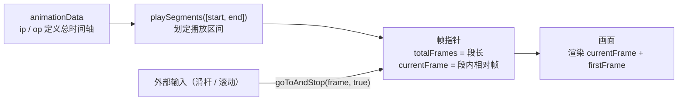

import { Canvas, Controls, Meta } from '@storybook/addon-docs/blocks';
import * as FramesSegmentsStories from './frames-segments.stories';

<Meta of={FramesSegmentsStories} name="Docs" />

# 帧与片段

「播放控制」一课的方法都在拨动同一个帧指针，本课改的是帧指针的**活动范围**。lottie 动画的时间轴由 animationData 里的 `ip`（起点帧）与 `op`（结束帧）定义，而实例的播放范围可以在运行时改写：`playSegments` 在总时间轴上划出一段 `[start, end]`，之后的推进、循环、完成判断都只看这一段——「整条动画里的局部循环」就是它实现的；`goToAndStop` 则是「外部输入 → 帧指针」的原语，滑杆、滚动这些连续输入映射成帧号喂给它，就是进度控制——交互式动画一课的滚动驱动建立在这两个能力上。

范围改变后，帧指针的读法多了一层：segment 激活时 `totalFrames` 被改写为段长、`currentFrame` 变成段内相对帧，循环与完成事件也以段为界。下方的时间轴控制台把这两层都画了出来——顶部灰色是全片、蓝色高亮是生效中的 segment、深色指针是帧指针的绝对位置，拖动控件即可看到三者如何被 `playSegments` 与 `goToAndStop` 拨动。



帧相关的属性与方法速查（默认值以官方 README 与源码为准）：

| 名称 | 归属 | 做什么 | 回查要点 |
| --- | --- | --- | --- |
| `ip` / `op` | animationData | 全片的起点帧 / 结束帧 | 总帧数 = op − ip；总时长（毫秒）= (op − ip) ÷ fr × 1000 |
| `fr` | animationData | 帧率（帧/秒） | 毫秒 ↔ 帧换算：ms × fr ÷ 1000 |
| `totalFrames` | 实例属性 | 当前生效范围的总帧数 | 初值 = op − ip；segment 激活后被改写为段长 |
| `currentFrame` | 实例属性 | 帧指针 | segment 激活后是段内相对帧；子帧开启时为小数 |
| `firstFrame` | 实例属性 | 当前生效范围的起始帧 | 渲染画面 = currentFrame + firstFrame |
| `playSegments(arr, forceFlag)` | 实例方法 | 划定播放区间 | forceFlag 省略时入队、当前段播完才切换；传 true 立即跳转 |
| `resetSegments(forceFlag)` | 实例方法 | 恢复全片区间 | 队列重置为 [ip, op]；force 立即跳回，否则等当前段播完 |
| `setSegment(init, end)` | 实例方法 | 直接改写区间映射 | 不排队、不触发 segmentStart、不自动播放 |
| `goToAndStop(value, isFrame)` | 实例方法 | 外部输入 → 帧指针 | isFrame 传 true 按帧（默认按毫秒）；帧号按段内相对帧解释 |

## 时间轴与帧

lottie 的时间轴有两套数量：**帧**是本征单位——JSON 里关键帧的 `t`、`ip`、`op` 全是帧号；**毫秒**是真实时间，只出现在 API 入口（如 `goToAndStop` 的默认模式）。`fr` 是两者的换算率，播放器内部的推进、循环、跳转一律按帧计算：

```text
总帧数（帧）   = op − ip
总时长（毫秒） = (op − ip) ÷ fr × 1000
毫秒 → 帧     = ms × fr ÷ 1000
```

本课范例动画：`fr = 30`、`ip = 0`、`op = 120`，即 120 帧、4 秒——蓝橙圆点第 0–60 帧向右、第 60–120 帧向左。帧数足够多，划出的 segment 才有观察价值。

### currentFrame：随时可读的帧指针

实例属性随时可读，「事件与生命周期」一课的 `enterFrame.currentTime` 与它同源。子帧插值开启（`setSubframe` 默认 true）时是小数，做读数或进度条先取整。全片语境下它落在 0 到 `totalFrames` 之间——下一节会看到 segment 如何改写这个值域。

### totalFrames 与 op 的关系

源码（AnimationItem.js 的 configAnimation）里就是一道减法：

```js
this.totalFrames = Math.floor(data.op - this.animationData.ip);
```

三个推论：

- `totalFrames` 等于 **op − ip** 而不是 op——`ip = 0` 的常见素材两者恰好相等，不要据此写死换算；
- 帧号从 `firstFrame`（取 `ip`）起算，播放、循环、完成判断用的都是这个「区间长度」，`getDuration(true)` 返回的也是它；
- segment 激活后 `totalFrames` 会被改写成段长——这正是下一节的主题。

## playSegments

`playSegments([start, end])` 把 `[start, end]` 从总时间轴上划出来，播放器从此把这一段当作「完整的动画」。切换瞬间（源码 adjustSegment）固定发生四件事：

1. `totalFrames` 改写为段长 `end − start`；
2. `firstFrame` 改写为段起点 `start`；
3. 帧指针归位到段内起点，循环计数清零；
4. 触发 `segmentStart` 事件（事件对象带 `firstFrame` 与 `totalFrames`）。

此后的渲染画面 = `currentFrame + firstFrame`：`currentFrame` 从「绝对帧」变成「段内相对帧」。循环与完成也以段为准——`loop` 为 true 时帧指针只在段内回卷，每回卷一次触发一次 `loopComplete`；区间之外的帧永远不会被播到（`goToAndStop` 硬拨指针是唯一例外，见常见问题）。

```js
animation.playSegments([20, 50]);        // 排队：当前播放走完后切入 [20, 50]
animation.playSegments([20, 50], true);  // 立即：跳到第 20 帧，在区间内循环播放
```

顺带一提：AE 标记（marker）导出后自带时长，`goToAndPlay('标记名')` 在内部就转成 `playSegments([marker.time, marker.time + marker.duration], true)`——标记相当于「带名字的预设区间」，其数据结构在「JSON 结构概览」一课展开。

### 生效时机：forceFlag

- 传 `true`：清空等待队列，**立即**切换——跳到新段起点并触发 `segmentStart`；
- 省略或传假值：新段推入等待队列，当前段播放到末尾时才切换（循环动画在下一轮回卷点切入）；连续调用会积压多段，依次切换；
- 暂停中的实例调用 `playSegments` 会**自动 `play()`**——即使新段只是入队，播放也会恢复；
- 切换瞬间方向被规格化成段的顺序：正序段（end > start）强制正向、倒序段（end < start，合法，把这一段反向播完）强制反向——之前 `setDirection` 的设置会被覆盖。

### 多段队列与 resetSegments

入参也接受段数组，播完一段无缝接下一段：

```js
animation.playSegments([
  [10, 20],
  [40, 60],
]); // 先播 [10, 20]，接着播 [40, 60]
```

`resetSegments(forceFlag)` 把等待队列重置为全片 `[ip, op]`：传 `true` 立即跳回全片起点；省略则等当前段播完再回到全片。「播完这一段就回归整片」用它。

### setSegment：安静的区间改写

`setSegment(init, end)` 与 `playSegments` 改写同样两个量（`firstFrame`、`totalFrames`），但**不排队、不触发 segmentStart、不自动播放、不动方向**；仅当实例暂停且当前帧落在新区间之外时，把指针钳回区间边缘。适合配合 `goToAndStop` 调整「帧号 ↔ 画面」的映射，而不打断当前播放节奏。

## 帧驱动交互

`goToAndStop` 是「外部输入 → 帧指针」的原语。滑杆、滚动条、指针位置……任何连续输入最终都归结为一个数值，把它映射成帧号喂给 `goToAndStop(frame, true)`，实例停在该帧等待下一次输入。进度条就是本模式的百分比包装（`frame = ratio × totalFrames`），交互式动画一课的滚动驱动同样如此：

```js
slider.addEventListener('input', (event) => {
  animation.goToAndStop(Number(event.target.value), true); // 输入值 → 帧 → 暂停待命
});
```

三个要点：

- `isFrame` 必须显式传 `true`——省略时按毫秒解释（播放控制一课的坑）；
- `goToAndStop` 自带 `pause()`：外部驱动通常正是要「停在输入对应的位置」，想恢复播放另调 `play()`；
- 传给它的值域应与可用帧值域对齐——超出不会被钳回来， segment 激活时尤其如此（见常见问题）。

与 `playSegments` 组合可以做**区间内 seek**：segment `[20, 50]` 激活后，`goToAndStop` 的帧号按段内相对帧解释，合法范围是 0 到 `end − start`；要按画面上的绝对帧 seek，先减去 `firstFrame`：

```js
// 跳到绝对帧 35（segment [20, 50] 激活时：35 − 20 = 段内第 15 帧）
animation.goToAndStop(35 - animation.firstFrame, true);
```

下面的时间轴控制台把两节内容装进同一个自制动画（30fps、120 帧，蓝橙圆点在轨道上往返）：顶部画出总时间轴——灰色是全片 ip–op、蓝色高亮是生效中的 segment、深色指针是帧指针的绝对位置；读数实时显示实例上的当前帧、生效区间与 totalFrames。每个控件对应一次真实的方法调用：

<Canvas of={FramesSegmentsStories.FramesSegments} />
<Controls of={FramesSegmentsStories.FramesSegments} />

| 读者操作 | 可观察证据 |
| --- | --- |
| 保持默认 | 圆点全片往返循环，指针扫过整条时间轴，高亮覆盖 [0, 120] |
| 「segment 起点」拖到 20、「segment 终点」拖到 50 | 高亮立即缩到 [20, 50]，「totalFrames」读数变 30，「当前帧（段内）」只在 0–30 之间，「段内循环」递增 |
| 关掉「立即生效」再拖起点/终点 | 高亮不动——新段只是入队，当前循环在回卷点走完后才切换、读数同步跳变 |
| 重新打开「立即生效」再拖 | 高亮立即移动，动画从新段起点重播，「段内循环」清零重计 |
| 关掉「循环」 | 播到段尾触发 complete，「播放状态」变「已暂停」；重新打开后从段尾回卷继续循环 |
| 拖「进度（帧）」滑杆 | 指针立即跳到「入参 + firstFrame」的位置并暂停——入参按段内相对帧解释 |
| segment [20, 50] 时把「进度（帧）」拖到 100 | 指针落到高亮区之外（绝对帧 120）、画面停在全片末帧姿态——超出段长不钳制 |
| 拖「进度」停住之后 | `goToAndStop` 自带暂停；此时拖任一 segment 滑杆，`playSegments` 会自动恢复播放 |

范例动画数据是课程自制的 frames-segments.json：一个形状图层带位置与颜色关键帧（往返 + 蓝橙渐变，任何一帧的颜色都反映其在全片中的位置），加一条静态轨道。时间轴条与指针由范例用 Canvas 2D 绘制，指针位置读自 `currentFrame + firstFrame`，segment 高亮读自实例的 `firstFrame` 与 `totalFrames`。

## 常见问题

- 调了 playSegments 画面没动静，以为方法没生效。
  forceFlag 省略时新段只是入队，当前段播放走完才切换，循环动画在下一轮回卷点切入；要立即跳转传第二个参数 `true`。另一个容易误判的点：暂停中的实例调用 playSegments 会自动恢复播放——如果预期「切段后仍暂停」，是它替你调了 `play()`。
- segment 循环时，loopComplete / complete 触发的到底是段还是全片？
  以段为准。segment 激活后 totalFrames 被改写为段长，推进、回卷与完成判断都按段长计算：loop 为 true 时每播完一段触发一次 `loopComplete`；loop 为 false 时播到段尾就触发 `complete` 并暂停——全片的 op 边界在 segment 激活期间不可达，`resetSegments()` 之后才恢复按全片判断。
- goToAndStop 的入参超过 segment 长度，画面跳到了高亮区间之外。
  帧指针不会被钳回段内：`goToAndStop(frame, true)` 直接把段内相对帧设为入参值，渲染绝对帧 = 入参 + firstFrame，可以画出区间外的画面，下一次播放 tick 才按段长取模卷回。做「区间内 seek」时在入参侧钳制：`Math.min(Math.max(frame, 0), end - start)`。
- setDirection(-1) 想倒着循环某一段，切换 segment 后方向又变回正向了。
  切换 segment 时方向被规格化成段的顺序方向：正序段强制正向、倒序段强制反向，`setDirection` 的设置被覆盖。想倒放 [20, 50]，直接传倒序段 `playSegments([50, 20], true)`，而不是先 `setDirection(-1)`。

## 总结回顾

摘要：

本课沿「总时间轴 → 播放区间 → 帧指针」梳理了 lottie-web 的帧与片段机制。时间轴由 animationData 的 `ip` 与 `op` 定义，总帧数 = op − ip，帧与毫秒通过 `fr` 换算，`totalFrames` 的初值就是这道减法，`currentFrame` 与 `enterFrame` 的 `currentTime` 同源。`playSegments` 在总时间轴上划定播放区间：激活瞬间 `totalFrames` 改写为段长、`firstFrame` 改写为段起点、帧指针归位并触发 `segmentStart`，此后的推进、循环与完成判断都以段为准；`forceFlag` 决定立即切换还是排队等当前段播完，`resetSegments` 把队列恢复成全片，`setSegment` 提供不打断播放的安静改写。`goToAndStop(frame, true)` 是外部输入到帧指针的原语：帧号按段内相对帧解释、超出段长不钳制，进度条与滚动驱动都建立在这个最小模式上。

一句话：

> playSegments 决定帧指针「在哪一圈里转」，goToAndStop 决定它「停在哪一格」——两个方法拨动的是同一个帧指针。

知识要点：

- 总帧数与总时长如何从 fr / ip / op 换算？totalFrames 等于 op 还是 op − ip？
- playSegments 的 forceFlag 传与不传，生效时机差在哪里？暂停中调用有什么副作用？
- segment 激活后 totalFrames、currentFrame、渲染画面的帧号各发生了什么变化？
- loopComplete 与 complete 在 segment 循环时以什么为界触发？
- resetSegments 与 setSegment 各自改写什么？与 playSegments 的行为差异是什么？
- 用滑杆驱动动画的最小模式是什么？segment 激活时 goToAndStop 的帧号如何解释、超界会怎样？

## 参考资料

- [lottie-web 仓库 README](https://github.com/airbnb/lottie-web)
  AnimationItem 方法表：playSegments / setSegment / resetSegments 的签名与说明、segmentStart 事件、goToAndStop 的 isFrame 默认值。
- [AnimationItem.js 源码](https://github.com/airbnb/lottie-web/blob/master/player/js/animation/AnimationItem.js)
  configAnimation 中 totalFrames = op − ip 的初值、adjustSegment 的区间改写与方向规格化、playSegments 的队列与 forceFlag 分支、checkSegments 在回卷点的切队、setSegment 的指针钳制、advanceTime 中按段长回卷与完成的判断。
