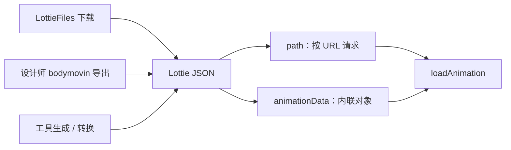

import { Canvas, Controls, Meta } from '@storybook/addon-docs/blocks';
import * as GettingAssets from './getting-assets.stories';

<Meta of={GettingAssets} name="Docs" />

# 获取动画素材

播放一个 Lottie 动画只需要两样东西：一份 Lottie JSON 数据，和一次 loadAnimation。上一课已经跑通了加载闭环，本课回答数据从哪里来、以什么方式交给 lottie-web。可用的动画有三条来源——LottieFiles 平台下载、设计师用 bodymovin 从 AE 导出、工具生成或转换；而交给 lottie-web 的入口只有两个——path 按 URL 异步请求，animationData 直接内联数据对象。下方的实例用同一份 data.json 分别以两种方式加载：切换「加载方式」后，读数会显示当前加载方式、从启动到 DOMLoaded 的耗时，以及本次加载发起了几次资源请求。



| 来源 | 你拿到什么 | 常见入口 |
| --- | --- | --- |
| LottieFiles 平台 | 单个动画 JSON，或打包资源的 .lottie | 免费库与市场的下载页 |
| 设计师导出 | bodymovin 导出的 data.json | AE 的 bodymovin 导出对话框 |
| 工具生成 / 转换 | 编辑器或转换器产出的 JSON | LottieFiles 工具集 |

| 加载方式 | loadAnimation 参数 | 数据何时可用 |
| --- | --- | --- |
| path | `path: '动画.json'` | 调用后异步请求，DOMLoaded 事件表示就绪 |
| animationData | `animationData: 数据对象` | 调用即同步可用，无网络等待 |

## 素材来源

三条来源的产物最终是同一种东西：一份描述图层与关键帧的 Lottie JSON（顶层结构总览见 [JSON 结构概览](?path=/docs/json-structure--docs)）。差别只在于获取方式与随附物：是否带图片资源目录、是否带许可约束、是否还需要回传给设计师修改。

### LottieFiles 下载

LottieFiles 免费库与市场收录了大量现成动画，是找不到设计师时最直接的来源。下载入口通常提供多种格式：要在 Web 端用 lottie-web 播放，选 JSON（纯矢量动画）或 .lottie（可打包图片资源，运行时见 [dotLottie 与新运行时](?path=/docs/dotlottie-runtime--docs)）；GIF 是预渲染位图，lottie-web 加载不了。商用前确认动画页面标注的许可协议，免费库不等于可自由商用。

### 设计师导出

设计师在 AE 里用 bodymovin 插件导出，你拿到的一般是 data.json（复杂动画还可能附带图片资源目录）。导出选项、特性支持与协作约定在 [制作流程](?path=/docs/production-workflow--docs) 展开，本课只需要知道：拿到 data.json 之后，它的地位与任何一份 Lottie JSON 完全相同。

### 工具生成

没有 AE 也能产出动画数据：LottieFiles 的 JSON 编辑器可以直接改参数、调关键帧；svg-to-lottie 这类转换器把 SVG 文件转成 Lottie JSON。这类工具适合简单图形动画与快速验证，产物同样是标准 JSON，加载方式与前两种来源完全一致。

## path 加载

path 模式把一个 URL 交给 lottie-web：调用 loadAnimation 之后，由 lottie-web 发起请求、解析响应、装配播放。返回的实例立即可用，但数据尚未就绪——DOMLoaded 事件是「数据已加载、首次装配完成」的信号（事件清单与监听时机见 [事件与生命周期](?path=/docs/events-lifecycle--docs)）。

```js
const animation = lottie.loadAnimation({
  container: document.getElementById('stage'),
  renderer: 'svg',
  loop: true,
  autoplay: true,
  path: 'data.json', // 相对 URL 以页面地址为基准解析
});

animation.addEventListener('DOMLoaded', () => {
  // 数据请求完成，可以安全读取动画时长等信息
});
```

### 相对路径的基准

传给 path 的相对 URL 以页面 URL（document base URI）为基准解析，不是以 JS 文件或 JSON 文件所在目录为基准。`path: 'data.json'` 在 `https://example.com/` 下请求 `https://example.com/data.json`，在 `https://example.com/app/page` 下请求 `https://example.com/app/page/data.json`——同一写法换一个路由就可能 404，SPA 与子路径部署下尤其容易踩中。可靠做法是让打包器解析资源地址，用 `?url` 导入拿到确定的 URL（Vite 写法，构建产物会变成带 hash 的资源地址）：

```js
import dataUrl from './data.json?url'; // 构建时由打包器解析成稳定 URL
```

一个紧贴 `?url` 的坑：小于几 KB 的资源在构建时会被 Vite 内联成 data: URL，而 XMLHttpRequest 无法加载 data: 地址，path 加载会直接失败。确信要按 URL 加载时，给导入加上 `?no-inline`（即 `./data.json?url&no-inline`），强制产出真实文件地址。

### 跨域与缓存

path 模式底层是标准资源请求，遵循同源策略：加载其他域名下的 JSON 需要对方允许跨域（CORS），否则 lottie-web 触发 data_failed 事件，动画无法播放。命中 HTTP 缓存时不再占用网络传输，但 loader 仍会执行一次资源加载——「有请求但走缓存」是 path 模式的正常状态；要彻底零请求，只能把数据编进打包产物，也就是 animationData。

## animationData 内联

animationData 模式直接把数据对象交给 loadAnimation：数据随代码一起打包分发，调用时已经在内存里，同步可用，没有任何网络等待。

```js
// 打包器会把 data.json 的内容一并写进产物
import animationData from './data.json';

const animation = lottie.loadAnimation({
  container: document.getElementById('stage'),
  renderer: 'svg',
  loop: true,
  autoplay: true,
  animationData,
});
```

代价同样直接：数据体积计入 bundle，动画越大、越多，包越重；数据更新只能随应用发版。动画 JSON 引用图片资源（assets 里的图片层）时，内联会让其中的资源路径失去基准，需要配合 assetsPath 或在导出时内嵌资源；多实例共享数据、资源与字体路径等数据管理细节在 [动画数据管理](?path=/docs/animation-data--docs) 展开。

## 两种方式对比

| 维度 | path | animationData |
| --- | --- | --- |
| 数据到位时机 | 调用后异步请求，DOMLoaded 通知 | 调用即同步可用 |
| 网络请求 | 每次加载发起，可命中 HTTP 缓存 | 零请求 |
| 打包 | 独立文件，不占 bundle | 体积计入 bundle |
| 更新方式 | 替换文件即可，URL 不变时注意缓存 | 随应用发版 |
| 调试 | Network 面板直接可见请求与响应 | 到源码或模块中查看数据 |
| 适用场景 | 动画较大、较多，或更新频繁 | 动画小而固定，要求首屏确定 |

下方实例把同一份 data.json 分别用两种方式加载到同一画布：切换「加载方式」时，范例会销毁旧实例并按新方式重新加载。

<Canvas of={GettingAssets.LoadModes} />
<Controls of={GettingAssets.LoadModes} />

| 读者操作 | 可观察证据 |
| --- | --- |
| 切换「加载方式」 | 「本次资源请求」path 为 1 次以上、animationData 为 0 次；「到 DOMLoaded」path 通常多出请求往返的耗时 |
| 打开 Show code | 看到 example.ts 里两种方式只有 loadAnimation 的参数不同 |

本机 dev server 的请求往返只有几毫秒，耗时差在真实网络下会随往返时长放大；命中缓存时请求仍会计数，但传输量近乎为零。

## 常见问题

- 下载的动画带一个 images 目录，只加载 JSON 时动画缺图或报错
  说明 JSON 的 assets 数组引用了位图资源，lottie-web 会按其中的路径另行请求图片。把资源目录与 JSON 一起部署，用 loadAnimation 的 assetsPath 指定路径前缀，或改用能打包资源的 .lottie；纯矢量动画没有这个问题，筛选素材时可优先选择。资源路径的完整规则见 [动画数据管理](?path=/docs/animation-data--docs)。
- LottieFiles 下载列表里有 JSON 和 GIF，应该选哪个
  要用 lottie-web 播放就选 JSON（或打包资源的 .lottie）。Lottie JSON 描述矢量图形与关键帧，播放时按帧实时绘制；GIF 是预渲染位图，只有像素没有动画数据，lottie-web 无法加载，它面向不支持 Lottie 的场合。
- 拿到的 JSON 是一整行压缩文本，是不是被混淆了，还能用吗
  能用。导出工具默认输出紧凑 JSON，lottie-web 加载不受影响；bodymovin 还提供 gzip 导出（生成 .json.gz），需要服务器以 Content-Encoding: gzip 返回才对浏览器透明，配置不当会拿到二进制流导致解析失败。日常把压缩交给构建工具或 CDN 即可，不必在源文件上开启。

## 总结回顾

摘要：

可用动画收敛于同一份 Lottie JSON：LottieFiles 平台、设计师 bodymovin 导出与工具生成只是获取渠道不同，下载或接收时注意许可与随附的资源目录。交给 lottie-web 只有两个入口——path 把 URL 交给 lottie-web 异步请求，相对路径以页面 URL 为基准，跨域需要 CORS，缓存命中仍计一次资源加载；animationData 把数据对象内联进代码，同步可用、零请求，代价是体积计入 bundle、更新随发版。同一份 JSON 可以随时在两种方式之间切换。

一句话：

> 素材的差别在来源，加载的差别在入口：文件在远处就用 path 按需请求，数据要进包里就用 animationData 内联。

知识要点：

- 三条素材来源各自拿到什么，选格式时如何避开 GIF 与缺资源目录的坑
- path 与 animationData 分别在什么时机拿到数据，切换方式时读数如何变化
- path 的相对 URL 以什么为基准解析，怎样交给打包器拿到稳定地址
- 跨域、缓存与 JSON 压缩分别怎样影响加载，如何判断与处理

## 参考资料

- [lottie-web README（loadAnimation 的 path 与 animationData 参数、事件与 rendererSettings）](https://github.com/airbnb/lottie-web)
- [LottieFiles（免费库与市场下载入口）](https://lottiefiles.com)
- [LottieFiles 工具集（JSON 编辑器、svg-to-lottie 等转换工具）](https://lottiefiles.com/tools)
- [bodymovin（AE 导出插件官方分发页，含 gzip 导出选项）](https://aescripts.com/bodymovin/)
- [Lottie 格式文档（JSON 结构与 assets 资源引用）](https://lottiefiles.github.io/lottie-docs/)
