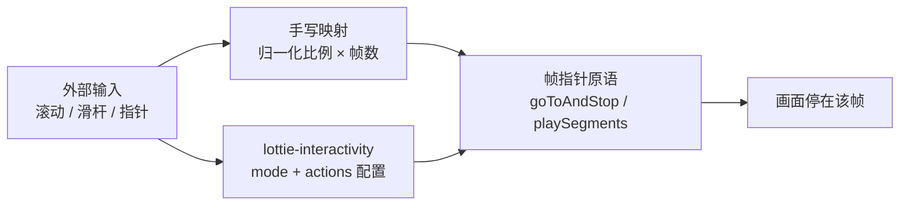

import { Canvas, Controls, Meta } from '@storybook/addon-docs/blocks';
import * as InteractivityStories from './interactivity.stories';

<Meta of={InteractivityStories} name="Docs" />

# 交互式动画

前两课的方法都由代码自己调用，本课把调用权交给使用者——滚动、滑杆、指针这些外部输入，最终都归结为一件事：把输入换算成帧号，拨动「[帧与片段](?path=/docs/frames-segments--docs)」一课讲过的帧指针。核心判断由此而来：简单的进度映射，手写 `goToAndStop` 就够（一个公式 + 一个监听器）；状态化的交互——点击播放某段、悬停进/出、滚动区间分段——用 lottie-interactivity 的模式化配置更省事，而库内部拨动的仍是同一组原语。



交互模式速查（输入类型 × 实现方式，回查入口）：

| 交互模式 | 输入 | 实现方式 | 回查要点 |
| --- | --- | --- | --- |
| 进度驱动 | 连续值（滚动 / 滑杆） | 手写：`goToAndStop(比例 × totalFrames, true)` | 映射公式；滑杆监听 `input` |
| 区间内进度 | 连续值 + 帧区间 | 手写：`playSegments` + 段内相对帧 seek | 绝对帧先减 `firstFrame`（2.4 结论） |
| 滚动区间分段 | window 滚动 | 库：`mode: 'scroll'` + 多个 `actions` | `visibility` 划定容器可见比例区间 |
| 悬停进/出、点击 | pointer 进出 | 库：`mode: 'cursor'`（hold / pauseHold / click…） | 进入 / 离开容器触发，`forceFlag` 管重播 |
| 指针位置映射 | 指针坐标 | 库：`mode: 'cursor'` + `type: 'seek'` + `position` | 坐标按容器归一化到 0–1 |

## 手写帧驱动

任何连续输入都走同一条三步管线：**归一化 → 换算帧号 → seek**。不同输入只差第一步的分子分母：

```text
ratio = 输入值 / 输入最大值                      // 归一化到 [0, 1]
frame = ratio × totalFrames                     // 全片映射
animation.goToAndStop(Math.round(frame), true)  // 拨帧指针并暂停
```

滚动输入用页面尺寸归一化，滑杆用控件量程：

```js
// 滑杆：input 事件在拖动过程中连续触发，画面即时跟手
slider.addEventListener('input', (event) => {
  const ratio = Number(event.target.value) / Number(event.target.max);
  animation.goToAndStop(Math.round(ratio * animation.totalFrames), true);
});

// 页面滚动：scroll 事件高频触发，用 requestAnimationFrame 节流到每帧至多一次 seek
let ticking = false;
window.addEventListener(
  'scroll',
  () => {
    if (ticking) {
      return;
    }
    ticking = true;
    requestAnimationFrame(() => {
      const max = document.documentElement.scrollHeight - window.innerHeight;
      const ratio = max > 0 ? window.scrollY / max : 0;
      animation.goToAndStop(Math.round(ratio * animation.totalFrames), true);
      ticking = false;
    });
  },
  { passive: true },
);
```

三个要点：

- 监听选择：滑杆等连续控件用 `input`——`change` 只在松手时触发一次，画面不跟手；`scroll` 用 rAF 节流并加 `passive: true`，把 seek 成本压到每帧一次；
- `goToAndStop` 自带暂停（2.4 的结论）：seek 驱动的实例通常以 `autoplay: false` 创建，画面完全由输入决定，实例停在该帧等待下一次输入；
- 输入值域要与可用帧值域对齐：`goToAndStop` 不做钳制，segment 激活时超出段长同样画出区间外的画面。

### 区间内 seek

把「帧与片段」一课的结论直接组合进来：segment 激活后 `goToAndStop` 的帧号按**段内相对帧**解释，合法范围是 0 到段长；要按画面上的绝对帧 seek，先减去 `firstFrame`：

```js
animation.playSegments([20, 80], true); // 激活区间（forceFlag 立即生效并跳到段首）
const frame = 20 + ratio * (80 - 20);   // 比例映射到 [20, 80] 的绝对帧
animation.goToAndStop(Math.round(frame) - animation.firstFrame, true);
```

这正是「滚动到页面某个章节就播对应片段」的底座：输入照旧归一化，只是映射目标从全片换成了区间。下方的滚动控制台把两种映射装进同一个自制动画（30fps、120 帧：圆点沿轨道单向行进、颜色随全片推进从蓝渐变到橙、中段在第 60 帧放大到峰值）：画面右侧是一条可拖动的自制滚动条，模拟页面滚动；Controls 的「滚动进度」与它写同一个进度状态。

<Canvas of={InteractivityStories.Interactive} />
<Controls of={InteractivityStories.Interactive} />

| 读者操作 | 可观察证据 |
| --- | --- |
| 拖动画面右侧滚动条（或「滚动进度」滑杆） | 「输入」变化，「映射帧」按公式换算，圆点位置、大小、颜色停在该帧，「当前帧」与「映射帧」一致 |
| 「映射模式」切到 segment 内 seek | 「映射区间」变 20 – 80；同样拖到 50%，「映射帧」落在区间中点 50 而不是全片中点 60 |
| segment 模式下把进度拖到 100% | 「映射帧」= 80（区间终点），不越过段尾去全片末帧 120 |
| 调整 segment 起点或终点 | 区间立即重激活，同一比例的输入按新区间重新映射 |

范例动画数据是课程自制的 interactivity.json：一个形状图层带位置、缩放与颜色关键帧（单向行进 + 中段放大 + 蓝橙渐变，任何一帧的颜色都反映它在全片中的位置），加一条静态轨道。滚动条与拇指由范例用 Canvas 2D 绘制，拖动事件按本节公式换算后调用 `goToAndStop`。

## lottie-interactivity

进度映射手写只要三行；一旦交互出现**状态**——悬停要进/出配对、点击要在正播倒播间切换、滚动要按区间分段各配动作——手写就得自己维护状态机。lottie-interactivity 把这些常见模式收编成一份声明式配置。

先说状态：官方仓库 2026 年起归档只读（与 lottie-player 同批），npm 包仍可安装使用，现存项目无需急着迁移；新项目是否引入它，见下一节的判断。引入方式 CDN 与 npm 等价：

```html
<!-- 播放器本体：lottie-web 或 lottie-player 二选一，先于交互库加载 -->
<script src="https://unpkg.com/lottie-web@5/build/player/lottie.min.js"></script>
<!-- 交互库：放在 body 内 -->
<script src="https://unpkg.com/@lottiefiles/lottie-interactivity@latest/dist/lottie-interactivity.min.js"></script>
```

```bash
npm install @lottiefiles/lottie-interactivity
```

```js
import { create } from '@lottiefiles/lottie-interactivity';
```

核心模型是一次 `create` 调用：

```js
LottieInteractivity.create({
  player: animation, // 播放器：AnimationItem 实例 / lottie-player 元素 / 选择器字符串
  container: box,    // 可选：监听输入的容器，省略时取播放器自己的容器
  mode: 'scroll',    // 'scroll' 滚动同步 | 'cursor' 指针同步 | 'chain' 多动画串接
  actions: [],       // 动作数组：scroll 按 visibility 区间匹配，cursor 按 type 匹配
});
```

配置字段速查（配置结构以官方仓库 README 为准，行为细节核对自仓库源码）：

| 字段 | 归属 | 含义 |
| --- | --- | --- |
| `player` | 顶层 | 三种传法：lottie-web 的 AnimationItem 实例；lottie-player 元素；选择器字符串（仅对 Web Component 有效，内部调 `getLottie()` 归一成实例） |
| `container` | 顶层，可选 | 监听输入的容器；省略时取播放器的容器（wrapper） |
| `mode` | 顶层 | `'scroll'` / `'cursor'` / `'chain'` |
| `actions` | 顶层 | 动作对象数组，可配置多段 |
| `visibility` | scroll 动作 | 容器可见比例区间 `[start, end]`，取值 0–1 |
| `frames` | 动作 | 参与动作的帧区间 `[start, end]`；scroll 的 seek 只给一个值时终点取 `totalFrames − 1` |
| `position` | cursor 的 seek 动作 | 指针坐标生效范围 `{ x: [x0, x1], y: [y0, y1] }`，坐标已按容器归一化到 0–1 |
| `forceFlag` | cursor 动作 | `true`：触发时从头重播（播放中也重启）；`false`：播放中不重启 |

### mode: 'scroll'

滚动模式下库监听 window 的 scroll 事件，每个事件计算容器的**可见比例**（源码 `getContainerVisibility`）：`(innerHeight − rect.top) / (innerHeight + rect.height)`——容器顶边刚进入视口底时约 0，容器底边离开视口顶时约 1。当前比例落进哪个 action 的 `visibility` 区间，就执行哪个 action：

| type | 行为（库内部的调用） |
| --- | --- |
| `seek` | 可见比例线性映射到 `frames` 区间，`goToAndStop(frame, true)`——与手写公式同款 |
| `loop` | `playSegments(frames, true)` 在区间内循环 |
| `play` | 暂停时 `playSegments(frames, true)`（有 `frames` 时）或 `play()` |
| `playOnce` | 首次滚进区间播放一次，之后不重复 |
| `stop` | `goToAndStop(frames[0], true)` 停在指定帧 |

最小可复制配置（页面滚动驱动动画进度）：

```html
<div style="height: 400px"></div>
<!-- 制造滚动空间 -->
<div id="lottie-box" style="height: 400px"></div>
<script>
  const animation = lottie.loadAnimation({
    container: document.querySelector('#lottie-box'),
    path: 'anim.json', // 任一合法动画数据
    renderer: 'svg',
    loop: false,
    autoplay: false,
  });

  animation.addEventListener('DOMLoaded', () => {
    LottieInteractivity.create({
      mode: 'scroll',
      player: animation, // lottie-web 场景直接传实例
      actions: [
        {
          visibility: [0, 1], // 容器从进入视口到离开视口
          type: 'seek',
          frames: [0, 120],   // 可见比例 0 → 1 映射到帧 0 → 120
        },
      ],
    });
  });
</script>
```

多个 `actions` 按 `visibility` 分段——比如 `[0, 0.5]` seek 前半、`[0.5, 1]` loop 后半——滚动到不同区间自动切换动作，这就是「滚动区间分段」。

### mode: 'cursor'

指针模式下库监听容器上的 mouse / touch 事件，按 action 的 `type` 触发：

| type | 触发 | 行为 |
| --- | --- | --- |
| `click` | 点击容器 | 从头播放；播放中不重启（`forceFlag: true` 则重启） |
| `hover` | 指针进入容器 | 同 click，进入即播 |
| `toggle` | 点击容器 | 正播、倒播来回切换（内部 `setDirection` 翻转） |
| `hold` | 悬停期间 | 进入正向播放，移开倒放回起点 |
| `pauseHold` | 悬停期间 | 进入播放，移开暂停 |
| `seek` | 指针在容器内移动 | 需配 `position` 与 `frames`：指针坐标映射帧区间，内部同样 `playSegments` + `goToAndStop` |

悬停进/出配对（hold）的最小配置：

```js
LottieInteractivity.create({
  player: animation, // lottie-web 实例
  mode: 'cursor',
  actions: [
    {
      type: 'hold', // 悬停播放、移开倒放回起点
    },
  ],
});
```

第三种 `mode: 'chain'` 用状态机串接多段动作或多只动画（state / transition / jumpTo 字段），适合「点一下播一段、播完等下一下」的引导流程；使用频率低，需要时查官方示例页即可。

无论哪种模式，库都没有自己的动画引擎：seek 落在 `goToAndStop(frame, true)`，loop / play / hold 落在 `playSegments` 与 `setDirection` + `play`，stop 落在 `goToAndStop(frames[0], true)`——全是「帧与片段」一课的原语。理解了帧指针，这份配置表就不是咒语，而是可推导的行为。

## 选型判断

两条实现路径各有清晰的适用面。

手写够用的场景：

- 单一进度映射：页面滚动进度条、滑杆拖动、加载进度——一个公式加一个监听器，零依赖；
- 映射规则非标准：只映射部分区间、反向映射、缓动曲线、自定义滚动容器或水平滚动——库的 scroll 模式只认 window 的竖向滚动，这些都要回到手写；
- 对归档库有维护顾虑：手写约 50 行状态机替代一份不再更新的依赖，长期反而省心。

用库省事的场景：

- 多状态交互：hold / pauseHold 的进/出配对、toggle 的方向切换、click 的重播语义——手写要自己维护指针事件状态机，库一行配置；
- 滚动区间分段播放：多段 `actions` + `visibility`，配置即状态表。

混用边界：两者可以在同一页面共存——滚动 seek 手写、卡片悬停交给库——因为它们最终都拨同一个实例的帧指针；但**同一个实例的同一段输入不要交给两处驱动**，两套监听会互相覆盖落点。判断顺序：先把交互写成「输入 → 帧指针」的映射，映射能一行写完就手写；出现分支状态再引入库；库的模式覆盖不了（自定义容器、非线性映射）就退回手写。

## 常见问题

- seek 时画面闪回第 0 帧或先跳一下再到位。
  把首次 seek 放到 `DOMLoaded` 之后——数据未就绪时加载流程会重置帧指针；seek 驱动的实例用 `autoplay: false` 创建，避免自动播放线程与输入线程抢同一个帧指针。若每帧都在小数姿态间抖动（SVG 渲染器上边缘发虚），是子帧插值在渲染小数帧：`setSubframe(false)` 让 seek 落整帧。
- scroll 模式里动画在容器刚碰到视口底边就开始动，或滚动方向与动画方向对不上。
  `visibility` 的语义是容器可见比例：`[0, 1]` 覆盖「顶边进入视口」到「底边离开视口」的全过程，想等容器多进入一些再开始，把起点调大（如 `[0.4, 1]`）；映射方向由 `frames` 决定，`frames: [120, 0]` 就是合法的倒放映射。多个 actions 按数组顺序取第一个覆盖当前比例的，区间重叠时前面的优先生效。
- `player: '#box'` 传选择器字符串后 seek 完全没效果，控制台还可能报 `Specified player: ... is invalid`。
  选择器只在目标是 lottie-player 这类 Web Component 时有效——库内部对它调 `getLottie()` 取实例；选择器查不到元素直接抛错，查到的是 lottie-web 的普通容器 div 时更隐蔽，后续所有帧操作落空。lottie-web 场景把 `loadAnimation` 返回的实例直接传给 `player`；React / Vue 组件化环境同理，传 ref 拿到的实例或元素，不赌全局选择器能查到。

## 总结回顾

摘要：

本课把「外部输入 → 帧指针」的映射写成两种实现。手写路径是一条三步管线——输入归一化到 [0, 1]、乘以可用帧数得到帧号、`goToAndStop(frame, true)` 拨指针并暂停；滑杆监听 `input` 事件，页面滚动用 rAF 节流的 `scroll` 监听，segment 激活时绝对帧先减 `firstFrame` 就成了区间内 seek。lottie-interactivity 把状态化交互收编成 `create({ player, mode, actions })` 配置：scroll 模式按容器可见比例（`visibility`）匹配 seek / loop / play / playOnce / stop，cursor 模式按指针进出与点击匹配 click / hover / toggle / hold / pauseHold / seek——而库内部拨动的仍是同一组帧指针原语。选型随之清晰：单一进度映射手写三行，多状态交互与滚动分段交给库，库覆盖不了的映射规则退回手写。

一句话：

> 交互动画的本质是「外部输入 → 帧指针」的映射：简单进度手写 goToAndStop 就够，状态化交互交给 lottie-interactivity 的模式化配置，而库内部拨动的仍是同一组原语。

知识要点：

- 滚动 / 滑杆输入怎样归一化并映射为帧？滑杆和页面滚动各该监听什么事件？
- segment 激活时如何做区间内 seek？绝对帧为什么要先减 firstFrame？
- lottie-interactivity 的核心配置模型是什么？scroll 模式的 visibility 如何计算、各 action type 分别做什么？
- cursor 模式有哪些 action type？forceFlag 改变什么行为？
- player 参数有哪三种传法？选择器字符串在什么条件下失效？
- 什么时候手写够用、什么时候用库、两者混用的边界在哪？

## 参考资料

- [LottieFiles/lottie-interactivity 仓库](https://github.com/LottieFiles/lottie-interactivity)
  README 的配置说明与安装方式；本课的 visibility 计算、scroll / cursor 各 type 的内部调用、player 三种传法核对自仓库源码与 dist 产物（仓库已归档只读）。
- [lottie-web 仓库 README](https://github.com/airbnb/lottie-web)
  goToAndStop / playSegments / resetSegments / setSubframe 的 API 依据。
- [帧与片段（2.4）](?path=/docs/frames-segments--docs)
  本课引用的前课结论：playSegments 的 forceFlag 与自动播放副作用、goToAndStop 的段内相对帧解释与越界行为、setSubframe。
