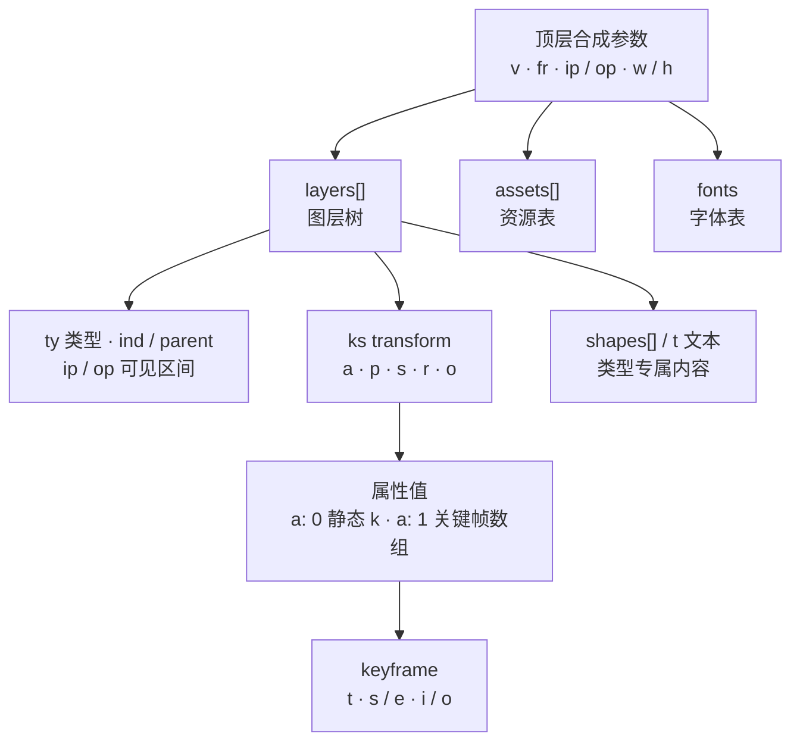

import { Meta } from '@storybook/addon-docs/blocks';

<Meta id="json-structure" title="数据与工程化/JSON 结构概览" name="Docs" />

# JSON 结构概览

打开任何一个 bodymovin 导出的 Lottie JSON，结构都是同样的三块：**顶层合成参数 + 图层树 + 资源表**。顶层定时长与画布，`layers` 定「有什么、怎么动」，`assets` 定「引用了什么」。本课把这三块读出坐标感：读完你能对着页面现象，按「顶层参数 → 图层 → 属性 → 关键帧」逐层下钻，把大部分字段问题对号入座。边界也说在前面：以读懂、能对照排错为界，不深入手改关键帧曲线的数学。正文片段全部裁剪自一个真实导出（工作区 `examples/hello/data.json`：v5.3.4、30fps、38 帧的文本弹跳动画），字段含义以 lottie-docs 规范为准。



顶层字段速查（含义与取值以 lottie-docs 为准）：

| 字段 | 含义 | 回查要点 |
| --- | --- | --- |
| `v` | bodymovin 导出版本号（字符串） | 解析异常先看它；新旧版本行为有差异（如关键帧 `e`） |
| `fr` | 帧率（帧/秒） | 帧 ↔ 秒的换算率 |
| `ip` / `op` | 入点 / 出点（帧） | 播放与循环边界；总帧数 = op − ip |
| `w` / `h` | 合成画布宽高 | 图层坐标的参考系 |
| `nm` | 合成名称 | 排错时确认「是不是这个动画」 |
| `ddd` | 是否含 3D 图层（0/1） | 1 时 transform 带 z 分量与三维旋转 |
| `layers` | 图层树 | 见「图层」 |
| `assets` | 资源表：图片、预合成等 | 图层用 `refId` 引用其 `id` |
| `fonts` | 字体表 | 文本图层按 `fName` 引用 |
| `markers` | 命名区间（AE 标记） | `tm` 起始帧、`dr` 时长帧、`cm` 名称；运行时可按标记切段 |

## 顶层参数

顶层就是合成面板的几组数字：`v` 是身份、`fr` 是节奏、`ip`/`op` 是区间、`w`/`h` 是画布。裁剪自 hello 动画的顶层：

```json
{
  "v": "5.3.4",
  "fr": 30,
  "ip": 0,
  "op": 38,
  "w": 315,
  "h": 600,
  "nm": "new",
  "ddd": 0,
  "assets": [],
  "layers": ["…23 个图层…"],
  "fonts": { "list": ["…Teko-Bold…"] },
  "markers": [
    { "tm": 0, "cm": "0", "dr": 0 },
    { "tm": 22, "cm": "1", "dr": 0 }
  ]
}
```

- **`v`：** bodymovin 插件的导出版本，不是规范版本号。同一段结构在新旧版本里写法可能不同（关键帧的 `e` 字段就是一例，见「关键帧」），排查解析问题时先看它。
- **`fr`：** 帧率，帧与真实时间的换算率。JSON 里所有时间量（`ip`、`op`、关键帧 `t`）都是帧号。
- **`ip` / `op`：** 入点与出点，帧单位，播放与循环的边界。lottie-web 只播 `[ip, op]` 这一段，`totalFrames` 初值就是这道减法——「帧与片段」一课的结论在这里对上源头：

```text
总帧数（帧）   = op − ip
总时长（毫秒） = (op − ip) ÷ fr × 1000
```

hello 动画：38 − 0 = 38 帧，÷ 30fps ≈ 1.27 秒。`ip` 规范上「通常为 0」但不保证——非 0 时第 0 帧不在播放区间内。

- **`w` / `h`：** 合成画布尺寸，图层位置坐标的参考系。hello 画布 315×600，各图层位置 `p` 的 x 值多在 157 附近——约 315 的一半，居中就是这么读出来的。
- **`ddd`：** 0/1 标记合成里是否有 3D 图层；为 1 时相关图层的位置、旋转会多出 z 轴分量。
- **`nm`：** 合成名，编辑器里显示的名字。

## 图层

`layers` 是一棵按引用展开的树：顶层 `layers` 是主干，预合成图层把 `assets` 里自带 `layers` 的资源再挂进来。每个图层 = 类型 + 身份 + 可见区间 + transform + 类型专属内容。hello 里一个带父级的形状图层：

```json
{
  "ddd": 0,
  "ind": 2,
  "ty": 4,
  "nm": "bodyband Konturen",
  "parent": 4,
  "ks": {
    "o": { "a": 0, "k": 100 },
    "r": { "a": 0, "k": 0 },
    "p": { "a": 0, "k": [157.5, 129, 0] },
    "a": { "a": 0, "k": [157.5, 140, 0] },
    "s": { "a": 0, "k": [100, 100, 100] }
  },
  "shapes": ["…形状路径与填充…"],
  "ip": 0,
  "op": 150,
  "st": 0,
  "bm": 0
}
```

**类型：`ty`。** 常见枚举如下（lottie-docs 还定义了 6 音频、13 摄像机、15 数据，少见，遇到再查）：

| ty | 类型 | 内容与引用 |
| --- | --- | --- |
| 0 | 预合成 | `refId` 指向 `assets` 里带 `layers` 的资源，是一段嵌套子动画 |
| 1 | 实体 | 纯色矩形色块 |
| 2 | 图片 | `refId` 指向 `assets` 里的图片资源 |
| 3 | 空对象 | 本身不绘制内容，只有 transform |
| 4 | 形状 | `shapes` 数组：路径、填充、描边、分组 |
| 5 | 文本 | `t` 数据，字体引用 `fonts` 里的 `fName` |

**身份与层级：`ind` / `nm` / `parent`。** `ind` 是图层在自己列表里的索引（同列表内唯一），`parent` 用它指认父级；子层继承父级的 transform（矩阵叠加），**唯独不透明度 `o` 不继承**——父级半透明不会带透明子级。hello 里 ind 2、3 都 `parent` 到其他层，跟着父级一起动。同列表内靠前的图层渲染在最上层（lottie-docs：渲染顺序从最后一个元素到第一个），排查「被盖住」看数组顺序。

**可见区间：图层自己的 `ip` / `op`。** 与顶层同名但只管本层何时可见，`st` 是起始时间。注意 hello 的真实细节：顶层 `op` 是 38，所有图层却是 `op: 150`——播放与循环边界以顶层为准，图层区间只是自己的窗口；反过来，图层 `op` 小于顶层 `op` 时，元素会中途消失。

**transform 五件套：`ks`。** 图层的几何与透明状态，五个属性各是一个「属性值」结构（下一节展开）：

| 属性 | 含义 | 回查要点 |
| --- | --- | --- |
| `a` | 锚点 | 旋转、缩放的基准点 |
| `p` | 位置 | 画布坐标系；常带第三个 z 分量 |
| `s` | 缩放 | 百分比，100 为原大；数组形式一维一分量 |
| `r` | 旋转 | 角度 |
| `o` | 不透明度 | 0–100 |

## 关键帧

每个可动画属性都是同一个结构：`a` 标记是否有关键帧，`k` 承载值，`ix` 是属性索引。`a` 为 0 时 `k` 就是静态值（上一节 transform 片段全是这种）；`a` 为 1 时 `k` 是关键帧数组。hello 里图层的不透明度淡入：

```json
"o": {
  "a": 1,
  "k": [
    {
      "i": { "x": [0.833], "y": [0.833] },
      "o": { "x": [0.167], "y": [0.167] },
      "t": 3.704,
      "s": [0],
      "e": [100]
    },
    { "t": 4.4443359375 }
  ]
}
```

读法：不透明度从第 3.704 帧的 0 过渡到第 4.444 帧的 100，`i`/`o` 是这段过渡的缓动手柄。

| 字段 | 含义 | 回查要点 |
| --- | --- | --- |
| `t` | 关键帧时间（帧号） | 可以是小数 |
| `s` | 该帧取值 | 多维属性是数组，一维一分量 |
| `e` | 本段终值（旧式写法） | **已废弃**：新版不写 `e`，终值取下一帧的 `s` |
| `h` | 保持帧标记 | `1` 时值保持到下一帧，无需 `i`/`o` |
| `i` / `o` | 入 / 出切线手柄 | 决定两帧之间的缓动曲线 |

**新旧写法差异。** hello 导出于 v5.3.4，每个关键帧自带 `s`（起值）和 `e`（终值），一段过渡自描述。现行规范已废弃 `e`——lottie-docs 明确写「应使用下一关键帧的 `s` 取终值」——新导出的文件每段只写 `s`，末帧只剩一个 `t`（hello 片段的最后一项就是）。读旧文件两者读出同样的结果；但手工改值要认准 `s`：运行时取终值的规则是「下一帧的 `s` 优先，没有才用本帧的 `e`」（lottie-web 源码 `endValue = nextKeyData.s || keyData.e`），改中间段的 `e` 不生效——只有末段（下一帧只剩 `t`）才轮到它。

**`i` / `o` 手柄的存在意义。** `o` 是离开本帧的出切线、`i` 是进入下一帧的入切线，各有 x、y 两个分量：x 是时间分量（0 = 本帧、1 = 下一帧），y 是值分量（0 = 起值、1 = 终值），四个点定义两帧之间插值的一条贝塞尔曲线。本课只定位它的结构位置：知道「动画节奏不对 → 查关键帧的 `i`/`o`」即可；x/y 如何换算出曲线形状属于格式规范的进阶内容（lottie-docs 的 Bezier Curves 章节），本课不展开。

## 资源表 assets

`assets` 是被引用资源的仓库：图层不内嵌资源本体，预合成层（ty 0）与图片层（ty 2）都用 `refId` 按 `id` 引用。纯矢量动画就是空数组——hello 的 `"assets": []`。

**图片：`id` / `u` / `p` / `e` 三元组。** 字段与路径解析规则（`assetsPath`、Data URI、加载基准）在「动画数据管理」一课已完整讲过，这里只留速查：

| 字段 | 含义 |
| --- | --- |
| `id` | 资源唯一标识，图层以 `refId` 引用 |
| `u` | 资源目录，可为空 |
| `p` | 文件名；`e` 为 1 时是完整 Data URI |
| `e` | 内嵌标记：`1` 表示 `p` 已内嵌，不再发请求 |

**预合成：自带 `layers` 的资源。** 预合成是「文件里的子动画」：asset 项不写 `u`/`p`，而带一套完整的 `layers` 数组（另有自己的 `fr`），ty 0 图层用 `refId` 把它挂进主干。可以多层嵌套，但不能成环——运行时遇到循环引用没法算。

**字体：`fonts.list`。** 数组里每项描述一款字体：`fName` 是文本图层引用字体的键（文本数据里按它找字体），`fFamily`/`fStyle` 是字体族与样式，`fPath` 指向字体来源。hello 的 Teko-Bold 就把 `fPath` 指到 Google Fonts 的 CSS 地址；文本显示异常时，先查 `fName` 引用与 `fPath` 的可达性。

## 排错入口

有了结构地图，排错就是把页面现象翻译成字段问题：先顶层参数（时长、画布、播放区间对不对），再图层（类型、可见区间、层级），再属性（transform 五件套），最后关键帧（时间点与取值）。常见现象的入口：

| 页面现象 | 先检查 | 判断 |
| --- | --- | --- |
| 完全不动 | 顶层 `ip` / `op` 与当前帧 | 播放区间 = `[ip, op]`，总帧数 = op − ip；`ip` 非 0 时第 0 帧不在区间内 |
| 时长不对 | `fr` 与 `op − ip` | 毫秒 = (op − ip) ÷ fr × 1000；改播放速度用 setSpeed，不改 `fr` |
| 尺寸或留白异常 | `w` / `h` 与容器尺寸 | 图层坐标以画布为参考系 |
| 某个元素不显示 | 该层 `o`、图层 `ip`/`op`、`parent` 链 | `o` 为 0 或起始关键帧值就是 0；当前帧在图层区间外；父级 transform 同样生效 |
| 元素中途消失 | 图层自身 `op` | 小于顶层 `op` 就提前退场 |
| 位置 / 角度不对 | `ks` 的 `a` 与 `p`、`parent` | 锚点决定旋转缩放基准；父级链会叠加位移 |
| 图片不显示 | `assets` 的 `u` / `p` / `e` | 路径解析规则见[动画数据管理](?path=/docs/animation-data--docs)；图片加载失败控制台不一定报错 |
| 文本显示异常 | `fonts.list` 的 `fName` / `fPath` | 文本层按 `fName` 引用字体，`fPath` 指向加载来源 |

对照工具：LottieFiles 工具集里的 Lottie JSON Editor 可以加载 JSON、按图层树展开字段、改值实时预览，拿到陌生 JSON 先丢进去对照本课结构读一遍；lottie-docs 站点自带 JSON Editor 与 Builder 两个 Playground，字段含义可直接对着规范查。

## 总结回顾

摘要：

本课把任何一份 Lottie JSON 读成固定的三块：顶层合成参数定版本、帧率、播放区间与画布——总帧数 = op − ip、时长靠 `fr` 换算，与运行时 `totalFrames` 的初值同源；`layers` 图层树里，`ty` 分出预合成、实体、图片、空对象、形状、文本六种常见类型，`ind`/`parent` 组织层级（继承 transform 但不继承 `o`），图层自带 `ip`/`op` 只管自己可见的窗口，`ks` 的 transform 五件套 a/p/s/r/o 各是一个属性值结构；属性值 `a: 0` 是静态值、`a: 1` 是关键帧数组，关键帧用 `t` 定时间、`s` 定取值，旧式的 `e` 已废弃（终值取下一帧的 `s`），`i`/`o` 贝塞尔手柄决定段内节奏；`assets` 资源表按 `refId` 被图层引用，图片是 `id`/`u`/`p`/`e` 三元组，预合成自带 `layers`，字体表 `fonts.list` 以 `fName` 被文本层引用。排错时按「顶层参数 → 图层 → 属性 → 关键帧」下钻，用 LottieFiles 的 JSON 编辑器对照字段。

一句话：

> Lottie JSON = 顶层合成参数 + 图层树 + 资源表；排错按「顶层参数 → 图层 → 属性 → 关键帧」下钻，大部分字段问题都能对号入座。

知识要点：

- 顶层 `v` / `fr` / `ip` / `op` / `w` / `h` 各管什么？总帧数与时长怎么换算？
- 图层 `ty` 常见类型有哪些？`ind` / `parent` 如何组织层级，继承什么、不继承什么？
- transform 五件套 `a` / `p` / `s` / `r` / `o` 各是什么？
- 属性值 `a: 0` 与 `a: 1` 差在哪？关键帧的 `t` / `s` / `e` / `h` / `i` / `o` 各是什么，`e` 为什么被废弃？
- `assets` 里的图片、预合成、字体分别怎么被引用？
- 「动画不动 / 元素不见 / 图片缺失」分别先查哪些字段？

## 参考资料

- [Lottie 格式文档：Animation](https://lottiefiles.github.io/lottie-docs/composition/)
  顶层字段（v、fr、ip、op、w、h、nm、ddd、layers、assets、fonts、markers）的定义与时长推导。
- [Lottie 格式文档：Layers](https://lottiefiles.github.io/lottie-docs/layers/)
  ty 枚举、ind/nm/parent、图层 ip/op/st/sr、transform 属性，以及图层列表「靠前在上」的渲染顺序。
- [Lottie 格式文档：Properties](https://lottiefiles.github.io/lottie-docs/properties/)
  属性值 a/k/ix 结构、关键帧 t/s/h 与 i/o 手柄、e 字段的废弃说明。
- [PropertyFactory.js 源码](https://github.com/airbnb/lottie-web/blob/master/player/js/utils/PropertyFactory.js)
  interpolateValue 中 `endValue = nextKeyData.s || keyData.e` 的终值取值规则。
- [Lottie 格式文档：Assets](https://lottiefiles.github.io/lottie-docs/assets/)
  图片资源的 id/u/p/e 字段与预合成资源自带 layers 的结构。
- [Lottie 格式文档：Text](https://lottiefiles.github.io/lottie-docs/text/)
  fonts.list 各字段（fName、fFamily、fStyle、fPath、origin）与字体加载来源。
- [Lottie Specs](https://lottie.github.io)
  开放规范组织：JSON Schema 与版本演进，字段的权威对照。
- [LottieFiles 工具集](https://lottiefiles.com/tools)
  Lottie JSON 编辑器等工具入口，排错时加载 JSON 对照字段。
