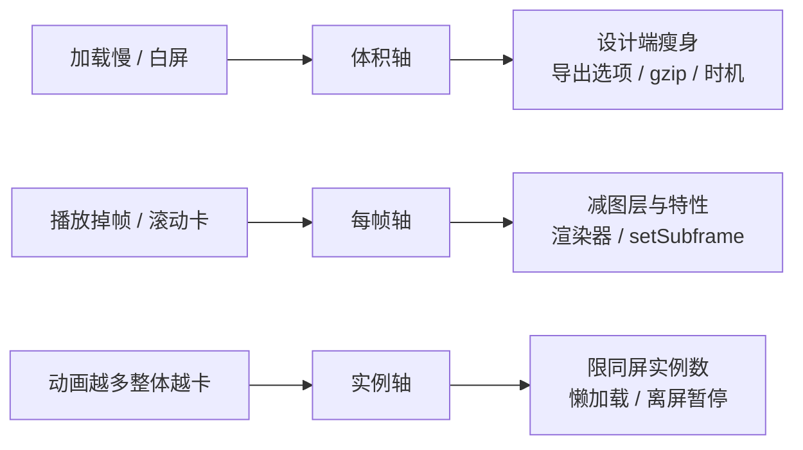

import { Canvas, Controls, Meta } from '@storybook/addon-docs/blocks';
import * as PerformanceStories from './performance.stories';

<Meta of={PerformanceStories} name="Docs" />

# 性能优化

一个 Lottie 动画在页面里的成本由三个轴决定：**数据体积**（网络传输与解析装配）、**每帧计算量**（图层数与图层特性）、**实例规模**（同屏数量与渲染器的 DOM 结构）。三个轴相互独立——JSON 很小不妨碍每帧很贵，单实例流畅不代表八个实例流畅——所以动手优化之前先诊断：卡在加载，还是卡在每一帧。本课按「症状 → 轴 → 手段」组织；下方实例固定数据与渲染器，只动「同屏实例数」一个轴，示范怎样用读数观测每帧开销。



| 症状 | 先查的轴 | 对应小节 |
| --- | --- | --- |
| 首屏动画区域白屏、出现晚 | 体积轴：JSON 太大，或请求发起太晚 | 「体积优化」 |
| 动画播放中掉帧、滚动卡顿 | 每帧轴：图层数、特性与渲染器 | 「每帧开销」 |
| 页面整体变卡，动画越多越明显 | 实例轴：同屏数量与可见性管理 | 「每帧开销」「页面级策略」 |

## 诊断顺序

「动画慢」有两种，手段完全不同：**加载慢**是数据没到位（网络与解析），**渲染慢**是每帧太贵（计算与绘制）。先用两个面板把问题归到轴上，再动手优化。

**Network 面板看加载。** 刷新页面，按类型过滤出动画 JSON，回答三个问题：请求何时发起（是否排在关键资源之后排队）、传输体积多大（Size 列同时显示压缩后的传输体积与解压后的资源体积）、何时完成（`DOMLoaded` 依赖这次请求，见[获取动画素材](?path=/docs/getting-assets--docs)）。请求晚或体积大，问题在体积轴。

**Performance 面板看每帧。** 录制一段动画播放或列表滚动的操作，看每帧的脚本耗时；再用「暂停对比」确认因果——调用 `pause()` 暂停全部实例后重录一次：卡顿消失，说明成本确实来自 lottie 的每帧计算；仍然卡顿，则另有原因。确认后看火焰图里时间集中在哪：集中在数据处理与装配，是解析成本（体积轴）；集中在渲染器的每帧更新，是图层数与特性的成本（每帧轴）。

不设通用阈值：帧预算取决于目标设备与页面上的其他工作。用**相对比较**代替绝对判断——同一页面只改一个轴（实例数、渲染器、数据），对比前后录制结果，读数变差的就是当前瓶颈。下方实例的读数设计正是这个方法。

## 体积优化

JSON 的成本分两段：加载时的网络传输与解析装配（一次性，装配完进内存），以及它间接决定的每帧计算量（下一节）。本节只处理第一段——从生成到到达，每一环都能瘦身。

### 设计端瘦身

体积大头在数据里装了什么：图层越多、路径点越密、位图越多，JSON 越大。导出前让设计师合并可合并的图层、删除未使用的资源与隐藏图层、避免「用巨大形状只为一小块蒙版」的画法——这也是 lottie-web 官方 README 给出的性能建议。导出选项与协作约定的完整清单见[制作流程](?path=/docs/production-workflow--docs)。

### 导出选项

- **精度（Precision）**：bodymovin 导出面板可设置数据保留的小数位数。坐标差在小数点后三四位之外通常不可见，位数越少 JSON 越小。
- **位图引用**：位图资源以 assets 引用（独立图片文件）而非塞进 JSON，数据本身保持轻；能用矢量表达的形状不要塌缩成位图——位图的体积与解析成本都更高。

### 传输压缩

- **gzip / br**：Lottie JSON 是文本，压缩率高，让服务器或 CDN 带 `Content-Encoding` 返回即可，浏览器透明解压，Network 面板的 Size 列能看到前后差异。bodymovin 也提供 gzip 导出（`.json.gz`），但需要服务器按压缩格式配合返回；日常把压缩交给构建与 CDN 即可（见「获取动画素材」一课的讨论）。
- **.lottie 打包**：zip 容器把 JSON 与位图统一压缩打包，动画多或资源多时收益更大，展开见[dotLottie 与新运行时](?path=/docs/dotlottie-runtime--docs)。

### 加载时机

体积小了还要看请求何时开始：再小的 JSON 排在关键资源后面排队，动画区域照样白屏等待。把动画请求提前到可见之前——预加载后用 `animationData` 播放，或按需管理的多实例与资源路径——能让网络等待移出用户的感知窗口。预加载与多实例管理的完整处理见[动画数据管理](?path=/docs/animation-data--docs)。

## 每帧开销

播放中的每一帧，播放器都要把所有图层的属性重新计算并绘制一遍。这条账单由三部分构成：

- **图层总数**：每帧成本随图层数线性增长——8 个实例各 2 个图层，就是每帧 16 层的计算量。官方 README 的原话是 "Too many nodes will also affect performance"。
- **图层特性**：蒙版、track matte、渐变、修剪路径等每帧都要额外计算；效果（投影、模糊、色调等）只在 svg 渲染器有实现——svg 下它们每帧真的执行，canvas 下没有实现会静默跳过（外观消失，成本也随之消失）。
- **渲染器与实例数**：svg 给每个图层建真实 DOM 节点，浏览器每帧更新这棵树；canvas 的 DOM 恒为 1，绘制发生在画布内部（[渲染器选型](?path=/docs/renderers--docs)的结论：svg 保真、canvas 提量）。实例数是乘在这一切上的系数——同屏 N 个实例，每帧成本近似 N 倍。

下方实例把其余轴全部固定——同一份自制数据、同一 canvas 渲染器——只拖动「同屏实例数」一个轴（1–8）。读数三行分别是：实例数；最近 60 帧的平均每帧耗时（rAF 回调间 `performance.now` 差值的滑动平均）；单帧超过 25ms（60Hz 帧间隔的约 1.5 倍）的掉帧累计。

<Canvas of={PerformanceStories.Performance} />
<Controls of={PerformanceStories.Performance} />

| 读者操作 | 可观察证据 |
| --- | --- |
| 滑杆从 1 拉到 8 | 舞台上的槽位从虚线占位逐格变为播放中的实例；「同屏实例数」同步变化，每帧要算的图层数 = 实例数 × 2 |
| 观察另外两行读数 | 平均每帧耗时接近 16.7ms（60Hz 的一帧预算）说明未超预算；掉帧累计增长说明连续超时 |
| 打开 Show code | 看到增删实例、`destroy()` 清理与帧间隔统计的全部实现 |

读数受设备与页面其他工作影响，只用于相对比较，不设通用阈值。本范例的动画只有两个图层，多数设备上拉满 8 个实例读数依然平稳——这本身就是有效结论：该轴在当前素材下不是瓶颈；换上图层更多、特性更重的素材，同一套读数就能看出差异。**先测出哪个轴真的超了预算，再动它**——这是全课方法的落点。

## 页面级策略

每帧开销的账算清楚之后，页面级的优化就是回答「什么时候该算」：不可见的动画，一帧都不该算。四个策略按创建、播放、绘制、形态四个环节展开。

### 懒加载：进视口才创建

最彻底的节省是不创建。用 IntersectionObserver 观察容器，进入视口才调 `loadAnimation`——网络、解析与每帧计算全部推迟到真正需要显示的时刻：

```js
const observer = new IntersectionObserver((entries) => {
  entries.forEach((entry) => {
    if (!entry.isIntersecting) return;
    observer.unobserve(entry.target); // 只需加载一次，观察即停
    lottie.loadAnimation({
      container: entry.target,
      renderer: 'canvas',
      path: entry.target.dataset.src,
    });
  });
});
document.querySelectorAll('[data-src]').forEach((el) => observer.observe(el));
```

### 离屏暂停：不可见就 pause

已创建的实例在滚出视口或标签页隐藏时暂停，回来再恢复。`pause()` 之后播放器每帧的推进直接返回，不再计算与绘制，每帧成本立刻归零（实例状态机见[事件与生命周期](?path=/docs/events-lifecycle--docs)）：

```js
const observer = new IntersectionObserver(([entry]) => {
  if (entry.isIntersecting) animation.play();
  else animation.pause();
});
observer.observe(container);

document.addEventListener('visibilitychange', () => {
  if (document.hidden) animation.pause();
  else animation.play();
});
```

长离屏（路由切换、列表项删除）干脆 `destroy()`，回来重建——组件卸载必须清理的规则见「事件与生命周期」一课；重建时的数据复用与多实例管理见[动画数据管理](?path=/docs/animation-data--docs)。

### setSubframe(false)：把重绘压回动画帧率

默认开启子帧渲染：播放器按显示刷新率逐次 rAF 插值重绘——30fps 的动画在 60Hz 屏上每秒画 60 次，120Hz 屏上画 120 次。对实例调用 `setSubframe(false)` 后帧号取整，渲染器发现帧号没变就跳过本次重绘（svg 与 canvas 的 `renderFrame` 都有同帧号短路），实际重绘频率回到动画声明的帧率：

```js
animation.setSubframe(false); // 默认 true；关闭后重绘上限 = 动画自身的帧率
```

代价是运动按整数帧跳变，高速或大幅运动的动画可能察觉不够顺滑。导出帧率本就不高的素材、多实例的列表页面适合关闭；精致的单一主视觉保持默认。

### 低功耗场景降级：给动画一个「不播」的形态

装饰性动画不值得在任何设备上抢每帧预算，值得预留一个不播放的形态：

- **静态首帧当海报**：`autoplay: false` 时播放器仍会渲染第 0 帧（见「事件与生命周期」一课），天然得到一张「会动的海报」；悬浮、点击或滚动到位再 `play()`。
- **尊重系统偏好**：用户开启「减弱动态效果」时 `matchMedia('(prefers-reduced-motion: reduce)').matches` 为 `true`，直接不自动播。
- **低电量环境**：iOS 低电量模式等省电状态会压低系统动画帧率（lottie-ios 官方讨论确认为系统预期行为），动画在这类设备上变卡属于环境调度而非代码问题——上面的降级形态正是应对方式。

## 常见问题

- 页面上的动画越加越多，整个页面一起变卡。
  先数同屏实例：svg 渲染器每个实例都是一棵独立 DOM 子树，数量一多合成压力线性上涨（判断依据见「渲染器选型」一课）。处理按性价比排序：批量小实例换 canvas 渲染器；滚出视口的暂停或销毁；还没进视口的不创建（懒加载）。列表里重复出现的同一动画，数据只取一份、逐实例解析拷贝传入。
- JSON 明明很小，动画还是卡。
  体积轴和每帧轴是两本账：小 JSON 不代表每帧便宜。回到「诊断顺序」，用 Performance 面板的暂停对比确认卡顿来自 lottie，再看图层与特性——几十个图层、多层蒙版渐变的单个动画，比十个轻动画更贵。让设计端合并图层、简化特性，或给该实例换 canvas 渲染器卸掉 DOM 更新。

## 总结回顾

摘要：

Lottie 的页面成本拆成三个独立的轴：体积轴决定加载（网络传输与解析装配），每帧轴决定播放（图层总数、特性与渲染器），实例轴决定页面整体（同屏数量与可见性）。诊断靠两个面板：Network 看请求时机与传输体积，Performance 配合「暂停对比」确认卡顿是否来自 lottie 的每帧计算——一切优化前先测出真正超预算的轴，用相对比较代替绝对阈值。体积从设计端瘦身、导出精度、传输压缩、加载时机四个环节收缩；每帧靠减图层、简化特性、canvas 渲染器与 `setSubframe(false)` 收缩；页面级用懒加载、离屏暂停与降级形态回答「什么时候该算」。

一句话：

> 先诊断卡在加载还是每帧，再动对应的那一个轴——每个轴都可测量，不要凭感觉优化。

知识要点：

- 三类症状分别对应哪个轴？Network 与 Performance 面板各看什么？
- 「暂停对比」怎样确认卡顿来自 lottie？为什么优化用相对比较而非绝对阈值？
- 体积可以在哪四个环节瘦身？各自的关键动作是什么？
- 每帧成本由什么决定？为什么多实例场景优先 canvas 渲染器？
- `setSubframe(false)` 的收益与代价是什么？四个页面级策略各回答什么问题？

## 参考资料

- [lottie-web 仓库 README](https://github.com/airbnb/lottie-web)
  `setSubframe` 的说明；性能建议原文（精简 AE 工程、"Too many nodes will also affect performance"）与 gzip 压缩建议。
- [AnimationItem.js 源码](https://github.com/airbnb/lottie-web/blob/master/player/js/animation/AnimationItem.js)
  `setSubframe` 与 `gotoFrame` 的帧号取整；暂停后 `advanceTime` 直接返回的实现。
- [SVGRendererBase.js 源码](https://github.com/airbnb/lottie-web/blob/master/player/js/renderers/SVGRendererBase.js)、[CanvasRendererBase.js 源码](https://github.com/airbnb/lottie-web/blob/master/player/js/renderers/CanvasRendererBase.js)
  `renderFrame` 的同帧号短路：`setSubframe(false)` 能跳过重复重绘的实现位置。
- [bodymovin（aescripts）](https://aescripts.com/bodymovin/)
  导出面板的精度与 gzip 选项。
- [MDN IntersectionObserver](https://developer.mozilla.org/zh-CN/docs/Web/API/Intersection_Observer_API)
  懒加载与离屏暂停使用的观察器 API。
- [MDN Page Visibility API](https://developer.mozilla.org/zh-CN/docs/Web/API/Page_Visibility_API)
  `document.hidden` 与 `visibilitychange` 事件。
- [MDN prefers-reduced-motion](https://developer.mozilla.org/zh-CN/docs/Web/CSS/@media/prefers-reduced-motion)
  「减弱动态效果」偏好的检测方式。
- [dotLottie 官方站点](https://dotlottie.io)
  .lottie 打包压缩格式的动机与规范（展开见「dotLottie 与新运行时」一课）。
- [lottie-ios Discussion #1867](https://github.com/airbnb/lottie-ios/discussions/1867)
  低电量模式下系统节流动画属预期行为的官方确认。
