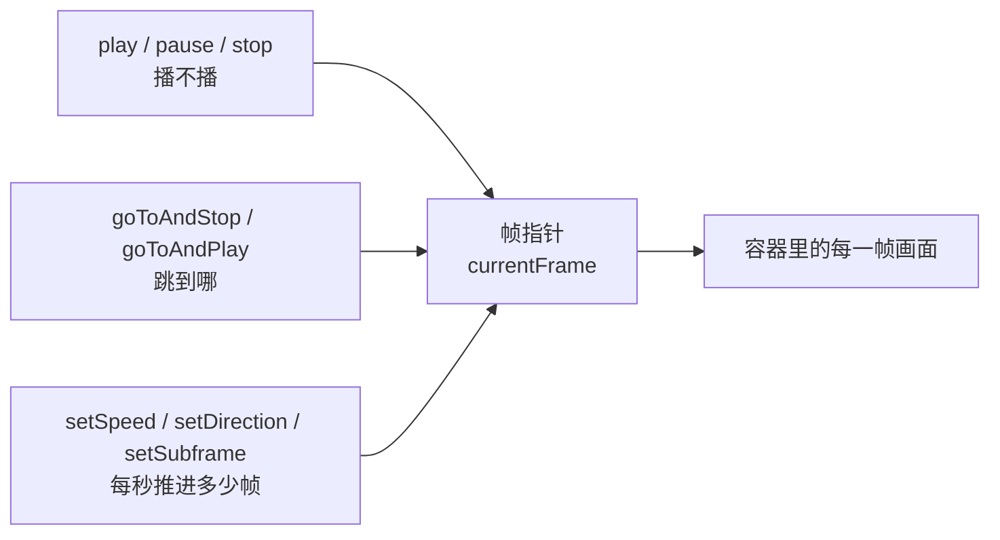

import { Canvas, Controls, Meta } from '@storybook/addon-docs/blocks';
import * as PlaybackControlStories from './playback-control.stories';

<Meta of={PlaybackControlStories} name="Docs" />

# 播放控制

`loadAnimation` 返回的 AnimationItem 实例就是动画的遥控器。它的控制方法都在拨动三个状态量：**帧指针**（当前帧，读作 `currentFrame`）、**速度**（`playSpeed`，默认 1）、**方向**（`playDirection`，1 正向 / -1 反向）。play、pause、stop 决定「播不播」，goToAndStop、goToAndPlay 决定「跳到哪」，setSpeed、setDirection、setSubframe 决定「每秒推进多少帧」。会读这三个量，任何控制组合的结果都能提前预测——比如把速度调到 3 再按毫秒跳转，落点会出现在按速度放大的位置，本课控制台可以直接验证这一点。



控制方法速查（默认值以官方 README 为准）：

| 方法 | 做什么 | 关键影响 |
| --- | --- | --- |
| `play()` | 从当前状态继续播放 | 只把实例置为播放态，不动帧指针；播放中调用是空操作 |
| `pause()` | 暂停 | 帧指针停在原地，`play()` 从这一帧继续 |
| `stop()` | 停止并回到起点 | 等价 `pause()`，再把帧指针拨回第 0 帧、清零循环计数 |
| `goToAndStop(value, isFrame)` | 跳到 value 并暂停 | `isFrame` 默认 `false` 按「毫秒」，`true` 按「帧」 |
| `goToAndPlay(value, isFrame)` | 跳到 value 并继续播 | `isFrame` 含义同上；继续播的方向由当前方向决定 |
| `setSpeed(speed)` | 设播放速度 | `1` 为常速，可大于 1 加速、小于 1 减速，默认 `1` |
| `setDirection(direction)` | 设播放方向 | `1` 正向、`-1` 反向，默认 `1` |
| `setSubframe(useSubFrames)` | 亚帧渲染开关 | 默认 `true` 按渲染节奏插值中间帧，`false` 按动画原始帧率整帧跳 |

## 播放与暂停

实例内部只有一个「播放中 / 已暂停」的开关（源码里就是 `isPaused` 布尔量）。三个方法只是对这个开关和帧指针的不同组合：play 打开开关，pause 关掉开关，stop 关掉开关并顺手把帧指针归零。

```js
const animation = lottie.loadAnimation({ /* ... */ });

animation.play();  // 播放中 → 空操作；已暂停 → 从当前帧、当前速度与方向继续
animation.pause(); // 帧指针停在原地
animation.stop();  // 暂停 + 帧指针回第 0 帧 + 循环计数清零
```

`autoplay` 是 `loadAnimation` 的创建参数，只决定数据就绪后是否自动进入播放状态；创建之后，播与停完全由这三个方法接管。想让自动播放的动画停下来，调 `pause()` 就行，不需要为「改 autoplay」重建实例。

### play：从当前状态继续

play 只负责把实例切回播放态，从哪继续由调用瞬间的三个状态量决定：从当前帧出发、按当前速度和方向推进。它不会把帧指针拨回起点，也不会重置速度和方向。`autoplay: false` 创建的实例停在动画开头，第一行 `animation.play()` 就能启动。

### pause：停在当前帧

pause 只关播放开关，帧指针原地看着不动，`play()` 恢复后从这一帧继续。它与 stop 的差异只有一条：stop 会把帧指针拨回第 0 帧。

### stop：回到起点并暂停

stop 等于 pause 加归零：源码里它先调用 pause，再把帧指针设回第 0 帧，并把循环计数与循环完成标记清零。所以 `loop` 传数字（有限次循环）的实例，stop 后再 play 会重新计满整个循环次数。

## 跳转

两个方法签名相同：`goToAndStop(value, isFrame)`、`goToAndPlay(value, isFrame)`。第二个参数 `isFrame` 默认 `false`——value 按「毫秒」解释；传 `true` 按「帧」。这是本课最容易踩的默认值：直觉里想跳第 5 帧写下的 `goToAndStop(5)`，实际只前进了 5 毫秒。

按帧跳转直接设置帧指针；按毫秒跳转要在内部换算回帧：

```text
落点（帧）= 毫秒 × 帧率 ÷ 1000 × 速度 × 方向
```

前两项把毫秒换算成帧，后两项意味着速度和方向也会参与换算：30fps 的动画在 `setSpeed(2)` 之后 `goToAndStop(1000)` 落在第 60 帧而不是第 30 帧；`setDirection(-1)` 之后按毫秒跳转的落点是负数，画面停在与第 0 帧相同的起点画面上。还要注意超出动画长度的落点不会被拉回来——画面停在最末帧的姿态，`currentFrame` 如实显示放大的数值。要「指哪停哪」，传 `isFrame: true`。

```js
animation.goToAndStop(2000);     // 第 2000 毫秒（常速 30fps 下即第 60 帧），并暂停
animation.goToAndStop(60, true); // 第 60 帧，并暂停
animation.goToAndPlay(1500);     // 第 1.5 秒，从这一帧继续播
```

### 跳转与播放方向

跳转只搬动帧指针，不改速度和方向。goToAndPlay 相当于「goToAndStop 加 play」——先跳并暂停，再以当前方向继续：正向播放中跳到中点后往末帧走；`setDirection(-1)` 之后跳到中点，则从中点往第 0 帧走。loop 为 true 的反向播放到达第 0 帧时算完成一轮，触发 `loopComplete` 并回卷到末帧继续。

## 速度与方向

播放器每秒推进多少帧由一个乘式决定：

```text
每秒推进帧数 = 动画帧率 × 速度 × 方向
```

setSpeed 与 setDirection 改写乘数，下一个渲染帧立即生效——不用重建实例，也不需要重新 play。

### setSpeed：速度倍率

`setSpeed(0.5)` 半速、`setSpeed(2)` 倍速，小于 1 减速、大于 1 加速，默认 1。速度是相对动画自身帧率的倍率，与动画多长无关：120 帧 30fps 的动画在 2 倍速下 2 秒播完一轮。

### setDirection：播放方向

`setDirection(1)` 正向、`setDirection(-1)` 反向；传入其他值时按「小于 0 取 -1，其余取 1」归一。方向反转后帧指针原地掉头：正在第 40 帧时切到 -1，下一帧就是第 39 帧。反向播放的一轮在「回到第 0 帧」时算播完。

### setSubframe：亚帧渲染

默认 `true`：渲染按 requestAnimationFrame 的节奏插值中间帧，慢速播放依旧平滑。设为 `false`：按动画原始帧率（本课是 30fps）整帧跳，慢速播放时能看到逐帧跳动的停格感。它只改变渲染取帧的粒度，不改变帧指针的推进速度。

速度与方向还决定循环事件的节奏：loop 为 true 时，每推进一轮就触发一次 `loopComplete`——速度越快触发越密，反向一轮在第 0 帧完成。`complete` 仍然只在非循环播完时触发（见常见问题），事件全表在「事件与生命周期」一课展开。

下面这个控制台把三组方法装进同一个自制动画：120 帧、30fps、常速 4 秒，蓝色圆点从左上移向右下，第 60 帧恰好压在舞台中央的竖线上，尺寸随时间脉动。每个控件对应一次真实的方法调用，读数实时显示实例上的当前帧、速度、方向和播放状态（打开 Show code 可看到完整实现）：

<Canvas of={PlaybackControlStories.PlaybackControl} />
<Controls of={PlaybackControlStories.PlaybackControl} />

| 读者操作 | 可观察证据 |
| --- | --- |
| 选「stop()」再选「play()」 | 圆点回到起点重播；选「pause()」则停在当前帧，「播放状态」读数区分两者 |
| 选「goToAndPlay(60, true) 跳到中点」 | 「当前帧」跳到 60，圆点压在中央竖线上，从这一帧继续播 |
| 「速度」调到 3，再拖「目标帧」到 60 | isFrame 关（按毫秒）时「当前帧」显示 180——2000 毫秒 × 3 倍速 × 30 ÷ 1000 = 180 帧，超出范围不回拉、画面停在最末帧姿态；isFrame 开时停在 60 |
| 「方向」切到 -1 | 「当前帧」掉头递减，反向播完回卷到末帧继续 |
| 「方向」-1 时选「goToAndPlay(60, true) 跳到中点」 | 从第 60 帧往第 0 帧走——跳转不改变方向 |
| isFrame 关时把「方向」切到 -1 再拖「目标帧」 | 按毫秒落点为负，「当前帧」读数显示负值，画面停在起点画面 |

范例动画数据是课程自制的 playback-control.json：骨架与「第一次播放」课相同，一个形状图层带位置与缩放关键帧，外加一条静态竖线图层。加载方式与播放无关——控制方法都作用在实例上。

## 常见问题

- goToAndStop(5) 之后发现停在的不是第 5 帧。
  `isFrame` 省略时默认 `false`，5 按「5 毫秒」解释——常速 30fps 下只相当于第 0.15 帧，画面几乎就是开头。要按帧跳，写 `goToAndStop(5, true)`；要按秒跳，传毫秒值，例如第 5 秒写 `goToAndStop(5000)`（超出动画长度的落点画面停在最末帧姿态）。
- setDirection(-1) 之后动画不动。
  setDirection 只改方向，不改播放状态——实例原本暂停、停止或从未开始，它就继续停着。补一个 `play()` 即可；播放中的实例调用 setDirection 会原地掉头，无需重启。
- loop 为 true 时动画播完没有触发 complete。
  循环实例每一轮只触发 `loopComplete`，`complete` 属于「非循环播完」：loop 为 false 时正向到末帧、反向到第 0 帧才触发。事件与生命周期在「事件与生命周期」一课展开。
- 调了全局 lottie.setSpeed(2, 'hero')，页面上动画速度却不对劲。
  全局管理方法把调用转发给所有已注册实例，名字规则并不一致：play、pause、stop、goToAndStop 传入的名字与实例注册的 `name` 不符时静默跳过；setSpeed、setDirection 则忽略名字参数、作用于全部实例。控制单个动画最可靠的方式是拿实例调用 `animation.setSpeed(2)`——`loadAnimation` 的返回值本身就是实例。

## 总结回顾

摘要：

本课把 AnimationItem 的八个控制方法收敛到三个状态量上：帧指针、速度、方向。播放与暂停是「播不播」开关和帧指针的组合——play 续播、pause 原地停、stop 停并把帧指针归零、清零循环计数；跳转用 goToAndStop 和 goToAndPlay 搬动帧指针，isFrame 默认按毫秒，换算落点时会把速度与方向一起乘进去，超出动画长度的落点也不会被拉回；速度、方向与亚帧开关改写「每秒推进帧数 = 帧率 × 速度 × 方向」这一乘式，决定了 loopComplete 的触发节奏和反向播放回卷的落点。控制台范例把三组方法装进同一个 120 帧的自制动画，每个控件对应一次真实的方法调用。

一句话：

> 会读帧指针、速度、方向三个状态量，就能预测任何播放控制组合的结果。

知识要点：

- play、pause、stop 分别改变哪些状态，stop 与 pause 的差异在哪里？
- goToAndStop(5) 为什么停不到第 5 帧，isFrame 的默认值是什么？
- 按毫秒跳转时，速度和方向如何改变落点？
- setDirection(-1) 之后跳到中点，动画朝哪边继续播？
- setSubframe 关闭后，画面的什么性质变了，什么没变？
- loop 为 true 时一轮播完触发哪个事件，complete 什么时候才触发？

## 参考资料

- [lottie-web 仓库 README](https://github.com/airbnb/lottie-web)
  AnimationItem 方法表：goToAndStop 与 goToAndPlay 的 isFrame 默认值、setSpeed 与 setDirection 的取值含义、setSubframe 默认 true，以及全局管理方法列表。
- [AnimationItem 源码](https://github.com/airbnb/lottie-web/blob/master/player/js/animation/AnimationItem.js)
  stop() 归零帧指针与循环计数、goToAndStop 按毫秒值乘 frameModifier、goToAndPlay 先跳后 play、setDirection 取值归一的实现依据。
