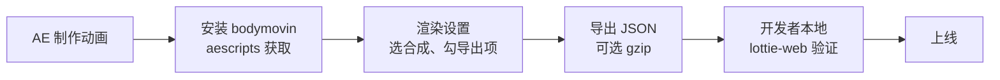

import { Meta } from '@storybook/addon-docs/blocks';

<Meta id="production-workflow" title="数据与工程化/制作流程" name="Docs" />

# 制作流程

开发者的职责边界是「接收 JSON 并正确播放」，但 JSON 是从 AE 经 bodymovin 翻译出来的结果：设计师在 AE 里预览一切正常的效果，翻译后可能缺失、降级，甚至导不出来。本课站在开发者视角讲清这条制作链路——动画怎么从 AE 走到你手里的 JSON、链路上哪里会出问题——并给出特性支持范围与一份双方协作清单。读完你能在动画落地前发现「设计稿效果做不出来」的问题，而不是上线后返工；AE 本身的操作是设计师的领域知识，本课不展开。



链路各环节的职责与交接物，出问题时按环节归位：

| 环节 | 负责 | 开发者关心什么 |
| --- | --- | --- |
| AE 制作 | 设计师 | 效果是否落在特性支持范围内 |
| 安装与导出 | 设计师 | 插件版本、导出选项、交付物形态 |
| JSON 交付 | 双方 | v 字段、images 目录是否成套 |
| 本地验证 | 开发者 | 能加载、效果一致、记录版本 |
| 上线 | 开发者 | 加载路径、传输压缩、资源可达 |

## bodymovin 导出流程

bodymovin 是 After Effects 的导出插件，也是这条管道的源头：它把 AE 合成翻译成 Lottie JSON，翻译规则决定了你手里的 JSON 长什么样。lottie-web 早期就叫 bodymovin，两者同源，但职责不同——插件负责「写出」，运行时负责「读出」。导出操作本身归设计师，开发者要掌握的是三件事：插件从哪来、版本怎么对应、哪些导出选项会改变交付物。

### 插件的获取与版本对应

获取只有一条官方渠道：

- 插件在 [aescripts 的 bodymovin 页面](https://aescripts.com/bodymovin/)分发，以 After Effects 扩展形式安装，页面标注的兼容范围从 AE CC 2014 到 2025。
- 核对最新版本以 lottie-web 仓库的 GitHub releases 为准——aescripts 页面的版本历史可能滞后。

版本对应记住三条判断：

1. JSON 的 `v` 字段就是导出插件的版本号，拿到交付物先看它（顶层字段地图见 [JSON 结构概览](?path=/docs/json-structure--docs)）。
2. 插件版本不等于运行时版本。两边按同一套格式规范对话，各自独立升级：lottie-web 用 npm 升级，不必等设计师换插件；设计师升级插件，也不要求你同步动运行时。
3. 「对版本」是排查的第一步：加载失败或效果缺失时，先确认设计师的插件版本（看 `v` 字段）与你的 lottie-web 版本，对齐版本重导一次，比盲目换运行时更快定位。

### 导出设置里开发者关心的选项

导出面板怎么点归设计师，但下面这些选项直接决定你拿到的文件，接需求时应该先约定：

| 选项 | 决定什么 | 协作要点 |
| --- | --- | --- |
| 目标合成 | 导出哪支动画，合成的时间范围就是 JSON 的 `ip` / `op` | 确认导出的是你验收的那支，避免同名不同版 |
| 图片导出方式 | 未转形状的图片与 AI 图层进 images 目录，或选 base64 内联进 JSON | 内联是单文件交付；不内联则 JSON + images 必须成对交付 |
| 压缩与精简 | 面板的压缩与体积精简设置，影响数值精度与文件体积 | 具体选项随插件版本变化，以面板为准 |
| 输出目录 | images 文件夹与 JSON 的相对位置 | JSON 按相对路径引用 images，交付后目录不能拆散 |

压缩分两个层次，别混淆：

- **文件压缩：** 导出阶段开启，交付物本身是压缩文件，加载侧与服务端都要配合解压处理，常规项目不默认走这条路。
- **传输压缩：** JSON 原样交付，服务端或 CDN 开 gzip 传输。这是 lottie-web 官方 README 建议的生产做法——对 JSON 和播放器脚本都开 gzip，体积收益明显，加载代码一行不改。

## 特性支持范围

「AE 能做」和「Lottie 能播」之间隔着 bodymovin 的翻译能力：它只支持 AE 特性的一个子集。两类典型事故——效果直接缺失（不支持）、效果走样（部分支持）。核对有固定顺序：先看 lottie-web README 的 AE Feature Support 一节，再查 aescripts 页面的 Supported Features（粒度更细），个别特性到 lottie-docs 对照格式定义。下表只给判断起点，标注「部分支持」的条目最终以官方说明与导出验证为准；5.7.0 起插件在导出时会报告不支持的特性，很多问题在导出阶段就能暴露，协作时让设计师留意这份报告。

| AE 特性 | 支持度 | 判断要点 |
| --- | --- | --- |
| 形状图层（路径、椭圆、星形、矩形） | 支持 | 矢量数据直接进 JSON，优先用它 |
| 填充、描边、渐变、虚线 | 支持 | 渐变填充与渐变描边均可导出 |
| 修剪路径（trim paths） | 部分支持 | 官方标注 partial，复杂剪裁导出验证 |
| 变换（位置、锚点、旋转、缩放、不透明度、skew） | 支持 | 位移动画的主干，最稳妥 |
| 预合成、固态层、空对象 | 支持 | 工程组织的常规手段都可用 |
| 蒙版（masks） | 部分支持 | 加法与反选可用，差值、减法仅部分情况 |
| 轨道遮罩（matte） | 部分支持 | 官方标注「新支持，Web 端可用」，canvas 与 svg 的历史差异明显 |
| 表达式 | 部分支持 | 只翻译子集且逐版本扩大，滑块可用，不支持的可用烘焙兜底 |
| 文本 | 大多数字体支持 | 可导出为形状，或导出为文本由端上加载字体；每个文本框限一种字体样式 |
| 摄像机 | 部分支持 | 3D 相机动画导出后逐个验证 |
| 特效 | 仅少数 | 官方列出 fill、pro levels、drop shadow、tint、tritone（svg/html 渲染器） |
| 图片序列、视频 | 不支持 | README 明确排除，含视频素材的合成导不出 |
| 音频层 | 较新版本支持 | aescripts 标注 AE 2019 起，播放端行为导出验证 |
| 负图层拉伸 | 不支持 | README 明确排除 |

表达式值得单独一句：AE 里大量动效靠表达式生成，但 bodymovin 只翻译它认识的表达式子集，这是「设计稿效果做不出来」的高频原因。两条出路：设计师改用关键帧实现等效效果，或在新版插件里对不支持的表达式做关键帧烘焙再导出——烘焙后的 JSON 不再依赖表达式，但导出前要人工确认烘焙结果与原效果一致。

同一份 JSON 换渲染器，表现也可能不同：渐变、matte 等特性的实现差异集中在 canvas 与 svg 之间，svg 支持面最全。交付前用目标渲染器验收；渲染器怎么选回看 [渲染器选型](?path=/docs/renderers--docs)。

## 协作清单

前两节的知识落到协作上就是两份清单：接需求时把约定交给设计师，交动画时按动作验收。清单按「出问题时各归谁」设计——约定没做到位，问题在制作端；验收没做，问题漏到线上。

### 给设计师的约定

| 约定 | 具体做法 | 为什么 |
| --- | --- | --- |
| 尺寸按 @1x | 用最终展示尺寸定合成大小，不留冗余画布，缩放交给端上 | 合成尺寸就是 JSON 的 `w` / `h`，画布冗余直接放大文件 |
| 帧率整支统一 | 与端上约定帧率（如 30 或 60fps），避免中途改合成帧率 | 帧率写入 JSON 的 `fr`，改帧率影响播放节奏与时长换算 |
| 图层可读命名 | 图层与合成用语义命名，不留「Shape Layer 17」这类默认名 | 图层名写入 JSON 的 `nm` 字段，是排错时的定位线索 |
| 素材矢量化 | 位图素材先「从矢量图层创建形状」，确需位图的再走图片导出 | 形状进 JSON 体积小、缩放清晰；位图要连带 images 目录交付 |
| 交付前收集素材 | 用 Collect Files 把图片、字体收进工程目录再导出 | 素材缺失会导致导出失败或运行时图片加载失败 |
| 避开未支持特性 | 特效、表达式、视频素材先导出验证，表达式可要求烘焙 | 见上文特性支持范围；上线后才发现就是返工 |
| 交付物成套 | 约定「JSON + images 目录」或内联单文件，成套打包发送 | JSON 单发、图片漏发是最高频的交接事故 |

### 开发者的验收动作

收到交付 JSON 后做三件事。

**1. 本地播放验证。** 用与生产一致的引入方式和目标渲染器加载 JSON，对照原设计核对效果；同时监听 `data_failed` 事件——图片资源缺失不会让动画整体报错，只会让对应元素空缺：

```js
import lottie from 'lottie-web';

// 验收播放：加载交付 JSON，记录运行时版本，监听资源加载失败
const animation = lottie.loadAnimation({
  container: document.querySelector('#animation'),
  renderer: 'svg', // 与上线渲染器保持一致
  loop: true,
  autoplay: true,
  path: './data.json',
});

console.log('lottie-web', lottie.version); // 写入交付记录
animation.addEventListener('data_failed', () => {
  console.error('资源加载失败：检查 images 目录与相对路径');
});
```

**2. Playground 快速验证。** 不搭环境时，把 JSON 拖进 lottie-web 官方 Playground 或上传 LottieFiles 预览：一眼核对整体效果，扫码在真机上看移动端表现；交付 zip 包时上传一份，还能顺带检查交付物是否成套。

**3. 版本记录。** 把 JSON 的 `v` 字段（导出插件版本）与验收时的 lottie-web 版本写进交付记录。出问题时它能回答两个高频疑问：这是版本不匹配，还是特性不支持——两者处理路径完全不同，前者对齐版本，后者回制作端改实现。

## 总结回顾

摘要：

本课沿「AE 制作 → 安装 bodymovin → 渲染设置 → 导出 JSON → 本地验证 → 上线」讲清制作链路。bodymovin 从 aescripts 获取，JSON 的 `v` 字段就是它的版本号；插件与 lottie-web 运行时职责分离、各自独立升级，排查问题先对版本。导出设置里，目标合成决定导出内容，图片导出方式决定交付物是「JSON + images 目录」还是内联单文件，压缩常规做法放在传输层。特性支持范围是「AE 能做」与「Lottie 能播」的落差：形状、变换、常规蒙版可用，修剪路径、matte、表达式只是部分支持，图片序列与视频不支持，拿不准就按「README → aescripts → lottie-docs」的顺序核对。最后是两份清单：给设计师的七条约定保证交付物可导出、成套；开发者的三个验收动作（本地验证、Playground 验证、版本记录）把问题拦在上线下。

一句话：

> 开发者的职责边界是「接收 JSON 并正确播放」，而理解导出链路与特性边界，是为了让「做不出来、导不出来」的问题在落地前暴露，而不是上线后返工。

知识要点：

- JSON 的 `v` 字段对应什么？插件版本与 lottie-web 版本是什么关系，出问题时先做什么？
- 导出设置里哪些选项决定交付物形态？两个层次的压缩分别在哪里起作用？
- 哪些 AE 特性导出后会缺失或走样？拿不准时按什么顺序核对官方说明？
- 表达式为什么是高频坑？不支持的表达式有哪两条处理路径？
- 给设计师的七条约定分别防什么问题？
- 收到新 JSON 后，开发者的三个验收动作是什么？

## 参考资料

- [airbnb/lottie-web](https://github.com/airbnb/lottie-web) — README 的插件安装说明、AE Feature Support 与 Events 各节，是特性清单与 `data_failed` 行为的一手依据。
- [bodymovin（aescripts）](https://aescripts.com/bodymovin/) — 插件官方分发页：Supported Features、版本历史、AE 兼容范围与不支持特性报告。
- [Lottie 格式文档（lottie-docs）](https://lottiefiles.github.io/lottie-docs/) — Lottie JSON 格式规范，个别特性的格式级对照。
- [使用 BodyMovin 和 Lottie 的避坑指南（站酷）](https://www.zcool.com.cn/article/ZOTk2MDgw.html) — 设计师视角的实战坑点：版本对应、素材矢量化、尺寸与上传验证习惯，协作清单的多个条目参考于此。
