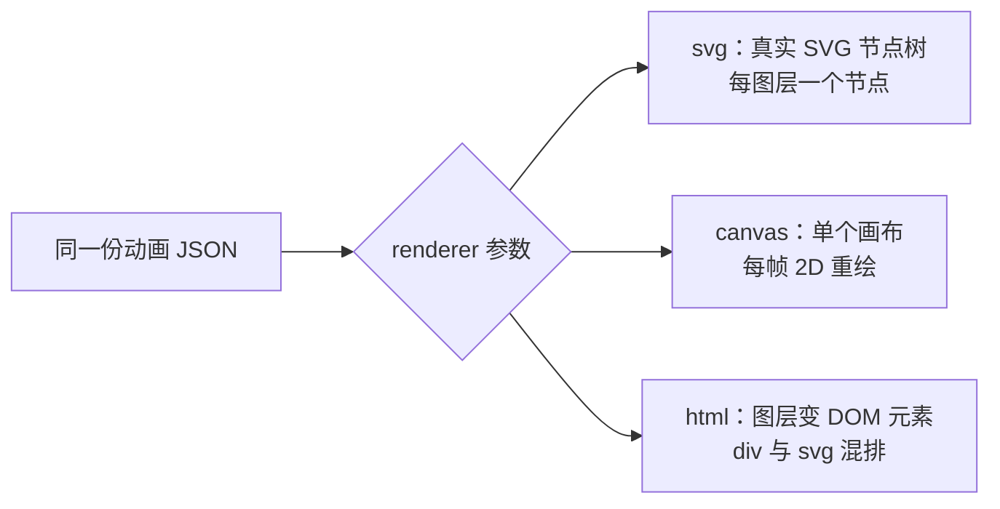

import { Canvas, Controls, Meta } from '@storybook/addon-docs/blocks';
import * as RenderersStories from './renderers.stories';

<Meta of={RenderersStories} name="Docs" />

# 渲染器选型

同一份 Lottie JSON，lottie-web 提供三种画到页面的方式：svg 把动画建成一棵真实的 SVG 节点树，canvas 在一块画布上逐帧重绘，html 把图层变成页面里的真实 DOM 元素。走哪条路由 `loadAnimation` 的 `renderer` 参数决定，不写时默认 `'svg'`。渲染器决定三件事——往页面里生成什么 DOM 结构、每帧怎么重画、效果能保真到什么程度——因此它直接决定动画在页面里的性能表现与可用功能范围。



三种渲染器的定位与关键回查点：

| `renderer` 取值 | 一句话定位 | 回查要点 |
| --- | --- | --- |
| `'svg'`（默认） | 保真首选：生成真实 SVG 节点，可交互、可样式化 | 节点数随图层数线性增长 |
| `'canvas'` | 性能首选：单画布逐帧重绘，无每图层 DOM | 投影、模糊等效果支持不全 |
| `'html'` | 混排专用：图层变真实 div，页面 CSS 可影响 | 效果能力与 canvas 相同，适用面最窄 |

创建时不传 `renderer`，lottie-web 按 `'svg'` 处理（`AnimationItem` 源码中 `var animType = 'svg'`）。选型直觉可以压成一句：svg 保真、canvas 提量、html 混排——下面逐个展开。

## svg 渲染器

svg 渲染器在容器里创建一个 `<svg>` 根元素：`viewBox` 对齐动画画布坐标，宽高设为 100% 跟随容器等比缩放；每个合成图层各占一个 `<g>` 节点，形状绘制为真实的 SVG 路径元素。整个动画就是一棵会动的 SVG DOM 树，结构可以在 DevTools 的 Elements 面板里直接看到（依据：`SVGRendererBase.js` 与 `SVGBaseElement.js`）。

```js
lottie.loadAnimation({
  container: document.getElementById('animation'),
  renderer: 'svg', // 不写时也是这个默认值
  path: 'renderers.json',
});
```

它是三个渲染器里**效果保真度最好**的一个：lottie-web 实现的 AE 效果——投影、高斯模糊、色调、三色调、色阶等——都以 SVG filter 的形式实现在 svg 渲染器里。同时节点是普通 DOM，可以把选择器命中某个图层去绑定 click 事件、用 CSS 覆写样式，这是「图层级交互」最顺手的方式。

边界在 DOM 开销：每个图层至少一个节点，图层越多节点越多，浏览器每帧都要更新并合成这棵树。单个精致动画没问题；几十个实例或单动画上百图层时，DOM 数量本身就成了瓶颈。

## canvas 渲染器

canvas 渲染器把整个动画压缩成一个 `<canvas>` 元素：渲染器每帧用 2D context 把所有图层重画一遍，图层不产生任何 DOM 节点——动画再复杂，页面里也只有这一个元素（依据：`CanvasRendererBase.js`）。

```js
lottie.loadAnimation({
  container: document.getElementById('animation'),
  renderer: 'canvas',
  rendererSettings: {
    // canvas 按位图绘制，高分屏上乘以 devicePixelRatio 保持清晰
    dpr: Math.min(window.devicePixelRatio || 1, 2),
  },
  path: 'renderers.json',
});
```

性能优势来自 DOM 恒定：节点数永远是 1，绘制成本与图层数相关但不进 DOM。同一页面挂几十个实例、或动画铺满大面积（列表批量、整屏背景、抽奖转盘）时，浏览器的 DOM 与合成压力远低于 svg 模式。

代价是功能限制：投影、高斯模糊、色调、色阶等 AE 效果只在 svg 渲染器里有实现（源码目录 `player/js/elements/svgElements/effects/`），canvas 渲染器的效果注册表目前只注册了变换效果（`player/js/elements/canvasElements/CVEffects.js`），遇到没有实现的效果会静默跳过。蒙版与 track matte 在 canvas 下是支持的——`CVMaskElement` 以 clip 实现，`CVBaseElement` 用离屏缓冲实现 matte——但具体模式的表现建议用实际素材验证。

一个专属于 canvas 的选项：省略 `container`、给 `rendererSettings` 传 `context`（只支持 `'2d'` context）时，lottie-web 不再创建自己的画布，直接把动画逐帧画进你提供的画布（源码分支 `this.canvasContext = this.renderConfig.context`）。需要把动画合成进自管画布或 WebGL 场景时用得上。

## html 渲染器

html 渲染器把每个图层变成一个真实的 DOM 元素（默认 `<div>`）：transform 与 opacity 直接写成该元素的 CSS style，形状内容仍以内嵌 `<svg>` 画在 div 里——DOM 与 SVG 混排（依据：`HBaseElement.js`）。图层数据里的 `ln` / `cl` 会写成元素的 id / class，页面选择器可以直接命中；反过来，页面里的全局 CSS 也会作用到图层上。

它是三者中唯一支持 3D 图层 transform 的渲染器：合成里含 3D 图层（导出数据 `ddd: 1`）时，渲染器会建立带 perspective 的 3D 容器（源码 `HybridRendererBase.js` 的 `supports3d` 与 matrix3d 变换），能还原 AE 里 3D 层的旋转透视——svg 渲染器只能平面呈现。

边界：效果能力与 canvas 一样只有有限的集合（html 渲染器直接复用 canvas 的效果实现）；外观受页面 CSS 干扰、行为依赖 DOM 与 CSS 引擎。除非明确需要「动画与页面元素混排」或「3D 图层透视」，否则优先考虑 svg / canvas。

## 选型对比

三个渲染器同看一张表：

| 维度 | svg | canvas | html |
| --- | --- | --- | --- |
| DOM 结构 | 一个 `<svg>`，每图层一个节点 | 一个 `<canvas>`，无每图层节点 | 每图层一个 `<div>`，内嵌 `<svg>` |
| 性能特征 | 节点随图层线性增长，适合少量动画 | DOM 恒为 1，适合大批量、大面积 | DOM + CSS 合成，能力受限 |
| 效果保真 | 最好：投影、模糊、色调等都有实现 | 部分效果缺失，未实现的静默跳过 | 与 canvas 相同的有限集合 |
| 交互能力 | 图层节点可选中、绑事件、CSS 覆写 | 画布整体交互，图层级需自算坐标 | 完全融入页面 DOM 与 CSS，支持 3D 图层 |
| 适用场景 | 默认选择：页面上的精致单动画 | 列表批量、整屏背景等高数量场景 | 与页面混排或 3D 透视的特例 |

下面用同一份自制动画（两个形状图层：橙色描边圆环 + 蓝色圆点，含 transform 与 trim path 关键帧）在三种渲染器间切换。「动画产生的 DOM 节点数」在每次 `DOMLoaded` 后统计容器内 lottie 创建的全部元素，数字背后就是上面说的 DOM 结构差异：

<Canvas of={RenderersStories.Renderers} />
<Controls of={RenderersStories.Renderers} />

| 读者操作 | 可观察证据 |
| --- | --- |
| renderer 从 svg 切到 canvas | 读数从十来个（svg 根、每图层节点与形状路径）变为 1，动画外观不变 |
| renderer 切到 html | 节点数变为每图层一个 div 加内嵌 svg 的组合，顶层从 SVG 元素变成普通 div |
| 任意切换 renderer | 动画都从第 0 帧重新播放——renderer 是创建参数，切换即销毁旧实例重建 |

表里「性能特征」一栏不给具体耗时读数：每帧绘制耗时随动画内容、设备与浏览器差异很大，小样本数字容易误导。本课用 DOM 结构差异作为可核对证据，绘制成本的评估方法在「性能优化」一课展开。

## 常见问题

- 同一个动画，canvas 模式下投影 / 模糊 / 色调等效果不见了，svg 模式正常。
  该效果超出了 canvas 渲染器的实现范围：这些效果只在 svg 渲染器里有 SVG filter 版本，canvas 的效果注册表只含变换效果，遇到会静默跳过。先用 svg 渲染器确认效果本身正常，再决定处理方式——该实例改用 svg，或让设计师在导出前把效果烘焙进形状 / 位图。若消失的是蒙版而非效果，canvas 是支持蒙版与 track matte 的，先检查素材导出是否正确。
- 同一页面挂了几十个 svg 动画实例，页面明显卡顿。
  svg 渲染器每个实例都是一棵独立的 DOM 子树，节点数随图层膨胀，浏览器每帧都要更新这些节点。把批量、小尺寸的实例换成 canvas 渲染器（每个实例只占一个画布元素），或复用同一实例、离屏暂停（见「性能优化」一课）。
- 切换 renderer 后动画没变化，或容器里出现残留内容。
  `renderer` 是 `loadAnimation` 的创建参数，不存在实例级的切换方法。先对旧实例调用 `destroy()` 并清空容器，再按新渲染器重新 `loadAnimation`——本课内嵌实例的切换正是这样做的，可打开 Show code 对照。

## 总结回顾

摘要：

本课围绕一个判断展开：`renderer` 决定 lottie 动画的 DOM 结构、性能特征与效果保真度。svg 是默认值与保真首选，在容器里生成一棵 SVG 节点树（每图层一个 `<g>`），节点可交互、可样式化，代价是节点随图层线性膨胀；canvas 用单个画布逐帧重绘，DOM 恒为一个元素，适合大批量、大面积场景，但投影、模糊、色调等效果只在 svg 渲染器实现，canvas 遇到会静默跳过；html 把图层变成真实 div（内嵌 svg 混排），页面 CSS 可影响图层、还支持 3D 图层透视，但效果能力与 canvas 相同，适用面最窄。`renderer` 是 `loadAnimation` 的创建参数，切换必须销毁旧实例重建。

一句话：

> svg 保真、canvas 提量、html 混排——先按效果保真筛掉不支持的渲染器，再按页面上的实例规模选 DOM 结构。

知识要点：

- `renderer` 的三个取值各自在容器里生成什么 DOM 结构？默认值是什么？
- 为什么 canvas 适合同一页面的大批量动画？它的功能代价是什么？
- 哪些 AE 效果在 canvas / html 渲染器下不可用，判断依据在源码的哪里？
- html 渲染器在什么情况下值得选（3D 图层、页面 CSS 混排）？
- 切换渲染器的正确步骤是什么？

## 参考资料

- [lottie-web 仓库 README](https://github.com/airbnb/lottie-web)
  `renderer` 的三个取值 `'svg' / 'canvas' / 'html'`，以及 `rendererSettings` 的 `context`、`preserveAspectRatio` 等选项说明。
- [AnimationItem 源码](https://github.com/airbnb/lottie-web/blob/master/player/js/animation/AnimationItem.js)
  `var animType = 'svg'`：`renderer` 默认值的实现依据。
- [SVGRendererBase 源码](https://github.com/airbnb/lottie-web/blob/master/player/js/renderers/SVGRendererBase.js)
  svg 根元素的 viewBox、宽高 100% 生成逻辑；[SVGBaseElement 源码](https://github.com/airbnb/lottie-web/blob/master/player/js/elements/svgElements/SVGBaseElement.js)中每图层一个 `<g>` 节点。
- [CanvasRendererBase 源码](https://github.com/airbnb/lottie-web/blob/master/player/js/renderers/CanvasRendererBase.js)
  单 `<canvas>` 创建、`rendererSettings.context` 直绘分支与 `dpr` 缩放的实现。
- [SVG 效果实现目录](https://github.com/airbnb/lottie-web/tree/master/player/js/elements/svgElements/effects)
  投影、高斯模糊、色调、三色调、色阶等效果的 SVG filter 实现；canvas / html 渲染器没有对应实现（对照 [CVEffects 源码](https://github.com/airbnb/lottie-web/blob/master/player/js/elements/canvasElements/CVEffects.js)）。
- [HybridRendererBase 源码](https://github.com/airbnb/lottie-web/blob/master/player/js/renderers/HybridRendererBase.js)
  html 渲染器的 3D 容器（`supports3d`、matrix3d）；[HBaseElement 源码](https://github.com/airbnb/lottie-web/blob/master/player/js/elements/htmlElements/HBaseElement.js)中图层 div、CSS transform 与内嵌 svg 的混排结构。
