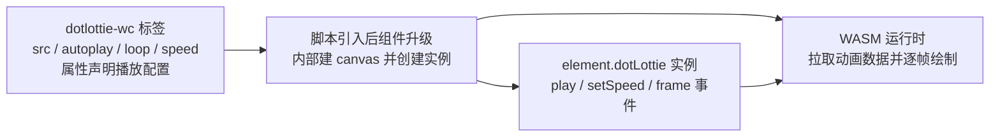

import { Canvas, Controls, Meta } from '@storybook/addon-docs/blocks';
import * as WebComponentsStories from './web-components.stories';

<Meta of={WebComponentsStories} name="Docs" />

# 播放器组件

「[第一次播放](?path=/docs/first-animation--docs)」一课的路线是「引入脚本 + 手写一次 `lottie.loadAnimation(...)`」；本课换成另一条路线：Web Component 播放器把注册自定义元素、建画布、拉数据、逐帧绘制全部封装进一个标签，播放配置写在 HTML 属性上，一行 JS 不写也能上线。代价同样清楚：控制能力受组件 API 面约束。核心判断先行——`@lottiefiles/lottie-player` 仓库已于 2026-06-20 归档只读、README 标注弃维护，官方指定的继任者是 dotlottie-web 仓库的 `@lottiefiles/dotlottie-wc`：存量项目可以继续用，新项目直接从 dotlottie-wc 起步。



两个播放器组件速查（状态 × 定位，回查入口）：

| 组件 | 标签 | npm 包 | 状态 | 定位 |
| --- | --- | --- | --- | --- |
| lottie-player | `<lottie-player>` | `@lottiefiles/lottie-player` | 仓库 2026-06-20 起归档只读，弃维护 | 存量项目维护 |
| dotlottie-wc | `<dotlottie-wc>` | `@lottiefiles/dotlottie-wc` | 活跃，官方指定的继任者 | 新项目首选 |

## lottie-player 的现状

LottieFiles/lottie-player 仓库于 2026-06-20 起归档只读，README 开头明确标注 deprecated、不再维护，并把 `<dotlottie-wc>`（npm 包 `@lottiefiles/dotlottie-wc`，来自 dotlottie-web 仓库）列为官方替代。4.1 课用过的 lottie-interactivity 与它是同一批归档的。

归档改变的是维护，不是可用性：

- 仓库转只读：不再接受 issue 与 PR，不再修 bug，没有安全更新；
- npm 包与 unpkg 产物仍在：已上线的 `<lottie-player>` 页面会继续正常播放；
- 求助渠道收窄：新问题官方不再处理，只能社区互助或自行 fork。

存量项目按「能跑就不动」处理：把迁移排进常规迭代，而不是紧急抢修；期间遇到组件 bug 只能绕过或 fork；新功能一律落在新的技术栈上。

迁移方向就是换到 dotlottie-wc：标签名与脚本地址换掉（下节展开），底层渲染引擎从 lottie-web（纯 JS）换成 Rust + WASM 运行时，播放行为细节可能有差异——迁移后把站内动画过一遍回归清单，逐项属性对照见「常见问题」。

## dotlottie-wc 上手

一个 module 脚本注册自定义元素，之后 `<dotlottie-wc>` 标签本身就是完整播放器。与 `loadAnimation` 的三要素对照：渲染到哪由标签自身承担（内部画布铺满标签），画什么是 `src`，怎么开始是 `autoplay` / `loop`——三要素从 JS 调用参数变成了标签属性。

CDN 引入（官方 README 写法）：

```html
<!-- 组件标签：播放配置全部写在属性上 -->
<dotlottie-wc
  src="web-components.json"
  autoplay
  loop
  style="width: 320px; aspect-ratio: 15 / 8;"
>
</dotlottie-wc>

<!-- module 脚本：注册 <dotlottie-wc> 自定义元素，写在标签前后都可以 -->
<script
  type="module"
  src="https://unpkg.com/@lottiefiles/dotlottie-wc@latest/dist/dotlottie-wc.js"
></script>
```

四个要点：

- 脚本是 `type="module"`，先写标签后引脚本也能工作——脚本执行后会对页面上已存在的标签做「升级」，这是 custom element 的标准行为；
- 组件宿主默认 `display: block`，内部画布铺满宿主，**必须给标签明确的宽度与高度**（或用 `aspect-ratio` 定高），高度塌陷时页面一片空白；
- `src` 既接受 Lottie JSON（.json）也接受 dotLottie 打包（.lottie），运行时怎么区分见「常见问题」；
- 构建工具项目改用 npm：`npm install @lottiefiles/dotlottie-wc` 后 `import '@lottiefiles/dotlottie-wc';`。

### 核心属性

常用属性一览（默认值核对自组件源码的回退逻辑）：

| 属性 | 类型 | 默认 | 作用 |
| --- | --- | --- | --- |
| `src` | string | 无（必填） | 动画 URL，.json 与 .lottie 都可以 |
| `autoplay` | boolean | 关 | 数据就绪后自动播放；加载期配置，热切换无效，改了要重建元素 |
| `loop` | boolean | 关 | 循环播放；可热更新 |
| `speed` | number | `1` | 播放速度倍率；可热更新 |
| `mode` | string | `'forward'` | 播放方向模式：`'forward'` 正播、`'bounce'` 到头往返 |
| `segment` | Array | 无 | 播放区间 `[起始帧, 结束帧]`，对应 lottie-web 的 `playSegments` |
| `background-color` | string | 空（不绘制背景） | 背景色，只认 6 位或 8 位 hex（如 `#000000FF`） |
| `data` | string | 无 | 内联动画数据，与 `src` 二选一；.lottie 的 ArrayBuffer 用 JS 属性赋值 |

两点边界：

- 属性是「活」的：组件就绪后读取会直达播放器，写入会转发给播放器——`loop`、`speed` 这类热更新就靠它；结构型属性（`segment`、`renderConfig`）在 JS 里直接给元素属性赋值更稳妥；
- 但**改 `src` 或 `data` 重新加载时，一切回到标签里声明的值**：先热改 `speed` 再换 `src`，速度会被 markup 里的声明覆盖。

### 实例方法与事件

标签属性只解决「怎么播」；播放中改东西要拿实例：`element.dotLottie` 指向内部的 DotLottie 实例（组件就绪前是 `null`），方法名与 lottie-web 的 AnimationItem 高度同款：

| 实例成员 | 作用 |
| --- | --- |
| `play()` / `pause()` / `stop()` | 播放、暂停、停止 |
| `setFrame(frame)` | 跳到指定帧（对应 lottie-web 的 `goToAndStop`） |
| `setSpeed(n)` / `setLoop(bool)` | 热改速度与循环 |
| `setSegment(start, end)` / `resetSegment()` | 限定播放区间与解除，对应 `playSegments` |
| `setMode('forward' \| 'bounce')` | 切换正播 / 往返 |
| `currentFrame` / `totalFrames` / `isPaused` / `isLoaded` | 状态读数 |
| `destroy()` | 销毁实例、释放运行时资源 |

事件也在实例上：组件不向 DOM 派发事件，`addEventListener` 挂在 `element.dotLottie` 上。常用事件：`load`、`loadError`、`play`、`pause`、`stop`、`frame`（载荷携带 `currentFrame`）、`loop`（载荷携带 `loopCount`）、`complete`。

下面的实例把两套控制面接进同一只动画：橙色圆角方块（课程自制 30fps、90 帧动画：从左行进一整趟，同时旋转一圈）。切 `autoplay` 会**重建组件元素**（加载期参数），切 `loop`、拖 `speed` 则通过实例方法**热更新**。前置状态：组件脚本与 WASM 运行时都来自公共 CDN，需要网络可达（与「第一次播放」的 CDN 引入同条件）：

<Canvas of={WebComponentsStories.Player} />
<Controls of={WebComponentsStories.Player} />

| 读者操作 | 可观察证据 |
| --- | --- |
| 关掉 `autoplay` | 重建后的方块静止在初始画面，读数「已暂停」；再打开立即播放 |
| 关掉 `loop` | 不重建：播完第 90 帧停在「已暂停」，「已循环次数」不再增加 |
| 拖动 `speed` | 「播放速度」读数同步变化，方块明显加速或减速，画面不中断 |
| 打开 Show code | 看到该 Canvas 实际执行的 `web-components.ts` |

读数全部来自实例事件：`frame` 携带当前帧、`loop` 标记一轮播完、播放状态读 `isPaused`——挂接时机与「事件与生命周期」一课同一套思路。文档页的资源地址经打包器改名，范例里 `src` 用 `new URL(...)` 从模块位置解析出真实地址；普通页面直接写相对路径。

## 与直接用 lottie-web 的取舍

两条路线装配的是不同的东西：组件把「加载 + 画布 + 控制」封装成一个标签；lottie-web 给你一个全量 API 的动画实例，装配由自己动手。

| 维度 | 播放器组件（dotlottie-wc） | lottie-web 直接加载 |
| --- | --- | --- |
| 接入成本 | 一个标签，零 JS 上线 | 手写 `loadAnimation` 与容器管理 |
| 控制面 | 标签属性 + `element.dotLottie` 实例 | 完整实例 API 与事件全表 |
| 渲染 | 内部画布一种（WASM 运行时绘制） | svg / canvas / html 三种渲染器任选 |
| 倒放 | 无 `setDirection`，往返靠 `mode: 'bounce'` | `setDirection` 原生支持 |
| 运行时 | 额外下载 WASM（可经 `setWasmUrl` 自托管） | 纯 JS，无额外运行时 |
| 内置 UI | 无——lottie-player 的 `controls` 控制条没有继任 | 无，全部自建 |

选择判断：

- 官网装饰、落地页、内容站嵌入这类「播出来就行」的场景 → 组件：声明式上线，加载与销毁都不用操心；
- 需要 SVG 输出、帧级精确控制、交互驱动（4.1 课的玩法），或页面里已有 lottie-web → 直接加载；
- 组件的省心想要、API 面又不够用 → 用 dotlottie-web 的核心 `DotLottie` 类：组件正是它的薄封装，画布自管、API 全量——归入「dotLottie 与新运行时」一课的范围。

## 常见问题

- `<dotlottie-wc>` 放在页面上什么都不显示，控制台也不报错。
  先查尺寸：组件宿主是 `display: block` 的空块，没给宽高时高度塌陷为 0，和「第一次播放」的空容器是同一类问题。再开 Network 面板核对三样请求：module 脚本、`src` 指向的动画文件、WASM 运行时文件，哪个失败补哪个；在实例上监听 `loadError` 可以把「加载失败」和「压根没渲染」区分开。
- 把 `.json` 改名成 `.lottie`（或反过来）会不会播不了？
  不会——运行时按内容识别，不看扩展名：数据开头是 ZIP 魔数就按 dotLottie 包解包，否则按 Lottie JSON 解析。真正的差异在包里有什么：.json 只有动画数据本身，图片、字体要另行请求；.lottie 把动画和资源打成一个小体积 ZIP，一次请求全部带上。打包格式的细节归「dotLottie 与新运行时」一课。
- 从 lottie-player 迁移，属性怎么对照？
  `src` / `autoplay` / `loop` / `speed` 同名可用；`mode="normal"` 改成 `mode="forward"`；`background` 改成 `background-color`，且只认 6 位或 8 位 hex；`controls` 与 `direction` 没有对应属性——前者说明 dotlottie-wc 不带内置控制条，控制 UI 用实例方法自建，后者说明新运行时没有 `setDirection`，往返播放用 `mode="bounce"`。

## 总结回顾

摘要：

本课沿「标签式播放器」这条路线对比了两个组件：lottie-player 仓库 2026-06-20 起归档只读、弃维护，但 npm 包与线上页面继续可用，存量项目按「能跑就不动」处理；继任者 dotlottie-wc 用一个 module 脚本注册自定义元素，之后 `src`、`autoplay`、`loop`、`speed`、`mode` 等属性写在标签上即可播放，前提是给宿主明确的宽高。控制分两套面：标签属性负责声明配置（`autoplay` 是加载期参数，切换要重建元素；改 `src` 重载会回到 markup 声明值），`element.dotLottie` 实例负责播放中的修改——`play` / `setFrame` / `setSpeed` / `setLoop` 等方法与 lottie-web 的 AnimationItem 同款，事件（`frame`、`loop`、`loadError` 等）也全部挂在这个实例上。与直接用 lottie-web 的分工：播出来就行的场景选组件，帧级控制与交互驱动选 lottie-web，两头都要就用组件背后的 `DotLottie` 核心类。

一句话：

> 组件用标签属性声明「怎么播」，用 `element.dotLottie` 实例解决「播的时候要改」；lottie-player 已归档，新项目选 dotlottie-wc，老项目按属性对照迁移。

知识要点：

- 两个播放器组件哪个已归档、继任者是谁、归档对存量项目意味着什么？
- dotlottie-wc 怎么用 CDN 引入？标签要满足什么尺寸条件？
- 常用属性有哪些？哪些能热更新、哪些是加载期参数（autoplay 为什么切换要重建）？
- 怎么拿到组件实例？常用方法与事件分别挂在哪？
- 组件与直接用 lottie-web 各适合什么场景？
- `src` 的 .json 与 .lottie 怎么被区分？两者差异是什么？
- 从 lottie-player 迁移，哪些属性有变化、哪些没有对应？

## 参考资料

- [dotlottie-web 仓库 README](https://github.com/lottiefiles/dotlottie-web)
  CDN 引入写法、包家族（wc / react / vue / svelte 等）与 WASM 运行时说明。
- [dotlottie-wc 包 README](https://github.com/lottiefiles/dotlottie-web/blob/main/packages/wc/README.md)
  属性表、`element.dotLottie` 实例入口、改 `src` 重载回到 markup 声明值的活属性语义、`setWasmUrl` 自托管。
- [@lottiefiles/lottie-player 仓库](https://github.com/LottieFiles/lottie-player)
  归档与弃维护声明、指向 dotlottie-wc 的迁移指引。
- [docs.lottiefiles.com：lottie-player](https://docs.lottiefiles.com/lottie-player/)
  lottie-player 的属性文档，迁移对照表中 `controls`、`direction`、`background` 的依据。
- [第一次播放（1.2）](?path=/docs/first-animation--docs)
  本课对照的前课：`loadAnimation` 三要素与容器尺寸塌陷的排查思路。
- [DotLottie 类源码（dotlottie-web/packages/web）](https://github.com/lottiefiles/dotlottie-web/blob/main/packages/web/src/dotlottie.ts)
  实例方法、状态 getter 与事件载荷（`frame` / `loop` / `loadError`）的核对依据；`src` 按内容（ZIP 魔数）识别格式的实现位置。
