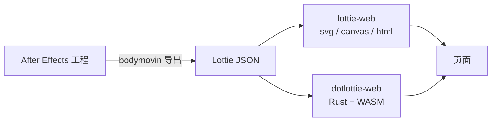

import { Meta } from '@storybook/addon-docs/blocks';

<Meta id="what-is-lottie" title="认识与上手/什么是 Lottie" name="Docs" />

# 什么是 Lottie

Lottie 是 Airbnb 在 2017 年开源的动画方案，核心是一条管道：设计师在 After Effects 里制作动画，bodymovin 插件把合成导出成一份 Lottie JSON，各端运行时读取这份 JSON，在页面上逐帧重算并渲染。文件里存的不是画面，而是「动画的描述」——这是 Lottie 与 GIF、视频最本质的区别。本课建立这条链路的全景认知，读完你能说清一条动画从设计稿到页面的完整路径，动画出问题时也能判断该找制作端、运行时还是格式。

整条链路的参与者按环节分工，先混个脸熟，后文逐一展开：

| 角色 | 是什么 | 所处环节 |
| --- | --- | --- |
| bodymovin | After Effects 导出插件，把合成翻译成 Lottie JSON | 制作端 |
| lottie-web | Airbnb 的 Web 运行时，JS 逐帧重算，用 svg / canvas / html 渲染 | 运行时 |
| lottie-player | `<lottie-player>` 播放器组件，仓库已归档，不再演进 | 播放器（已归档） |
| dotlottie-wc | 继任播放器组件 `<dotlottie>`，构建在 dotlottie-web 之上 | 播放器 |
| dotLottie 格式 | `.lottie` 打包格式：ZIP 容器收纳动画 JSON、素材与清单 | 格式 |
| LottieFiles | 动画托管、预览、转换与协作平台 | 平台 |
| lottie-docs | Lottie JSON 格式的开放规范文档 | 格式规范 |

## 工作原理

**为什么用 JSON 描述动画。** GIF 和视频把每一帧都烧成位图：文件大、放大会糊、播放完全不可控。Lottie 反过来——文件只记录「该怎么动」，每一帧画面由播放方的运行时现场计算。动画因此变成一份数据：任何实现了运行时的平台都能播放它，代码也能随意操控它。

**导出物里有什么。** bodymovin 把 AE 合成翻译成一份 JSON：

- 全局帧信息：帧率、起止帧、画布宽高；
- 图层列表：对应 AE 的图层结构，每个图层带类型（形状、图片、空对象、预合成等）；
- 每层的属性与关键帧：位置、缩放、旋转、不透明度等变换，以及它们在各时间点的取值；
- 形状路径与引用资源：矢量路径数据，引用的图片、字体等 assets。

JSON 里只有结构和数值，没有任何「怎么画」的代码。顶层字段的完整地图在「JSON 结构概览」一课展开，那课为调试排错服务。

**运行时按帧重算并渲染。** 运行时（如 lottie-web）加载 JSON 后循环做三件事：按当前时间找到相邻关键帧，插值算出此刻各属性的值；把整棵图层树用 SVG、Canvas 或 DOM 绘制出来；进入下一帧重复。动画就是这条循环跑出来的。

这套设计带来三个直接结果：

- **文件小：** 只存关键帧而非每帧画面，JSON 是纯文本，通常明显小于同画面的 GIF。
- **缩放不失真：** 描述是矢量的，任意分辨率下都由运行时重绘。
- **播放可编程：** 动画是数据，代码可以变速、反向、跳帧、按交互驱动——GIF 和视频做不到。

代价是渲染开销落在客户端：插值和重绘逐帧进行，图层越多、关键帧越密，CPU 开销越高。

## 生态角色

一条动画的生命周期分制作、渲染、分发三个环节，每个环节由不同工具承担。排查问题按环节定位：动画缺效果或形状不对，找制作端；能加载但播放、性能异常，找运行时；文件加载失败或资源丢失，先查格式与资源组织。

### 制作端：bodymovin 与 After Effects

- bodymovin 是 After Effects 的导出插件，把 AE 合成里的图层、属性、关键帧翻译成 Lottie JSON。lottie-web 早期就叫 bodymovin，旧文章里两个名字常混用。
- 这一端由设计师负责，也决定能力上限：AE 特性并非全部支持，部分效果、表达式和第三方插件导出后会丢失或降级。开发者拿到「页面播放正常但效果不对」的动画时，问题多半出在这一端，换运行时没有用。
- 开发者不需要会操作 AE，但需要能验收导出物：JSON 能否加载、缺哪些效果、体积是否可接受。完整导出流程与协作注意点在「制作流程」一课展开。

### 运行时：lottie-web 与 dotlottie-web

运行时负责「拿 JSON、算帧、画画面」，是开发者直接打交道的环节。Web 端有两个：

- **lottie-web**：事实标准，纯 JavaScript 实现。解析 JSON 后逐帧插值，经三种渲染器输出——svg（默认）、canvas、html。特性覆盖最全，现有动画素材基本以它为兼容基准。
- **dotlottie-web**：新一代运行时，核心用 Rust 编写、编译成 WASM 在浏览器里执行，把插值和渲染的重活从 JS 移进 WASM。对外提供 Web Components 和主流框架封装，定位是高复杂度、多实例场景下的性能方案。

选择判断：常规页面动画从 lottie-web 开始，生态与兼容性最稳；当动画数量多、复杂度高、JS 帧率撑不住时，再评估 dotlottie-web。

### 播放器与格式：lottie-player、dotlottie-wc 与 .lottie

- **lottie-player（已归档）**：LottieFiles 曾把运行时包成 `<lottie-player>` 标签，「一行 HTML 就能播」。该仓库已归档、不再演进，官方继任者是 dotlottie-wc。旧项目里见到它不急于迁移，新项目不要再用。
- **dotlottie-wc（继任者）**：`<dotlottie>` 组件，构建在 dotlottie-web 运行时之上，延续「标签化播放」的用法，不需要自己写 loadAnimation 调用。
- **dotLottie 格式**：`.lottie` 文件本质是个 ZIP 包，把动画 JSON、图片字体资源、清单信息打成一个文件。它解决裸 JSON 的分发痛点：资源不用散落多个文件、引用路径不会断、压缩率更高。播放器组件可以直接加载 `.lottie`。

## 与其他方案的位置

Lottie 不是所有动画的答案。选型时它常和下面几类方案被放在一起比较：

| 方案 | 与 Lottie 的关键差异 | 各自的位置 |
| --- | --- | --- |
| GIF / 视频 | 位图逐帧对比关键帧描述 | 真实影像用视频；界面动效用 Lottie |
| CSS 动画 / SMIL | 表达能力限于过渡与简单属性动画 | 界面状态过渡用 CSS；复杂合成动画用 Lottie |
| Rive | 自有编辑器与状态机运行时，不走 AE | 强交互的角色与界面动画 |
| SVGA | 把 AE 动画栅格化成位图序列播放 | 兼容性优先、效果复杂的运营场景 |

- **对 GIF / 视频：** Lottie 只存关键帧描述，体积通常明显更小，矢量任意缩放、支持透明背景，播放由代码控制；代价是播放端要跑运行时。真实拍摄的影像只能用视频，这不是 Lottie 的赛道。
- **对 CSS / SMIL：** CSS 适合界面状态之间的过渡，SMIL 能在 SVG 内部做动画但表达力和工具链都有限；AE 里的遮罩、蒙版、形状图层、渐变、表达式等复杂合成超出它们的能力范围，这正是 Lottie 的主战场。
- **对 Rive / SVGA：** Rive 用自家编辑器制作，主打状态机驱动的交互动画，脱离 AE 工作流；SVGA 把 AE 动画转成位图包，播放兼容性好，代价是体积和清晰度。两者与 Lottie 是并列选型，本手册不展开。

## 总结回顾

摘要：

本课沿「After Effects 工程 → bodymovin 导出 → Lottie JSON → 运行时渲染 → 页面」建立 Lottie 全景。JSON 里只有动画描述——帧信息、图层、变换与关键帧——运行时逐帧插值并重绘，因此文件小、缩放不失真、播放可编程，代价是渲染开销落在客户端。生态按环节分工：制作端 bodymovin 决定能力边界；运行时 lottie-web（JS 逐帧重算）是事实标准，dotlottie-web（Rust + WASM）面向高性能场景；播放器组件 lottie-player 已归档，由 dotlottie-wc 继任；`.lottie` 打包格式解决资源打包分发。与 GIF/视频、CSS/SMIL、Rive/SVGA 相比，Lottie 的位置是「AE 复杂动画在 Web 端的原生播放」。

一句话：

> Lottie 是「AE 动画 → JSON 描述 → 各端运行时渲染」的管道，出问题时先按环节定位：缺效果找制作端，播放异常找运行时，文件异常找格式。

知识要点：

- 一条 Lottie 动画从设计到页面经过哪些环节，每个环节的工具和产物是什么？
- Lottie JSON 里存什么、不存什么？运行时靠什么让动画动起来？
- 「描述而非画面」带来哪三个直接结果？代价是什么？
- lottie-web 和 dotlottie-web 的定位差异是什么，分别什么时候选？
- lottie-player 为什么不该在新项目使用，继任者是谁？`.lottie` 格式解决了什么？
- 与 GIF、CSS 动画、Rive、SVGA 相比，Lottie 适合什么、不适合什么？

## 参考资料

- [airbnb/lottie-web](https://github.com/airbnb/lottie-web) — Web 运行时官方仓库，README 覆盖引入方式与 svg / canvas / html 三种渲染器。
- [Lottie 格式文档（lottie-docs）](https://lottiefiles.github.io/lottie-docs/) — Lottie JSON 格式规范总入口。
- [Lottie Specs](https://lottie.github.io) — 开放规范组织站点，格式演进与 JSON Schema。
- [LottieFiles 开发者文档](https://docs.lottiefiles.com) — 播放器组件与 dotLottie 工具链的文档总站。
- [dotLottie](https://dotlottie.io) — `.lottie` 打包格式与新一代运行时的官方站点。
