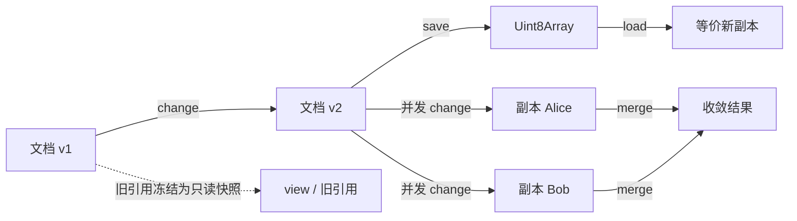

import { Canvas, Controls, Meta } from '@storybook/addon-docs/blocks';
import * as ChangesAndMerging from './changes-and-merging.stories';

<Meta of={ChangesAndMerging} name="Docs" />

# 变更、快照与合并

前面的最小闭环里已经用过一次 `change`，本课把「写一个 Automerge 文档」完整拆开：`change` 如何把一批修改打包成一条变更记录、旧文档引用为什么变成了只读快照、文档如何与二进制互相转换、两个副本并发编辑后怎样收敛到同一结果，以及如何逐条检查变更历史。

一条主线贯穿全课：**Automerge 文档是不可变值**。所有写操作（`change`、`merge`、`load`）都返回新的文档值，而不是原地修改。下面四个交互实例分别对应这四件事，调节控件即可复现正文里的每一条结论。



## 快速上手

一段代码走完「变更 - 快照 - 合并 - 检查」的完整闭环，细节在各主题小节展开：

```ts
import * as A from '@automerge/automerge';

// 1) change：可变语法，产生新文档
const doc1 = A.from({ todos: ['买牛奶'] }, 'a1a1a1a1a1a1a1a1a1a1a1a1a1a1a1a1');
const doc2 = A.change(doc1, '加一条待办', (d) => {
  d.todos.push('写周报');
});
doc1.todos; // ['买牛奶']           —— 旧引用仍读旧时点
doc2.todos; // ['买牛奶', '写周报']

// 2) save/load：二进制快照往返
const copy = A.load(A.save(doc2));
A.equals(doc2, copy); // true

// 3) fork + merge：两副本并发修改后收敛
const alice = A.change(
  A.clone(copy, 'a1a1a1a1a1a1a1a1a1a1a1a1a1a1a1a1'),
  (d) => {
    d.todos.push('Alice 的待办');
  },
);
const bob = A.change(
  A.clone(copy, 'b2b2b2b2b2b2b2b2b2b2b2b2b2b2b2b2'),
  (d) => {
    d.todos.push('Bob 的待办');
  },
);
const merged = A.merge(alice, bob);
merged.todos; // 两条新待办都在，与合并顺序无关

// 4) 历史检查：当前头 + 任意时点
A.getHeads(merged); // 变更哈希数组，指向最新时点
A.view(merged, A.getHeads(doc2)).todos; // 回到合并前的时点
```

## 用 change 回调建模变更

### 文档是不可变值，回调里是可变代理

`change` 的回调拿到的不是原文档，而是一个可变代理（proxy）：在回调里像改普通对象一样直接赋值，退出回调后这批修改被打包成一条变更记录，作用在旧文档上产生并返回一个新文档。原文档不会被修改——它从此代表「变更之前的时点」。

```ts
import * as A from '@automerge/automerge';

// v3 起 actor ID 必须是合法 hex 字符串，传 'alice' 会直接抛错
const doc1 = A.from({ count: 0, note: '' }, 'a1a1a1a1a1a1a1a1a1a1a1a1a1a1a1a1');

const doc2 = A.change(doc1, '加一', (d) => {
  d.count += 1; // 回调里直接改代理
});
doc1.count; // 0 —— 旧引用读到的仍是旧值
doc2.count; // 1 —— 只有新文档包含这批修改
doc1 === doc2; // false —— change 返回新文档
```

第二个参数除了回调，还可以传字符串（作为变更 message）或选项对象。message 和 time（单位是秒）会写进变更记录，供历史检查时阅读：

```ts
const doc3 = A.change(
  doc2,
  { message: '修复计数', time: 1_640_995_200 },
  (d) => {
    d.count += 10;
  },
);
```

### 旧引用自动过期：快照、view 与 clone

`change` 之后，旧引用仍然可读，读到的是它对应的旧时点——相当于一份免费生成的只读快照。但它不能再被写入：对旧引用（或 `view` 的结果）调用 `change` 会直接抛错，错误信息明确提示需要 clone。

```ts
const heads1 = A.getHeads(doc1); // 记住旧时点
const snapshot = A.view(doc2, heads1); // 廉价的只读视图
snapshot.count; // 0 —— 免费读到旧时点

A.change(doc1, () => {});
// RangeError: Attempting to change an outdated document.
//   Use Automerge.clone() if you wish to make a writable copy.

const writable = A.clone(doc2, 'a2a2a2a2a2a2a2a2a2a2a2a2a2a2a2a2'); // 可写副本
const forked = A.change(writable, (d) => {
  d.note = 'forked';
}); // 正常写入，且换上了新的 actor ID
```

三者的分工：旧引用和 `view(doc, heads)` 只用来读，几乎零成本；`clone` 复制出可继续编辑的文档，代价是生成新的 actor 身份。

### 空变更、回滚与嵌套限制

三条边界语义，交互实例里都能复现：

- **没有实际修改就不产生变更**：空回调或赋相同值时，`change` 返回同一个文档引用，也不留下变更记录。确实需要记一条空变更（例如作为签名锚点）时，用 `A.emptyChange(doc, message)`。
- **回调抛错自动回滚**：回调内抛出的异常会原样向外抛，未完成的修改被回滚，文档保持原状、不留下半条变更，之后可以继续正常编辑。
- **回调不能嵌套**：不要在 `change` 回调里再调用 `change`，会直接抛错。一次回调就是一条变更。

<Canvas of={ChangesAndMerging.ChangeLab} />

<Controls of={ChangesAndMerging.ChangeLab} />

| 读者操作 | 可观察证据 |
| --- | --- |
| 切换「场景」 | 画布日志与读数随之变化：基础变更显示新旧文档分离；过期快照显示 view 读旧值、clone 后可写；空变更显示同一引用；回滚显示文档原状保留 |
| 打开 Show code | 看到该 Canvas 实际执行的 `example-change.ts` |

## 二进制快照：save 与 load

### 往返：save 出字节，load 还原

`save` 把文档连同它的全部变更历史压缩成一个 `Uint8Array`，`load` 从字节还原出等价文档。这是 Automerge 落盘和传输的基本形态：值层面完全相等，历史原样保留。

```ts
const bytes = A.save(doc2); // Uint8Array，含全部历史
const copy = A.load(bytes); // 还原文档
A.equals(doc2, copy); // true —— 值完全一致
```

`equals` 比较的是文档值，不看副本身份。还原文档可以直接继续编辑，与任何其他副本合并。

### 新身份与增量格式

两个值得知道的边界：

- **身份属于副本，不随字节走**：`load` 不带第二个参数时会生成一个新的随机 actor ID。同一份字节加载两次，就得到两个身份不同的副本。
- **增量格式**：`saveIncremental` 只编码尚未保存过的部分，配 `loadIncremental` 追加到已有文档上，适合流式场景；日常整存整取用 `save` / `load` 就够了。另外，`load` 遇到不完整的字节会直接抛错，网络分片接收时可改用 `init` 加 `loadIncremental` 逐步喂入。

<Canvas of={ChangesAndMerging.SnapshotLab} />

<Controls of={ChangesAndMerging.SnapshotLab} />

| 读者操作 | 可观察证据 |
| --- | --- |
| 修改「新增待办」 | 保存字节数、往返 equals、actorId 对比与增量字节数同步刷新 |
| 打开 Show code | 看到该 Canvas 实际执行的 `example-snapshot.ts` |

## 并发修改与 merge 收敛

### merge 让分叉收敛成同一结果

两个副本从同一状态各自 `change` 就产生了分叉。`merge(local, remote)` 把 remote 的变更并入 local，返回合并后的新文档。Automerge 保证收敛：只要两边最终拥有相同的变更集合，不管以什么顺序、经过几轮合并，得到的文档值都相同。

```ts
const base = A.from({ n: 0 });
const a = A.clone(base, 'a1a1a1a1a1a1a1a1a1a1a1a1a1a1a1a1');
const b = A.clone(base, 'b2b2b2b2b2b2b2b2b2b2b2b2b2b2b2b2');
const a2 = A.change(a, (d) => {
  d.n = 3;
});
const b2 = A.change(b, (d) => {
  d.n = 7;
}); // 两副本并发分叉

const m1 = A.merge(a2, b2); // A 合入 B
const m2 = A.merge(b2, a2); // B 合入 A
A.equals(m1, m2); // true —— 与合并顺序无关
A.equals(m1, A.merge(m1, b2)); // true —— 重复合并是幂等的
```

一个容易踩的实现细节：`merge` 之后只有第一个参数（local）会过期，第二个参数仍然可读可写。类型注释里「两个参数都被冻结」的说法与当前实现并不一致——实践中不必依赖任何一边，**始终使用 merge 的返回值**。

### 冲突候选与确定性胜出

两边并发修改同一个键时，两处修改都会保留为候选值：文档呈现一个按规则确定的胜出值（相同历史必然得到相同胜者，不用背「谁赢」），`getConflicts` 则返回以操作 ID 为键的全部候选值。如何建模数据让冲突少发生、如何用计数器等类型消解冲突，由路线中「集合类型与冲突」节点承载，本课只到「候选值可查」为止。

```ts
A.getConflicts(m1, 'n'); // { '2@a1a1…': 3, '2@b2b2…': 7 } —— 全部候选值
m1.n; // 确定性胜出值
```

<Canvas of={ChangesAndMerging.MergeLab} />

<Controls of={ChangesAndMerging.MergeLab} />

| 读者操作 | 可观察证据 |
| --- | --- |
| 调整「Alice 写入值」和「Bob 写入值」 | 合并结果、双向一致、冲突候选数与 local 过期提示同步刷新 |
| 打开 Show code | 看到该 Canvas 实际执行的 `example-merge.ts` |

## 检查变更与历史

### heads、diff 与任意时点视图

变更历史是一张不断增长的依赖图：每条变更记录它依赖的先前变更，`heads`（一组变更哈希）标识当前时点。三个最常用的检查入口：

```ts
let doc = A.from({ count: 0 }, 'a1a1a1a1a1a1a1a1a1a1a1a1a1a1a1a1');
const initialHeads = A.getHeads(doc); // from 也记一条初始变更
doc = A.change(doc, '第一次', (d) => {
  d.count += 1;
});
doc = A.change(doc, '第二次', (d) => {
  d.count += 1;
});

const heads = A.getHeads(doc); // 当前时点
A.view(doc, initialHeads).count; // 0 —— 免费回到任意时点
A.diff(doc, initialHeads, heads); // 两个时点之间的补丁列表
```

`diff` 返回的是补丁（patch）：描述「从这个时点到那个时点发生了什么」，形如 `action: 'put'` 加上 `path` 和 `value`，适合做审计、调试或自定义 UI 增量更新。

### 变更元数据与原始变更

每条变更都有两层表示：原始字节（`Uint8Array`）和可读元数据。检查历史主要用元数据：

```ts
// 全部变更的元数据：actor、seq、message、hash、deps、time……
// 第二个参数传 [] 表示从头开始
const metas = A.getChangesMetaSince(doc, []);
metas.at(-1)?.message; // '第二次'

// 按哈希解码单条变更的完整内容（标注为 semi-stable，字段可能微调）
A.inspectChange(doc, metas.at(-1)!.hash);

A.getAllChanges(doc); // 全部原始变更字节，可传输给其他副本
A.getLastLocalChange(doc); // 本副本最近一条本地变更
```

`applyChanges` 可以把这批原始字节应用到另一份文档上，是 `getAllChanges` 的逆操作。官方另有 `getHistory` 一类的内部 API（源码标注 `@hidden`），随时可能变动，不要在业务代码里依赖。

<Canvas of={ChangesAndMerging.HistoryLab} />

<Controls of={ChangesAndMerging.HistoryLab} />

| 读者操作 | 可观察证据 |
| --- | --- |
| 调整「变更次数」 | 变更总数、diff 补丁数、当前头数量与元数据列表同步刷新 |
| 打开 Show code | 看到该 Canvas 实际执行的 `example-history.ts` |

## 最佳实践

- 总是接住 `change` / `merge` / `load` 的返回值，把文档当不可变值传递；在 UI 框架里用返回的新文档触发重渲染。
- 读旧时点用 `view`（近乎免费），需要继续写才 `clone`；不要为了「保险」随手 clone，那会白白分裂副本身份。
- 给每条 `change` 写清楚 message：历史检查与协作排查主要靠它读懂每条变更的意图。
- 存储与传输用 `save` 的二进制；`toJS` 的结果只是纯 JSON 值，丢掉了变更历史，既不能还原文档，也无法再参与合并。

## 常见问题

- **控制台报 `Attempting to change an outdated document`，文档明明还在却写不进去。**
  当前引用已经过期，是某个时点的只读快照。改用 `change` / `merge` 的返回值作为最新引用；确实要从旧时点分叉时，对它 `clone` 出可写副本再改。

- **回调里明明改了属性，返回的文档没变，历史里也没有新变更。**
  这批修改没有产生实际变化（空回调或赋了相同值），Automerge 会直接返回同一个引用且不记录变更。目的是留下一条带 message 的空变更（例如做签名锚点）时，改用 `emptyChange`。

- **load 回来的文档 actorId 和保存时不一致，身份对不上了。**
  字节里只有变更历史，没有「你是谁」：`load` 默认生成新的随机 actor ID。需要固定身份时，把 hex actor ID 或 `InitOptions` 作为第二个参数传给 `load`；同一份字节加载两次会得到两个不同身份的副本，通常这正是期望行为。

## 总结回顾

摘要：

本课把 Automerge 的写路径拆成四件事并逐一验证：`change` 在可变代理上收集修改、返回不可变的新文档，空修改不记变更、回调抛错自动回滚；旧引用自动冻结为只读快照，`view` 免费读任意时点，`clone` 才换来可写副本；`save` / `load` 在文档与二进制之间往返，值相等而身份换新；`merge` 把并发分叉收敛到与顺序无关的同一结果，冲突候选可查；`heads`、`diff` 与变更元数据让历史随时可检查。

一句话：

> 文档是不可变值：change 用可变语法产生新版本，merge 让任何副本按相同历史收敛到同一结果。

知识要点：

- `change` 返回的为什么是一个「不同的」文档？旧的文档引用此后还能读什么、还能写吗？
- 什么时候 `view` 就够用，什么时候必须 `clone`？clone 的代价是什么？
- `save` / `load` 往返之后，什么没变、什么变了？为什么 `toJS` 的结果不能当存储格式？
- 两个副本并发修改同一个键，各自 merge 对方后结果一定一致吗？冲突候选值去哪查？
- 怎么回答「这个文档经历了哪些变更」「某两个时点之间差在哪」这两个问题？

## 参考资料

- [Automerge 官方文档：Documents](https://automerge.org/docs/reference/documents/) —— 文档数据模型的官方说明
- [Automerge 官方文档：Concepts](https://automerge.org/docs/reference/concepts/) —— 副本、变更与合并的官方概念解释
- [automerge/automerge GitHub 仓库](https://github.com/automerge/automerge) —— 源码与变更记录
- 本工作区 `node_modules/@automerge/automerge/dist/implementation.d.ts` —— 本课全部 API 签名的核对依据（3.5.0）
