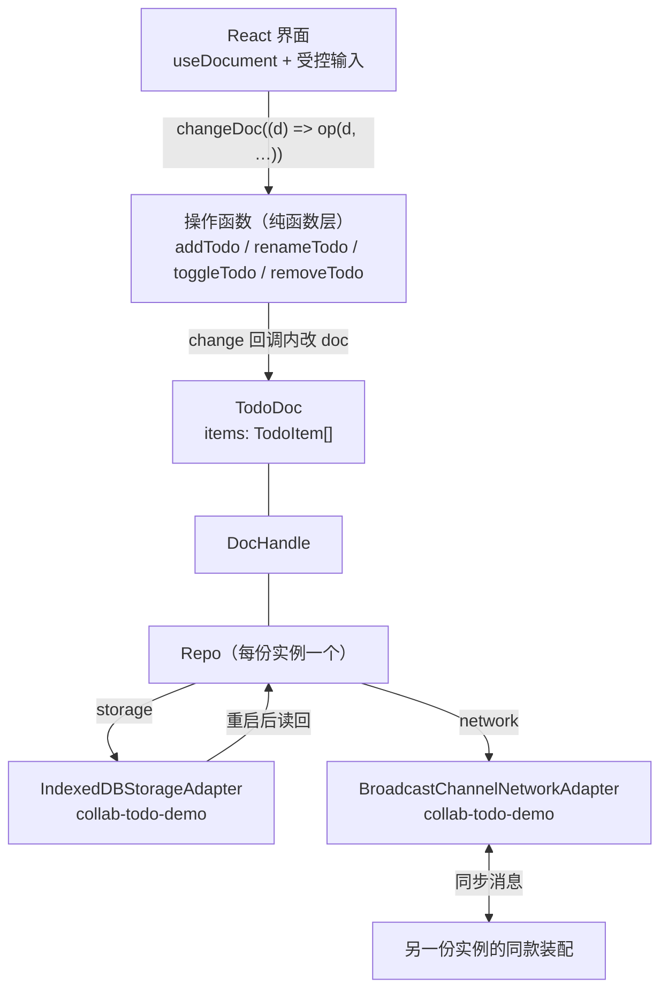

import { Canvas, Controls, Meta } from '@storybook/addon-docs/blocks';
import * as CollabTodo from './collab-todo.stories';

<Meta of={CollabTodo} name="Docs" />

# 实战：协同待办应用

前两个阶段的所有零件——[文档模型](?path=/docs/collections-and-conflicts--docs)、[存储](?path=/docs/local-storage--docs)、[网络](?path=/docs/networking-sync--docs)、[React hooks](?path=/docs/react-bindings--docs)——本课第一次把它们装成一台完整的应用：一份 todo 文档、一组纯函数操作、一个接好存储与网络的 Repo、一个真正的 React 界面，最后同页跑两份实例，A 添加、B 实时出现。协同应用的特殊性在于：单机 todo 里只关乎口味的每个选择，在这里都直接决定并发行为，所以正文突出每一步的「为什么」。看完本课，你应能预测两个实验台的行为：两副本并发操作后双向 merge 必然收敛（判据是 heads 相同）；重启实例 B，清单先从 IndexedDB 读回、再由网络补齐。



本课的装配决策一览，细节见对应小节。示例基于 `@automerge/automerge` 3.5.0 与 `@automerge/react` 2.6.0-alpha.3：

| 决策点 | 本课取值 | 一句话理由 |
| --- | --- | --- |
| 清单容器 | 单文档 `TodoDoc` 的 `items` list | 一份文档一个 URL，整个清单原子同步；list 保序 |
| 条目标识 | `id`（`crypto.randomUUID()`） | 并发插入让下标漂移，身份要自己带 |
| 标题 | `string`，整段赋值 | 并发改名一边赢，两侧一致；不逐字符合并 |
| 完成状态 | `boolean` | 是状态不是计数；并发勾选收敛一致 |
| 存储 | `IndexedDBStorageAdapter('collab-todo-demo')` | dbName 即数据边界 |
| 网络 | `BroadcastChannelNetworkAdapter`（channelName 同名） | 同源标签页实时互联 |
| 根 URL | localStorage 固定 key | 存储没有文档清单 API，URL 归应用保管 |

## 数据建模：字段类型就是并发语义

协同应用的第一步不是写界面，而是决定「什么是一条待办、整个清单住在哪里」。Automerge 文档里的每个字段都有并发语义：两台设备同时写它会发生什么，由类型决定。所以建模先于一切——后面所有小节都建立在这一节的选择上。

### TodoItem：三个字段各自的理由

```ts
export type TodoItem = {
  id: string; // 稳定身份：操作定位与 React key 都用它
  title: string; // 整段赋值：并发改名一边赢
  done: boolean; // 状态赋值：并发勾选收敛一致
};

export type TodoDoc = {
  items: TodoItem[]; // list 保序；map 表达不了顺序
};
```

- **`id` 必须有。** 清单是 list，并发插入会让下标漂移：A、B 同时在末尾各加一条，合并后两条的相对顺序由 CRDT 规则确定，可能与时间先后不同。于是下标既不能当身份（会指向别的条目），也不能当 React key（会错位复用）。用 `crypto.randomUUID()` 生成，条目内唯一即可。
- **`title` 是整段赋值的标量。** 文档里的普通字符串没有字符结构：并发把同一条改成两个文案，按[集合类型与冲突](?path=/docs/collections-and-conflicts--docs)的赋值规则收敛——一边赢，两侧一致。逐字符合并是富文本的事（[3.2](?path=/docs/rich-text-collab--docs)），待办标题不需要。
- **`done` 是布尔赋值，不是增量。** 两个副本从同一个基值各取反一次（并发勾选同一条），得到同一个结果，不会互相抵消；并发写不同值（一边勾选、一边取消）时一边赢、两侧一致。要「只增不减」的累加语义才需要 `Counter`（[文本与计数器](?path=/docs/text-and-counters--docs)）——完成状态不是计数。
- **容器选 list。** 待办是有序集合，「新的一条插在哪」有语义；`Record` map 无序，表达不了插入位置。

### 一份文档装整个清单

文档是同步与存储的最小单元：单文档意味着一个 URL 就能把整个清单交给对端，清单整体原子可见，建模与分享都最简单。代价在渲染端：订阅粒度是整份文档（[React 绑定](?path=/docs/react-bindings--docs)），任何一条变更都会重渲染清单组件。

官方 [react-todo 示例](https://github.com/automerge/automerge-repo/tree/main/examples/react-todo)给出了进阶选择：根文档只存 `AutomergeUrl[]`，每条待办是独立文档，条目组件各自订阅自己的文档——渲染粒度细了，代价是根文档与条目文档两层建模、按条 find 的复杂度。清单这种同屏共览、条目不多的场景，单文档最省事；条目体量大或要按条加载时再拆，完整取舍见[数据建模手册](?path=/docs/modeling-data--docs)。

## 操作函数：把业务写成 change 内的纯函数

模型定了，业务操作统一成一个签名约定：`(doc: TodoDoc) => void`——这恰好就是 `change` / `changeDoc` 回调的形状，于是组件、实验台和将来的测试复用同一层：

```ts
export function addTodo(doc: TodoDoc, title: string): void {
  doc.items.push({ id: newId(), title, done: false });
}

export function toggleTodo(doc: TodoDoc, id: string): void {
  const item = doc.items.find((item) => item.id === id);
  if (item) {
    item.done = !item.done;
  }
}

export function removeTodo(doc: TodoDoc, id: string): void {
  const index = doc.items.findIndex((item) => item.id === id);
  if (index !== -1) {
    deleteAt(doc.items, index); // 类型层的独立函数，等价列表代理的同名方法
  }
}
```

两条纪律：

- **只改 `doc`。** 操作不碰网络、不碰组件状态，任何副本以任意顺序重放语义一致——这正是并发下「不用写额外代码」的前提。
- **按 `id` 定位。** `removeTodo` 先找下标再 `deleteAt`，因为下标只在「此刻这份快照」里有效；`renameTodo` 与 `toggleTodo` 同形——按 id 找到条目后整段赋值或取反（完整模型共四个操作，见 `todo-model.ts`）。

这些函数在并发下的表现值得单独跑一遍。下面的实验台用 `from` / `clone` / `change` / `merge` 直连核心库（[变更、快照与合并](?path=/docs/changes-and-merging--docs)的手法），不经过 Repo、不经过网络——并发语义是文档层的性质，与装配无关。

<Canvas of={CollabTodo.ConcurrentOpsLab} />

<Controls of={CollabTodo.ConcurrentOpsLab} />

| 读者操作 | 可观察证据 |
| --- | --- |
| 保持「并发各加一条」 | 副本 A、B 各多一条，合并结果 4 条都在且两侧顺序一致；两个 merge 方向 heads 相同 → 已收敛 |
| 切「并发改同一条标题」 | 同一条被改成两个值，合并后收敛到同一个标题——一边赢，两侧一致 |
| 切「勾选与改名并发」 | 不同字段互不覆盖：done 的勾选与 title 的改名都完整保留 |
| 打开 Show code | 看到该 Canvas 实际执行的 `concurrent-ops-lab.ts`，操作函数来自 `todo-model.ts` |

## 组网与持久化：装配 Repo

一个工厂函数装出「本地持久化 + 本机多端互联」的仓库，全部决策只有两行：

```ts
import {
  BroadcastChannelNetworkAdapter,
  IndexedDBStorageAdapter,
  Repo,
  type PeerId,
} from '@automerge/react';

const DB_NAME = 'collab-todo-demo';
const CHANNEL_NAME = 'collab-todo-demo';

function createTodoRepo(peerId: PeerId): Repo {
  return new Repo({
    peerId,
    storage: new IndexedDBStorageAdapter(DB_NAME), // 数据落在哪
    network: [
      new BroadcastChannelNetworkAdapter({ channelName: CHANNEL_NAME }), // 和谁同步
    ],
  });
}
```

- **dbName 是数据边界**（[本地存储](?path=/docs/local-storage--docs)）：同一 origin 上用同名的代码共享文档，所以按应用命名，不裸用默认的 `"automerge"`。
- **channelName 是本机互联边界**（[网络同步](?path=/docs/networking-sync--docs)）：同一 origin 的所有标签页经这个频道自动握手、自动互通。跨设备时往 `network` 数组里再叠一个 `WebSocketClientAdapter` 即可，其余应用代码分毫不动。

存储里没有「上次有哪些文档」的清单 API，重启后找回数据只有 URL 这一条线索——所以根文档 URL 由应用自己保管：

```ts
const ROOT_URL_KEY = 'collab-todo-demo:root-url';

async function openRootDoc(repo: Repo): Promise<DocHandle<TodoDoc>> {
  const saved = window.localStorage.getItem(ROOT_URL_KEY);
  if (saved) {
    try {
      return await repo.find<TodoDoc>(saved as AutomergeUrl);
    } catch {
      // URL 存过但数据已不在（存储被清等）：落到底下的重建分支
    }
  }
  const handle = repo.create<TodoDoc>({ items: [] });
  window.localStorage.setItem(ROOT_URL_KEY, handle.url);
  return handle;
}
```

官方 react-todo 示例把根 URL 放在 location hash，方便把整份清单的链接发给别人；本课放 localStorage，行为是「这台设备的浏览器里始终是同一份清单」。两种都行，要点只有一个：URL 的保管者是应用，不是 Repo。

## React 界面：hooks 接文档，操作函数接事件

界面层没有新机制——Provider、`useDocument`、三态渲染都是[React 绑定](?path=/docs/react-bindings--docs)拆过的内容，本课只看它们与操作函数层的接法：

```tsx
function TodoApp() {
  const [doc, changeDoc] = useDocument<TodoDoc>(rootUrl);
  if (!doc) {
    return <p>清单加载中……</p>; // 加载中 changeDoc 是空函数，占位不放写入按钮
  }
  return (
    <ul>
      {doc.items.map((item) => (
        <li key={item.id}>
          <input
            type="checkbox"
            checked={item.done}
            onChange={() => changeDoc((d) => toggleTodo(d, item.id))}
          />
          {item.title}
        </li>
      ))}
    </ul>
  );
}
```

三条接法纪律：

- **Provider 建一次、value 稳定**——仓库在组件树外由工厂创建，整份实例共享。
- **三态分开渲染**：无 URL、加载中（`doc` 为 `undefined`）、就绪；写入控件只在就绪态出现。
- **事件里只写一行**：`changeDoc((d) => addTodo(d, title))`。变更细节全部留在操作函数层，组件不感知字段结构。

列表渲染的 `key` 用 `item.id`——建模一节「下标不能当身份」的结论在这里兑现。

## 双实例协同：同一个应用跑两份

把同一工厂跑两遍、经同一根 URL 打开同一份文档，就得到两份互相同步的完整应用——每一份都有独立的 Repo、独立的 IndexedDB 连接和独立的网络适配器，这正是「两台设备」在同一个页面里的最小等价物。

<Canvas of={CollabTodo.DualInstanceLab} />

<Controls of={CollabTodo.DualInstanceLab} />

| 读者操作 | 可观察证据 |
| --- | --- |
| 在实例 A 输入回车 | 待办进文档，实例 B 的清单约百毫秒内出现同一条，读数「两侧 heads 一致」 |
| 在实例 B 勾选或删除 | 同一份数据反方向流动，A 同步更新——写入不区分「哪份界面」 |
| 选「重启实例 B（模拟刷新）」 | B shutdown 后用同一套工厂重建并 `find` 原 URL：清单从 IndexedDB 读回，网络补齐节流窗口内的最新变更，heads 重新一致 |
| 选「重置演示（清存储重建）」 | IndexedDB 演示库与 localStorage 根 URL 一并清掉，两份实例从空清单开始 |
| 打开 Show code | 看到该 Canvas 实际执行的 `dual-instance-lab.ts`（含仓库工厂与完整界面组件） |

「重启实例 B」值得盯紧：真实应用里它就是用户刷新页面。`shutdown()` 负责把缓存的变更写完、断开网络、关闭存储连接；重建后的实例 `find` 同一 URL，先从 IndexedDB 读回绝大部分数据，存储写入有约 100 毫秒节流，节流窗口内没落盘的最后几笔由仍然在线的 A 经网络补齐——[存储](?path=/docs/local-storage--docs)与[网络](?path=/docs/networking-sync--docs)两层各司其职，应用代码里甚至没有「重启」这个概念。

再用一个浏览器标签页打开本课，两页的四份实例也会经同一频道互联成四副本网状同步——应用没有为「跨标签页」写一行代码，通道换了、协议没换。演示数据会留在浏览器 IndexedDB 里（库名 `collab-todo-demo`），「重置演示」随时可清。

## 最佳实践

- **写入全走操作函数层。** 组件里只允许 `changeDoc((d) => op(d, …))` 一行；变更细节散写在组件里，很快就会出现两处不一致的定位逻辑。
- **dbName、channelName、根 URL key 按应用命名。** 三者都是同 origin 的共享边界：裸用默认值，同端口上的其他原型会与你的清单串数据。
- **根 URL 尽早、同步地确定。** 在挂载界面前的同一段引导代码里先读后写 localStorage；两个 Repo 同时冷启动且都读到空，就会各自 `create` 出两份清单（处理见常见问题）。
- **跨设备 = 往 network 数组里加适配器。** BroadcastChannel 只覆盖同一 origin；叠一个 `WebSocketClientAdapter` 接同步服务器即可，操作函数与界面零改动。
- **拆文档要等真实痛点。** 单文档先跑到出现渲染或体量问题，再按官方 react-todo 的「根文档存 URL 列表 + 每条一份文档」拆；提前拆是把两份复杂度提前付掉。

## 常见问题

- **两个实例（或两个标签页）改了互不同步。**
  只接了存储没接网络：`IndexedDBStorageAdapter` 只管落盘，不做标签页间实时同步。给 Repo 的 `network` 数组挂上 `BroadcastChannelNetworkAdapter`，同一 origin 的实例即自动互联；跨设备同步与收敛语义见[网络同步](?path=/docs/networking-sync--docs)。

- **打开页面发现「不是上次那份清单」，或出现两份互不相通的清单。**
  根 URL 保管失效：localStorage key 不一致、站点数据被清（此时 `openRootDoc` 会重建新文档，属于预期），或两个实例同时冷启动各自 `create`（先读后写的窗口被同时命中）。处理：引导代码在 `create` 前再读一次 key（同步读写的窗口极小），出现两份后删掉其中一个 URL 对应的数据即可；需要彻底杜绝，就先建一份引导文档、由它协商唯一根 URL。

- **并发勾选同一条，一边的勾「没了」。**
  `done` 是赋值语义：并发写两个不同值时一边赢，文档只暴露收敛后的那一个，这是[集合类型与冲突](?path=/docs/collections-and-conflicts--docs)的收敛规则而非丢失。两个值都留在变更历史里（`getConflicts` 可取回），但语义上无法「同时要两个布尔值」；要只增不减的语义用 `Counter`，要保留双方意图就得在应用层另建操作记录。

## 总结回顾

摘要：

本课把前两个阶段装配成第一个端到端应用。建模层，字段类型就是并发语义：`id` 给条目稳定身份（下标在并发插入下漂移），`title` 与 `done` 是标量赋值（并发写一边赢、两侧一致），清单住进单文档的 `list`——原子、简单，代价是订阅粒度为整份文档。操作层把业务写成 `change` 内的纯函数，按 id 定位、`deleteAt` 删除；并发操作实验台用 `clone` / `change` / `merge` 证明并发加、并发改名、不同字段并发都不需要额外代码即收敛，判据是双向 merge 的 heads 相同。装配层一个工厂接 IndexedDB（dbName 是数据边界）与 BroadcastChannel（channelName 联通同源标签页），根 URL 归应用保管在 localStorage。界面层 Provider 建一次、`useDocument` 订阅、事件里一行 `changeDoc` 调操作函数。双实例演示里 A 添加 B 实时出现，重启实例 B 从存储读回、由网络补齐——本地优先的完整闭环。

一句话：

> 建模定并发语义，操作写成纯函数，装配定数据边界：数据真身永远在本地文档里，UI 与通道都只是它的投影。

知识要点：

- 为什么条目必须有 `id`？下标为什么不能当身份或 React key？
- `done` 用 `boolean` 的并发后果是什么？什么语义才需要 `Counter`？
- 操作函数的签名约定是什么？为什么必须按 id 定位、只改 doc？
- 并发操作收敛的判据是什么？哪些并发场景不需要写任何额外代码？
- Repo 装配的 `storage` 与 `network` 各决定什么？dbName 与 channelName 为什么不能裸用默认值？
- 根文档 URL 为什么要应用自己保管？官方示例与本课各放在哪里？
- 重启一个实例后数据怎么回来？存储与网络各补哪一段？

## 参考资料

- [automerge-repo 官方 React todo 示例](https://github.com/automerge/automerge-repo/tree/main/examples/react-todo) —— 根文档存 URL 列表、每条一份文档的进阶建模与 IndexedDB + BroadcastChannel + WebSocket 三适配器装配（`types.ts` / `App.tsx` / `Todo.tsx` / `main.tsx`）
- [Automerge 官方文档](https://automerge.org/docs/hello/) —— 文档模型与 Repo 层手册，本课各决策的第一手依据
- [automerge-repo 仓库](https://github.com/automerge/automerge-repo) —— 网络与存储适配器、React 绑定的源码
- 本工作区 `node_modules/@automerge/react/dist/default-exports.d.ts` —— `IndexedDBStorageAdapter` 与 `BroadcastChannelNetworkAdapter` 再导出面的核对依据（2.6.0-alpha.3）
- 本工作区 `node_modules/@automerge/automerge/dist/implementation.d.ts` —— `deleteAt` 独立函数与 `change` 签名的核对依据（3.5.0）
