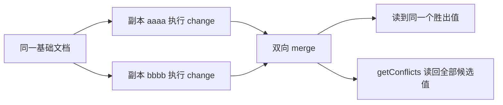

import { Canvas, Controls, Meta } from '@storybook/addon-docs/blocks';
import * as CollectionsAndConflicts from './collections-and-conflicts.stories';

<Meta of={CollectionsAndConflicts} name="Docs" />

# 集合类型与冲突

承接[变更、快照与合并](?path=/docs/changes-and-merging--docs)的 `change` 与 `merge` 模型，本课讲 Automerge 文档的"形状"：文档是一棵 JSON 式的树，容器只有 map（对象）、list（数组）和文本（text），能放进值的类型是一个封闭的小集合。理解三件事就能预测几乎所有合并结果：哪些值能进文档；对象进入文档后以什么身份存在；两个副本并发写同一位置时如何收敛。示例基于 `@automerge/automerge@3.5.0`。

本课配两个可操作实例。「对象身份规则」实例切换两种赋值操作，显示两个键各自的 ObjID 与结果。「并发实验室」实例把两个副本（actorId 为 `aaaa` 与 `bbbb`，真实 actorId 是随机 hex）从同一基础文档分叉，各自执行一次并发写，再双向 `merge`：切换「并发场景」或修改两个副本的写入内容，画布与读数会给出合并后读到的值、`getConflicts` 里的候选值，以及双向合并是否一致。



## 值与容器

标量值是封闭集合，容器有三种：对象（map）、数组（list）、文本（text）。给字段赋一个普通字符串时，它就是文本容器，可以按字符并发编辑；其余类型都是标量。常拿到的读回类型如下：

| 值 | 写入方式 | 读到 | 边界 |
| --- | --- | --- | --- |
| 字符串 | `d.url = 'https://...'` | `string` | 默认按文本容器存储，可按字符编辑 |
| 数字 | `d.count = 3` | `number` | 默认按 64 位浮点存储 |
| 整数标注 | `d.count = new A.Int(3)` | `number` | `Int` / `Uint` / `Float64` 显式标注存储类型 |
| 布尔与 null | `d.done = true` | `boolean` / `null` | 没有 `undefined`，见下 |
| 日期 | `d.at = new Date()` | `Date` | 标量，并发赋值按冲突规则收敛 |
| 二进制 | `d.blob = new Uint8Array([1])` | `Uint8Array` | 标量，适合小体积数据 |
| 计数器 | `d.n = new A.Counter(0)` | `Counter` 实例 | 并发增减自动相加，见「天然收敛的值」 |
| 原子字符串 | `d.url = new A.ImmutableString('...')` | `ImmutableString` | 标量，整体替换语义，见下 |

`Counter` 与 `ImmutableString` 是"有行为的包装类"：写入时构造，读回时是实例；`Counter` 支持 `valueOf`，可以直接参与算术运算和字符串拼接。

### 不支持的值

`undefined`、函数、symbol 进不了文档，赋值当场抛 `RangeError`（报错会提示所有 JSON 基本类型都支持、函数不支持）：

```ts
A.change(doc, (d) => {
  d.missing = undefined; // RangeError：undefined 不是合法 JSON 数据类型
  d.handler = () => {};  // RangeError：function 不受支持
});
```

处理方式报错里已经给出：表达"没有"用 `null`，删除字段用 `delete d.key`。另外 `__proto__` 不能作为键名，文档直接拒绝。

### 字符串的两种形态

普通字符串是文本容器：并发的字符级编辑会逐字符合并。字符编辑要用 `A.splice`（在 `change` 回调内对文档代理调用），不能像数组那样按下标赋值——下标赋值只会得到 `TypeError`。整段替换（`d.title = '新标题'`）则是一次 put，并发整段替换走冲突规则。

想表达"这个字符串应当整体替换、不该被逐字符合并"（URL、枚举值），用 `ImmutableString`：它是纯标量，没有字符结构，`splice` 对它会直接报错，并发赋值时按冲突规则收敛。

文本编辑、游标与 counter 的完整语义见[文本与计数器](?path=/docs/text-and-counters--docs)。

## 对象与数组的身份

文档里的每个对象和数组在存储层都有一个 ObjID，`A.getObjectId(value)` 可以读到（根对象是 `_root`）。JS 层的赋值是"把值拷进文档"，不是建立引用。三条规则：

**裸对象赋值即深拷贝快照。** 赋值那一刻的值被逐层拷入文档，之后改动裸对象与文档无关。同一个裸对象赋给两个键，得到两个独立对象：

```ts
A.change(doc, (d) => {
  const shared = { n: 1 };
  d.first = shared;  // 拷贝此刻的 { n: 1 }
  shared.n = 42;     // 只改裸对象
  d.second = shared; // 再拷贝，这次是 { n: 42 }
});
// d.first 是 { n: 1 }，d.second 是 { n: 42 }，两个不同的 ObjID
```

**文档内对象不能移动或自引用。** 把已经在文档里的对象赋给另一个键会抛 `RangeError: Cannot create a reference to an existing document object`。要复制就显式构造新对象：`d.second = { ...d.first }`。`Date` 是唯一例外，它是不可变标量，可以在文档内随意赋值。

**在 `change` 外读到的值是快照。** 改快照不报错也不写回文档；由于物化结果有缓存，同一引用可能"看起来改过了"。核对真相用 `A.toJS(doc)`。

<Canvas of={CollectionsAndConflicts.IdentityDemo} />
<Controls of={CollectionsAndConflicts.IdentityDemo} />

| 读者操作 | 可观察证据 |
| --- | --- |
| 保持「同一裸对象赋给两个键」 | 两个键的值分别是拷贝时刻的快照，ObjID 不同，读数为「否（两次拷贝）」 |
| 切到「文档内对象赋给另一个键」 | 画布显示捕获的 `RangeError` 文本，`second` 保持未写入 |
| 打开 Show code | 看到该 Canvas 实际执行的 `object-identity.ts` |

## map 上的并发赋值冲突

冲突只有一个来源：两个副本从同一状态分叉后，对**同一个 map key 各写一次**（或对同一 list 索引各写一次，见下一节）。其余组合都自动合并，包括"一方删除、另一方赋值"——赋值保留，不产生冲突记录。

| 并发操作组合 | 合并结果 |
| --- | --- |
| 不同 key 各写 | 全部保留 |
| 同一 key 各写一次 | 冲突：读值唯一，`getConflicts` 可见全部候选值 |
| 一方 `delete`，另一方赋值同一 key | 赋值保留，无冲突记录 |

收敛规则：merge 之后，所有副本读到**同一个**胜出值。谁胜出不看墙钟时间（`change` 的 `time` 只是元数据），而看操作 ID：先比操作计数器，计数器相同再比 actorId。所以"谁后写"没有意义，结果对所有副本都一致、可复现。

```ts
const base = A.from({ mood: 'ok' });
let alice = A.change(A.clone(base, { actor: 'aaaa' }), (d) => {
  d.mood = 'great';
});
let bob = A.change(A.clone(base, { actor: 'bbbb' }), (d) => {
  d.mood = 'meh';
});

const merged = A.merge(A.clone(alice), A.clone(bob));
merged.mood;                    // 双向合并都会收敛到同一个胜出值
A.getConflicts(merged, 'mood'); // { '2@aaaa': 'great', '2@bbbb': 'meh' }
```

`getConflicts` 的第一个参数是**值所在的 map**（根字段就传文档本身，嵌套字段传那个对象），返回 `{ 操作ID: 值 }`，包含胜者与所有败者；没有冲突时返回 `undefined`。冲突对象里的值在回调外是冻结快照，只能读。对该 key 重新赋值即视为解决，冲突记录消失。

注意 `merge` 会冻结两个参数，之后不能再对它们 `change`（报 `Attempting to change an outdated document`），需要继续操作就先 `A.clone`——上一课已详述，这里提醒示例中都传了 clone。

<Canvas of={CollectionsAndConflicts.MapConflict} />
<Controls of={CollectionsAndConflicts.MapConflict} />

| 读者操作 | 可观察证据 |
| --- | --- |
| 调整「副本 aaaa 写入」「副本 bbbb 写入」 | 合并后读数随操作 ID 收敛到固定一方，与输入先后无关 |
| 把「并发场景」切到其他选项 | 同一实例复现 list 与对象场景的收敛行为 |
| 打开 Show code | 看到该 Canvas 实际执行的 `concurrent-conflicts.ts` |

## list 的并发插入与删除

list 元素按身份锚定：插入操作记录的是"在哪个元素旁边插"，index 只是当前的读视图。因此并发操作不靠下标博弈：

| 并发操作组合 | 合并结果 |
| --- | --- |
| 同一位置并发插入 | 两个元素都保留，顺序由操作 ID 决定（与先后无关，实例中可观察） |
| 一方删除，另一方插入到附近 | 各自成立，插入仍锚定在原位置 |
| 一方删除，另一方改写同一元素 | 改写保留，元素没有被删掉 |
| 同一索引各写一次 | 冲突：读值唯一，`A.getConflicts(d.list, index)` 可见候选值 |

在回调内用 `insertAt` / `deleteAt` 增删（数组代理自带这两个方法；类型层面也提供独立函数 `A.insertAt(list, index, ...values)` 与 `A.deleteAt(list, index, numDelete?)`），用 `push` 追加。下标越界赋值直接抛错，列表不能用稀疏下标"扩容"。

<Canvas of={CollectionsAndConflicts.ListInsert} />

同位置并发插入：两个副本都在 `['起点']` 后插入，两个值都保留，顺序确定。想换输入值可在上一节实例的「并发场景」里切换。

<Canvas of={CollectionsAndConflicts.ListOverwrite} />

改写与删除并发作用在同一元素：改写胜出，元素保留。这与 map 上"删除 vs 赋值"的取舍一致——Automerge 只在"同时 put"时记冲突，删除永远不赢得并发竞争。

下标会随并发插入漂移，业务上应当让列表项成为带 id 的对象、按对象身份定位，而不是按下标定位（建模取舍见[数据建模手册](?path=/docs/modeling-data--docs)）。

## 天然收敛的值

`Counter` 的并发 `increment` / `decrement` 按增量相加，永不冲突；文本容器的字符级编辑同理，每个字符都是独立元素。它们的共同点是：**修改被建模为对既有值的增量操作，而不是对同一位置的覆盖。** 一旦绕过类型 API 直接整体赋值，就退化成普通 put，照样冲突：

```ts
A.change(doc, (d) => {
  d.visits.increment(3);        // 并发副本各加 3，合并后是 +6
  d.visits = new A.Counter(99); // 这是 put：并发赋值走冲突规则
});
```

边界就这一条：想要合并语义，用对应类型的操作（`increment`、字符编辑）；想要覆盖语义，就接受冲突规则。两类编辑器语义与游标见[文本与计数器](?path=/docs/text-and-counters--docs)。

## 最佳实践

- **细粒度操作优先于整体替换。** 改一个字段就写 `d.card.done = true`，不要 `d.card = { ... }` 整体替换——整体替换是并发下最常见的冲突源。Automerge 3 还会拒绝"把文档内对象装进新值再整体赋回"：像 `{ ...entities, ... }` 这样 spread 实体映射的"不可变更新"写法会直接报 `Cannot create a reference`，旧教程的风格在新版本跑不通。
- **用类型表达替换语义。** 需要整体替换的字符串用 `ImmutableString` 标注意图，让并发赋值走冲突规则并保留候选值，而不是静默地逐字符合并出一串拼接结果。
- **给列表项建模身份。** 列表项做成带 `id` 的对象，引用它时用对象身份；下标在并发插入后会漂移，`getConflicts` 之外的位置问题更难排查。

## 常见问题

- 在 `change` 回调外改了 `doc.card.title`，没报错，但文档里没生效，有时再读又像改过了
  所有修改放进 `change` 回调。回调外读到的嵌套对象是物化快照，改动只落在本地缓存；判断真相用 `A.toJS(doc)` 或在回调内重新读取。
- 报错 `RangeError: Cannot create a reference to an existing document object`
  把文档里已有的对象赋给了另一个位置。改为显式拷贝：字段都是标量时 `{ ...obj }` 即可；嵌套结构要逐层重建，因为文档对象不能被装进新值整体赋回。`Date` 不受此限制，可以文档内移动。
- 报错 `TypeError: Cannot assign to read only property '0' of string '...'`
  字符串不是数组：回调内拿到的字符串没有可写下标。字符级编辑用 `A.splice`（文本语义见[文本与计数器](?path=/docs/text-and-counters--docs)）。
- 报错 `RangeError: index 5 is out of bounds`
  list 不能按下标稀疏赋值。新增用 `push` 或 `insertAt`，改写前确认下标在 `length` 之内。

## 总结回顾

摘要：

Automerge 文档是 JSON 式的树：容器有 map、list 和文本，标量值封闭在字符串、数字、布尔、null、日期、二进制、计数器与原子字符串这个集合内，`undefined` 和函数直接抛错。对象进入文档即获得 ObjID，赋值是深拷贝快照而非引用，文档内对象不能再次赋给别的键。并发编辑中，只有"同一 map key 或同一 list 索引上各自 put 一次"构成冲突：所有副本收敛到由操作 ID（先比计数器、再比 actorId，与时间无关）决定的同一个胜出值，其余候选值仍能从 `getConflicts` 读回，重新赋值即解决。list 的插入锚定元素身份，同位置并发插入全部保留且顺序确定，删除从不赢得与改写或插入的并发竞争。计数器与文本的增量操作天然收敛，整体赋值则退化为普通 put。

一句话：

> 并发写同一位置时，Automerge 收敛到一个由操作 ID 决定的稳定胜者，其余候选值仍可从 `getConflicts` 读回；其余一切并发编辑都自动合并。

知识要点：

- 哪些值能进文档？`undefined` 与函数赋值时会怎样，正确的出路是什么？
- 把同一个裸对象赋给两个键得到什么？把文档内对象赋给另一个键呢？
- map 并发赋值后读到的值由什么决定？怎么读回全部候选值、怎么解决冲突？
- list 同位置并发插入、"删除 vs 改写"的结果各是什么？为什么下标不能用来定位业务对象？
- `Counter` 的 `increment` 与整体赋值在并发下行为差在哪里？

## 参考资料

- [Simple Values — Automerge Docs](https://automerge.org/docs/reference/documents/values/)
- [Lists — Automerge Docs](https://automerge.org/docs/reference/documents/lists/)
- [Conflicts — Automerge Docs](https://automerge.org/docs/reference/documents/conflicts/)
