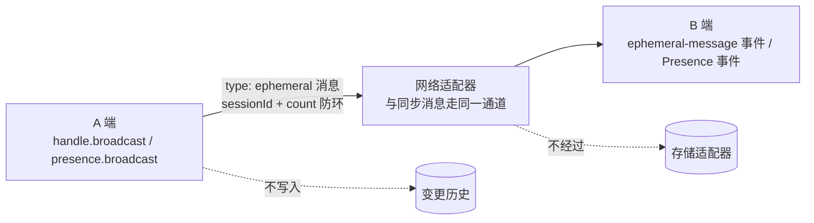

import { Canvas, Controls, Meta } from '@storybook/addon-docs/blocks';
import * as EphemeralData from './ephemeral-data.stories';

<Meta of={EphemeralData} name="Docs" />

# 在线状态与临时数据

承接[网络同步](?path=/docs/networking-sync--docs)：写进 `handle.change()` 的数据会落盘、进变更历史、同步给任何稍后上线的副本——这对「便签内容」是正确待遇，对「谁正在输入」却不是：这类状态只对**此刻在线的人**有意义，人走了就该消失。本课讲 Automerge 的答案——挂在文档同步网络上的临时信道：`handle.broadcast()` 发一次性消息（输入指示器、通知、闹铃），`Presence` 维护带心跳的在线状态（成员板、自定义状态、光标位置）。两者都不落盘、不进变更历史、不给离线副本。



本课用到的核心 API 与配置一览，细节见对应小节。示例基于 automerge-repo 2.6.0-alpha.3（`Presence` 是该线新增的成员）：

| API / 配置 | 用途 | 关键点 |
| --- | --- | --- |
| `handle.broadcast(message)` | 发一条一次性临时消息 | 不落盘、无送达保证；只发给正在同步本文档的在线 peer |
| `handle.on("ephemeral-message", fn)` | 收临时消息 | payload `{ handle, senderId, message }`，`message` 是发送时的原值（CBOR 往返） |
| `handle.on("ephemeral-message-outbound", fn)` | 观察出站字节 | payload `{ handle, data: Uint8Array }`，同步层借它把消息送上网络 |
| `new Presence({ handle })` | 某文档的在线状态机 | 创建后不活动，`start()` 才开始收发与心跳 |
| `presence.start({ initialState, heartbeatMs?, peerTtlMs? })` | 激活并广播初始状态 | 心跳默认 15000ms；成员遗忘阈值默认 45000ms（3 倍心跳） |
| `presence.broadcast(channel, value)` | 更新一个状态通道并广播 | 只发变化的通道，不是整包状态 |
| `presence.getPeerStates()` | 读在线成员状态 | 返回 `PeerStateView`，`getStates()` 按成员给出 value 与最近活跃时间 |
| `presence.getLocalState()` | 读自己的当前状态 | `broadcast` 会在本地同步更新 |
| `presence.stop()` | 告别下线 | 广播 goodbye：对端立即移除自己，随后心跳与监听一并停止 |
| `update` / `snapshot` / `heartbeat` / `goodbye` / `pruning` 事件 | 逐条感知成员变化 | `pruning` 表示对端没告别，超时被修剪 |
| `repo.peers` | 连接层的在线名单 | `PeerId[]`，只知道「连接着」，没有业务语义 |

## 快速上手

安装（本工作区已按基线装好，可跳过）：

```bash
npm install @automerge/automerge-repo @automerge/automerge-repo-network-broadcastchannel
```

十几行走完「广播 - 接收」闭环。两个 Repo 在同一页面扮演两台设备，用 BroadcastChannel 适配器互连（同源多标签页的真实场景也用它）：

```ts
import { Repo, type PeerId } from '@automerge/automerge-repo';
import { BroadcastChannelNetworkAdapter } from '@automerge/automerge-repo-network-broadcastchannel';

const channel = 'quick-start';
const repoA = new Repo({
  peerId: 'writer-a' as PeerId,
  network: [new BroadcastChannelNetworkAdapter({ channelName: channel })],
});
const repoB = new Repo({
  peerId: 'reader-b' as PeerId,
  network: [new BroadcastChannelNetworkAdapter({ channelName: channel })],
});

// 临时消息挂在文档上：先让两边打开同一份文档
const handleA = repoA.create<{ text: string }>({ text: '共享便签' });
const handleB = await repoB.find(handleA.url);

// B 订阅：收到 { senderId, message }，message 就是 A 发出的原值
handleB.on('ephemeral-message', ({ senderId, message }) => {
  const { text } = message as { text: string };
  console.log(`${senderId} 正在输入：${text}`);
});

// A 广播：不落盘、不进历史，只有在线且打开本文档的 peer 能收到
handleA.broadcast({ type: 'typing', text: '你好，协同世界' });
```

两个前提藏在代码里：临时消息挂在**文档**上，对端必须先 `find` 同一份文档才能收到；`peerId` 传可读字符串只为演示好认，不传时 Repo 随机生成。

## 临时消息：broadcast 与 ephemeral-message

临时消息走的是文档同步网络的既有通道：`broadcast()` 把消息 CBOR 编码后交给同步层，网络子系统给它盖上本进程的 `sessionId` 和递增 `count` 再送上适配器；对端按 `senderId:sessionId:count` 去重（网状网络里同一条消息可能从多个路径到达），解码后以 `ephemeral-message` 事件派发给打开了这份文档的每个 handle。收到消息的 Repo 还会把它转发给自己的其他 peer——消息在网状拓扑里逐跳扩散。

发送与接收的形状对照：

```ts
// A 端：发什么都行，一个原值整体传输
handleA.broadcast({ type: 'typing', text: '你好' });

// B 端：原样收到，外加发送方的 PeerId
handleB.on('ephemeral-message', ({ senderId, message }) => {
  message; // { type: 'typing', text: '你好' }
});
```

三条边界决定了它的适用范围，也把它和普通文档数据区分开：

- **不落盘。** 消息不经过存储适配器，存储里不会出现它的任何痕迹；演示 Repo 即便接了存储适配器也一样。
- **不进变更历史。** 广播不产生 change，`handle.metrics().numChanges` 不变，`heads` 不动，离线副本合并时也看不见它。
- **只达在线的 peer，且无送达保证。** 对端不在线、还没打开这份文档、或刚巧断线，消息就没了——没有重发、没有补投。

<Canvas of={EphemeralData.TypingLab} />

<Controls of={EphemeralData.TypingLab} />

| 读者操作 | 可观察证据 |
| --- | --- |
| 「实时输入」下逐步修改输入框文本 | B 每次都实时收到一条指示，收件箱条数随修改累加 |
| 观察共享文档的变更次数 | 始终是 create 时的 1 次——广播不进变更历史 |
| 切到「重启对照」 | 重启前 B 收到过消息；重建 Repo 后文档内容从 A 同步回来，收件箱却是空的——旧消息不重放；A 再广播一条，新消息照常到达 |

两点补充边界。其一，**作用域是「正在同步本文档的 peer」**：广播只发给这份文档同步组里的成员（被 sharePolicy 拒绝的除外），没打开这份文档的 peer 收不到——临时消息跟着文档的受众走，这是它与「全局聊天频道」类方案的本质区别。其二，**PeerId 不是用户身份**：一个用户开三个标签页就是三个 PeerId，刷新页面还会换新的；消息里的 `senderId` 只能定位连接，用户身份要靠消息内容自己携带（成员板范例里就是用 `name` 通道携带的）。

典型场景里的「光标位置」由此有了分工：位置**怎么算**（`getCursor` 等核心 cursor API，见[富文本协同编辑](?path=/docs/rich-text-collab--docs)）是文档层的事；位置**怎么实时送到别人屏幕上**就是本课的事——把算好的位置字符串塞进临时消息即可。

## 在线状态：Presence

一次性消息足够发送输入指示器，但「成员板」需要更多：谁刚上线要补发当前状态、断网的人要能被识别、状态要按字段更新而不是整包重发。`Presence`（每个 DocHandle 一个实例）把这些机制打包好：你的状态是一个按**通道（channel）**组织的对象，`start()` 时广播全量快照（snapshot），之后每次 `broadcast(channel, value)` 只发单通道 update；有心跳保活（默认 15 秒一次，有实际更新时自动让位），对端超过遗忘阈值（默认 45 秒）没动静就修剪；`stop()` 发 goodbye 告别并停掉心跳与监听，对端立即移除你。所有消息统一装在 `__presence` 信封里走上一节的 `broadcast` 通道，所以 Presence 的传播范围与临时消息完全一致。

```ts
import { Presence } from '@automerge/automerge-repo';

type MemberState = { name: string; status: string; cursor: number };

const presence = new Presence<MemberState>({ handle });
presence.start({
  initialState: { name: '小张', status: '在线', cursor: 0 },
  // 两个参数都有默认值：heartbeatMs 15000，peerTtlMs 45000
  heartbeatMs: 1000,
  peerTtlMs: 3000,
});
presence.broadcast('cursor', 12); // 只广播 cursor 通道

// 读对端状态：按成员给出 value 与最近活跃时间
presence.getPeerStates().getStates(); // { "member-b": { peerId, value, lastActiveAt, lastSeenAt } }

// 逐条感知对端变化
presence.on('update', ({ peerId, channel, value }) => {});
```

晚到的人不会被落下：新成员出现时，已在场的 Presence 会补发一次自己的快照（约半秒内），新成员由此拿到全部当前状态——这正是它比裸 `broadcast` 适合做「当前态」的原因：错过 update 还有 snapshot 兜底。

### 成员板与状态通道

成员板是 Presence 的标准应用：每个成员把自己的昵称、状态、光标放在固定通道里，界面从 `getPeerStates()` 渲染。下面的实验台里 A（小张）的状态由控件直接驱动，B（小李）的成员板实时跟随——拖动光标滑块，能看到 update 事件只携带 `cursor` 一个通道。

<Canvas of={EphemeralData.MembersLab} />

<Controls of={EphemeralData.MembersLab} />

| 读者操作 | 可观察证据 |
| --- | --- |
| 观察 B 的成员板 | A（小张）带着昵称、状态、光标出现——snapshot 补发到位 |
| 把 A 的状态从「在线」切到「离开」 | B 收到 `update(status)` 事件，成员板即时改写 |
| 拖动 A 的光标位置滑块 | B 连续收到 `update(cursor)`，光标读数实时跟随 |

### 离开的两种样子

成员从成员板消失有两条路径，对应两种真实世界里的离场：正常下线与异常失联。实验台把心跳与遗忘阈值调快（300ms / 1200ms，真实默认 15000ms / 45000ms），两种离场都能在几秒内观察到。

<Canvas of={EphemeralData.LeaveLab} />

<Controls of={EphemeralData.LeaveLab} />

| 读者操作 | 可观察证据 |
| --- | --- |
| 选「stop 告别（goodbye）」 | B 收到 goodbye 事件，立即把 A 移出成员板 |
| 选「断网不告别（模拟断电）」 | B 的连接层知道 A 断开了，但成员板上的 A 要等约 1.2 秒（peerTtlMs）才被 pruning 修剪掉 |

异常离场的这段「延迟存在期」是 TTL 机制的固有代价：对端没机会告别时，其他人只能靠「心跳停了多久」来判断。阈值越短发现越快，但网络抖动越容易误伤在线成员；默认值取心跳的 3 倍，容忍连续两次心跳丢失。

## 最佳实践

- **按「错过一条要紧吗」选工具。** 要紧的当前态（成员板、光标、选中区域）用 Presence：有快照补发和超时清理，晚到者也能对齐；错过无妨的瞬时信号（输入指示、通知、reaction）用 `broadcast`：发完即忘，收不到也无害。
- **状态按通道拆，值保持小。** `broadcast(channel, value)` 的价值在于只发变化的字段——把光标和昵称塞在一个通道里，每次移动光标都会重发昵称；每条消息都要经 CBOR 编码走网络，大状态会让高频更新变成流量灾难。
- **高频信号先节流再广播。** 输入指示器几百毫秒一条足够，光标位置几十毫秒一条；在事件源一侧合并（比如 `requestAnimationFrame` 或定时器窗口），而不是指望网络层兜底。
- **页面隐藏时 `presence.stop()`。** 官方建议把 stop 挂在 `pagehide` / `visibilitychange` 上：切到后台就告别下线，既省心跳也让对端的成员板立刻诚实。反过来，PeerId 不稳定，跨会话识别用户要靠消息内容里自己携带的会话标识。

## 常见问题

- **对端收不到广播，本端也不报错。**
  按顺序排查：`repo.peers` 里有没有对方（网络没通）；对方有没有 `find` 同一份文档（广播只达文档同步组）；sharePolicy 有没有拒绝这个 peer。三条都正常再看时序——广播发出时对方还没上线，这条消息就没了，无送达保证是特性不是故障。

- **新加入的人看不到之前的任何消息。**
  临时消息不重放，这是设计而非丢失。需要「加入即对齐」的状态改用 Presence：`start()` 的快照加上在场成员的补发（约半秒），新成员能拿到全部当前态；需要历史的地方本来就该用 `handle.change()` 写进文档。

- **成员板上的对端迟迟不走，或者一闪就没。**
  先核对两端 `heartbeatMs` 与 `peerTtlMs` 的换算：遗忘阈值至少是心跳的 3 倍，阈值小于心跳会把活人当死人反复修剪。对端明明正常下线了却没立刻消失，说明它发出的 goodbye 没送到——多半只是断网了，成员板要等超时修剪才更新；浏览器后台标签页会暂停心跳定时器，被修剪属于正常行为。

- **同一个用户开多个标签页，被算成了多个成员。**
  PeerId 是连接身份不是用户身份，每个标签页、每次刷新都会不同。Presence 的 `getStates()` 支持 `groupingFn`，按状态里自己携带的用户标识分组聚合，多个标签页就能合并成一个成员。

## 总结回顾

摘要：

本课把「只对在线的人有意义」的状态安放进 Automerge：临时信道复用文档同步网络的通道，但三条边界把它与文档数据划开——不落盘、不进变更历史、只达在线 peer 且无送达保证。一次性信号用 `handle.broadcast()` 发、`ephemeral-message` 事件收，消息以 CBOR 编码、靠 sessionId 加 count 防环去重，并在网状拓扑里逐跳转发。持续状态用 `Presence`：状态按通道组织，`start()` 广播快照、之后只发单通道 update，心跳保活、TTL 修剪失联者、goodbye 告别离场，晚到成员靠补发的快照对齐。输入指示器、成员板、光标位置各得其所；与文档数据的分界线始终是那一句——这个状态在人走之后还该存在吗？

一句话：

> 该留下的写进文档，只给此刻在线的走临时信道：broadcast 发信号，Presence 管状态。

知识要点：

- 临时消息与 `handle.change()` 写入的数据有哪三条边界差异？
- 为什么对端必须打开同一份文档才能收到广播？无送达保证意味着什么？
- Presence 的 snapshot 与 update 消息分别何时发送？晚到的成员如何拿到当前状态？
- `stop()` 的 goodbye 与超时修剪（pruning）分别对应什么离场场景？遗忘阈值与心跳是什么关系？
- PeerId 能当用户 ID 用吗？多标签页场景怎么合并同一用户？
- 输入指示器、成员板、光标位置分别该用哪把工具？

## 参考资料

- [Automerge 官方文档：Ephemeral Data](https://automerge.org/docs/reference/repositories/ephemeral/) —— broadcast 与 ephemeral-message 的官方说明、无送达保证与 PeerId 语义
- [automerge-repo 仓库 Presence 源码](https://github.com/automerge/automerge-repo/tree/main/packages/automerge-repo/src/presence) —— Presence 的心跳、TTL、goodbye 与快照补发实现
- [automerge-repo-network-broadcastchannel 包源码](https://github.com/automerge/automerge-repo/tree/main/packages/automerge-repo-network-broadcastchannel) —— 本课示例使用的同页/同源多标签页网络适配器
- 本工作区 `node_modules/@automerge/automerge-repo/dist/presence/`、`dist/synchronizer/DocSynchronizer.js` 与 `dist/network/messages.d.ts` —— 心跳与 TTL 默认值（15000ms / 45000ms）、去重键 `senderId:sessionId:count`、`EphemeralMessage` 结构等核对依据（2.6.0-alpha.3）
