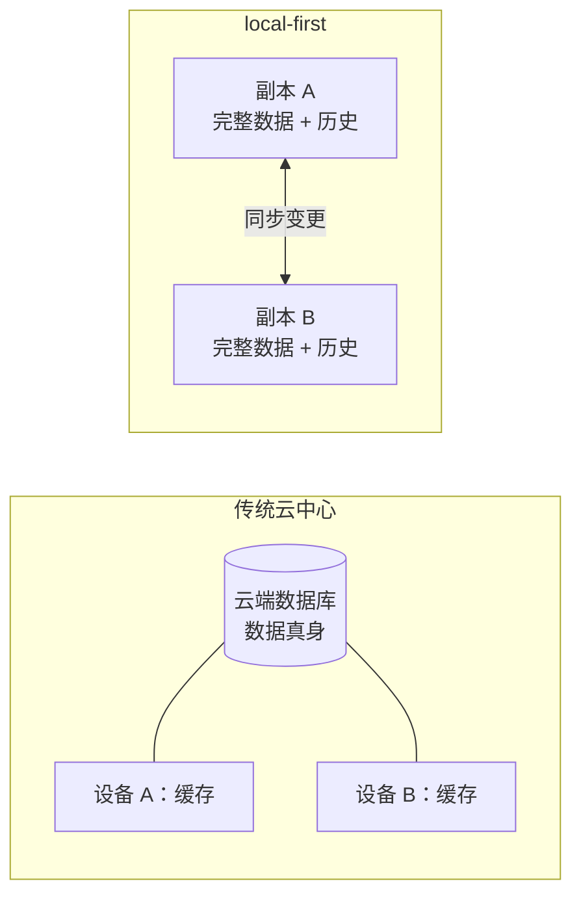
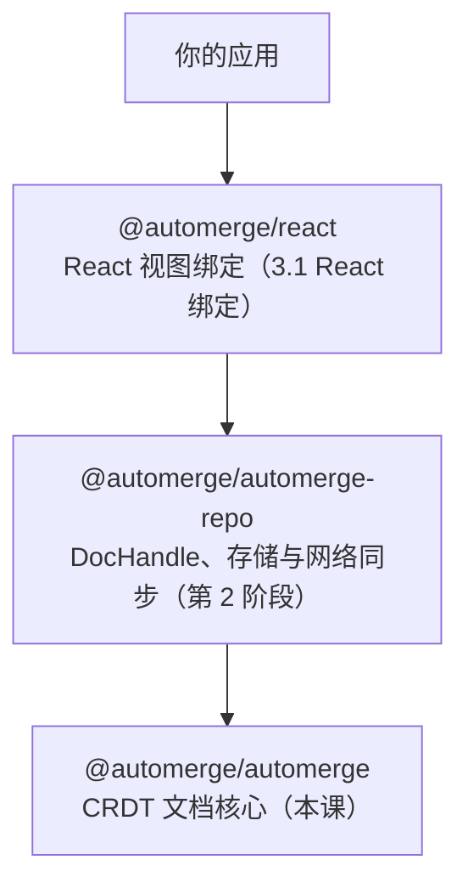

import { Canvas, Controls, Meta } from '@storybook/addon-docs/blocks';
import * as GettingStarted from './getting-started.stories';

<Meta of={GettingStarted} name="Docs" />

# 初识 Automerge

Automerge 是一个让应用数据「离线可改、随时合并」的 CRDT 数据结构库。本课建立 local-first 的问题意识，装好核心依赖，并跑通第一条完整链路：创建文档 → `change` 修改 → `clone` 分出第二副本 → `merge` 自动合并。看完本课，你应能预测合并实验台的现象：调整两个副本的写入值后，读数会显示并发冲突何时出现、两个副本是否收敛成同一份文档。

local-first 的关键转变在于「数据的真身在哪里」：传统架构把真身放在云端，设备上只是缓存，断网即停摆；local-first 把完整数据与历史放进每台设备的副本，网络只负责交换变更。



本课用到的核心 API 一览，细节见对应小节：

| API | 用途 | 关键点 |
| --- | --- | --- |
| `init()` | 创建空文档 | 自动生成随机 actorId 作为副本身份 |
| `from(initial)` | 从普通对象创建文档 | 初值被复制进文档，与原对象脱离引用 |
| `change(doc, fn)` | 用回调描述一次变更 | 返回新文档；旧文档是不可变快照 |
| `clone(doc)` | 生成可写副本 | 带全新 actorId，用来模拟另一台设备 |
| `merge(local, remote)` | 把另一副本的全部历史并入 | 返回新文档；并发修改自动收敛 |
| `getActorId(doc)` | 读取副本身份（十六进制字符串） | 同一 actorId 的变更必须串行产生 |
| `getConflicts(doc, key)` | 检视并发写入的全部候选值 | 合并结果永远唯一，冲突只是候选集合 |

## 快速上手

安装核心库（本工作区已按基线装好 `@automerge/automerge@3.5.0`，可跳过）：

```bash
npm install @automerge/automerge
```

十几行就能跑通完整闭环，下面这段代码在 Node 与浏览器中一致可用：

```ts
import * as A from "@automerge/automerge";

type Note = { title: string; note: string };

// from：把普通对象复制成文档，作为两个副本的共同起点
const base = A.from<Note>({ title: "新建笔记", note: "（未填写）" });

// clone：各带全新 actorId 的可写副本，相当于两台设备
let docA = A.change(A.clone(base), (d) => {
  d.title = "季度规划会";
});
let docB = A.change(A.clone(base), (d) => {
  d.title = "季度复盘会";
});

// merge：把 docB 的全部历史并入 docA
const merged = A.merge(docA, docB);

console.log(merged.title); // 一个确定的胜出值，所有副本读到同一结果
console.log(A.getActorId(docA) === A.getActorId(docB)); // false：两副本身份不同
console.log(A.equals(A.merge(docA, docB), A.merge(docB, docA))); // true：双向合并一致
```

Node 20+ 对上述代码零配置，直接用 `npx tsx` 或编译后运行即可；浏览器端由打包器加载 WASM，本工作区的 Vite 8 原生支持，其他环境见[常见问题](#常见问题)。

## local-first 与 Automerge

Ink & Switch 在论文《Local-first software》中为这类应用提出七项理想性质，与数据结构直接相关的四项是：

- **即时响应**：数据就在本地，读写零网络往返，界面不转圈。
- **离线可用**：网络是可选的，断网只影响同步，不影响使用。
- **多设备与协作**：多副本各自修改，重新连接后自动合并。
- **长期归属与隐私**：数据不寄居在某台服务器上，服务消失数据仍在。

Automerge 是这套理念的数据结构答案。它是 CRDT（无冲突复制数据类型）：只要两份副本收到相同的变更集合，就一定收敛到完全相同的状态。类比 Git，本地随便提交、随时合并；比 Git 更进一步的是合并完全自动，且是字段级的——不需要人工解冲突，同一字段的并发写入也有确定的唯一结果。

## 生态三层

Automerge 生态按职责分三层，本课只使用最底层：



- `@automerge/automerge`：纯内存的核心数据结构与合并算法，不涉及任何网络和存储。版本基线 3.5.0。
- `@automerge/automerge-repo`：在核心之上管理文档的存储（IndexedDB、文件系统等）与同步（WebSocket 等）。版本基线 2.6.0-alpha.3（为 automerge 3 设计的 alpha 线）。
- `@automerge/react`：把文档状态接入 React 渲染的 hooks。

直接用核心库适合理解语义、写原型和单元测试；真实应用从 Repo 层起步，见后续课程。

## 创建文档与 change

一份 Automerge 文档近似一份 JSON：根对象是字符串到值的映射，值可以是嵌套对象、数组、文本以及标量类型（string、number、boolean、Date、Uint8Array、Counter 等，各类型的写入规则见 1.3 与 1.4）。TypeScript 里文档类型是 `Doc<T>`，它把 `T` 的每个属性都变成只读——因为修改永远走 `change`，不直接赋值。

### init 与 from

`init<T>()` 创建空文档；`from<T>(initialState)` 从普通对象创建，是更常用的起点。两者都可以传入 `actorId` 或 `InitOptions` 定制副本身份，默认自动生成随机 actorId：

```ts
import * as A from "@automerge/automerge";

type Note = { title: string; note: string };

const empty = A.init<Note>();
const base = A.from<Note>({ title: "新建笔记", note: "（未填写）" });
```

`from` 会把初值复制进文档：之后改动原对象不影响文档，反向亦然。这两个调用都返回新的文档引用。

### change：唯一的修改入口

`change(doc, fn)` 的回调参数 `d` 是一个可写代理，像改普通对象一样写它；回调返回时，这些操作被记录为一条带 actorId 的变更。`change` 返回指向新状态的文档，旧文档保持原样——文档是不可变快照：

```ts
let doc = A.from<Note>({ title: "新建笔记", note: "" });
let next = A.change(doc, (d) => {
  d.title = "改好的标题";
});
console.log(doc !== next); // true：change 产生新文档
console.log(doc.title); // "新建笔记"：旧快照不变
```

回调之外拿到的 `doc` 只读：直接赋值 `doc.title = "x"` 通不过 TypeScript 的 readonly 检查，运行时也只有 `change` 这一条写路径。

`change` 还能携带说明信息：`A.change(doc, "补全标题", (d) => { ... })` 或传入 `{ message, time }` 选项对象。这些元数据随变更一起进入历史，查看与回放历史是 [1.2 变更、快照与合并](?path=/docs/changes-and-merging--docs)的主题。

## 两个副本的合并闭环

`merge(local, remote)` 把 remote 的全部历史并入 local，返回合并后的新文档，`local` 与 `remote` 本身不变。它合并的是两份**独立历史**——所以模拟第二台设备时要用 `clone`：克隆出的副本带全新 actorId，两边产生的变更才互不相同。对同一状态的别名变量做 `merge` 没有意义。

把四步串起来就是完整闭环，也是本课实验台每次运行的真实执行路径：

```ts
const base = A.from<Note>({ title: "新建笔记", note: "（未填写）" });
let replicaA = A.change(A.clone(base), (d) => {
  d.title = "季度规划会";
});
let replicaB = A.change(A.clone(base), (d) => {
  d.title = "季度复盘会";
});
const merged = A.merge(replicaA, replicaB);
```

两个副本并发写了 `title`，`merged.title` 仍是一个确定的值——Automerge 从候选中按确定性规则选出胜出者，持有相同变更集合的所有副本都会选中同一个。全部候选值可用 `A.getConflicts(merged, "title")` 检视；冲突的产生条件、对象身份规则与处理策略见 [1.3 集合类型与冲突](?path=/docs/collections-and-conflicts--docs)。

<Canvas of={GettingStarted.MergeLab} />
<Controls of={GettingStarted.MergeLab} />

| 读者操作 | 可观察证据 |
| --- | --- |
| 保持「并发模式」为 `concurrent`，修改两个副本的写入值 | 两张副本卡片各显自己的值与 actor 短码；读数「并发冲突」为「有」，合并文档的 `title` 是唯一胜出值 |
| 把「并发模式」切到 `independent` | 副本 B 改写另一字段，读数「并发冲突」变为「无」，合并文档同时保留两个写入 |
| 打开 Show code | 看到该 Canvas 实际执行的 `merge-loop.ts`，与正文闭环逐行对应 |

无论怎么调整，「双向合并一致」恒为「是」：`merge(A, B)` 与 `merge(B, A)` 结果完全相同，这正是 CRDT 收敛性的最小验证；「不可变快照」恒为「是」，对应 `change` / `merge` 都返回新文档的行为。

## 常见问题

- 报错 `Attempting to change an out of date document`
  用 `clone` 生成真正独立的副本，不要用变量别名复制文档引用。该错误源于对同一文档状态持有两个指针：`const doc2 = doc1` 之后对其中一个执行过 `change`，另一个指针就指向过期状态，再对它 `change` 即报错；`clone` 会复制底层状态并生成新 actorId，从根源上避免。
- 浏览器或打包器下 WASM 加载失败
  按环境补配置。Node 20+ 零配置；Vite 8+ 已原生支持 WASM ESM 导入（本工作区即如此），旧版 Vite 需安装 `vite-plugin-wasm` 与 `vite-plugin-top-level-await`；webpack 需开启 `experiments.asyncWebAssembly`；React Native 等不支持 WASM ES 模块的环境改用 `@automerge/automerge/slim` 入口并调用 `initializeWasm` 或 `initializeBase64Wasm` 手动初始化。

## 总结回顾

摘要：

Automerge 把「协同」从服务器职责变成数据结构职责：文档近似 JSON 却携带完整历史，任何副本都能离线用 `change` 修改，`clone` 出的副本各自演进，`merge` 时自动收敛到同一确定状态。修改必须走 `change` 回调，因为文档是不可变快照，每次变更都产生新文档；`actorId` 标记副本身份，是变更的署名。核心库 `@automerge/automerge` 只管内存中的数据与合并，存储与网络交给 automerge-repo，React 渲染交给 `@automerge/react`。

一句话：

> 把数据真身放进每份本地副本：修改走 `change`、分副本靠 `clone`、合并交给 `merge`，所有副本最终收敛到同一个确定状态。

知识要点：

- local-first 与云中心架构的核心差别是什么？
- 为什么修改文档必须经过 `change` 回调，`change` 的返回值是什么？
- 合并实验里 `clone` 起了什么作用，直接用别名变量为什么不行？
- 两个副本并发修改同一字段，`merge` 之后会读到什么？
- 核心库、automerge-repo、`@automerge/react` 各自负责什么？

## 参考资料

- [Automerge 官方文档：Hello](https://automerge.org/docs/hello/)
- [Automerge 官方文档：Library initialization](https://automerge.org/docs/reference/library-initialization/)
- [Automerge 官方文档：Documents](https://automerge.org/docs/reference/documents/)
- [Local-first software（Ink & Switch）](https://www.inkandswitch.com/local-first/)
- [automerge 主仓库](https://github.com/automerge/automerge/)
