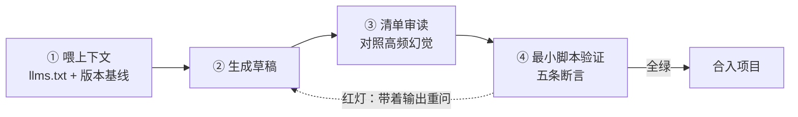

import { Canvas, Controls, Meta } from '@storybook/addon-docs/blocks';
import * as LlmAssistedDevelopment from './llm-assisted-development.stories';

<Meta of={LlmAssistedDevelopment} name="Docs" />

# 用 LLM 辅助 Automerge 开发

全书到此收尾：前面十三课的 API 与行为你都已见过，本课回答最后一个问题——怎么让 AI 助手按**当前版本**的 Automerge 写代码。核心判断一句话：LLM 写错 Automerge 不是随机失误，而是版本断层——训练数据以 2.x 旧 API 为主，stable 与 alpha 两条产品线并存，连安装包里的注释都残留旧示例。所以对策不是换个更强的模型，而是换一套工作方式：**把官方 `llms.txt` 喂进上下文，把生成结果当草稿按实测清单审读，再用最小脚本验证合并行为。**看完本课，你应能预测幻觉校验器的读数：哪些典型的「AI 风格」片段当场抛错、报什么错，哪些能跑却埋着静默偏差。



本课的四样输入，也是回查入口：

| 输入 | 是什么 | 什么时候用 |
| --- | --- | --- |
| [automerge.org/llms.txt](https://automerge.org/llms.txt) | 官方文档索引（llmstxt.org 标准） | 每条 prompt 的固定附件 |
| [automerge.org/llms-full.txt](https://automerge.org/llms-full.txt) | 官方全量文档单文件 | 上下文窗口充裕时整份喂入 |
| [官方迁移指南](https://automerge.org/docs/guides/migrating-from-automerge-2-to-automerge-3/) | 2 到 3 的 API 差异清单 | 审读旧风格代码时对照 |
| 本手册各课的实测记录 | 每个行为都在 3.5.0 / 2.6.0-alpha.3 上实测核对过 | 写审读清单与验证断言时 |

示例基于 `@automerge/automerge@3.5.0` 与 `@automerge/automerge-repo@2.6.0-alpha.3`，幻觉清单里的每条行为都在浏览器与 Node 中实测核对。

## 快速上手

三步走完「喂上下文 → 生成 → 验证」的最小闭环。

**第 1 步，用任务书生成。**把下面的模板整段发给 AI 助手，按需替换第一行的需求描述：

```text
为 Automerge 写一个协同笔记模块：新建笔记、追加一行、两台设备并发追加后合并。

版本基线（不要使用其他版本的 API）：
- @automerge/automerge@3.5.0
- @automerge/automerge-repo@2.6.0-alpha.3

权威上下文：
- 文档索引 https://automerge.org/llms.txt（先读它，再按需要打开具体页面）
- 全量文档 https://automerge.org/llms-full.txt

硬性规则：
- 没有把握的 API 先查上面的索引，不要凭记忆写。
- 以下 API 已移除或已更名，禁止使用：Text 类、RawString、docSync()、
  whenReady()、EphemeralData。
- 输出可直接运行的 .ts 文件而不是片段，每处合并行为都要能被断言。
```

**第 2 步，拿生成的核心行为跑五问。**把生成代码里「建文档、改文档」的部分替换进这个十行脚本的对应位置，`npx tsx verify-automerge.ts` 跑一遍（Node 20+ 零配置）：

```ts
import * as A from '@automerge/automerge';

const base = A.from({ title: '计划：' });
const a = A.change(A.clone(base, { actor: 'aaaa' }), (d) => {
  A.splice(d, ['title'], 3, 0, 'A 补充议程');
});
const b = A.change(A.clone(base, { actor: 'bbbb' }), (d) => {
  A.splice(d, ['title'], 3, 0, 'B 补充预算');
});
const merged = A.merge(A.clone(a), A.clone(b));

console.log('单副本编辑生效:', merged.title.includes('A 补充议程'));
console.log('双副本编辑都在场:', merged.title.includes('B 补充预算'));
console.log('save/load 往返一致:', A.load<{ title: string }>(A.save(merged)).title === merged.title);
console.log('双向合并一致:', A.merge(A.clone(a), A.clone(b)).title === A.merge(A.clone(b), A.clone(a)).title);
```

**第 3 步，红灯处理。**生成代码跑不起来的，先对照下一节的幻觉清单找病因（多半不是你的环境问题）；全绿才谈得上继续开发。五条断言的完整版与逐条说明见[用最小脚本验证](#用最小脚本验证)。

## 为什么 LLM 写错 Automerge

断层有三处来源，每一处都会让模型写出「另一个版本」的代码：

- **训练数据以旧版本为主。**Automerge 的 API 短短几年换了三代：1.x 的 `Am` 代理、2.x 的 stable 与 `next` 双轨、3.x 的当前形态。网上教程、博客与问答大多停在 2.x，模型按概率把不同时代的写法混在一起。
- **官方材料自己也不同步。**官网部分页面仍描述 2.x stable 线的行为（`doc()` 异步、`EphemeralData` 还在）；甚至安装包 `dist/index.d.ts` 顶部的示例注释里，都还留着 `new automerge.Text(...)` 这样的旧 API——「包里写的」也不等于「能跑的」。
- **stable 与 alpha 两条产品线并存。**automerge-repo 2.5.6（stable，止步于此）与 2.6.0-alpha（为 automerge 3 设计，本手册基线）的 API 并不一样，模型不知道你装的是哪条。

同一个需求「在文本开头插入字符」，三代给出的答案不同：

| 时代 | 写法 | 在 3.5.0 的现状 |
| --- | --- | --- |
| 2.x Text 类 | `d.text.insertAt(0, 'X')` | `TypeError`：Text 类已整体移除 |
| 2.x `next` 线（字符串 API） | `A.splice(doc, ['text'], 0, 0, 'X')` | 正是 3.x 的主 API |
| 3.x | 同上；`next` 命名空间仍在，但只是再导出 | `import * as A from '@automerge/automerge'` |

断层无法消除，只能对冲。本课剩下的三节就是三道闸：喂上下文缩小误差，审读拦住已知雷区，验证兜底裁决。

## 把当前版本喂给模型

`llms.txt` 是 [llmstxt.org](https://llmstxt.org/) 定义的约定：在网站根路径放一个 Markdown 文件，H1 是项目名，紧跟一段引言，然后按 `##` 分节列出带链接的页面清单——模型不必爬全站，就能按需取页。Automerge 官方在 [LLM 指南](https://automerge.org/docs/guides/using-automerge-with-llms/)中给出的就是这套方案，共两个文件：

- **`llms.txt`**：约一页的文档索引。从教程、[迁移指南](https://automerge.org/docs/guides/migrating-from-automerge-2-to-automerge-3/)到 Documents、Text、Conflicts、Repositories 各参考页一目了然，适合当「目录」用。
- **`llms-full.txt`**：全量文档拼成的单文件，上下文窗口充裕时整份喂入，一步到位。

三种注入方式按场景选：

| 方式 | 做法 | 适用场景 |
| --- | --- | --- |
| 粘贴索引 | 把 `llms.txt` 全文贴进对话，模型指名要哪几页再补哪几页 | 一次性问答、上下文紧张 |
| 整份喂入 | 把 `llms-full.txt` 作为附件或 `@`-引用放进对话 | 窗口充裕的长任务 |
| 让代理自己抓 | 编码代理（Claude Code、Cursor 等）有读 URL 的能力时，在任务书里给出两个地址让它按需取 | agent 工作流 |

任务书要写全四要素，[快速上手](#快速上手)的模板就是按它组织的：

1. **版本基线**——包名加版本号，堵住「别的版本」的想象空间。
2. **权威上下文**——`llms.txt` 与 `llms-full.txt` 两个地址。
3. **禁用清单**——点名已移除的 API（下一节清单里所有「已移除」行）。
4. **输出要求**——可运行的文件而非片段，行为可被断言。

边界要说清：`llms.txt` 保证「文档是新的」，不保证「模型照着用」。生成之后仍要审读——这就是下一节。

## 审读高频幻觉清单

审读不是把代码重读一遍，而是对照清单扫已知雷区。下面三族清单全部来自本手册课程的实测记录，每条行为都在 3.5.0 与 2.6.0-alpha.3 上真实运行核对过；「实际行为」一列给出的是真实错误信息或真实观测值。迁移差异的完整背景见[从 Automerge 2 迁移](?path=/docs/migrating-from-v2--docs)。

### 核心库：旧版残留

| AI 常写 | 实际行为（3.5.0 实测） | 正确写法 |
| --- | --- | --- |
| `new A.Text('hi')`、`d.text.insertAt(0, 'X')` | `TypeError`：… is not a constructor / … is not a function——Text 类在 3.x 整体移除 | 字符串直接赋值就是文本容器，编辑用 `A.splice` / `A.updateText`（[文本与计数器](?path=/docs/text-and-counters--docs)） |
| `new A.RawString('u')` | 能跑，但 RawString 已是弃用别名，指向 ImmutableString | `new A.ImmutableString('u')`（[集合类型与冲突](?path=/docs/collections-and-conflicts--docs)） |
| `import { next as Automerge }` | 能跑，但 `next` 命名空间只剩再导出 | `import * as A from '@automerge/automerge'` |
| 回调外 `A.splice(doc, ['text'], 0, 0, 'X')` | `RangeError: object cannot be modified outside of a change block` | 写操作全部包进 `A.change` / `handle.change` 回调 |
| 回调内 `d.title[0] = 'X'` | `TypeError: Cannot assign to read only property '0' of string` | 字符串没有可写下标，编辑用 `A.splice` |

### Repo 层：版本线差异

| AI 常写 | 实际行为（2.6.0-alpha.3 实测） | 正确写法 |
| --- | --- | --- |
| `await handle.doc()` | 能跑但无意义：`doc()` 本就同步返回，`await` 等不到任何东西 | `const doc = handle.doc()`（[Repo 与 DocHandle](?path=/docs/repo-and-dochandles--docs)） |
| `handle.docSync()` | `TypeError: handle.docSync is not a function`——本线已移除 | `handle.doc()` |
| `new EphemeralData(handle)`、`eph.publish(...)` | `EphemeralData` 不再导出，调用即 `TypeError`——stable 线的临时数据 API 在本线被 Presence 取代 | `new Presence({ handle })`，`start()` 激活、`broadcast(channel, value)` 更新、`getPeerStates()` 读成员（[在线状态与临时数据](?path=/docs/ephemeral-data--docs)） |
| `import { useDocument } from '@automerge/automerge-repo-react-hooks'` | 旧教程里的包名——本基线的 hooks 在 `@automerge/react` | `import { useDocument } from '@automerge/react'`（[React 绑定](?path=/docs/react-bindings--docs)） |

### 静默偏差：不报错才危险

| AI 常写 | 实际行为（实测） | 正确写法 |
| --- | --- | --- |
| `A.clone(doc, { actorId: 'aaaa' })` | **不报错**，但键名错了被忽略，`getActorId()` 返回随机 hex——自定义身份被静默丢弃 | 键名是 `actor`，或直接传字符串 `A.clone(doc, 'aaaa')`；值必须是 hex |
| `d.title = '整串覆盖'` 做并发编辑 | 能跑，单机结果也对；但整串赋值是一次 put，并发时走冲突规则，一份编辑被静默丢弃 | 增量编辑用 `A.splice` / `A.updateText`（[文本与计数器](?path=/docs/text-and-counters--docs)） |
| `const m = A.merge(a, b)` 后继续 `A.change(a, ...)` | `RangeError: Attempting to change an outdated document. Use Automerge.clone() if you wish to make a writable copy.`——merge 冻结两个参数 | 继续写用合并结果，或先 `A.clone`（[集合类型与冲突](?path=/docs/collections-and-conflicts--docs)） |

前两族会当场抛错，一眼可辨；第三族才是审读清单真正的价值——**不报错的幻觉骗过肉眼，只有运行与断言能抓住。**下面的校验器把清单里的片段逐段真实执行一遍：

<Canvas of={LlmAssistedDevelopment.HallucinationChecker} />

<Controls of={LlmAssistedDevelopment.HallucinationChecker} />

| 读者操作 | 可观察证据 |
| --- | --- |
| 逐个切换「AI 生成片段」 | 画布给出该片段的真实结局：抛错的给出错误原文，能跑的给出观测值，并附修正写法 |
| 切到「actorId 键名写错」 | 唯一的静默偏差：不抛错，`getActorId()` 是随机 hex，`'aaaa'` 被丢弃 |
| 切到「await handle.doc()」 | 能跑、写法过时：`doc()` 同步返回，`await` 是无效动作 |
| 打开 Show code | 看到该 Canvas 实际执行的 `hallucination-checker.ts` |

## 用最小脚本验证

审读拦的是已知雷，验证兜的是未知底。一套固定的断言脚本把「这段代码对不对」变成机械问题——每次拿到 AI 草稿，跑一遍读结果即可。五条断言各自对应 Automerge 的一个核心承诺：

| 断言 | 对应的承诺 | 能抓什么幻觉 |
| --- | --- | --- |
| 创建初值文档 | 生成代码在当前版本跑得起来 | Text 类等已移除的 API |
| 单副本编辑生效 | 写路径正确 | 回调外写、错误键名 |
| 双副本并发编辑不丢 | 并发收敛、增量语义 | put 式覆盖、静默丢编辑 |
| `save` / `load` 往返一致 | 数据可持久化 | 序列化不兼容的值（函数、`undefined` 进不了文档） |
| 双向合并一致 | CRDT 收敛性 | 手写合并逻辑、非确定规则 |

脚本保持几十行、无外部依赖，断言输出**结构化结果**而不是裸 `console.log`——红灯的原样输出可以直接贴回对话喂给模型：

```ts
// verify-automerge.ts —— Node 20+ 零配置：npx tsx verify-automerge.ts
import * as A from '@automerge/automerge';

type PlanDoc = { title: string };
const results: Array<{ name: string; ok: boolean; evidence: string }> = [];

// ① 创建：把 AI 生成的初始化代码替换到这里，跑不跑得起来本身就是断言
const base = A.from<PlanDoc>({ title: '计划：' });

// ② 编辑：单副本修改是否按预期生效
const edited = A.change(base, (d) => {
  A.splice(d, ['title'], 3, 0, '议程；');
});
results.push({ name: '单副本编辑生效', ok: edited.title === '计划：议程；', evidence: edited.title });

// ③ 并发不丢：两副本各编辑一次，合并后是否都在场（专抓 put 式覆盖）
const a = A.change(A.clone(base, { actor: 'aaaa' }), (d) => {
  A.splice(d, ['title'], 3, 0, 'A 补充议程');
});
const b = A.change(A.clone(base, { actor: 'bbbb' }), (d) => {
  A.splice(d, ['title'], 3, 0, 'B 补充预算');
});
const merged = A.merge(A.clone(a), A.clone(b));
results.push({
  name: '双副本并发编辑不丢',
  ok: merged.title.includes('A 补充议程') && merged.title.includes('B 补充预算'),
  evidence: merged.title,
});

// ④ 往返：save/load 后一致
const restored = A.load<PlanDoc>(A.save(merged));
results.push({ name: 'save/load 往返一致', ok: restored.title === merged.title, evidence: restored.title });

// ⑤ 收敛：双向合并结果一致（merge 冻结参数，每次传新鲜 clone）
const oneWay = A.merge(A.clone(a), A.clone(b)).title;
const otherWay = A.merge(A.clone(b), A.clone(a)).title;
results.push({ name: '双向合并一致', ok: oneWay === otherWay, evidence: oneWay });

for (const { name, ok, evidence } of results) {
  console.log(`${ok ? 'PASS' : 'FAIL'}  ${name}  ->  ${evidence}`);
}
if (results.some((r) => !r.ok)) {
  process.exitCode = 1; // 红灯：把全部输出原样贴回给 AI，让它带着证据修
}
```

同一组断言跑在不同草稿上，就是本课的验收现场。「草稿验证台」里三份草稿实现同一个需求（两台设备并发往笔记追加内容），验证台对每份草稿执行完全相同的五条断言：

<Canvas of={LlmAssistedDevelopment.DraftVerifier} />

<Controls of={LlmAssistedDevelopment.DraftVerifier} />

| 读者操作 | 可观察证据 |
| --- | --- |
| 保持「草稿A：旧版 Text 类」 | 第 1 条断言就抛 `TypeError`，后四条未执行——幻觉死在最前面，损失最小 |
| 切到「草稿B：整串覆盖文本」 | 四绿一红：代码全部「能跑」，只有「并发编辑不丢」失败——读数给出胜出值与被覆盖丢弃的编辑（冲突候选 2 个） |
| 切到「修正后：splice 增量编辑」 | 五条全绿，合并文本里两个编辑各归其位 |
| 打开 Show code | 看到该 Canvas 实际执行的 `draft-verifier.ts` |

草稿B 是本课最值钱的一幕：它骗过了肉眼（每一行都跑得起来、单机结果也对），只骗不过并发断言。这正是验证脚本存在的理由——**能跑不算数，断言全绿才算数。**

## 最佳实践

- **把「生成」降级为「草稿」。**任务书里明说「输出草稿，我会验证」；三道闸（上下文、审读、验证）一道都不能省——上下文降低出错率，审读拦已知雷，验证兜未知的底。
- **上下文永远用「当下」的。**每条 prompt 带版本基线与 `llms.txt` 地址；模型背出的写法、搜到的旧教程、甚至安装包里的注释示例，一律以安装版本的 `node_modules/*.d.ts` 与实际运行为准。
- **静默偏差只能靠断言抓。**`actorId` 键名写错、put 式文本覆盖这类幻觉不抛错，代码评审也未必看出来；五条断言里的「并发编辑不丢」就是为它准备的。
- **让代理自己跑验证。**编码代理有执行环境时，把验证脚本定为验收命令，红灯输出原样喂回去让它带着证据修——比人肉转述错误信息高效得多。
- **文档与实现冲突时，以实测为准。**官方材料也可能描述另一个版本（下一节第一节就是活例）；拿不准的写法，两种都丢进验证脚本，让运行结果裁决。

## 常见问题

- **模型坚持写旧 API，提示了也没改干净。**
  三步升级：把 `llms-full.txt` 里的相关页（Text、DocHandles、迁移指南）整页贴入，补足上下文；在任务书里点名禁用清单（Text、RawString、`docSync()`、`whenReady()`、EphemeralData）；仍复发就把本课三族清单直接贴进 prompt 当「审读规则」，要求模型输出前逐条自查，必要时换更新的模型。
- **官方迁移指南让「期望字符串的地方改用 ImmutableString」，裸字符串到底能不能编辑？**
  能。实测 3.5.0：裸字符串赋值后照常可 `splice`（本课验证脚本与[集合类型与冲突](?path=/docs/collections-and-conflicts--docs)的实验台都核对过）；迁移指南那条是迁移步骤的建议写法，`ImmutableString` 表达的是「整体替换」语义。这类文档与实现的出入不要靠猜——把两种写法都丢进验证脚本，以运行结果为准。
- **AI 生成的代码在我机器上 WASM 加载失败。**
  这是环境问题不是 API 问题：Node 20+ 零配置；浏览器按打包器配置（Vite 8+ 原生支持，webpack 需开 `experiments.asyncWebAssembly`，React Native 用 slim 入口手动初始化）。逐环境做法见[初识 Automerge](?path=/docs/getting-started--docs)的常见问题。
- **模型写的 API 在 `.d.ts` 里根本找不到。**
  先分清两条线：官网部分页面描述 stable 2.x，本基线是 2.6.0-alpha。再到安装版本的 `node_modules/@automerge/automerge/dist/` 里查类型声明——查不到就是不存在的 API，把它连同 `llms.txt` 里对应页面的链接一起发给模型重写。

## 总结回顾

摘要：

LLM 写错 Automerge 的根源是版本断层：训练数据以 2.x 旧 API 为主，stable 与 alpha 两条产品线并存，连安装包内的注释都残留旧示例——权威材料自己也可能「写着一个不存在的版本」。对策是一套工作方式而非更强的模型：先用官方 `llms.txt`（文档索引）与 `llms-full.txt`（全量文档）把当前版本的权威上下文喂给模型，任务书写明版本基线与禁用清单；生成之后按三族清单审读——核心库旧版残留（Text 类、RawString、回调外写）、Repo 层版本线差异（`doc()` 同步、EphemeralData 换成 Presence、旧包名）、不报错的静默偏差（`actorId` 键名、put 式文本、merge 后 change）；最后用五条断言（创建、编辑、并发不丢、往返、双向一致）的最小脚本验证，红灯输出原样喂回给模型。静默偏差骗过肉眼，只有断言能抓到。

一句话：

> 把 LLM 的输出当草稿而不是答案：喂当下的 `llms.txt`、按实测清单审读、用最小脚本验证——能跑不算数，断言全绿才算数。

知识要点：

- LLM 写错 Automerge 的三个断层来源是什么？为什么「官方材料」也不可全信？
- `llms.txt` 与 `llms-full.txt` 分别是什么？三种上下文注入方式各适用什么场景？
- 任务书四要素是什么？禁用清单为什么要显式点名已移除的 API？
- 三族高频幻觉各举一例：AI 常写什么、真实行为是什么、正确写法是什么？
- 为什么静默偏差比当场抛错更危险？五条断言里哪条专抓它？
- 五条验证断言分别对应 Automerge 的什么承诺？红灯之后的标准动作是什么？

## 参考资料

- [Using Automerge with LLMs — Automerge Docs](https://automerge.org/docs/guides/using-automerge-with-llms/) —— 官方 LLM 指南，`llms.txt` 方案的出处
- [automerge.org/llms.txt](https://automerge.org/llms.txt) —— 官方文档索引（llmstxt.org 标准）
- [automerge.org/llms-full.txt](https://automerge.org/llms-full.txt) —— 官方全量文档单文件
- [llmstxt.org](https://llmstxt.org/) —— `llms.txt` 标准本身
- [Migrating from Automerge 2 to Automerge 3 — Automerge Docs](https://automerge.org/docs/guides/migrating-from-automerge-2-to-automerge-3/) —— Text 类移除、`next` 再导出、ImmutableString 迁移步骤的官方出处
- [Automerge 官方文档：Text](https://automerge.org/docs/reference/documents/text/) —— 3.x 字符串 API 的权威页面
- 本工作区 `node_modules/@automerge/automerge/dist/index.d.ts`、`implementation.d.ts` 与 `node_modules/@automerge/automerge-repo/dist/index.d.ts` —— 幻觉清单与断言行为的逐条核对依据（3.5.0 / 2.6.0-alpha.3）
