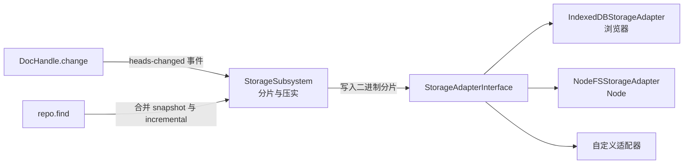

import { Canvas, Controls, Meta } from '@storybook/addon-docs/blocks';
import * as LocalStorage from './local-storage.stories';

<Meta of={LocalStorage} name="Docs" />

# 本地存储

承接[Repo 与 DocHandle](?path=/docs/repo-and-dochandles--docs)的 Repo 模型——那节课的文档都活在内存里，页面一刷新就没了。本课给 Repo 接上持久化：存储适配器把文档写成二进制分片，变更后约 100 毫秒自动落盘；无论刷新页面还是重启进程，用同样的适配器配置重建 Repo，`find` 同一个 URL 就能原样读回文档。看完本课，你应能预测重启恢复实验台的行为：同库重建读回相同值，换一个数据库名重建则报 `unavailable`——存储位置就是数据边界。



本课用到的核心 API 与配置一览，细节见对应小节。示例基于 automerge-repo 2.6.0-alpha.3：

| API / 配置 | 用途 | 关键点 |
| --- | --- | --- |
| `IndexedDBStorageAdapter(database?, store?)` | 浏览器持久化 | 默认库 `"automerge"`、store `"documents"`；dbName 是数据边界 |
| `NodeFSStorageAdapter(baseDirectory?, options?)` | Node 持久化 | 默认目录 `"automerge-repo-data"`；按文档 ID 前缀分片成目录 |
| `RepoConfig.storage` | 把适配器接入 Repo | 不传即 ephemeral，数据完全不落盘 |
| `RepoConfig.saveDebounceRate` | 自动写盘节流 | 默认 100 毫秒，变更后延迟写入 |
| `repo.flush()` | 立即写完缓存文档 | 返回 Promise，测试与退出前使用 |
| `repo.shutdown()` | 进程收尾 | flush 全部文档并关闭网络与适配器 |
| `repo.delete(url)` | 删除文档 | snapshot、incremental、sync-state 分片一并删除 |
| `StorageAdapterInterface` | 自定义适配器接口 | 五个方法加可选 `close()` |
| `Chunk` | 存储读写单元 | key 是 `string[]` 路径，data 是二进制 |

## 快速上手

安装同步层与 IndexedDB 适配器（本工作区已按基线装好，可跳过）：

```bash
npm install @automerge/automerge-repo @automerge/automerge-repo-storage-indexeddb
```

十几行走完「写入 - 落盘 - 重启 - 恢复」闭环：

```ts
import { Repo } from '@automerge/automerge-repo';
import { IndexedDBStorageAdapter } from '@automerge/automerge-repo-storage-indexeddb';

// 接上存储：这个 Repo 的所有文档都写进名为 my-app 的 IndexedDB 数据库
const repo = new Repo({ storage: new IndexedDBStorageAdapter('my-app') });
const handle = repo.create<{ title: string }>({ title: '第一次保存' });
handle.change((d) => {
  d.title = '改好的标题';
});
await repo.flush(); // 立即写完并等待；不调用也会在约 100 毫秒后自动写

// —— 应用重启（刷新页面、重开进程）之后，用同样的配置重建 Repo ——
const restored = await repo.find(handle.url);
restored.doc(); // { title: '改好的标题' } —— 数据回来了
```

两个前提藏在「重启」二字里：重建的 Repo 必须指向**同一个存储**（这里是同一个 dbName）；文档 URL 要由应用自己保存（写进 localStorage、另一份索引文档或自己的清单）——存储按文档 ID 归组分片，Repo 不提供「上次有哪些文档」的清单。

## 存储在 Repo 中的位置

`Repo` 构造时通过 `storage` 选项接入一个存储适配器：

```ts
const repo = new Repo({
  storage: new IndexedDBStorageAdapter('my-app'),
});
```

适配器不直接理解 Automerge 文档：它只是一个 key/value 二进制接口。Repo 内部的 StorageSubsystem 负责所有存储决策——把文档拆成分片、决定写增量还是整体压实、恢复时把分片拼回完整文档。本课的三个小节正好对应它的三件事：接什么（适配器）、什么时候写（写时机）、写成什么样（分片）。

### 不接存储的 Repo：临时副本

不传 `storage` 时 Repo 完全临时，官方的说法是「entirely transient」——每次重启都得从远端 peer 重新加载数据。同时这个 Repo 以 `isEphemeral: true` 的身份出现在对端（该默认值取 `storage === undefined`），对端也不会为它持久化同步状态。内存演示、测试与无状态中继适合这样跑；面向用户的数据一律接适配器。

### 适配器接口：五个方法加一个可选 close

`StorageAdapterInterface` 的全部接口面：

| 方法 | 职责 |
| --- | --- |
| `load(key)` | 读单个 key 对应的二进制 |
| `save(key, data)` | 写入一个二进制值 |
| `remove(key)` | 删除单个 key |
| `loadRange(keyPrefix)` | 读出所有以该前缀开头的分片 |
| `removeRange(keyPrefix)` | 删除所有以该前缀开头的分片 |
| `close?()` | 可选：释放资源，`repo.shutdown()` 最后调用 |

key 是 `string[]`（`StorageKey`）。分层路径让前缀查询成为可能：`[documentId, "incremental"]` 一次取回某文档的全部增量。适配器不需要理解 key 的含义——想接 Redis、S3 或 SQLite 时，实现这五个方法即可。下面的分片实验台就用一个 20 行的内存适配器替跑了 IndexedDB。

## 写时机与存储分片

### 变更后约 100 毫秒自动落盘

存储写入挂在文档的 `heads-changed` 事件上：每次 `handle.change()` 之后，Repo 把保存动作经 `saveDebounceRate`（默认 100 毫秒）节流后异步执行；`create` 出的文档带初值，同样会触发保存。也就是说写盘是自动的，但不是同步的——`change` 返回时数据还在内存里。

需要确定性写盘点时用两个显式入口：

```ts
await repo.flush(); // 立即把所有缓存文档写完并等待
await repo.shutdown(); // flush 全部文档 + 断开网络 + 关闭适配器
```

`repo.delete(url)` 同样直接：删除文档时把它的 snapshot、incremental、sync-state 分片一并清掉，不需要手工清理存储。

### snapshot、incremental 与压实

存储里的最小单位是分片（chunk），键形如分层路径：

| 存储键 | 内容 | 何时写入 |
| --- | --- | --- |
| `[documentId, "snapshot", hash]` | 整份文档（含全部历史）的二进制快照 | 首次保存与每次压实 |
| `[documentId, "incremental", hash]` | 自上次保存以来的增量变更 | 小变更之后 |
| `[documentId, "sync-state", storageId]` | 与某个远端 peer 的同步进度 | 接入网络后（2.3） |

写入策略是「先增量、够数就压实」：小变更先写成 incremental 分片；当增量累计到快照量级、或快照本身小于 1KB 时，整体重写成一个新 snapshot 并删除旧分片。`documentId` 就是文档 URL `automerge:` 后面那段 ID，分片天然按文档归组。

<Canvas of={LocalStorage.ChunkLab} />

<Controls of={LocalStorage.ChunkLab} />

| 读者操作 | 可观察证据 |
| --- | --- |
| 把「快照后追加变更」保持为 0 | 只有 1 块 snapshot 分片——首份快照 |
| 逐步调大追加次数 | incremental 分片一块块堆积，读数显示「尚未压实」 |
| 继续调大直到压实发生 | 增量清零、快照换成新 hash，画布日志标出压实发生的变更序号 |

实验台用内存适配器存储，存储子系统对它的行为与对 IndexedDB 完全一致；它的完整源码就在 Show code 里，同时也是自定义适配器的最小模板。

## 重启后的恢复

恢复不需要任何导出导入：重建一个指向同一存储的 Repo，`find` 同一个 URL，存储子系统把该文档的 snapshot 与 incremental 分片全部读出、合并成完整二进制再加载——连同历史一起还原，得到的 handle 直接可读可写。文档不在存储里也不在对端时，`find` 以 `Document … is unavailable` 拒绝。

URL 是重启后找回数据的唯一线索，而「有哪些文档」没有现成 API。应用要自己持久化文档 URL 清单，重启时逐个 `find`。

<Canvas of={LocalStorage.RestartLab} />

<Controls of={LocalStorage.RestartLab} />

| 读者操作 | 可观察证据 |
| --- | --- |
| 选「写入并落盘」 | 画布显示 create → change → flush 的写入步骤与落库分片 |
| 选「同库重建（模拟重启）」 | 第 1 代 shutdown 卸载后，第 2 代用同一数据库 `find` 同一 URL，读数「原样读回，数据已恢复」 |
| 选「换库重建（数据隔离）」 | 只把重建用的 dbName 换成另一个库，`find` 即报 `unavailable`——数据没丢，只是不在这块存储里 |

## 浏览器：IndexedDB 适配器

```ts
import { IndexedDBStorageAdapter } from '@automerge/automerge-repo-storage-indexeddb';

// 两个参数都有默认值：数据库名 "automerge"，对象仓库 "documents"
const storage = new IndexedDBStorageAdapter('my-app', 'documents');
```

一个 Repo 的全部分片放进同一个 IndexedDB object store：key 就是分片的 `string[]` 路径（IndexedDB 原生支持数组键），前缀查询用区间游标实现。三点实践语义：

- **dbName 是应用的数据边界。** 同一 origin 上的代码用同一个库名会共享文档，多个原型共用默认的 `"automerge"` 会互相看到数据；按应用（以及 dev / prod）分名。
- **多标签页并发安全。** 官方文档明确适配器可并发使用：两个标签页同时编辑同一文档，刷新后按常规合并规则收敛。但标签页之间不会实时互相同步——那是网络适配器的职责（BroadcastChannel / WebSocket，见[网络同步](?path=/docs/networking-sync--docs)）。
- **卡顿时的进阶选项。** 同包还提供 `IndexedDBWorkerStorageAdapter`，把 IndexedDB 操作挪进 Worker 线程执行（无 Worker 环境自动回退线程内实现），避免大文档读写阻塞主线程。

## Node：文件系统适配器

```ts
import { Repo } from '@automerge/automerge-repo';
import { NodeFSStorageAdapter } from '@automerge/automerge-repo-storage-nodefs';

// 默认写入当前工作目录下的 automerge-repo-data/
const repo = new Repo({ storage: new NodeFSStorageAdapter('automerge-repo-data') });

// 长驻进程退出前收尾：写完所有文档并关闭适配器
process.on('SIGINT', async () => {
  await repo.shutdown();
  process.exit(0);
});
```

目录布局按文档 ID 前缀分片，避免单目录文件过多：

```text
automerge-repo-data/
  4N/                              ← documentId 前 2 个字符
    MNnkMhL8jXrdJ9jamS58PAVdXu/    ← documentId 其余字符
      snapshot/<hash>
      incremental/<hash>
```

两个 Node 特有的注意点：

- **`maxConcurrency` 限制并发文件操作数（默认 100）。** 一个大文档可能有成百上千个增量分片，`loadRange` 会并行读文件；把这个值控制在进程文件描述符上限以内（Linux 常见 1024、macOS 256），给其他占用留余量。
- **退出前收尾。** `process.exit()` 不等节流中的异步写入；长驻进程退出前 `await repo.shutdown()`，至少也要 `await repo.flush()`。

本节不配浏览器实例：文件系统在 Storybook 画布里无法真实复现。适配器实现不到 200 行（读写内存缓存加信号量限流），包内附带 `src/index.ts` 源码，可直接对照阅读。

## 最佳实践

- **按应用划存储边界。** dbName 与 baseDirectory 不要用默认值裸跑：同一 origin 上多个原型共用 `"automerge"` 会互相看到文档。按应用名、环境分名，数据隔离在存储层就完成。
- **在关键点显式 flush。** 自动写盘是 100 毫秒节流的异步动作；测试断言前、批量导入后、页面隐藏或 Node 退出前，用 `await repo.flush()` 或 `repo.shutdown()` 给出确定性写盘点。
- **删除走 `repo.delete()`。** 它连 snapshot、incremental、sync-state 分片一起删；绕过 Repo 手工清存储容易留下孤儿分片。
- **把压实当读写放大点看待。** 小文档（快照小于 1KB）每次保存都整体重写；大文档增量攒到快照量级才压实，但一次巨型 change（例如导入大 JSON）本身就会触发下一次整体重写。导入大内容时分批 `change`，让中间态留在增量里。

## 常见问题

- **`find` 报 `Document … is unavailable`，文档明明保存过。**
  先核对重建 Repo 时的 dbName / baseDirectory 是否与写入时完全一致——换库等于换了一块空存储。URL 只是地址，数据跟着存储位置走；要到另一台设备拿这份数据靠的是网络同步（[2.3 网络同步](?path=/docs/networking-sync--docs)），不是同一个 URL。

- **Node 里批量写入后立刻 `process.exit()`，偶尔丢最后几条变更。**
  写盘经 100 毫秒节流异步进行，`exit()` 不等它。退出前 `await repo.shutdown()`；来不及改造退出流程时，至少在退出前 `await repo.flush()`。

- **浏览器里 IndexedDB 数据「无故」消失。**
  存储压力下浏览器会清除未申请持久化的 origin 数据。重要应用调用 `navigator.storage.persist()` 申请持久化；数据消失也可能来自用户手动清除站点数据——这不是 Automerge 的行为。

## 总结回顾

摘要：

本课把「数据真身在本地」落成机制：Repo 通过 `storage` 选项接一个 key/value 二进制适配器，存储子系统把文档拆成 `[documentId, "snapshot"|"incremental", hash]` 分片——小变更写增量，攒到快照量级就整体压实并删除旧分片；写入挂在 `heads-changed` 上经 100 毫秒节流自动发生，`flush` 与 `shutdown` 提供确定性写盘点。重建 Repo 后 `find` 同一 URL，存储把快照与增量合并还原成完整文档：同库恢复、换库即 `unavailable`，dbName 与 baseDirectory 就是数据边界。浏览器用 IndexedDB 适配器（多标签页并发安全），Node 用文件系统适配器（按文档 ID 前缀分片目录、退出前 shutdown）；换别的存储后端只需实现五个方法的 `StorageAdapterInterface`。

一句话：

> 存储适配器决定数据落在哪，dbName 与目录就是数据边界；变更自动落盘，重建 Repo 后 find 同一 URL 即原样恢复。

知识要点：

- 不传 `storage` 的 Repo 处于什么状态？`isEphemeral` 对同步对端意味着什么？
- 一次 `handle.change()` 之后数据什么时候写盘？怎样获得确定性的写盘点？
- 存储分片有哪几种键？什么时候写增量、什么时候压实？
- 重启后怎样恢复文档？为什么 URL 清单要由应用自己保存？
- 换一个 dbName 或 baseDirectory 会发生什么？
- 自定义存储后端要实现哪些方法？

## 参考资料

- [Automerge 官方文档：Storage](https://automerge.org/docs/reference/repositories/storage/) —— 存储适配器官方说明与并发语义
- [automerge-repo-storage-indexeddb 包源码](https://github.com/automerge/automerge-repo/tree/main/packages/automerge-repo-storage-indexeddb) —— IndexedDB 适配器实现与 Worker 变体
- [automerge-repo-storage-nodefs 包源码](https://github.com/automerge/automerge-repo/tree/main/packages/automerge-repo-storage-nodefs) —— 文件系统适配器与分片目录布局
- 本工作区 `node_modules/@automerge/automerge-repo/dist/storage/` 与 `dist/Repo.d.ts` —— 分片键布局、压实阈值与 `saveDebounceRate` 等默认值的核对依据（2.6.0-alpha.3）
