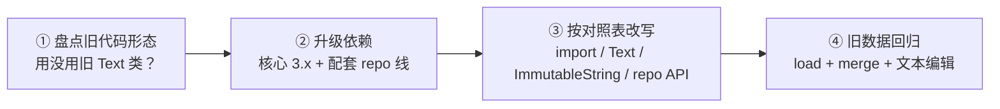

import { Canvas, Controls, Meta } from '@storybook/addon-docs/blocks';
import * as MigratingFromV2 from './migrating-from-v2.stories';

<Meta of={MigratingFromV2} name="Docs" />

# 从 Automerge 2 迁移

本课为带着 Automerge 2 代码或知识来的读者而写：把旧写法升级到本手册的 3.x 基线（核心库 `@automerge/automerge@3.5.0`、同步层 `@automerge/automerge-repo` 生态 2.6.0-alpha 线），并把前面课程零散记录的 2→3 行为差异收拢成一张对照表。核心判断一句话：**Automerge 3 换了引擎、没换油料——文件格式与主干 API 几乎原样，真正的破坏面集中在文本 API 的收拢与配套链路的版本语义**。所以升级不是重写：先判断旧代码属于哪一类，再按对照表改写，最后用旧数据验证行为不变。

正文结论分两类标注：3.x 侧行为全部在 3.5.0 与 2.6.0-alpha.3 上实测；2.x 侧行为以官方迁移指南与发布公告为准（工作区不安装 2.x，不做伪造对照）。

迁移速查表——旧形态到 3.x 的处置，依据见对应小节：

| 旧形态（2.x） | 3.x 处置 | 深入 |
| --- | --- | --- |
| `import { next as A }` | `import * as A`；`next` 仍在但只是弃用转发 | import：next 命名空间已弃用 |
| `new A.Text()` 加 `.insertAt()` 做字符编辑 | 普通字符串加 `A.splice` / `A.updateText`，数据不用动 | Text 类 → 普通字符串 |
| v2 stable 的整串覆盖 `d.s = 'x'` | `d.s = new A.ImmutableString('x')`（v3 普通赋值已变成字符序列） | 整串覆盖 → ImmutableString |
| v2 next 的 `RawString` | 更名 `ImmutableString`，旧名仍是弃用别名 | 整串覆盖 → ImmutableString |
| `A.init(初始对象)` | 改用 `A.from(初始对象)`——init 会忽略对象参数 | 初始化与 actorId |
| 非 hex 的 actorId（如 `'seed'`） | 换成 hex 字符串，否则抛 `RangeError` | 初始化与 actorId |
| `await handle.doc()` / `docSync()` | `handle.doc()` 同步（repo 2.6 线；稳定线仍旧异步） | Repo 层的行为差异 |
| `new EphemeralData(handle)` | `handle.broadcast()` 与 `Presence`（repo 2.6 线） | Repo 层的行为差异 |
| `BrowserWebSocketClientAdapter` / `NodeWSServerAdapter` | `WebSocketClientAdapter` / `WebSocketServerAdapter` | Repo 层的行为差异 |

## Automerge 3 变了什么

先回答「值不值得升、风险在哪」。Automerge 3 的主要动机是资源占用：Rust 核心把原来只在落盘时使用的列式压缩格式搬进了运行时，官方公告给出的数字是内存占用降到 2 的十分之一以下、极端案例更多——同一份《白鲸记》全文文档从约 700 MB 降到约 1.3 MB；大历史文档的加载从「17 小时没加载完」变成 9 秒。这些是官方公告数字，本课未在 2.x 上复测（工作区不装 2.x），3.x 侧的加载与体积量级可参考[数据建模手册](?path=/docs/modeling-data--docs)的实测表。

风险面用一张表看清——变的少，且集中在文本：

| 层面 | 2.x | 3.x | 迁移动作 |
| --- | --- | --- | --- |
| 文件格式 | 列式压缩二进制 | **不变** | 旧字节直接 `load` |
| 主干 API（`init` / `from` / `change` / `merge` / `clone` / `save` / `load` 等） | 稳定 | 签名不变 | 基本不动 |
| 文本 API | stable 的 `Text` 类与 next 的新 API 并存 | 收拢为一套：字符串即字符序列 | 唯一的大改写面 |
| 非协作字符串 | next 里叫 `RawString` | 更名 `ImmutableString` | 改名或用弃用别名 |
| `next` 命名空间 | 实验性新 API 入口 | 弃用，转发主模块 | 改成根导入 |
| 内存与大历史加载 | 高内存、大文档加载慢 | 官方数字：内存 10 倍级下降、加载大幅提速 | 升级即得 |

配套层的版本语义也有变化：同步层 automerge-repo 各条线支持的核心版本与 handle 行为不同，见「版本配套」与「Repo 层的行为差异」。WASM 入口方面，3.x 把环境差异收进 package exports 按条件分发（Node、bundler、workerd、默认 base64 内嵌各一个入口，另有 `./slim` 供手动初始化）；各环境的配置对照已在[初识 Automerge](?path=/docs/getting-started--docs)的常见问题里按 3.x 核对过。

## 版本配套

核心 3 不是凭空换上的：同步层的每条线绑定不同的核心版本区间。下表来自 npm registry 各版本 manifest 的实查（2026-10）：

| automerge-repo 线 | 依赖的 `@automerge/automerge` | 说明 |
| --- | --- | --- |
| 2.0.x | `^2.2.8`（仅 core 2） | 不能配 core 3 |
| 2.1.0 – 2.5.6（稳定线） | `2.2.8 - 3`（两个大版本皆可） | 官方博客：2.1.0 起默认安装 core 3 |
| 2.6.0-alpha 线 | `^3.2.6`（仅 core 3） | 本工作区基线；handle 行为有调整，见下文 |

三条实用结论：

- **只升核心、留在稳定线是可行的**：稳定线 2.1.0 起的依赖区间已兼容 core 3，直接 `npm update @automerge/automerge` 即可（官方迁移指引的说法）。适合先把核心换掉、同步层改动往后排的项目。
- **npm 的 `latest` 标签目前指向 2.6.0-alpha.3**：裸 install 拿到的就是 alpha 线，与本工作区基线一致。
- **稳定线已止步 2.5.6**，后续演进（handle 即就绪、`Presence` 等）都在 2.6 线；新项目按本手册基线直接用 2.6.0-alpha 线，各适配器（network / storage / react）版本保持同一 alpha 号。

## 文本 API 对照

这是唯一的较大改写面。v2 时代文本有两套 API：stable 的 `Text` 类（早已标记弃用）和 next 命名空间的新 API（普通字符串即字符序列）。3 把赌注全押在后者：`Text` 类删除、next 转正，非协作字符串 `RawString` 更名 `ImmutableString`。下面的实验室在 3.5.0 上实测两类旧写法的结局与新写法的成本：

<Canvas of={MigratingFromV2.ApiDiffLab} />
<Controls of={MigratingFromV2.ApiDiffLab} />

| 读者操作 | 可观察证据 |
| --- | --- |
| 保持「Text 类 → 普通字符串」场景 | 旧写法报 `TypeError: d.content.insertAt is not a function`；新写法 `A.splice` 写入同样的内容，`next` 转发读数为「是」 |
| 切到「整串覆盖 → ImmutableString」 | 默认内容 11 个字符：普通赋值 12 个 op（1 个 put + 每字符 1 op），`ImmutableString` 1 个 op；两者并发赋值的冲突候选同为 2 个 |
| 修改「写入内容」 | 普通赋值的 op 数随字符数同步上涨，`ImmutableString` 恒为 1 |
| 打开 Show code | 看到该 Canvas 实际执行的 `api-diff-lab.ts` |

### 判断旧代码的 API 形态

迁移第一步是分清旧代码用的哪套 API，处置路径完全不同：

| 特征 | 旧 stable API | 旧 next API |
| --- | --- | --- |
| 导入 | `import * as Automerge` | `import { next as Automerge }` |
| 协作文本 | `new Automerge.Text()`，对象方法 `.insertAt` / `.deleteAt` | 普通字符串赋值，`Automerge.splice` 编辑 |
| 整串覆盖 | `d.s = '新值'`（单一值语义） | 避免整串赋值，用 `RawString` 表达单一值 |
| 迁移路径 | Text → 普通字符串；整串覆盖 → `ImmutableString` | `RawString` → `ImmutableString`，其余只改导入 |

### import：next 命名空间已弃用

官方迁移指南对「不用旧 Text API」的代码只要求一件事——把 next 导入改成根导入：

```ts
// 2.x（next）
import { next as A } from '@automerge/automerge';

// 3.x
import * as A from '@automerge/automerge';
```

`next` 命名空间在 3.x 仍然存在（3.5.0 的类型声明里是 `export * as next`），内容与主模块完全相同——实测 `A.next.splice === A.splice` 为 `true`。所以漏改导入不会坏，但它是弃用 API，新代码一律用根导入。

### Text 类 → 普通字符串

官方指南的对照示例：

```ts
// 2.x：文本是 Text 类实例，方法挂在对象上
let doc = A.from({ content: new A.Text() });
doc = A.change(doc, (d) => {
  d.content.insertAt(0, 'Hello ');
});

// 3.x：文本就是字符串，编辑走带路径的 API
let doc = A.from({ content: '' });
doc = A.change(doc, (d) => {
  A.splice(d, ['content'], 0, 0, 'Hello ');
});
```

这是三类迁移里最省心的一类：**存储层没变**。`Text` 类在底层就是字符序列对象，3.x 的普通字符串是同一种对象的新呈现——旧字节 `load` 进来，字段直接读回 `string`，原来的并发字符编辑、游标全部照旧有效（语义见[文本与计数器](?path=/docs/text-and-counters--docs)）。要改的只是调用方式：`insertAt` / `deleteAt` 换成 `A.splice`，整串重建换成 `A.updateText`。实测旧写法在 3.x 的结局是 `TypeError: d.content.insertAt is not a function`——字符串上没有这些方法，报错点即迁移点。

### 整串覆盖 → ImmutableString

反向的陷阱在「普通字符串」的语义变化上。v2 里两套 API 对整串覆盖的字符串各有一个「单一值」表达：stable 直接用普通字符串（底层是标量），next 用 `RawString`。到了 3.x，普通字符串赋值变成了字符序列——**同样的 `d.s = '新值'`，在 v2 stable 是一次单一值覆盖，在 3.x 会按字符落 op**。官方指南因此要求把这类字段改用 `ImmutableString`：

```ts
// 2.x：整串覆盖是单一值
let doc = A.from({ content: 'Hello world' });
doc = A.change(doc, (d) => {
  d.content = 'Goodbye world';
});

// 3.x：单一值语义要用 ImmutableString 保住
let doc = A.from({ content: new A.ImmutableString('Hello world') });
doc = A.change(doc, (d) => {
  d.content = new A.ImmutableString('Goodbye world');
});
```

不改会怎样？代码能跑、合并语义也相同（实测两者并发赋值的冲突候选同为 2 个，都走 put 冲突规则），但每次覆盖从 1 个 op 变成 1 + N 个 op——历史按 op 数膨胀、加载逐 op 重放，账单见[数据建模手册](?path=/docs/modeling-data--docs)的粒度实测。`RawString` 在 3.5.0 里是 `ImmutableString` 的弃用别名（实测两者是同一个类），旧名能用但应改新名。

## 初始化与 actorId

主干 API 签名不变，但两个初始化习惯在 3.x 有不同结局，都实测过：

```ts
// 陷阱一：init 忽略对象参数——旧代码以为在设初值，实际拿到空文档
const doc = A.init({ title: 'x' });
A.toJS(doc); // {}——对象被静默忽略；设初值用 A.from

// 陷阱二：actorId 必须是 hex 字符串
A.init('seed');
// RangeError: could not parse Actor ID as a hex string:
//   Invalid character 's' at position 0
A.from({ title: 'x' }, 'aaaa'); // OK：hex actorId 合法
```

- `init` 的参数只接受 actorId 或 `InitOptions`，传普通对象会被当配置对象忽略——**不报错、不设初值**，是最隐蔽的一类静默失灵；创建带初值的文档只有 `from` 一条路。
- actorId 不是任意字符串：3.x 从 WASM 层强制 hex（偶数位十六进制字符），传 `'seed'` 这类短字符串在创建文档时就抛 `RangeError`；不传参、用自动生成的随机 id 永远合法。
- 其余创建与加载路径不变：`clone` 可带 actorId、`load` 同步返回、`save` 往返无损（基线语义见[初识 Automerge](?path=/docs/getting-started--docs)与[变更、快照与合并](?path=/docs/changes-and-merging--docs)）。

## 数据兼容性

数据兼容分两层看，结论不同：

- **字节层：兼容，官方保证。** 官方公告明确 Automerge 3「使用与 2 相同的文件格式」——升级后用 3.x `load` 旧字节即可。工作区不安装 2.x、无法伪造真正的 2.x 产出的字节做实测，此结论以官方资料为准；本课实测用的是 3.5.0 造出的同形态数据（见下）。
- **形态层：能读，但编辑语义随字段形态走。** 底层一直区分两种字符串对象——`str` 标量（整段存取）与 `text` 序列（逐字符有身份）。3.x 只是把这个区分显性化：序列读回普通 `string`，标量读回 `ImmutableString` 实例。v2 各种写法落到 3.x 的读回形态：

| v2 写法 | 底层形态 | 3.x 读回 | 能否 `A.splice` |
| --- | --- | --- | --- |
| v2 stable `d.s = 'x'` | str 标量 | `ImmutableString` 实例 | 否（整段赋值） |
| v2 next `new RawString('x')` | str 标量 | `ImmutableString` 实例 | 否（整段赋值） |
| v2 `new Text()` / next 普通赋值 | text 序列 | 普通 `string` | 是 |

所以「升级后代码坏在文本字段上」的根因多数是第二层：字段读回的是标量，旧代码却按序列编辑。两个处置方向：语义就该是整段覆盖的，把代码改成 `ImmutableString` 赋值；确实需要逐字编辑的（比如旧 stable 项目想把字符串升级成协作文本），用 `load` 的隐藏选项 `convertImmutableStringsToText` 把标量一次性转成序列再 `save` 固化：

<Canvas of={MigratingFromV2.DataCompatLab} />
<Controls of={MigratingFromV2.DataCompatLab} />

| 读者操作 | 可观察证据 |
| --- | --- |
| 保持「原样 load」 | `note` 读回 string（序列）、`homepage` 读回 ImmutableString（标量）、`views` 读回 Counter(3)——与 2.x 同形态 |
| 切到「转换后编辑」 | load 带选项后 `homepage` 变为序列，`splice` 插入 `docs.` 成功；save 往返后再 load 仍是序列（转换已固化） |
| 打开 Show code | 看到该 Canvas 实际执行的 `data-compat-lab.ts` |

`convertImmutableStringsToText` 是 `InitOptions` 类型里的公开字段但标注 hidden、未见于官方文档，上表行为在 3.5.0 实测；用前以本地类型声明为准。Counter、日期、二进制等其余标量类型与 2.x 同形，无迁移动作。

## Repo 层的行为差异

核心 3 之外，配套的 automerge-repo 各线之间也有一批差异。注意区分：这些是**同步层的线差异**（稳定线 2.5.6 与 2.6.0-alpha 线之间），不是 core 3 带来的——留在稳定线升核心，下表左列行为照旧。以本工作区 2.6.0-alpha.3 基线为准的对照：

| 旧（稳定线 / 旧教程） | 现（2.6.0-alpha 基线） | 处置 |
| --- | --- | --- |
| `await handle.doc()`、`docSync()` | `doc()` 同步。类型声明备注原文：`In past releases, this was asynchronous and could be undefined` | 去掉 await；`docSync()` 已移除 |
| `handle.whenReady()` 等待就绪 | 弃用。原文：`Handles are always ready when handed out by Repo.find / Repo.create` | handle 交出即可用，直接删等待 |
| handle 经历 loading / requesting 中间态 | create / find 交出即 ready（状态机仍在，delete 等场景使用） | 不再写针对中间态的分支 |
| `new EphemeralData(handle)` | 类已从包导出中移除；一次性消息用 `handle.broadcast()`，持续在线状态用 `Presence` | 按[在线状态与临时数据](?path=/docs/ephemeral-data--docs)改写 |
| `BrowserWebSocketClientAdapter` / `NodeWSServerAdapter` | `WebSocketClientAdapter` / `WebSocketServerAdapter`（旧名仍是隐藏别名） | 改现名，选型见[网络同步](?path=/docs/networking-sync--docs) |

生命周期与 find 语义的完整讲解在[Repo 与 DocHandle](?path=/docs/repo-and-dochandles--docs)（其「常见问题」记录了这些差异的实测细节）；`@automerge/react` 的 hooks 随同一 alpha 线发布，用法见[React 绑定](?path=/docs/react-bindings--docs)。

## 迁移步骤

四步走，判断与改写都对照本文速查表：



1. **盘点。** 全局搜 `next`、`new Text`、`.insertAt`、`RawString`、`EphemeralData`、`docSync`、`whenReady`，命中项决定改写清单；一个没搜到的项目通常只需改依赖。
2. **升级依赖。** 核心升 3.x；同步层二选一——先留 2.5.6 稳定线（依赖区间已兼容 core 3，改动最小），或按本手册基线上 2.6.0-alpha 线并完成 Repo 层改写。配套的 network / storage / react 适配器与 repo 同版本。
3. **按对照表改写。** import 转正、`Text` 调用换 `A.splice`、整串覆盖换 `ImmutableString`、`init(对象)` 换 `from`、actorId 补 hex、repo 侧按上表。
4. **旧数据回归。** 拿升级前 `save` 出的真实字节做三件事：`load` 成功且字段可读、并发 `change` 后 `merge` 收敛与升级前一致、文本字段按读回形态选择编辑方式：

```ts
import * as A from '@automerge/automerge';
import { readFileSync } from 'node:fs';

type OldDoc = { title: string; content: string };

// 同一文件格式：旧字节应能直接 load，字段可读
const doc = A.load<OldDoc>(readFileSync('旧文档.bytes'));

// 合并行为与升级前一致：两副本并发改写后收敛到唯一结果
const a = A.change(A.clone(doc, 'aaaa'), (d) => {
  d.title = 'A 的改写';
});
const b = A.change(A.clone(doc, 'bbbb'), (d) => {
  d.title = 'B 的改写';
});
console.log(A.merge(a, b).title);

// 文本语义：读回形态决定编辑方式
console.log(typeof doc.content); // string（序列，用 A.splice）或 ImmutableString（标量，整段赋值）
```

## 最佳实践

- **先盘形态，再动代码。** 「用没用旧 Text 类」这一项判断决定大半工作量：不用的项目改个导入就完事；用的项目把 Text 与整串覆盖两条对照走完。不要混着改。
- **整串覆盖的字段用 `ImmutableString` 保语义，不要顺手改成普通赋值。** 普通赋值在 3.x 是字符序列：op 成本变成 1 + N、历史与加载账单随之膨胀；`ImmutableString` 才是 v2 stable 字符串的等价物。
- **字节能读不等于代码能跑。** 字节层兼容由官方格式保证，但标量字段读回 `ImmutableString`、按序列编辑会抛 `RangeError`；按读回形态选编辑方式，需要逐字编辑的旧标量用转换 load 加 save 一次性固化。
- **同步层跟着基线走。** 只升核心可暂留稳定线，但 handle 即就绪、`Presence` 等演进只在 2.6 线；上 alpha 线时把 `doc()` 的 await、`EphemeralData`、适配器旧名一次清掉，适配器版本与 repo 对齐。
- **回归用真实数据，不满足于编译通过。** 编译器挡不住「init 忽略对象」「标量按序列编辑」这类运行时失灵；拿生产样本字节跑 load、merge、文本编辑三件套。

## 常见问题

- 升级后报 `TypeError: d.content.insertAt is not a function`
  这是旧 `Text` 类写法：3.x 的协作文本是普通字符串，把 `.insertAt` / `.deleteAt` 调用改成 `A.splice(doc, path, index, del, text)`，数据本身不用迁移（见「Text 类 → 普通字符串」）。
- 对某字段 `A.splice` 报 `RangeError: ... path did not refer to an object`
  该字段是标量字符串，读回 `ImmutableString`，没有字符可 splice。整段覆盖语义就改成 `new A.ImmutableString(...)` 赋值；确需逐字编辑就 load 时带 `convertImmutableStringsToText` 一次性转成序列再 save 固化（见「数据兼容性」）。
- `A.init({ ... })` 返回空文档，初值不见了
  `init` 只接受 actorId 或配置对象，普通对象参数被静默忽略。创建带初值的文档改用 `A.from(initialState)`（见「初始化与 actorId」）。
- 报 `RangeError: could not parse Actor ID as a hex string`
  actorId 传了非 hex 字符串（如 `'seed'`）。换成偶数位十六进制字符串，或干脆不传、让 automerge 生成随机 id。
- 升级依赖后 `await handle.doc()` 类型报错、`docSync` 不存在
  2.6 线的 handle 交出即就绪：`doc()` 同步、`docSync()` 移除、`whenReady()` 弃用。去掉 await 即可；若需暂留稳定线则行为不变（见「Repo 层的行为差异」）。
- LLM 或旧教程生成的代码带着 `next` 导入或 `Text` 类
  训练数据滞后于 3.x。按本课速查表逐条审读改写；让 AI 工具核对版本的完整工作流见「用 LLM 辅助 Automerge 开发」一课。

## 总结回顾

摘要：

Automerge 3 的动机是资源占用——运行时改用列式存储，官方数字为内存 10 倍级下降与大历史加载提速——而升级风险低的原因是文件格式与主干 API 不变，破坏面集中在文本 API 的收拢：`Text` 类删除、next 命名空间弃用转发、`RawString` 更名 `ImmutableString`。旧代码先分形态：不用旧 Text API 的只需把 next 导入转正；用了的，`Text` 类改成普通字符串加 `A.splice`（存储未变，数据不用迁移），整串覆盖改成 `ImmutableString` 赋值（v3 的普通字符串赋值已是字符序列，op 成本 1 + N）。初始化的两个坑：`init` 忽略对象参数、actorId 必须 hex。数据兼容分两层：字节层同格式可直接 load（官方保证）；形态层标量读回 `ImmutableString`、序列读回 `string`，编辑方式跟着形态走，隐藏选项 `convertImmutableStringsToText` 可把标量一次性转序列。同步层的差异属于线差异而非 core 3：2.6.0-alpha 基线下 `doc()` 同步、`docSync` 移除、`whenReady` 弃用、`EphemeralData` 换成 broadcast 与 `Presence`、WebSocket 适配器改名。迁移四步：盘点、升依赖、按表改写、旧数据回归。

一句话：

> Automerge 3 换的是引擎不是油料：格式与主干 API 照旧，把 `Text` 类换成普通字符串、整串覆盖换成 `ImmutableString`，再按配套表对齐同步层，旧数据回归通过即迁移完成。

知识要点：

- Automerge 3 的收益是什么？为什么说升级风险集中在文本 API 与配套链路？
- v2 的两套文本 API 怎么判别？各自迁移到 3.x 的哪种写法？
- v2 stable 的整串覆盖字段为什么不建议改成 v3 普通赋值？改与不改的 op 成本差多少？
- `init` 传对象、actorId 传非 hex 各会发生什么？正确写法是什么？
- 旧字节 load 后，标量与序列字符串字段分别读回什么？怎么把标量变成可 splice 的序列？
- 同步层 2.6.0-alpha 线相对稳定线有哪些 API 与命名差异？只升核心、暂留稳定线可行吗？
- 迁移验证的三件套是什么？为什么编译通过不等于迁移完成？

## 参考资料

- [Migrating from Automerge 2 to Automerge 3 — Automerge Docs](https://automerge.org/docs/guides/migrating-from-automerge-2-to-automerge-3/) —— Text 类移除、next 弃用、ImmutableString 更名的官方对照与升级步骤
- [Automerge 3.0 — Automerge Blog](https://automerge.org/blog/automerge-3/) —— 内存与加载收益的官方数字、同一文件格式声明、automerge-repo 2.1.0 起默认配套
- [Text — Automerge Docs](https://automerge.org/docs/reference/documents/text/) —— 3.x 文本 API 的现行语义（splice / updateText）
- [Library initialization — Automerge Docs](https://automerge.org/docs/reference/library-initialization/) —— WASM 入口与各环境初始化
- [@automerge/automerge-repo 2.6.0-alpha.3 — npm](https://www.npmjs.com/package/@automerge/automerge-repo/v/2.6.0-alpha.3) —— 本工作区基线；各线依赖区间经 npm manifest 实查
- 本工作区 `node_modules/@automerge/automerge@3.5.0` 的 `dist/implementation.d.ts` 与 `dist/immutable_string.d.ts` —— init / InitOptions、RawString 弃用别名等签名核对依据
- 本工作区 `node_modules/@automerge/automerge-repo@2.6.0-alpha.3` 的 `dist/DocHandle.d.ts` —— doc() 同步化备注与 whenReady 弃用标记的核对依据
