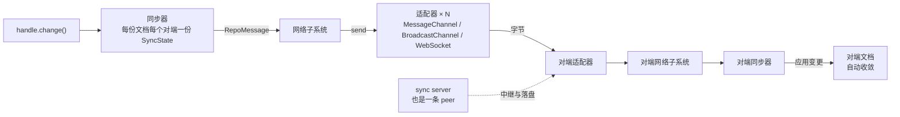

import { Canvas, Controls, Meta } from '@storybook/addon-docs/blocks';
import * as NetworkingSync from './networking-sync.stories';

<Meta of={NetworkingSync} name="Docs" />

# 网络同步

[本地存储](?path=/docs/local-storage--docs)解决了「重启后数据还在」；本课解决「另一台设备上的副本怎么对齐」。Repo 通过**网络适配器**与别的 Repo 交换同步消息：适配器只负责把字节送到对端，**收敛由同步协议保证**——换一种通道（同页直连、跨标签页广播、互联网 WebSocket）不改变文档语义。同步服务器本身也是一台普通 Repo，只是策略上「不主动、只应答」。看完本课，你应能预测两个实验台的行为：同页两个 Repo 互联后，一侧创建的文档不经任何搬运 API 就出现在另一侧，任一侧修改约百毫秒内两侧 heads 一致；低层协议跑完一轮后 `generateSyncMessage` 返回 null，再跑一轮一条消息都不产生。



本课用到的核心 API 与配置一览，细节见对应小节。示例基于 automerge-repo 2.6.0-alpha.3；同步握手以 `ProtocolV1`（`"1"`）标记，客户端与服务器不必同版本线：

| API / 配置 | 用途 | 关键点 |
| --- | --- | --- |
| `RepoConfig.network` | 接入适配器数组 | 可多个并存；运行时经 `networkSubsystem` 增删 |
| `MessageChannelNetworkAdapter(port, config?)` | 同页 / Worker 点对点通道 | 握手 arrive → welcome；同页场景官方推荐 |
| `BroadcastChannelNetworkAdapter(options?)` | 同 origin 跨标签页 | 默认 `"broadcast"` 频道、等 peer 1000ms；广播模拟点对点 |
| `WebSocketClientAdapter(url, retryInterval?)` | 连接远端服务器 | `retryInterval` 默认 5000ms，断线自动重连 |
| `WebSocketServerAdapter(server, keepAliveInterval?)` | Node 服务器端 | 包装 `ws` 的 WebSocketServer；keep-alive 默认 5000ms |
| `repo.peers` / `repo.peerId` | 连接状态 | 已连接 peer 列表 / 本机会话身份（默认随机） |
| `initSyncState()` / `generateSyncMessage()` / `receiveSyncMessage()` | 低层同步协议 | 收敛判据：generate 返回 null |
| `handle.on("change", fn)` | 感知同步到达 | 本地与远端变更走同一通道 |

## 快速上手

安装（本工作区已按基线装好三个适配器包，可跳过）：

```bash
npm install @automerge/automerge-repo @automerge/automerge-repo-network-messagechannel
```

十几行跑通「互联 - 创建 - 自动到达 - 修改 - 收敛」闭环，浏览器与 Node 皆可运行：

```ts
import { Repo } from '@automerge/automerge-repo';
import { MessageChannelNetworkAdapter } from '@automerge/automerge-repo-network-messagechannel';

// 一条 MessageChannel，两端各插到一个 Repo：本页两个仓库从此互通
const channel = new MessageChannel();
const left = new Repo({
  peerId: 'left',
  network: [new MessageChannelNetworkAdapter(channel.port1)],
});
const right = new Repo({
  peerId: 'right',
  network: [new MessageChannelNetworkAdapter(channel.port2)],
});

// left 创建文档：同步器把新文档 announce 给所有 peer
const handle = left.create<{ title: string }>({ title: '共享待办' });

// right 凭 URL 取回：find 向同伴请求并等待文档送达
const remote = await right.find<{ title: string }>(handle.url);
remote.doc(); // { title: '共享待办' } —— 文档自己流过来了

// left 修改，right 经同一连接自动收到
handle.change((d) => {
  d.title = '改好的标题';
});
await new Promise((r) => setTimeout(r, 300)); // 等同步往返：Repo 发同步消息前有 100ms 防抖
remote.doc().title; // '改好的标题'
```

`find` 不需要特殊处理：文档没到就等待，到了立即兑现。等待期间文档有两条到达路径——对端创建文档时主动 announce，或本机 `find` 按 URL 向所有 peer 请求；两条路最终跑的都是同一套同步协议（见下文「同步协议」一节）。

## 网络适配器

适配器是 Repo 与外界的点对点通道：一个 Repo 可以同时挂多个（`network` 数组），每个适配器通向一类距离。适配器不理解文档——它递送的唯一货物是 `RepoMessage` 信封（同步消息、按 URL 的请求、不可用通知等），拆信、应用、回信全是 Repo 内部同步器的职责。

### 适配器接口与事件

自定义或理解适配器，只需盯住这组接口面（`NetworkAdapterInterface`）：

| 成员 | 职责 |
| --- | --- |
| `connect(peerId, peerMetadata)` | Repo 调用：开始连接，报上本机身份 |
| `send(message)` | Repo 调用：把一条消息送到指定对端 |
| `disconnect()` | Repo 调用：断开通道 |
| `isReady()` / `whenReady()` | 适配器是否就绪；文档同步等网络就绪才开始 |
| `peerId` / `peerMetadata` | connect 之后记录的本机身份 |
| 事件 `peer-candidate` | 发现新 peer（握手成功的产物） |
| 事件 `peer-disconnected` | peer 掉线 |
| 事件 `message` | 收到一条消息 |
| 事件 `close` | 适配器关闭，Repo 把它从列表移除 |

写自定义适配器时继承 `NetworkAdapter` 基类（自带事件发射器与接口骨架），补齐五个方法即可；任何能按对端寻址的字节管道都够用。适配器也可以在 Repo 创建之后增删：`repo.networkSubsystem.addNetworkAdapter(adapter)` 与 `removeNetworkAdapter(adapter)`——官方教程「先建 Repo、后接网络」的写法走的就是这个低层入口。

### peer 发现与握手

Repo 构造后立刻对每个适配器调用 `connect(peerId, peerMetadata)`。`peerId` 默认随机生成（`"peer-…"`，刷新即变，只是会话身份）；`peerMetadata` 带上 `storageId` 与 `isEphemeral` 两个字段——对端据此决定要不要为这份同步进度落盘（临时身份不存，见[本地存储](?path=/docs/local-storage--docs)的 sync-state 分片）。

握手因通道而异，产物相同：

- MessageChannel / BroadcastChannel：双方互发 `arrive` → 回 `welcome`，各自发出 `peer-candidate`；
- WebSocket：客户端发 `join` 报上身份与协议版本，服务器逐个回应 `peer`。

`peer-candidate` 一路向上交给同步器，新 peer 被加进**每一份文档**的同步队列：默认共享策略对同伴慷慨，所有文档自动互通，无需逐份指名。此后 `repo.peers` 随时可查已连接的 peer，`repo.getStorageIdOfPeer(peerId)` 可查对端 storageId。

### 三个官方适配器怎么选

| 适配器（包 `@automerge/automerge-repo-network-*`） | 距离 | 要点 |
| --- | --- | --- |
| `MessageChannelNetworkAdapter`（`-messagechannel`） | 同页两个上下文、Worker、SharedWorker | 真点对点；`useWeakRef: true` 用于 SharedWorker 场景防引用泄漏 |
| `BroadcastChannelNetworkAdapter`（`-broadcastchannel`） | 同 origin 的多个标签页 | 用广播通道模拟点对点：消息按 peer 数复制，开销随人数增长；`channelName` 默认 `"broadcast"`，`peerWaitMs` 默认 1000ms |
| `WebSocketClientAdapter` / `WebSocketServerAdapter`（`-websocket`） | 跨设备、跨互联网 | 客户端用平台原生 WebSocket（浏览器与 Node 通用）；服务端包装 `ws`，Node 专用 |

旧名 `BrowserWebSocketClientAdapter` / `NodeWSServerAdapter` 仍作为别名导出（browser / node 命名是历史遗留），新代码用现名即可。选型一句话：同页用 MessageChannel，跨标签页用 BroadcastChannel，跨设备用 WebSocket——同类距离内表现可互换，代价不同。

## 同页双副本：看见收敛

上一节的握手与共享策略在同页就能全部发生：两个 Repo、一条 MessageChannel，不需要服务器。announce 让文档「创建即到达」，`change` 让后续修改自动流动；判断收敛的客观标准是两侧 heads 相等——heads 是文档状态的指纹（见[变更、快照与合并](?path=/docs/changes-and-merging--docs)）。

<Canvas of={NetworkingSync.PeerSyncLab} />

<Controls of={NetworkingSync.PeerSyncLab} />

| 读者操作 | 可观察证据 |
| --- | --- |
| 保持「connect · 建立连接」 | 日志出现 arrive → welcome 握手，读数「已连接 1 个 peer」 |
| 切到「create-a · left 创建文档」 | right 未调用任何搬运 API，handles 里已出现同一 documentId（announce 主动推送）；随后 `find` 立即就绪 |
| 依次执行「edit-a」「edit-b」 | 每次修改后读数两侧标题一致，日志给出「两侧 heads 相等 → 已收敛」；right 的 change 事件对远端与本地变更都触发 |
| 交替执行 edit-a / edit-b | 并发修改同样收敛，最终两侧 heads 一致 |
| 打开 Show code | 看到该 Canvas 实际执行的 `peer-sync-lab.ts` |

同页演示的意义不在玩具：协议与跨互联网场景完全相同，把字节管道换成 WebSocket，这套时序一行代码都不用改。

## 同步协议：收敛如何发生

Repo 为每份文档、每个对端维护一份 `SyncState`——同步协议是有状态的。状态记着「这个对端已经知道哪些」，于是消息不必重传整份历史。一条同步消息只有四个字段：

| 字段 | 含义 |
| --- | --- |
| `heads` | 发送方当前的前沿（change hash，作用类似 git 的 HEAD） |
| `need` | 从对方 heads 里发现自己还缺的 hash |
| `have` | 已有变更的 bloom 摘要，避免逐条列举 |
| `changes` | 直接补发的变更本体 |

三个函数构成循环：`generateSyncMessage(doc, state)` 生成要发的消息，返回 null 即「对这个对端无话可说」；对端 `receiveSyncMessage(doc, state, msg)` 应用消息、更新文档与同步状态；如此往复，直到双方都安静。**安静本身就是收敛判据**，而且这个判据是幂等的：安静之后再跑一万轮还是安静，协议不会产生任何多余消息。

低层 API 回查表（自 `@automerge/automerge` 包根导出）：

| 低层 API | 用途 |
| --- | --- |
| `initSyncState(options?)` | 新建同步状态；`readOnly: true` 只把我的变更发出去、不应用对方的 |
| `generateSyncMessage(doc, state)` | 生成待发消息；null 即与该对端无话可说 |
| `receiveSyncMessage(doc, state, msg)` | 应用消息，返回更新后的文档与同步状态 |
| `hasOurChanges(doc, state)` | 判断对端是否已有我的全部变更 |
| `encodeSyncState` / `decodeSyncState` | 同步状态二进制化；落盘后就是 sync-state 分片（2.2） |
| `decodeSyncMessage(msg)` | 解码消息四字段（低层内省辅助） |

<Canvas of={NetworkingSync.SyncProtocolLab} />

<Controls of={NetworkingSync.SyncProtocolLab} />

| 读者操作 | 可观察证据 |
| --- | --- |
| 保持「单侧修改后同步」 | 4 条消息完成收敛：交换进度 → 声明缺失 → 携带 1 条变更 → 确认；读数「内容完全一致」 |
| 切到「双方并发修改后同步」 | 同样 4 条消息，双方各自把自己的变更带出去；结束时两侧 items 相同、内容完全一致 |
| 切到「收敛后空转一轮」 | 0 条消息，读数「generateSyncMessage → null：已收敛」——协议幂等 |
| 打开 Show code | 看到该 Canvas 实际执行的 `sync-protocol-lab.ts` |

Repo 内部的 `DocSynchronizer` 跑的就是这个循环：把文档句柄换成仓库、把手工投递换成适配器，其余分毫不差。

## WebSocket 客户端与同步服务器

### 连接 sync server

客户端只是把同页演示里的 MessageChannel 换成 WebSocket。官方教程的标准组合是本地与远端各挂一个适配器：

```ts
import { Repo } from '@automerge/automerge-repo';
import { IndexedDBStorageAdapter } from '@automerge/automerge-repo-storage-indexeddb';
import { BroadcastChannelNetworkAdapter } from '@automerge/automerge-repo-network-broadcastchannel';
import { WebSocketClientAdapter } from '@automerge/automerge-repo-network-websocket';

const repo = new Repo({
  storage: new IndexedDBStorageAdapter(),
  network: [
    new BroadcastChannelNetworkAdapter(), // 本机各标签页互联
    new WebSocketClientAdapter('ws://localhost:3030'), // 远端同步服务器
  ],
});
```

服务器侧有两档选择。零代码档——官方参考服务器一行启动：

```bash
npx @automerge/automerge-repo-sync-server
# PORT 默认 3030；DATA_DIR 默认 .amrg（文档落盘目录）
# 也有现成镜像：docker run -d -p 3030:3030 ghcr.io/automerge/automerge-repo-sync-server:main
```

自建档——服务器的全部本质如下（Node 进程，Storybook 画布跑不了，本节因此不配实例）：

```ts
// sync-server.ts —— Node 侧最小同步服务器（npx tsx sync-server.ts 运行）
import express from 'express';
import { WebSocketServer } from 'ws';
import { Repo } from '@automerge/automerge-repo';
import { WebSocketServerAdapter } from '@automerge/automerge-repo-network-websocket';
import { NodeFSStorageAdapter } from '@automerge/automerge-repo-storage-nodefs';

const app = express();
const wss = new WebSocketServer({ noServer: true });

// 服务器也是一台普通 Automerge 节点：文件存储 + websocket 服务端适配器
const repo = new Repo({
  network: [new WebSocketServerAdapter(wss, 60000)], // 每 60s ping/pong 清理失活连接
  storage: new NodeFSStorageAdapter('.amrg'),
  peerId: 'storage-server',
  // 服务器不慷慨：不主动推送文档，只应答客户端按 URL 发来的请求
  sharePolicy: async () => false,
});

app.get('/', (_req, res) => res.send('sync server is running'));

const server = app.listen(3030, () => console.log('listening on 3030'));
server.on('upgrade', (request, socket, head) => {
  wss.handleUpgrade(request, socket, head, (socket) => {
    wss.emit('connection', socket, request);
  });
});
```

读这段代码的关键是 `sharePolicy: async () => false`：服务器与客户端跑同一套 Automerge 和同步协议，差别只在策略——它不向任何人 announce，只被动应答按 URL 的请求，文档落进自己的 `DATA_DIR`。于是「公网一份、离线可用」的架构自己长出来：客户端把文档 announce 给服务器，任何设备凭同一 URL 连上服务器即可取回。官方还提供公共服务器 `wss://sync.automerge.org`，按原样提供、无可靠性保证，只用于原型。

### 断线重连与离线补同步

重连由客户端适配器自理，边界如下：

- `WebSocketClientAdapter(url, retryInterval)` 的 `retryInterval` 默认 5000 毫秒：socket 关闭后按此间隔重连，未连上时反复尝试，连上后重新 `join`。
- 连接建立 1 秒内没收到服务器确认，适配器也把自己标记为就绪——服务器不在不阻塞本地工作。
- socket 未处于 OPEN 时发送的消息被静默丢弃：不用手工补偿，同步状态会在重连后驱动补发。
- 离线期间的编辑配合存储适配器照常落盘；重连后同步协议把本地与远端变更对齐，双方最终一致。同步进度按对端 `storageId`（而非易变的 peerId）持久化成 sync-state 分片，重连不用从头对账。

## 最佳实践

- **按距离选适配器，多适配器可叠加。** 同页用 MessageChannel，跨标签页用 BroadcastChannel，跨设备用 WebSocket；官方教程模式是 BroadcastChannel 与 WebSocket 同时挂——本机标签页走本地通道，远端设备经服务器，互不干扰。
- **把服务器当普通节点理解。** 它不是特殊中间件：同一套协议、同一个 Repo，差别只有「不慷慨」的共享策略与落盘目录。需要自建鉴权或对象存储时，换个 `sharePolicy` / `StorageAdapter` 即可，协议层不动。
- **离线优先 = 存储 + 网络一起接。** 只接网络的 Repo 在断线且刷新后什么都不剩；存储保证离线编辑不丢，网络负责重连后补齐，两层各司其职。
- **公共服务器只做原型。** `wss://sync.automerge.org` 无可靠性承诺；要交付就自建（`npx` 一行或 Docker 镜像都是起步方式）。

## 常见问题

- **连上了服务器，`find` 还是报 `Document … is unavailable`。**
  服务器 `sharePolicy` 为 false，从不主动推送；它没有这份文档时只能拒绝。确认创建端此刻也连着同一台服务器（文档要经 announce 先到达服务器），或先离线创建、等任一持有者上线后对同一 URL 重试 `find`——unavailable 不是终局。

- **两个标签页打开同一应用，改动互不同步。**
  存储适配器只管落盘，不做标签页间的实时同步；给 Repo 挂上 `BroadcastChannelNetworkAdapter`（或经 SharedWorker 的 MessageChannel 适配器），同一 origin 的标签页即自动互联。

- **每次刷新 `peerId` 都变，需要固定它吗？**
  不需要：peerId 只是会话身份，随机即可；对端的同步进度按它的 `storageId` 持久化，与 peerId 无关。想让日志里 peer 可辨认，构造 Repo 时显式传 `peerId`。

- **断线后要等 5 秒才重连，能加快吗？**
  能。`new WebSocketClientAdapter(url, 1000)` 把重试间隔改为 1 秒；间隔太短会徒增无效连接尝试，本地优先架构下通常没必要——离线期间照常编辑即可。

## 总结回顾

摘要：

本课把「另一台设备上的副本怎么对齐」拆成三层回答。适配器层：`NetworkAdapterInterface` 的五个方法与四个事件构成 Repo 与外界的点对点通道，三个官方适配器覆盖同页（MessageChannel）、跨标签页（BroadcastChannel）、跨互联网（WebSocket）三种距离；握手（arrive/welcome 或 join）产生 peer-candidate，默认共享策略把新 peer 加进每份文档的同步队列。协议层：`SyncState` 记住每个对端的同步进度，消息只含 heads / need / have / changes 四字段，`generateSyncMessage` 与 `receiveSyncMessage` 循环往复直到双方安静——安静即收敛，且幂等。部署层：同步服务器是共享策略设为 false 的普通 Repo 节点，`npx` 一行即可起步；断线重连由客户端适配器按 `retryInterval` 自理，离线编辑靠存储落盘、重连后由协议补齐。

一句话：

> 适配器只负责把字节送到对端，收敛由同步协议保证；文档靠 announce 与 find 双通道流转，同步完成的标志是 generateSyncMessage 返回 null。

知识要点：

- 网络适配器的接口有哪五个方法、四个事件？自定义适配器从哪里继承？
- peer 如何发现彼此？`peerMetadata` 里的 storageId 与 isEphemeral 影响什么？
- 文档到达对端有哪两条路径？它们最终跑的是不是同一套协议？
- 同步消息的 heads / need / have / changes 各是什么？三个低层函数怎么配合？
- 为什么收敛后 `generateSyncMessage` 返回 null？这说明了协议的什么性质？
- 同步服务器的 `sharePolicy: async () => false` 意味着什么行为？
- 断线重连由谁负责、间隔多少？离线期间的编辑靠什么不丢、靠什么补齐？

## 参考资料

- [Automerge 官方文档：Networking](https://automerge.org/docs/reference/repositories/networking/) —— 三种适配器的官方说明与示例
- [Automerge 官方教程：Network Sync](https://automerge.org/docs/tutorial/network-sync/) —— BroadcastChannel + WebSocket 组合与公共服务器
- [automerge-repo-sync-server](https://github.com/automerge/automerge-repo-sync-server) —— 官方同步服务器源码、npx 与 Docker 部署
- [automerge::sync 模块文档（docs.rs）](https://docs.rs/automerge/latest/automerge/sync/) —— 同步协议说明与来源论文
- [automerge-repo 官方示例集](https://github.com/automerge/automerge-repo/tree/main/examples) —— 可运行的同步示例
- 本工作区 `node_modules/@automerge/automerge-repo-network-*/dist/` 与 `@automerge/automerge/dist/implementation.d.ts` —— 握手时序、重连默认值与同步函数签名的核对依据（2.6.0-alpha.3 / automerge 3.5.0）
