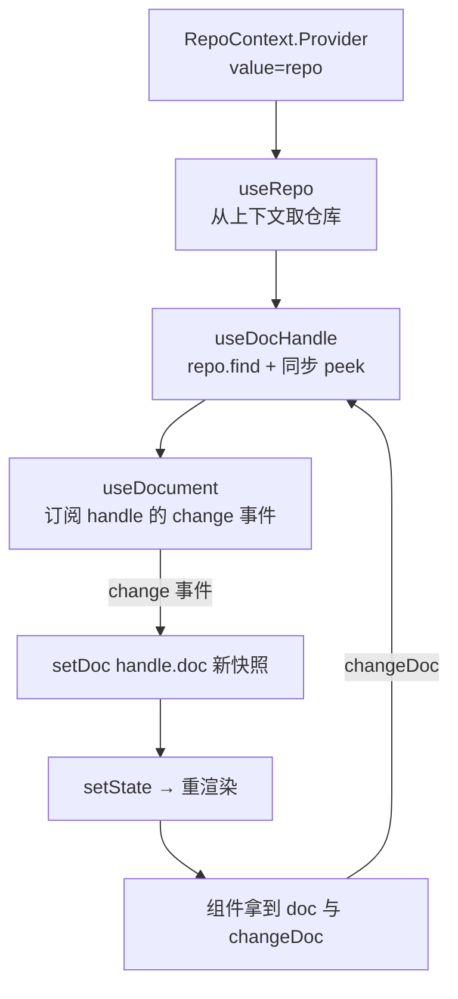

import { Canvas, Controls, Meta } from '@storybook/addon-docs/blocks';
import * as ReactBindings from './react-bindings.stories';

<Meta of={ReactBindings} name="Docs" />

# React 绑定

前两课的文档都活在命令式调用里：[`find`](?path=/docs/repo-and-dochandles--docs) 拿 handle，`doc()` 读快照，`change()` 写变更。本课的 `@automerge/react` 把这三件事接进 React 组件生命周期——hooks 替你 find、替你订阅变更、替你驱动重渲染，组件里只剩「用文档渲染 UI」和「在事件里改文档」两件事。看完本课，你应能预测四个实验台的行为：没包 Provider 时 `useRepo()` 第一行就抛错；URL 未到时两种加载模式都拿不到文档；任何来源、任何字段的写入都会重渲染订阅组件，而未订阅的 memo 组件纹丝不动。



本课用到的 hooks 一览，细节见对应小节。示例基于 `@automerge/react` 2.6.0-alpha.3（它同时再导出 `@automerge/automerge-repo` 全量与四个网络/存储适配器）：

| API | 用途 | 关键点 |
| --- | --- | --- |
| `RepoContext` | 仓库的 React Context | `value` 直接传 Repo 实例；整个应用共享一个 |
| `useRepo()` | 从上下文取仓库 | 没有 Provider 时抛 `Repo was not found on RepoContext.` |
| `useDocHandle(id, params?)` | 按 URL 拿 DocHandle | 默认 `suspense:false`：未就绪返回 `undefined` |
| `useDocument(id, params?)` | 文档快照 + 变更函数 | 返回 `[doc, changeDoc]`；加载中 `[undefined, 空函数]` |
| `useDocHandles(ids, params?)` | 一组 handle | 默认 `suspense:false`，返回 `Map`（url 到 handle 或 undefined） |
| `useDocuments(ids, params?)` | 一组文档 | 默认 **`suspense:true`**（全家唯一），返回 `[DocMap, changeDocFn]` |
| `usePresence(config)` | 在线状态 | 在线状态课程（2.4）的主题，本课只标边界 |

## 快速上手

安装 React 绑定（本工作区已按基线装好，可跳过）：

```bash
npm install @automerge/react
```

十几行走完「Provider → 订阅 → 变更」最小闭环：

```tsx
import { Repo, RepoContext, useDocument } from '@automerge/react';
import { createRoot } from 'react-dom/client';

const repo = new Repo(); // 先用内存仓库跑通；真实应用再接存储与网络
const handle = repo.create({ count: 0 }); // 文档在组件树外创建，URL 归应用保管

function Counter() {
  const [doc, changeDoc] = useDocument<{ count: number }>(handle.url);
  if (!doc) {
    return <p>加载中……</p>;
  }
  return <button onClick={() => changeDoc((d) => { d.count += 1 })}>{doc.count}</button>;
}

createRoot(document.getElementById('root')!).render(
  <RepoContext.Provider value={repo}>
    <Counter />
  </RepoContext.Provider>,
);
```

`useDocument` 在挂载时替你 `find`、订阅 change 事件、卸载时退订——这三件事正是下面各节要拆开的机制。

## Provider：把 Repo 交给组件树

`RepoContext` 就是一个普通的 React Context，`value` 传 Repo 实例本身。两条纪律：

- **建一次。** 仓库放在组件树外（模块级常量或 `useState(() => new Repo(...))` 的惰性初始化）。在 render 里 `new Repo()` 等于每次渲染撕出一个新仓库，文档各归孤岛。
- **传实例，不传壳。** `value` 引用要稳定；深层组件用 `useRepo()` 取回的是同一个实例，`peerId`、文档缓存、网络连接全部共享。

组装真实应用时，适配器也从这个包再导出，不必单独安装：

```ts
import { Repo, IndexedDBStorageAdapter, BroadcastChannelNetworkAdapter } from '@automerge/react';

const repo = new Repo({
  storage: new IndexedDBStorageAdapter('my-app'), // 存什么：见「本地存储」一课
  network: [new BroadcastChannelNetworkAdapter({ channelName: 'my-app' })], // 怎么同步：见 2.3
});
```

### 缺了 Provider 会怎样

`useRepo` 的全部逻辑就是读一次上下文，没有就 `throw new Error('Repo was not found on RepoContext.')`。这是渲染期错误，要靠错误边界接住，而不是 `try/catch`。

<Canvas of={ReactBindings.ProviderLab} />

<Controls of={ReactBindings.ProviderLab} />

| 读者操作 | 可观察证据 |
| --- | --- |
| 把「是否提供 Provider」切到「未提供」 | 深层子组件第一行 `useRepo()` 即抛错，错误边界显示报错原文，读数记下这条信息 |
| 切回「已提供」 | 子组件重新挂载，`useRepo()` 拿到仓库，读数显示 peerId |
| 选「子组件新建文档」 | 用上下文里的仓库 `create()`——深层组件与顶层共享同一实例 |

四个实验台都通过同目录的 `react-story.ts` 挂进画布：它只负责 `createRoot`、参数透传与离开页面时卸载，不含 automerge 逻辑；Show code 展示的是各实验台本体。

## 按 URL 加载文档

`useDocHandle` 是所有 hooks 的加载核心：拿 URL 调 `repo.find`，但先用 `findWithProgress` 同步 peek 一次——文档已在本地就当场返回，不在才走异步加载。就绪的结果有两种交付方式：

- **同步模式**（默认 `suspense:false`）：未就绪返回 `undefined`，组件自己渲染占位；`find` 被拒绝（文档不存在且无人能提供）时安静地停在 `undefined`。
- **Suspense 模式**（`suspense:true`）：未就绪把 Promise 抛给最近的 `<Suspense>`；`find` 被拒绝则在渲染期抛错，需要错误边界。

`id` 是 `undefined` 时两种模式都拿不到东西——链接还没到手，加载无从谈起。URL 从哪来？应用自己保管：索引文档、localStorage 或别人发来的分享链接。下面的实验台就模拟「同事分享链接」：文档在同事的 Repo B 上，你的组件树连着 Repo A，链接到达后 `find` 才开始跨仓库同步。

<Canvas of={ReactBindings.LoadLab} />

<Controls of={ReactBindings.LoadLab} />

| 读者操作 | 可观察证据 |
| --- | --- |
| 保持「等待分享链接」 | 两种模式都不渲染文档：URL 未到，hooks 无事可做 |
| 切「已到达」（同步模式） | 时间线记录 find 开始与文档就绪；期间 `useDocument` 一直返回 `undefined` |
| 切「已到达」（Suspense 模式） | fallback 一闪而过（时间线记下它的出现与文档就绪），随后内容渲染 |
| 选「同事再改一笔」 | Repo B 写入经 BroadcastChannel 同步到 A，订阅组件自动重渲染 |

切换「加载模式」会换一份新文档并重挂载组件，让加载窗口重新出现。

### 多文档：useDocuments 与 useDocHandles

一屏渲染多份文档时，逐个 `useDocument` 会被 hooks 条数约束卡住，两个列表版 hooks 接收 URL 数组：

```ts
const handles = useDocHandles<Note>(urls); // Map：url → DocHandle 或 undefined
const [docs, changeDoc] = useDocuments<Note>(urls); // Map：url → 文档快照
changeDoc(url, (d) => {
  d.done = true;
});
```

| | `useDocHandles` | `useDocuments` |
| --- | --- | --- |
| 返回 | handle 的 `Map` | 文档快照的 `Map` + 按文档变更函数 |
| 默认加载策略 | `suspense:false` | `suspense:true`（全家唯一默认挂起） |
| 改文档 | 拿 handle 自己 `change` | `changeDocFn(url, fn)` |
| `ids` 变化 | 按集合比较后重新订阅，顺序无关 | 同左 |

注意 `useDocuments` 的默认值与另外三个 hooks 相反：列表页直接包 `<Suspense>` 很顺手，但从同步模式迁移过来时容易在这里踩空。

## useDocument：订阅与重渲染

拿到文档只是开始，价值在「文档一变，组件自动重渲染」。`useDocument` 在 effect 里挂上 handle 的 `change` 事件，回调执行 `setDoc(handle.doc())`。而 `handle.doc()` 每次返回一份新快照（引用必然不同），`change` 事件在本地 `change`、远端同步、存储加载完成时都会触发——三件事叠起来就是：**任何来源、任何字段的变更，都带来一次重渲染**。它没有 selector，不比较字段，只认「文档变了」。

### 谁会重渲染

<Canvas of={ReactBindings.RenderLab} />

<Controls of={ReactBindings.RenderLab} />

| 读者操作 | 可观察证据 |
| --- | --- |
| 选「本组件 +1」或点画布里的按钮 | `changeDoc` 写入，左栏订阅组件重渲染，渲染计数 +1 |
| 选「外部 +1」 | 没经过 React——`change` 事件照发，订阅组件照样重渲染 |
| 选「外部写无关字段」 | 改的不是 count，订阅组件仍然重渲染：订阅粒度是整份文档 |
| 观察右栏 memo 组件 | props 不变它就一次都不渲染——细粒度的解法是拆组件加 memo，不是等 selector |

想让子树不跟文档同频，把订阅拆到叶子：父组件只持 URL，各叶子各自 `useDocument`，中间层用 `React.memo` 挡住。

### 文档被删除时

`repo.delete(url)` 之后 handle 发出 delete 事件，`useDocument` 把它存成错误、在下一次渲染时抛出：

```tsx
const [doc, changeDoc] = useDocument<Todo>(url);
// 文档被删除后，组件渲染时抛出：Error: Document automerge:… was deleted
```

两种接法：给这条子树配错误边界；或者在删除发生时把 URL 从清单里移除，让组件连同 `id` 一起卸载。

## 在组件里变更文档

`useDocument` 返回的第二项 `changeDoc` 就是 `handle.change` 的组件内绑定：签名 `(changeFn, options?)`，`options` 原样透传给 automerge（`message`、`time`、`patchCallback`）。回调拿到的 `d` 始终是最新快照——在回调里基于 `d` 计算，不要依赖组件 state 里缓存的旧值。

一个容易忽略的坑：文档未就绪时返回的 `[undefined, 空函数]` 里，`changeDoc` 是个**什么都不做的空函数**。点了不报错、也没效果。所以占位 UI 不要放写入按钮，至少要能区分「还没加载」和「空文档」。

### 待办清单：真实的输入与提交

<Canvas of={ReactBindings.TodoLab} />

<Controls of={ReactBindings.TodoLab} />

| 读者操作 | 可观察证据 |
| --- | --- |
| 在画布里输入文字回车或点「添加」 | 受控 input 的事件里调 `changeDoc`：待办进文档，渲染计数 +1 |
| 用 Controls 文本选「外部追加一条」 | 不经过组件 UI，直接 `handle.change`——清单立刻多一条 |
| 选「外部勾选第一条」「外部清掉已完成」 | 同一条外部路径的变体，完成计数随之变化 |
| 对照读数「组件渲染」 | 每次文档变更恰好 +1：清单组件订阅的是整份文档 |

## 最佳实践

- **Provider 一次、value 稳定。** 模块级或惰性 `useState` 建 Repo；测试或多账号场景需要隔离时才建多个，并各自配一个 Provider 子树。
- **三态分开渲染。** 「无 URL」（还没拿到链接）、「有 URL 未就绪」（`doc` 为 `undefined` 或 Suspense fallback）、「已就绪」三种状态给不同的 UI；写入控件只在第三态出现。
- **细粒度渲染靠拆组件。** 没有 selector API：列表页把每行拆成独立订阅的 memo 叶子，或先在父组件做投影（`const titles = doc ? doc.todos.map((t) => t.title) : []`）再传下去。
- **列表渲染用文档 URL 当 key。** URL 稳定且唯一，配合 `useDocuments` 的集合比较，增删文档不会引起整表重挂。
- **Suspense 边界按「一组同时加载的文档」画。** 边界太粗，一份慢文档扣住整屏；太细，fallback 闪烁。以一屏同批出现的文档为单位画边界，并给会拒绝的 `find` 配错误边界。
- **命令式操作用 `useDocHandle`。** 偶尔要做 `handle.change` 之外的事（发 ephemeral 消息、export）时，`useDocHandle` 给 handle 而不给快照；它与 `useDocument` 共享同一个缓存，不会重复 find。

## 常见问题

- **抛 `Repo was not found on RepoContext.`。**
  报错组件不在任何 `RepoContext.Provider` 里，或树上有两个 Provider 但组件被放在了外面。核对 Provider 是否包住整棵用到 hooks 的子树、仓库是否模块级建立的同一实例。

- **`useDocument` 一直返回 `undefined`。**
  三查：URL 本身是否是 `undefined`（链接没到）；这个 Repo 能否拿到文档——存储里没有、网络上也无人能提供时 `find` 被拒绝，同步模式就安静地停在 `undefined`（依据：hooks 对拒绝的处理是返回 `undefined`，不重试）；以及是否把「加载中」误当「空文档」——加载中是 `[undefined, 空函数]`，空文档是 `[doc, changeDoc]` 且 `doc` 可读。

- **删除文档后页面报 `Document … was deleted`。**
  这是 `useDocument` 的设计行为：delete 事件被转成渲染期错误强制你处理。按上一节两种接法之一接住，别在 catch 里继续渲染旧快照。

- **`useLocalAwareness` / `useRemoteAwareness` 标了 deprecated。**
  官方已用 `usePresence` 取代（本包内一并导出）。光标、在线状态这类临时数据是「在线状态与临时数据」（2.4）的主题，与文档状态分开建模。

- **Suspense 模式一直卡在 fallback。**
  `find` 没有落定：URL 指向的文档既不在本地存储、当前也没有 peer 能提供。核对 URL 来源与网络配置；加载语义本身见[网络同步](?path=/docs/networking-sync--docs)。

## 总结回顾

摘要：

本课把命令式同步层接进 React：`RepoContext` 把组件树外建好的一次性 Repo 交给所有 hooks，`useRepo` 负责取用、缺失即在渲染期抛错。`useDocHandle` 承担加载——先同步 peek 本地、再异步 `find`，默认同步模式返回 `undefined`，`suspense:true` 则把 Promise 抛给 `<Suspense>`；`useDocuments` / `useDocHandles` 把同一套语义推广到 URL 列表，且前者是全家唯一默认挂起的 hook。`useDocument` 在此之上订阅 handle 的 change 事件，`setDoc(handle.doc())` 的新快照让任何来源、任何字段的变更都驱动重渲染，文档被删除则转成渲染期错误；组件内变更统一走 `changeDoc`（未就绪时是空函数）。本包没有 selector，细粒度渲染靠拆组件加 memo；光标与在线状态归 `usePresence`（2.4）。

一句话：

> Provider 交仓库，URL 定加载，change 事件定重渲染：文档是唯一数据源，UI 只是它的投影。

知识要点：

- `useRepo()` 在什么情况下抛错？抛的是哪类错误，用什么机制接？
- 同步模式与 Suspense 模式在「未就绪」时分别交付什么？四个 hooks 的默认值哪个例外？
- `useDocument` 为什么对「外部写入」和「无关字段」也重渲染？想细粒度该怎么办？
- 加载中与空文档如何区分？`changeDoc` 在加载中是什么？
- 文档被 `repo.delete()` 删除后，订阅它的组件会发生什么？
- 光标、在线状态该用哪个 hook？

## 参考资料

- [Automerge 官方文档](https://automerge.org/docs/hello/) —— 官方手册的 Repo 层与前端集成章节
- [@automerge/react 包源码](https://github.com/automerge/automerge-repo/tree/main/packages/automerge-react) —— React 绑定与 hooks 的发布包
- [automerge-repo 官方示例集](https://github.com/automerge/automerge-repo/tree/main/examples) —— React 计数器与 todo 的官方最小应用
- React 官方文档：[传递数据给深层组件（Context）](https://react.dev/learn/passing-data-deeply-with-context) 与 [Suspense](https://react.dev/reference/react/Suspense) —— `RepoContext` 与 Suspense 模式的机制出处
- 本工作区 `node_modules/@automerge/react/node_modules/@automerge/automerge-repo-react-hooks/dist/` —— 各 hooks 签名、`suspense` 默认值与 change/delete 订阅语义的核对依据（类型声明与打包实现，2.6.0-alpha.3）
- 本工作区 `node_modules/@automerge/react/dist/default-exports.d.ts` —— `Repo` 与四个网络/存储适配器再导出面的核对依据
