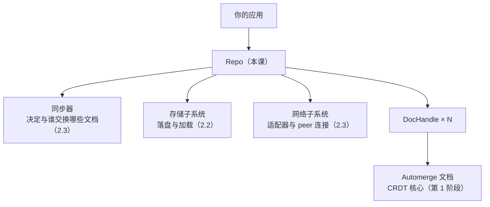

import { Canvas, Controls, Meta } from '@storybook/addon-docs/blocks';
import * as RepoAndDocHandles from './repo-and-dochandles.stories';

<Meta of={RepoAndDocHandles} name="Docs" />

# Repo 与 DocHandle

第 1 阶段的核心库只回答「一份文档如何在内存里被修改与合并」；真实应用还有一堆它不管的杂事：文档存在哪里、怎么发给别的设备、怎么凭一个链接重新找到它。本课进入第 2 阶段，主角是 `@automerge/automerge-repo` 同步层的两个角色：**Repo** 是文档集合的管家——创建、查找、删除、落盘、广播都从它进出；**DocHandle** 是文档的活把手——读文档、改文档、听变更都通过它。看完本课，你应能预测两个实验台的现象：`create` 出的 handle 要不要等待、按 URL 查找有哪三种结局、把文档从一台设备搬到另一台之后两边各是什么世界。

本课配两个可操作实例（示例基于 `@automerge/automerge-repo@2.6.0-alpha.3`）。「生命周期与 find」实例在一台内存仓库上依次执行 `create`、`change`、三种 `find` 与 `delete`，显示 handle 的状态与每次操作的结果。「离线搬运」实例让页面里的两个仓库扮演两台设备：A 创建文档并 `export` 成字节，B `import` 回来；切换搬运方式可对比「保住 docId」与「另存为」两种结局。



本课用到的核心 API 一览，细节见对应小节：

| API | 用途 | 关键点 |
| --- | --- | --- |
| `new Repo(config)` | 创建仓库 | 不接存储/网络就是纯内存仓库，演示与测试都够用 |
| `repo.create(initial?)` | 新建文档 | 同步返回就绪的 DocHandle，URL 自动生成 |
| `repo.find(url)` | 按 URL 取回文档 | 返回 Promise；同一 URL 永远拿回同一 handle |
| `repo.findWithProgress(url)` | 观察查找过程 | `peek()` / `subscribe()` / `whenReady()` |
| `repo.export(url)` | 导出文档字节 | Promise 的 `Uint8Array`；不依赖网络 |
| `repo.import(bytes, { docId? })` | 导入文档字节 | 带 docId 保住 URL；不带则生成新身份 |
| `repo.delete(url)` | 删除文档 | handle 进入 deleted，此 URL 随即不可再 find |
| `handle.url` / `handle.documentId` | 文档的身份 | `automerge:` 前缀加 base58check 校验的 id |
| `handle.doc()` | 同步读文档 | 本版本无需 await（旧教程写法已过时） |
| `handle.change(fn)` | 唯一写入口 | 同步返回；落盘与广播由 Repo 接手 |
| `handle.on("change", fn)` | 订阅变更 | 本地与远端变更都触发 |

## 快速上手

安装同步层（本工作区已按基线装好 `@automerge/automerge-repo@2.6.0-alpha.3`，可跳过）：

```bash
npm install @automerge/automerge-repo
```

十几行就能跑通第一份受管文档，下面这段代码在 Node 与浏览器中一致可用：

```ts
import { Repo } from "@automerge/automerge-repo";

type NoteDoc = { title: string; items: string[] };

// 什么都不接：没有存储、没有网络，是一个纯内存仓库
const repo = new Repo({ peerId: "device-a" });

// create：同步返回就绪的 DocHandle，documentId 由系统生成
const handle = repo.create<NoteDoc>({ title: "第一份文档", items: [] });

handle.isReady(); // true：create 交出的 handle 立即可用
handle.url;       // "automerge:2Rtz…"：文档的身份证
handle.doc();     // { title: "第一份文档", items: [] }：同步读取，无需 await

// change：唯一的写入口，回调语义与核心库完全一致
handle.change((d) => {
  d.title = "改好的标题";
  d.items.push("第一行");
});
```

纯内存仓库不是玩具限定：演示、测试、以及「文档生命周期只活在页面里」的场景都这么用；真实应用再按需接上存储与网络适配器（见[本地存储](?path=/docs/local-storage--docs)与[网络同步](?path=/docs/networking-sync--docs)）。

## Repo：文档集合的管家

### 核心库与 Repo 的分工

核心库管的是「一份文档」的内存语义：`init` / `from` / `change` / `merge`，不认识「保存」，也不认识「别的设备」。automerge-repo 补上的正是这些管道，Repo 实例聚合了四件事：

- **文档注册表**：同一 URL 在一个仓库里永远对应同一个 handle，重复 `find` 不会产生第二份内存副本。
- **持久化**：`handle.change` 之后把变更写给存储适配器，重启后 `find` 同一 URL 即可恢复（2.2）。
- **广播与同步**：按共享策略决定把哪些文档告诉哪些 peer，靠网络适配器交换变更（2.3）。
- **生命周期事件**：文档的删除、不可用等仓库级事件由 Repo 发出。

所以 `handle.change` 与核心库 `change` 的区别一句话说清：写进文档这件事相同，写完之后的杂事（落盘、广播）Repo 全替你做了——前提是你接了对应的适配器。

### 创建 Repo：先什么都不接

`new Repo()` 不给任何配置就是纯内存仓库：`peerId` 自动生成随机的 `"peer-…"`，是否「临时身份」默认取决于有没有接存储。这正是本课两个实例的用法——页面里 `new` 两个仓库就能扮演两台设备。真实应用再按需配置：

| 配置 | 作用 | 展开课程 |
| --- | --- | --- |
| `storage` | 落盘与加载（浏览器 IndexedDB、Node 文件系统等） | [2.2 本地存储](?path=/docs/local-storage--docs) |
| `network` | 一个或多个网络适配器（WebSocket、BroadcastChannel 等） | [2.3 网络同步](?path=/docs/networking-sync--docs) |
| `sharePolicy` / `shareConfig` | 决定把哪些文档广播给哪个 peer | [2.3 网络同步](?path=/docs/networking-sync--docs) |
| `peerId` | 本机身份，不填自动生成 | — |
| `saveDebounceRate` | 落盘防抖毫秒数，默认 100 | [2.2 本地存储](?path=/docs/local-storage--docs) |

每个应用通常只建一个 Repo 实例，放在模块单例或应用上下文里；本课为了同页扮演两台设备才 `new` 了两个。`sharePolicy` 这里只留个入口印象——它决定「我对谁慷慨」，[2.3](?path=/docs/networking-sync--docs)再展开。

## DocHandle：文档的活把手

DocHandle 是包着文档的把手：`url` 指明它是谁，`doc()` 读、`change()` 写、`on()` 听。你从不直接碰 Repo 里的文档，一切读写都经 handle。

### create：同步拿到就绪的 handle

`repo.create(initialValue?)` 同步返回 DocHandle：初始值是普通对象，documentId 由系统生成。这里有一个反直觉的关键事实：**`create` 交出的 handle 一交出来就绪**——`isReady()` 立即为 `true`、`state` 是 `"ready"`，没有任何「等它加载」的环节。原因也朴素：文档的初值就在你眼前，本地生成、无需从任何地方取。

### url：文档的身份证

`handle.url` 形如 `automerge:<base58check 校验的 documentId>`，例如 `automerge:2RtztfsXouNuiDR8wYYHpet7pCYD`。它是文档跨越设备与时间的身份：把 URL 存进 localStorage、写进另一份文档、发给朋友，之后任何人任何设备都能凭它重新找到这份文档——这是 local-first 应用里「分享」的原型。同一仓库内同一 URL 只有一个 handle：`repo.find(handle.url)` 拿回的就是你手里这个实例。

URL 还有两种后缀：`#heads` 把链接钉在某个历史时点，`/path` 深链到文档的子树。本课只用裸 URL，知道形状即可。工具函数 `isValidAutomergeUrl` 与 `parseAutomergeUrl` 从包根导出，用来校验与拆解外部输入。

### doc 与 change：读与写

```ts
const doc = handle.doc(); // 同步；各属性只读，修改必须走 change
handle.change((d) => {
  d.items.push("第二行");
}); // 同步 void

handle.on("change", ({ doc }) => {
  console.log("文档变了", doc.title);
});
```

`doc()` 在本版本是同步的：直接返回当前文档。快照纪律与第 1 阶段一致——回调之外的文档各属性只读，赋值请放进 `change` 回调。`change` 事件则是「活」的部分：**本地 `change` 与远端同步来的变更都会触发**，界面订阅它就能保持最新，不必关心数据是本机写的还是同伴发来的；`patchInfo.before` / `after` 还给出了变更前后的快照。

版本注记：官网文档（面向 2.x 稳定线）把 `doc()` 写成异步、另有同步的 `docSync()`，并让 handle 经历等待网络等中间状态。本工作区安装的 2.6.0-alpha.3 已改为 **handle 交出即就绪**：`doc()` 同步、`docSync()` 移除、`whenReady()` 弃用。两版差异见[常见问题](#常见问题)，API 语义以安装版本的类型声明为准。

### 状态与事件：删除之后

`handle.state` 是一台小状态机：`idle` → `loading` → `requesting` → `ready` 是「取得数据」的路径，`unloaded` 是仓库为省内存卸载了文档，`deleted` 是被删除，`unavailable` 是谁都没有这份文档。对本课的内存仓库，你只会亲眼看到其中两个：`create` 时直接 `ready`，`delete` 时 `deleted`。

```ts
repo.delete(handle.url);   // 同步 void

handle.isDeleted();        // true
handle.state;              // "deleted"
handle.isReady();          // false
repo.find(handle.url);     // 此后被拒绝：Document … is unavailable
```

删除的语义是「**本仓库不再提供这份文档**」：handle 上触发 `delete` 事件，Repo 上触发 `delete-document` 事件。已删除的 handle 当作作废处理：释放引用，不要继续读写。类型注释里「已删除文档上 `doc()` 会抛错」在当前 alpha 构建中并未生效——它仍会返回最后一次的文档视图，这更要求你把删除当作纪律来执行，而不是依赖运行时拦截。

## find：按 URL 取回文档

### find 的三种结局

`repo.find(url)` 返回 `Promise<DocHandle>`。它向自己的两个来源要文档：存储（2.2）与已连接的同伴（2.3）。接齐适配器的真实应用里，`find` 会等待加载、向同伴请求，就绪后兑现。本课的内存仓库两样都没有，所以每种结局都立即揭晓：

| 输入 | 结局 |
| --- | --- |
| URL 合法，本仓库已有 | 立即兑现，拿回同一个 handle 实例 |
| URL 合法，但存储与同伴都没有 | 拒绝：`Document <id> is unavailable`（内存仓库里几毫秒内） |
| 字符串非法，base58check 校验不过 | 拒绝：`Invalid AutomergeUrl: '…'` |

两种拒绝的病因不同：前者是「文档确实不存在，或还没同步到本机」，后者是「URL 本身是坏的」。处理用户输入时先用 `isValidAutomergeUrl` 排除后者。接上网络后，unavailable 不是终局——同伴带着文档上线后，同一 URL 再 `find` 一次就能拿到，这也是[在线状态与临时数据](?path=/docs/ephemeral-data--docs)的伏笔。

### findWithProgress：看见查找过程

想知道 `find` 卡在哪一步，用 `repo.findWithProgress(url)`：它返回一个可观察对象，`peek()` 读当前状态，`subscribe(fn)` 订阅状态流转，`whenReady({ signal })` 等待就绪且可取消。状态是 `loading` / `ready` / `unavailable` / `failed` 之一，`sources` 里还能看到每个来源（如 `automerge-sync`）各自的状态。下面的实例就用它旁边的 `find` 把三种结局跑给你看。

<Canvas of={RepoAndDocHandles.LifecycleLab} />
<Controls of={RepoAndDocHandles.LifecycleLab} />

| 读者操作 | 可观察证据 |
| --- | --- |
| 保持「create 新建文档」，改「写入标题」后再切回 create | 每次都同步拿到 state 为 ready 的 handle，URL 每次都是全新的 |
| 依次执行「change 修改文档」「find 自身的 URL」 | change 同步完成且 items 多了一条；find 拿回同一个 handle 实例 |
| 执行「find 未知的合法 URL」与「find 非法字符串」 | 两种拒绝各不相同：前者 `Document … is unavailable`（没人有这份文档），后者 `Invalid AutomergeUrl`（URL 没通过校验） |
| 执行「delete 删除文档」后再「find 自身的 URL」 | handle 进入 deleted；同一 URL 再 find 被拒绝 |
| 打开 Show code | 看到该 Canvas 实际执行的 `lifecycle-lab.ts` |

## 离线搬运：export 与 import

### 把文档装进字节，再搬进另一个 Repo

不接网络也能把文档交给另一台设备：`await repo.export(url)` 把整份文档序列化成 `Uint8Array`（一份小笔记约两百字节），U 盘、邮件、二维码、HTTP 接口，随便什么管道送过去；对端 `repo.import(bytes)` 把字节装回自己的仓库，同步返回就绪的 handle。关键分岔在 docId：

| 搬运方式 | 对端拿到的 | 含义 |
| --- | --- | --- |
| `import(bytes, { docId })` | 同一个 URL | 两台设备持有**同一份文档**的两个副本；接通网络后（2.3）可自动对齐 |
| `import(bytes)` | 全新 documentId | 「另存为」：内容相同、身份不同，两份文档从此各自独立 |

带 `docId` 时传的是 documentId（URL 去掉 `automerge:` 前缀的裸 id，`handle.documentId` 或 `parseAutomergeUrl(url).documentId` 都能拿到）——把整个 URL 当 docId 传会造出形如 `automerge:automerge:…` 的坏身份。官方对复用 docId 还有一条告诫：只给**确实从同一份文档搬运而来**的副本复用 docId；给两份从未互通的文档强配同一 id，会让同步协议把它们误当成同一份文档。

对比第 1 阶段的 `clone`：`repo.clone(handle)` 在同一仓库内 fork 出新 URL、共享历史、还能 `merge` 回来；`import` 复用 docId 则是跨仓库的「同一份文档」。而搬运永远是**快照**：B 上的后续修改不会自动流回 A——那条通道叫同步，是[2.3 网络同步](?path=/docs/networking-sync--docs)的主题。

<Canvas of={RepoAndDocHandles.TransferLab} />
<Controls of={RepoAndDocHandles.TransferLab} />

| 读者操作 | 可观察证据 |
| --- | --- |
| 保持「A export → B import（保住 docId）」 | B 拿到与 A 相同的 URL；B 的 items 比 A 多出「B 写的一行」，而 A 保持原样 |
| 把「搬运方式」切到「B 按 URL 向 A 要（find）」 | find 立即被拒绝：两个内存仓库互不相识，没有存储也没有同伴可问 |
| 切到「A export → B import（不带 docId）」 | B 的内容一样，但 URL 是全新的——另存为，不再是同一份文档 |
| 打开 Show code | 看到该 Canvas 实际执行的 `transfer-lab.ts` |

## 最佳实践

- **一个应用一个 Repo。** 放在模块单例或上下文里传递；到处 `new Repo` 会把文档注册表与连接拆散，同一文档出现多个互不相识的 handle。
- **把 `handle.url` 当作「重新打开」的钥匙持久化。** localStorage、路由、数据库里存 URL，下次启动 `repo.find(url)` 即可恢复现场。
- **外部输入先校验。** `isValidAutomergeUrl` 挡住坏 URL，免得 `find` 以 `Invalid AutomergeUrl` 拒绝时排查半天才发现是链接被截断。
- **删除即作废。** `repo.delete` 之后释放对 handle 的引用；当前构建里已删除 handle 仍能读到旧内容，别让代码依赖这种边缘行为。
- **离线搬运用于交付，持续协作靠同步。** `import` 复用 docId 是为了让两台设备此后能对齐，不是为了替代网络。

## 常见问题

- `repo.find(url)` 报错 `Document … is unavailable`
  内存仓库（无存储、无网络）里这几乎是必然：文档不在本机，也没有同伴可问。先确认 URL 没拼错，再接上[存储](?path=/docs/local-storage--docs)或[网络](?path=/docs/networking-sync--docs)以获得真正的等待与同步语义；网络到来后对同一 URL 重试即可。
- `repo.find(url)` 报错 `Invalid AutomergeUrl: '…'`
  URL 本身是坏的：被截断、缺 `automerge:` 前缀或校验和不符。外部输入先过 `isValidAutomergeUrl`。
- 照旧教程写 `await handle.doc()` 或 `handle.docSync()`，类型检查报错
  安装的 2.6.0-alpha.3 已把 `doc()` 改为同步、移除 `docSync()`、弃用 `whenReady()`（handle 交出即就绪）。官网文档目前仍描述 2.x 稳定线，两版差异以本地 `node_modules/@automerge/automerge-repo/dist/*.d.ts` 为准。
- `repo.on("document", …)` 从不触发
  类型注释声称 `create` 会派发 `document` 事件，但当前 alpha 构建实测并不会。要感知文档内容变化，订阅 handle 的 `change` 事件；自己 `create` 的文档自己登记即可。
- `repo.delete` 之后 `handle.doc()` 还能读到旧内容
  当前 alpha 构建的已实现行为（类型注释声称会抛错）。把删除当作纪律：删除即释放引用、停止读写；持久化数据的清理见[2.2 本地存储](?path=/docs/local-storage--docs)。

## 总结回顾

摘要：

Repo 是文档集合的管家：`create` 新建、`find` 按 URL 取回、`delete` 删除，落盘与广播这些杂事在 `change` 之后自动发生——前提是接了对应适配器；什么都不接的 Repo 是纯内存仓库，本课的实验全靠它。DocHandle 是文档的活把手：`url` 是文档跨越设备与时间的身份证，`doc()` 同步读、`change()` 同步写，`change` 事件让本地与远端变更走同一条通道；本版本 handle 交出即就绪，`doc()` 无需 await、`whenReady()` 已弃用。`find` 的三种结局——同一 handle、`unavailable` 拒绝、`Invalid AutomergeUrl` 拒绝——对应「有」「没有」「URL 是坏的」三种病因。`export` / `import` 用字节跨仓库搬运文档：带 docId 是同一份文档的两个副本，不带 docId 是另存为；搬运是快照，持续协作要靠网络同步。

一句话：

> Repo 管集合（create / find / delete 与落盘广播），DocHandle 管单文档（url / doc / change / on）；URL 是文档的身份证，搬运是快照，同步才是通道。

知识要点：

- 核心库与 Repo 的分工是什么？`handle.change` 比核心库的 `change` 多做了哪两件事？
- `new Repo()` 什么都不接时是什么仓库？`create` 交出的 handle 需要等待吗？
- `find` 的三种结局各自的病因是什么？用户输入的 URL 应该怎么预处理？
- `import` 带与不带 docId 的差别是什么？为什么说搬运是快照而不是通道？
- 删除之后 handle 处于什么状态？同一 URL 再 `find` 会怎样？

## 参考资料

- [Automerge 官方文档：Repositories](https://automerge.org/docs/reference/repositories/)
- [Automerge 官方文档：DocHandles](https://automerge.org/docs/reference/repositories/dochandles/)
- [Automerge 官方文档：Deep References（URL 的 heads 与 path 形状）](https://automerge.org/docs/reference/repositories/refs/)
- [automerge-repo 主仓库](https://github.com/automerge/automerge-repo)
- [automerge-repo 2.6.0-alpha.3（本工作区安装版本，API 语义以包内 .d.ts 为准）](https://www.npmjs.com/package/@automerge/automerge-repo/v/2.6.0-alpha.3)
