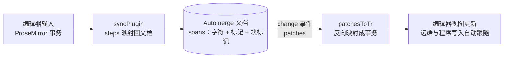

import { Canvas, Controls, Meta } from '@storybook/addon-docs/blocks';
import * as RichTextCollab from './rich-text-collab.stories';

<Meta of={RichTextCollab} name="Docs" />

# 富文本协同编辑

承接[文本与计数器](?path=/docs/text-and-counters--docs)的字符级合并与[React 绑定](?path=/docs/react-bindings--docs)的订阅模型，本课回答一个问题：**带格式的文本怎么进 Automerge？**核心判断一句话——纯文本把内容当字符序列，富文本在这条序列之上再叠两类东西：字符的格式记成**标记（mark）**，段落与标题记成**块标记（block marker）**。它们都被拉平到同一条序列上参与合并，所以「加粗一段字」和「插入一个字符」获得同级别的协同语义，不需要额外的冲突解决。示例基于 `@automerge/automerge@3.5.0` 与 `@automerge/prosemirror@0.2.0`，API 行为均对照类型声明并在 Node 中实际核对。

本课配三个可操作实例。「标记与边界」在纯数据层展开四个场景：插入继承（expand 矩阵）、块标记三连、并发标记的异名与同名；「编辑器双向同步」给一台带菜单栏的 ProseMirror 编辑器，既可以从编辑器里打字加粗，也可以用程序写入看反向跟随；「双副本实时协同」在页面上拉起两个 Repo、两台编辑器，任意一侧的字符与格式都会同步收敛到对侧。



| 目标 | 写法 | 要点 |
| --- | --- | --- |
| 读富文本 | `A.spans(doc, ['rich'])` | 文本片段与块标记混排的数组；块标记占一个索引 |
| 加 / 去格式 | `A.mark` / `A.unmark` | `change` 回调内调用；范围 + `expand` 决定边界插入是否继承 |
| 读标记 | `A.marks` / `A.marksAt` | 全文标记列表；某一点位上的标记集合 |
| 块结构 | `A.splitBlock` / `A.updateBlock` / `A.joinBlock` | 索引指块标记本身；首块没有标记 |
| 整段替换 | `A.updateSpans(doc, ['rich'], newSpans, config?)` | 内部 diff 成最小操作；程序化批量写入的入口 |
| 编辑器三件套 | `init(handle, ['rich'])` | 返回 `schema`、`pmDoc`、`plugin`（`@automerge/prosemirror`） |
| 双向同步 | `init` 默认装好的 `syncPlugin` | 编辑器事务写回文档；`change` 事件反向驱动编辑器 |
| 释放编辑器 | `view.destroy()` | 舞台卸载时必须调用；本课实验室的 `dispose` 已处理 |

## 快速上手

富文本在文档里就是一个普通的字符串字段（本课统一叫 `rich`），加上一层由标记和块标记组成的读数。把 ProseMirror 接上去只需要 `init` 一次：

```ts
import { Repo } from '@automerge/automerge-repo';
import { init } from '@automerge/prosemirror';
import { exampleSetup } from 'prosemirror-example-setup';
import { EditorState } from 'prosemirror-state';
import { EditorView } from 'prosemirror-view';

const repo = new Repo();
const handle = repo.create({ rich: 'hello rich text' });

// init 一次拿到三件套：schema、初始文档（pmDoc）、双向同步插件（plugin）
const { schema, pmDoc, plugin } = init(handle, ['rich']);

const view = new EditorView(document.querySelector('#editor')!, {
  state: EditorState.create({
    doc: pmDoc,
    // exampleSetup 没有 plugins 选项：automerge 插件要手动拼进数组
    plugins: [...exampleSetup({ schema }), plugin],
  }),
  dispatchTransaction: (tr) => view.updateState(tr),
});
```

从这一刻起，编辑器里每次键入都会经插件写进文档；反过来，任何来源的 `handle.change`（别的标签页、别的设备、程序写入）也会自动出现在这台编辑器里。下面三节拆开看：先看文档里富文本长什么样，再看插件怎么双向翻译，最后看双副本并发。

## 富文本的表示：字符之上还有标记

`A.spans` 把富文本读成一个 span 数组——文本片段与块标记混排，格式挂在文本片段上：

```json
[
  { "type": "text", "value": "发布会纪要", "marks": { "strong": true } },
  { "type": "block", "value": { "type": "heading", "attrs": { "level": 2 } } },
  { "type": "text", "value": "正文从这开始。" }
]
```

三条索引纪律，都实测核对过：

- **块标记占一个索引。** `A.splice`、`A.mark` 的位置计数把每个块标记当一个字符；上面这份 spans 里 `A.block(doc, ['rich'], 5)` 返回 heading 那个 map。
- **首块没有标记。** 序列开头的那一块（没有前驱块）没有块标记，`A.block` 在它的字符上返回 `null`。
- **块标记是内联 map。** `type` 是类型名（`paragraph`、`heading`、`code-block`……），`attrs` 携带参数（如 heading 的 `level`），列表项还带 `parents` 指明外层列表。

格式则是「名字 + 标量值 + 范围」：`A.mark(d, ['rich'], { start: 0, end: 5 }, 'strong', true)` 给前五个字符盖上 `strong: true`，名字与值都由 schema 约定（值可以是布尔、字符串、数字等标量）；`A.unmark` 反向擦除，`A.marks` 列出全文标记，`A.marksAt` 问某一点位正带哪些格式。

### mark 与 expand：边界上的格式延伸

标记的合并语义几乎全在一个选项里——`expand`：并发插入落在标记边界上时，新字符要不要继承格式。下面的实验台把「加粗 `[0,5)` + 副本在边界插入 XY + merge」的四种 expand 乘三种位置全部摆出来，「继承加粗」一栏由合并结果现场计算：

<Canvas of={RichTextCollab.MarksLab} />

<Controls of={RichTextCollab.MarksLab} />

| 读者操作 | 可观察证据 |
| --- | --- |
| 保持默认（expand 双向延伸 + 中间插入） | `heXYllo` 整段仍是一个带 `strong` 的 span：区域内的插入永远继承 |
| 插入位置切「右边界」，expand 切「不延伸」 | XY 落在标记外，spans 里它是无格式的独立 span |
| expand 切「向左延伸」+「左边界」 | XY 继承加粗：before 只向区间起点一侧延伸 |
| expand 切「向右延伸」+「左边界」 | XY 不继承：after 只照顾区间终点一侧 |

四种 expand × 三种位置的实测结果一览：

| 插入位置 | both 双向（默认） | none 不延伸 | before 向左 | after 向右 |
| --- | --- | --- | --- | --- |
| 区域中间 | 继承 | 继承 | 继承 | 继承 |
| 左边界 | 继承 | 不继承 | 继承 | 不继承 |
| 右边界 | 继承 | 不继承 | 不继承 | 继承 |

并发加标记的语义切到「并发标记」两个场景看：**不同名字并存**——副本 aaaa 盖 `em`、副本 bbbb 盖 `strong`、同一区域，合并后 `world` 同时带两个标记；**同名异值收敛**——两边都写 `color`（red 与 blue），合并后只剩一个值，且双向 merge 结果一致：标记名内是类似 map 的 last-writer-wins，按操作定序、与谁先 merge 无关。

块结构切「块标记」场景：`splitBlock(5)` 在索引 5 放下一个 `paragraph` 标记，`updateBlock(5, heading)` 把标记原地改成 heading，`joinBlock(5)` 再删掉它——三个操作的索引都是**块标记本身的位置**，这也是读回 spans 时「文本前多出来的那个元素」。

## ProseMirror 接入：init 与 syncPlugin

`init(handle, path)` 是 `@automerge/prosemirror` 的总入口，`path` 就是文档里那个富文本字段的路径（可以嵌套）。它一次返回三件套：`schema`（编辑器侧的文档模型）、`pmDoc`（由当前 spans 转换出的初始 ProseMirror 文档）、`plugin`（双向同步插件）。翻译工作由默认的 `basicSchemaAdapter` 承担，两边名字的对应关系如下：

| ProseMirror | Automerge |
| --- | --- |
| `strong` / `em` 标记 | mark `strong` / `em`（值 `true`） |
| `link` 标记 | mark `link`（值是 JSON 字符串，含 href 与 title） |
| `paragraph` / `heading` | 块 `paragraph` / `heading`（attrs 带 `level`） |
| `code_block` / `blockquote` / `aside` | 块 `code-block` / `blockquote` / `aside` |
| `list_item` | 块 `ordered-list-item` / `unordered-list-item`（随外层列表而定） |
| `image` | 块 `image`（内嵌块，attrs 存 src 等） |
| `code` 标记 / `horizontal_rule` | **无映射**：只是编辑器本地样式，不持久化 |

`plugin`（`syncPlugin`）就是上节流程图里的双向翻译器，两条通道各管一个方向：

- **编辑器到文档**：每次 ProseMirror 事务结束后，`appendTransaction` 把事务的 steps 映射回文档操作，包进一次 `handle.change`。
- **文档到编辑器**：插件挂载时订阅 `handle` 的 `change` 事件，把 patches 反向映射成 ProseMirror 事务并 dispatch；自己发出的事务会做标记，避免再次写回文档造成回环。

下面的实验台把两个方向都接到一个编辑器上：在编辑器里打字、用菜单栏加粗或改标题走第一条通道；从 Controls 或画布按钮触发程序写入走第二条通道。读数里的「文档变更次数」就是两条通道合流后的证据——无论哪条通道，写入都要变成一次 `handle.change` 才算落账。

<Canvas of={RichTextCollab.EditorLab} />

<Controls of={RichTextCollab.EditorLab} />

| 读者操作 | 可观察证据 |
| --- | --- |
| 在编辑器里打几个字 | 「文档变更次数」随之增加，读数的 spans 出现新字符：编辑器事务已写进文档 |
| 用菜单栏把某段加粗 / 改成标题 | spans 里出现 `strong` 标记或 `heading` 块标记 |
| 选「尾部追加一句话」 | 不经编辑器、直接 `handle.change`，编辑器里那句话照样出现：change 事件反向生效 |
| 选「开头五个字符加粗」 | `A.mark` 写入的标记经 patches 反向映射，编辑器里前五个字符变粗 |

编辑器实验台通过同目录的 `rich-text-story.ts` 挂进画布：它只负责建舞台、节流刷新读数，并在离开页面时 `view.destroy()` 与 `repo.shutdown()`，不含 automerge 逻辑；Show code 展示的是各实验台本体。

### updateSpans：程序化批量写入

绕过编辑器程序生成富文本时，逐字符 `splice` 又慢又碎；`A.updateSpans(doc, ['rich'], newSpans, config?)` 接受一整份目标 spans，内部 diff 成最小的一组操作。可选的 `config` 控制**新出现的标记**怎么设 `expand`：`defaultExpand` 给全部标记一个默认，`perMarkExpand` 按名字逐个指定。两点提醒：

- 编辑器集成下，插件内部正是用 `updateSpans` 做校正写回，其 expand 配置由适配器从 ProseMirror 标记的 `inclusive` 推导（默认 `true` 映射 `both`，`link` 这类 `inclusive: false` 映射 `none`）——光标停在加粗边界继续打字会不会带上格式，这条链就是终点。
- 一些旧文档说 `updateSpans`「只更新块结构、不更新格式标记」，以 3.5 实测为准：spans 里带的 `marks` 会照实应用，本课范例就是在 Node 里核对过的。它与 `updateText`（beta、按纯文本 diff、不搬格式）不是一回事。

## 双副本实时协同

前两节的语义在两个副本之间同样成立。实验台在页面上拉起两个 Repo，各自挂一个**随机命名**的 BroadcastChannel 网络适配器互为对端（避免同一页面上多份实例串线）；左侧 `create` 出文档，右侧用同一个 `documentId` 去 `find`，等首次同步完成后挂上第二台编辑器。此后两侧看到同一份文档历史：本地编辑先落本地 handle 并触发仓库间同步，对端 handle 更新后同样发出 `change` 事件，由对侧的 `syncPlugin` 反向映射进它那台编辑器。

<Canvas of={RichTextCollab.TwinLab} />

<Controls of={RichTextCollab.TwinLab} />

| 读者操作 | 可观察证据 |
| --- | --- |
| 在左侧编辑器里给首句加粗 | 对侧几乎立即出现同样格式，读数「两侧 spans 一致」为「是（已收敛）」 |
| 选「右侧：尾部追加一句」 | 字符经锚定归位，两侧 spans 读数一致 |
| 选「双侧：同时写入」 | 两个方向的写入交错到达，读数最终仍一致：格式走 expand、字符走锚定，互不打架 |
| 直接在两台编辑器里打字 | 双向实时跟随，任何一侧都只是同一份文档的一个视图 |

BroadcastChannel 只覆盖同源页面（本课为了在单页演示）；真实多设备协同把适配器换成 WebSocket 等即可，协议细节见[网络同步](?path=/docs/networking-sync--docs)一课，文档与 handle 的获取方式见[Repo 与 DocHandle](?path=/docs/repo-and-dochandles--docs)。

## 最佳实践

- **富文本字段保持独立、路径稳定。** `init` 的 `path` 直指文档字段，运行期不要挪动；富文本字段里不要再混普通数据，字符串旁边的元数据放兄弟字段。
- **编辑器生命周期成对。** `view.destroy()` 与 change 退订必须在卸载时执行，单页多编辑器（本课双副本实验台）尤其如此；否则舞台反复挂载会泄漏视图与订阅。
- **让插件独占该字段的翻译。** 程序写入走 `handle.change`（编辑器会跟随），批量生成走 `updateSpans` 一次到位；不要绕过 schema 直接造块标记结构。
- **expand 的默认值是合理的起点。** `both` 匹配「在格式末尾继续输入保持格式」的直觉；链接这类不需要延伸的标记，靠适配器把 ProseMirror 的 `inclusive: false` 映射成 `none`，不要手写边界特判。
- **自定义节点要走适配器。** 给节点/标记加 `automerge` 映射属性（块名、标记名、attr 解析器）；未映射的内容会被 `unknownBlock` / `unknownLeaf` 兜底显示，但不会按原结构持久化。

## 常见问题

**菜单栏里的「代码」（等宽字体）没有存进文档？**
`basicSchemaAdapter` 没有给 `code` 标记映射 automerge 标记名，它只是编辑器本地样式；要持久化等宽排版用 `code_block` 块（映射成 `code-block`）。`horizontal_rule` 同理无映射。

**为什么示例代码解构的是 `pmDoc`，官方文档写 `doc`？**
以安装版本 `@automerge/prosemirror@0.2.0` 的类型声明为准：`init` 返回 `{ schema, pmDoc, plugin }`。官方 cookbook 的 VanillaJS 页面沿用了早期版本的 `doc` 字段名。包名同理：文档示例里的 `@automerge/automerge-prosemirror` 与本工作区安装的 `@automerge/prosemirror` 是同一套实现的新旧包名，本课按安装版本书写。

**并发「加粗」同名标记，谁赢？**
同名标记收敛为单值（last-writer-wins，按操作定序、与 merge 先后无关）；不同名字的标记互不覆盖、并存生效。字符层的并发插入则由锚定归位，详见[文本与计数器](?path=/docs/text-and-counters--docs)。

**能不接 ProseMirror 直接用这些 API 吗？**
可以。`spans` / `mark` / `updateSpans` / `splitBlock` 都是文档层 API，Node 与浏览器通用——本课「标记与边界」实验台就没有编辑器，全部语义照常成立。ProseMirror 只是把编辑交互翻译到这层 API 上的官方适配。

## 总结回顾

### 摘要

Automerge 的富文本 = 字符序列 + 内联标记 + 块标记。`A.spans` 是这层结构的统一读数，`A.mark` / `A.updateSpans` / `A.splitBlock` 系列是写入面，`expand` 选项决定标记边界上并发插入的归属。ProseMirror 侧由 `@automerge/prosemirror` 的 `init` 一次接好：`basicSchemaAdapter` 负责两边模型互译，`syncPlugin` 负责编辑器事务与文档 `change` 事件的双向翻译。所有操作的合并语义与纯文本同源——字符按锚定归位，标记按 expand 延伸，同名标记按操作定序——因此双副本并发编辑富文本不需要任何额外协调。

### 一句话

**格式和段落被拉平成序列上的普通操作：字符有锚定、标记有 expand，于是富文本协同天然收敛，编辑器只是文档的一个视图。**

### 知识要点

- `A.spans(doc, path)` 读出文本片段与块标记的混排数组；块标记占一个索引，首块没有标记。
- `A.mark` / `A.unmark` 以「名字 + 标量值 + 范围」表达格式；`expand`（默认 `both`）决定边界插入是否继承。
- 不同名字的并发标记并存，同名异值收敛为单值且与 merge 顺序无关。
- `A.splitBlock` / `A.updateBlock` / `A.joinBlock` 的索引指块标记本身；`A.block` 读某位置的标记。
- `init(handle, path)` 返回 `schema` / `pmDoc` / `plugin` 三件套；`basicSchemaAdapter` 定义两边名字映射，`code` 标记与 `horizontal_rule` 不持久化。
- `syncPlugin` 双向翻译：编辑器事务经 `appendTransaction` 写回文档，`change` 事件的 patches 经 `patchesToTr` 反向驱动编辑器。
- `A.updateSpans` 是程序化批量写入入口，内部 diff 成最小操作，`config` 控制新标记的 expand；它会把 spans 里的格式一并应用（旧文档「只更新块结构」的说法已过时）。
- 双副本协同复用同一套收敛语义：BroadcastChannel（演示）或 WebSocket（生产）只影响通道，不影响结果。

## 参考资料

- [Rich Text 参考文档](https://automerge.org/docs/reference/documents/rich-text/)：spans、mark、块标记的完整 API 面与 expand 语义
- [ProseMirror + VanillaJS + Automerge](https://automerge.org/docs/cookbook/rich-text-prosemirror-vanilla/)：官方接法（本课按安装版本修正了 `pmDoc` 字段与 `exampleSetup` 拼接方式）
- [ProseMirror + React + Automerge](https://automerge.org/docs/cookbook/rich-text-prosemirror-react/)：React 场景的封装思路，接法与函数签名与上篇一致
- [Rich Text Schema（底层）](https://automerge.org/docs/under-the-hood/rich_text_schema/)：默认 schema 的标记与块类型全集、自定义扩展的 `__ext__` 前缀约定
- [automerge-prosemirror 源码仓库](https://github.com/automerge/automerge-prosemirror)：`syncPlugin` / `SchemaAdapter` 的实现（本工作区安装为 `@automerge/prosemirror@0.2.0`）
- [ProseMirror 文档](https://prosemirror.net/docs/)：EditorView、插件与 `exampleSetup` 的编辑器侧机制
- 本教程内链：[文本与计数器](?path=/docs/text-and-counters--docs)、[React 绑定](?path=/docs/react-bindings--docs)、[网络同步](?path=/docs/networking-sync--docs)、[Repo 与 DocHandle](?path=/docs/repo-and-dochandles--docs)
