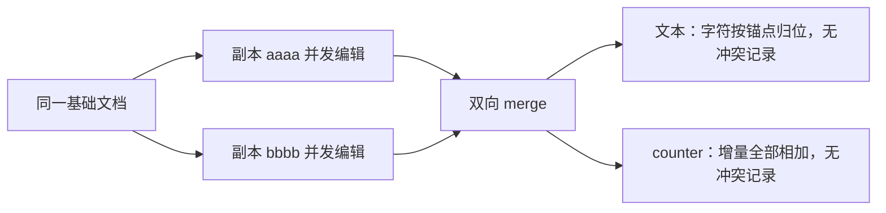

import { Canvas, Controls, Meta } from '@storybook/addon-docs/blocks';
import * as TextAndCounters from './text-and-counters.stories';

<Meta of={TextAndCounters} name="Docs" />

# 文本与计数器

承接[集合类型与冲突](?path=/docs/collections-and-conflicts--docs)的合并规则，本课深入 Automerge 两个"自带合并语义"的专项类型：文本序列与计数器。核心判断一句话——**修改被建模为对既有内容的增量操作（插入一个字符、加一个增量），就自动收敛且永不冲突；一旦建模为对同一位置的覆盖（下标赋值、整串赋值、`+=`），就退化为普通 put、走上一课的冲突规则。**示例基于 `@automerge/automerge@3.5.0`，API 行为均对照类型声明并在 Node 中实际核对。

本课配两个可操作实例。「文本并发实验室」把两个副本（actorId 为 `aaaa` 与 `bbbb`）从同一基础文本分叉，各自执行一次并发编辑再双向 merge：切换「并发场景」或修改两个副本的编辑内容，画布与读数给出各副本结果、合并后文本与冲突记录。「counter 实验室」给 Counter 与普通数字两个字段（初值同为 100）施加同样的增量：调整两个副本的增量，读数并排呈现「增量全保留」与「一份增量被丢弃」的对照。



| 目标 | 写法 | 要点 |
| --- | --- | --- |
| 按位置增删字符 | `A.splice(doc, ['text'], index, del, newText?)` | 字符编辑的基本入口；`change` 回调内调用；索引按 Unicode 码点计数 |
| 整串更新 | `A.updateText(doc, ['text'], newText)` | 内部 diff 转 splice；`change` 回调内调用；调用越频繁合并越好 |
| 读文本与格式片段 | `doc.text` / `A.spans(doc, ['text'])` | 文本容器读回普通 `string`，随时可读 |
| 稳定位置引用 | `A.getCursor(...)` / `A.getCursorPosition(...)` | 可分享的游标字符串，随编辑自校正，随时可生成与解析 |
| 计数增减 | `d.clicks.increment(n)` / `d.clicks.decrement(n)` | 增量是独立操作，并发自动相加；`change` 回调内调用 |
| 初始化计数器 | `d.clicks = new A.Counter(0)` | 仅用于初始化；之后再赋值是一次 put |

## 快速上手

一段代码走完「并发编辑文本收敛 + 并发增量相加」的最小闭环，细节在各主题小节展开：

```ts
import * as A from '@automerge/automerge';

// 文本：两个副本并发编辑同一基础文本，合并后字符各归其位
const base = A.from({ text: 'hello world' });
const a = A.change(A.clone(base, 'aaaa'), (d) => {
  A.splice(d, ['text'], 5, 0, ' wonderful'); // 中部插入
});
const b = A.change(A.clone(base, 'bbbb'), (d) => {
  A.splice(d, ['text'], 0, 5, 'Greetings'); // 替换开头
});
A.merge(a, b).text; // 'Greetings wonderful world'

// 计数器：并发增量按加法相加，永不冲突
const start = A.from({ clicks: new A.Counter(100) });
const x = A.change(A.clone(start, 'aaaa'), (d) => {
  d.clicks.increment(2);
});
const y = A.change(A.clone(start, 'bbbb'), (d) => {
  d.clicks.increment(3);
});
A.merge(x, y).clicks.valueOf(); // 105 = 100 + 2 + 3
```

## 编辑文本序列

文档里的字符串不是"一个值"，而是字符序列：每个字符像 list 的元素一样有自己的身份，可以并发地增删。读的时候（回调里、回调外都一样）它就是普通 `string`——所以在 `change` 回调里 `typeof d.text === 'string'`，没有 `insertAt` / `deleteAt` 方法可调，下标赋值直接抛 `TypeError`（上一课常见问题里那条报错的出处）。编辑不作用于读到的字符串，而是通过带路径的 API 作用于文档里的文本对象。

### splice：按位置增删

```ts
// 在 index 处先删除 del 个字符，再插入 newText（可省略）
A.splice(doc, ['text'], index, del, newText?)
```

调用要点：

- 必须在 `change` 回调内、对文档代理调用；回调外抛 `RangeError`（文档代理不可修改）。
- path 支持嵌套字段与列表元素：`['notes', 'body']`、`['items', 0]`。
- `del` 为负数时删除位置之前的字符；超出文本长度按长度截断。
- 索引按 **Unicode 码点**计数：👍 只占 1 个位置，而 JS 的 `'a👍b'.length` 是 4。定位时用 `[...text]` 展开或游标解析得到码点下标。

```ts
A.change(doc, (d) => {
  A.splice(d, ['text'], 1, 0, 'X'); // 'a👍b' -> 'aX👍b'（插在整个 emoji 前面）
  A.splice(d, ['text'], 3, -2);     // 'abcdef' -> 'adef'（删 index 3 之前的 2 个字符）
});
```

<Canvas of={TextAndCounters.TextSplice} />
<Controls of={TextAndCounters.TextSplice} />

| 读者操作 | 可观察证据 |
| --- | --- |
| 保持默认输入 | 官方文档同款示例：一方中部插入、一方替换开头，合并为「Greetings wonderful world」，双方编辑都保留 |
| 修改「副本 aaaa 编辑」「副本 bbbb 编辑」 | 各自的副本读数与合并结果同步刷新，两个编辑始终同时在场 |
| 打开 Show code | 看到该 Canvas 实际执行的 `text-concurrent-edits.ts` |

### 并发编辑的锚定与收敛

插入操作记录的是"锚在哪个字符旁边"，index 只是当前的读视图。因此并发编辑不靠下标博弈：别人并发插入后你的下标会漂移，但每个字符之间的相对位置不会乱。

| 并发操作组合 | 合并结果 |
| --- | --- |
| 不同位置各编辑一次 | 都保留，各归其位 |
| 同一位置并发插入 | 都保留，先后顺序由操作 ID 决定（与时间无关） |
| 一方删除，另一方在被删区域内插入 | 删除生效；插入保留（锚点还挂在两侧字符上） |
| 字符级编辑 vs 字符级编辑 | 永不产生冲突记录，`getConflicts` 恒为 `undefined` |

对比上一课：map/list 上"同一位置各 put 一次"会冲突，文本编辑没有这个问题——字符编辑是插入/删除操作，不是对同一位置的赋值。唯一的例外是整串赋值 `d.title = '新标题'`，那是一次 put，并发赋值走冲突规则。

<Canvas of={TextAndCounters.TextSamePos} />

同位置并发插入：两个副本都往 `<>` 的中间插，两个值都保留且顺序确定。

<Canvas of={TextAndCounters.TextDeleteVsInsert} />

删除与区域内插入并发：副本 aaaa 删掉 `bc`，副本 bbbb 在 `b` 和 `c` 之间插入，合并结果 `aXYdef`——删除照常生效，插入的字符没有随之消失。

### 游标：稳定的位置引用

裸下标在并发插入后会漂移。`getCursor` 把"某个位置"固化成一个可分享的字符串，它在任何副本上都能随编辑自校正：

```ts
let doc = A.from({ text: 'hello world' });
const at = A.getCursor(doc, ['text'], 5); // 形如 "7@8445c451…" 的可分享字符串

// 别的副本在开头插入 4 个字符后，同一段游标解析到 9，不需要任何重算
A.getCursorPosition(doc, ['text'], at); // 9
```

- `getCursor(doc, path, position, move?)`：position 是下标、`'start'` 或 `'end'`；move 决定锚点字符被删后游标偏向哪边，默认 `'after'`（偏向文本尾部）。
- 游标字符串可以直接当 `splice` 的 index 用：编辑后游标解析到新插入文本的末尾，可以连续复用同一段游标完成多次编辑。
- 用途：协同编辑器的光标与选区、评论锚点。跨网络广播光标见[在线状态与临时数据](?path=/docs/ephemeral-data--docs)，富文本编辑器内的完整方案见[富文本协同编辑](?path=/docs/rich-text-collab--docs)。

### updateText 与 updateSpans：整串简写

只有整串输入、拿不到按键级事件时用 `updateText`：它对当前值与新串做 diff，把差异转成最少量的 `splice`：

```ts
A.change(doc, (d) => {
  A.updateText(d, ['text'], 'hello brave world');
});
```

- 典型场景是 HTML 表单：`<input>` 的 `oninput` 事件只能拿到完整的新值，直接交给 `updateText` 即可。
- 合并质量取决于调用粒度：每键一次（小 diff）合并得好；`onchange` 级别的粗 diff 容易把别人的并发编辑圈进重写。官方建议尽可能频繁地调用。
- `A.updateSpans(doc, path, newSpans)` 同理，作用于带格式片段的文本（`{ type: 'text', value, marks }` 序列，用 `A.spans(doc, path)` 读回）。两者都标注为实验性 API；富文本主线见[富文本协同编辑](?path=/docs/rich-text-collab--docs)。

<Canvas of={TextAndCounters.TextWholeUpdate} />
<Controls of={TextAndCounters.TextWholeUpdate} />

| 读者操作 | 可观察证据 |
| --- | --- |
| 保持默认输入 | 两边都只改了文本的一小段，diff 片段互不重叠，合并后两个修改同时在场 |
| 把两边改成分歧更大的整串 | 合并结果里 diff 片段交错，直观看到粒度对合并质量的影响 |
| 打开 Show code | 同上，`text-concurrent-edits.ts` 的 update-whole 分支 |

## 计数器 Counter

`Counter` 是只能被增减的整数。每次增减记一条独立的 `inc` 操作（`A.diff` 里能看到 `action: 'inc'`），整数的加法交换律保证任意顺序合并都得到同一个和——它是 CRDT 里最天然的收敛结构。初值用 `new A.Counter()`（从 0 开始）或 `new A.Counter(3)`；`save` / `load` 往返后读回仍是 Counter 实例，`A.toJS` 与 `toJSON` 则把它表示成纯数字。嵌套在 map、list 里都可用。

### increment 与 decrement

```ts
A.change(doc, (d) => {
  d.clicks.increment(4); // +4
  d.clicks.increment(1); // +1（运行时可省略参数；TS 签名要求显式传参）
  d.clicks.decrement(3); // -3，负向调整用 decrement 表达更直白
});
```

读回与边界：

- 回调外 `doc.clicks` 是 `Counter` 实例：`doc.clicks.value` 读数；它实现了 `valueOf`，可以直接参与算术（`doc.clicks + 1`）和字符串拼接。
- 在 `change` 回调外调用 `increment` / `decrement` 直接抛错。
- `doc.clicks.value = 99` 不报错但也不生效——改的只是包装对象上的普通属性，Counter 没有"赋值"写法（见下一小节）。

### 为什么不能直接赋值

同一个"加一下"的意图，落在两种类型上行为完全不同。初值 100，两个副本并发各 +2、+3：

```ts
// Counter：增量是独立操作，全部保留
a: d.counter.increment(2); // 副本读到 102
b: d.counter.increment(3); // 副本读到 103
// merge 后 105，getConflicts 返回 undefined

// 普通数字：+= 只是读改写后的一次 put
a: d.n += 2; // put 102
b: d.n += 3; // put 103
// merge 后 102 或 103：put 冲突，一份增量丢失，getConflicts 可见两个候选值
```

给 Counter 赋值（`d.clicks = new A.Counter(99)`）同样是一次 put：并发赋值走冲突规则，与 map 上的值无异。想表达"重置为某个权威值"就接受这套冲突语义，否则一律用增减表达修改。官方特别提醒：不要拿 Counter 做自增主键——并发副本会生成相同的"自增号"，唯一标识用 UUID。

<Canvas of={TextAndCounters.CounterLab} />
<Controls of={TextAndCounters.CounterLab} />

| 读者操作 | 可观察证据 |
| --- | --- |
| 保持默认增量 +2 / +3 | Counter 合并值 105（两份增量都在），数字合并值只能是 102 或 103，冲突候选 2 个 |
| 把「副本 aaaa 增量」调为负数 | Counter 合并值仍等于 100 + 两份增量之和；数字一侧丢失其中一份 |
| 把一个增量调为 0 | 该副本未产生变更，另一份增量正常保留，无冲突 |
| 打开 Show code | 看到该 Canvas 实际执行的 `counter-convergence.ts` |

## 最佳实践

- **按事件粒度写文本。** 能拿到按键或输入事件就用 `A.splice` 记录最小编辑；只有整串输入（表单、粘贴整段）才 `updateText`，并且挂在 `oninput` 上而不是 `onchange`——diff 粒度决定合并质量。
- **增量语义选 Counter，覆盖语义才用赋值。** 计数、点赞、扣减这类"加一下"的值用 `increment` / `decrement`；确实要把值重置为权威值时用赋值，并接受冲突规则。不要拿 Counter 当自增主键。
- **跨副本引用文本位置用游标。** 裸下标在并发插入后漂移，`getCursor` 生成的游标随编辑自校正且可直接分享；只有单副本内的一次性定位才直接用下标。

## 常见问题

- 含 emoji 的文本 splice 后位置错乱
  索引按 Unicode 码点计数，不是 JS 字符串的 UTF-16 长度：`'a👍b'.length` 是 4，但 👍 在文档里只占 1 个位置。定位时用 `[...text]` 展开（或用 `A.getCursorPosition` 解析游标）得到码点下标再传给 `splice`。ZWJ 组合 emoji（如家庭 emoji）由多个码点组成，逐码点存储，删除可能把组合拆开。
- `d.clicks.value = 99` 不报错，但计数没变
  `.value` 是 Counter 包装对象上的普通属性，改它不经过文档。调整计数用 `increment` / `decrement`；确实要重置就整体赋值 `d.clicks = new A.Counter(99)`，并接受它是一次 put、并发下走冲突规则。
- `updateText` 合并后出现重复或互相覆盖的片段
  调用粒度太粗：两次调用之间文本变化越大，diff 越大，越容易把他人的并发编辑圈进重写。把 `updateText` 挂到 `oninput`（每键一次）保持每次 diff 尽量小；结构性大改直接用 `splice` 表达真实编辑。

## 总结回顾

摘要：

文档里的字符串是字符序列，每个字符像 list 元素一样有身份：读回是普通 `string`，编辑必须走带路径的 API——`A.splice` 按码点位置增删（负 `del` 删前方、超长截断），`A.updateText` 把整串 diff 成 splice（粒度越细合并越好），游标 `getCursor` / `getCursorPosition` 把位置固化成可分享、随编辑自校正的引用。并发编辑锚定字符身份：不同位置的编辑各归其位，同位置插入按操作 ID 定序，删除与区域内插入并发时两者都成立，字符级编辑永不产生冲突记录。Counter 把修改记成独立的 `inc` 操作，并发增量按加法相加、永不丢失；而 `+=`、下标赋值、整串赋值都是 put，并发时走冲突规则并丢失更新，`.value` 直改则完全无效。

一句话：

> 把修改建模为对既有内容的增量操作（插入字符、counter 增减）就自动收敛且永不冲突；一旦建模为对同一位置的覆盖（下标赋值、整串赋值、`+=`），就退化为 put、走冲突规则。

知识要点：

- 在 `change` 回调里读到的字符串是什么类型？为什么不能对它下标赋值或调用 `insertAt`？
- `A.splice` 的五个参数各是什么？`del` 为负、超出长度、位置落在 emoji 上时分别怎样？
- 两个副本并发编辑文本，哪些组合都保留？先后顺序由什么决定？会产生冲突记录吗？
- 游标字符串怎么生成、怎么解析、怎么直接用于 `splice`？它解决了裸下标的什么问题？
- `updateText` 和 `updateSpans` 适合什么场景？合并质量由什么决定？
- `increment` 与 `+=`、`d.clicks.value = 99`、`d.clicks = new A.Counter(99)` 在并发下各是什么语义？

## 参考资料

- [Text — Automerge Docs](https://automerge.org/docs/reference/documents/text/) —— splice 与 updateText 的官方说明与示例
- [Counters — Automerge Docs](https://automerge.org/docs/reference/documents/counters/) —— Counter 的官方说明与自增主键警告
- 本工作区 `node_modules/@automerge/automerge/dist/implementation.d.ts` 与 `counter.d.ts` —— 本课 API 签名的核对依据（3.5.0）
