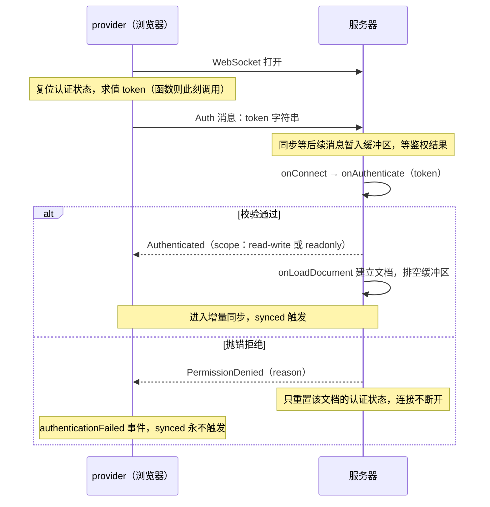

import { Meta } from '@storybook/addon-docs/blocks';

<Meta id="auth" title="服务端核心/鉴权与上下文" name="Docs" />

# 鉴权与上下文

「第一个协同文档」课里的服务器不设门禁：任何浏览器拿到地址就能进任意房间。Hocuspocus 的鉴权不是 HTTP 中间件，而是一条连接内的协议握手：provider 在每次 WebSocket 打开时把 token 作为一条协议消息发出，服务器用 `onAuthenticate` 钩子校验，通过后才真正建立文档连接；校验抛错则回送拒绝消息，客户端收到 `authenticationFailed` 事件。通过校验后还可以返回一份用户数据——它被并入 `context`，随连接流经之后的所有服务端钩子，类型上由 `Server` 的泛型参数一路传到底。读完你应能预测：token 不对时页面 `status` 仍是 `connected`，但内容永远不同步；token 换成函数后，每次重连都会自动取新凭据。

版本基线为 Hocuspocus v4（4.7.x，要求 Node 22+）。v3 差异处以一句话标注。



| 输入或概念 | 默认值或取值 | 回查要点 |
| --- | --- | --- |
| provider 的 `token` | `null` | 支持 string、`() => string`、`() => Promise`，每次 WebSocket 打开重新求值 |
| 服务器 `onAuthenticate` | 未配置 = 不鉴权 | 每个文档收到首条 Auth 消息时触发，抛错即拒绝 |
| payload 的 `token` | `''`（客户端未传时） | 同 payload 还有 `documentName`、`requestHeaders`、`connectionConfig` 等，见下文 |
| `connectionConfig.readOnly` | `false` | 钩子里改为 `true`，授权范围降为 readonly |
| `onAuthenticate` 返回值 | 无 | 并入 `context`，供后续钩子读取 |
| provider 的 `authorizedScope` | `undefined`（认证前） | 认证通过后写入 `'read-write'` 或 `'readonly'` |
| `authenticationFailed` 的 `reason` | 服务器抛出的错误消息 | 本地取 token 失败时带固定前缀 `Failed to get token during sendToken():` |

## 快速上手

前置：按 [安装](?path=/docs/install--docs) 课装好 `@hocuspocus/server` 与 `@hocuspocus/provider`，最小连接写法见 [第一个协同文档](?path=/docs/first-document--docs) 课。本课只在这两步之上各加一处。

服务器加门禁：

```ts
// server.ts
import { Server } from '@hocuspocus/server';

const server = new Server({
  port: 1234,
  async onAuthenticate({ token }) {
    // 对比固定 token；真实项目在这里验 JWT 或查会话
    if (token !== 'super-secret-token') {
      throw new Error('Not authorized!'); // 错误消息原文成为拒绝 reason
    }
    // 返回值并入 context，后续钩子可读（见「泛型 Context」一节）
    return { user: { id: 1234, name: 'John' } };
  },
});

server.listen();
```

客户端携带 token：

```ts
// client.ts（浏览器）
import * as Y from 'yjs';
import { HocuspocusProvider } from '@hocuspocus/provider';

const provider = new HocuspocusProvider({
  url: 'ws://127.0.0.1:1234',
  name: 'example-document',
  document: new Y.Doc(),
  token: 'super-secret-token',
  onAuthenticated: ({ scope }) => console.log('已认证:', scope),
  onAuthenticationFailed: ({ reason }) => console.error('认证失败:', reason),
});
```

token 取两种值时的两侧输出（示意）：

| token | 服务器控制台 | 浏览器控制台 |
| --- | --- | --- |
| `'super-secret-token'` | （无鉴权日志） | `已认证: read-write` |
| 其他任意值 | `[onAuthenticate] Not authorized!` | `认证失败: Not authorized!` |

边界：token 错误时 `status` 仍变为 `connected`，`synced` 永不触发——判断是否被拒要靠 `authenticationFailed` 事件，不是连接状态。

## 鉴权握手

握手是「每个文档一次」的协议过程，次序固定：

- provider 侧：WebSocket 打开后先复位认证状态，求值 token（配置为函数则此刻调用），发出 Auth 消息，随后照常发出同步消息——这些消息在服务器缓冲区等待，不因鉴权未完成而丢失。
- 服务器侧：收到某文档的首条 Auth 消息时，先跑 `onConnect` 再跑 `onAuthenticate`，两个钩子都能抛错拒绝；都通过后回送 Authenticated 消息并建立文档连接（`onLoadDocument` 排在这一步，见 [文档生命周期](?path=/docs/document-lifecycle--docs) 课），然后把缓冲的消息一次性排空，进入增量同步。

认证前的两条硬边界（默认值见 [Server 配置](?path=/docs/server-config--docs) 课）：

- 缓冲上限：未认证连接的待处理消息受 `maxUnauthenticatedQueueSize`（5 MiB）、`maxUnauthenticatedQueueMessages`（1000）、`maxPendingDocuments`（100）约束，超出立即断开，防止未认证连接耗尽内存。
- 绝对超时：认证前 `timeout`（默认 60000）从建连时刻绝对计时，客户端发再多消息也续不了命；认证后才改为按最后一条消息计时。到期以 4408（Connection Timeout）关闭。

一个容易想反的边界：`token` 只是从客户端带到服务器的凭据，钩子才是门禁。服务器不配置 `onAuthenticate` 时完全不鉴权，任何连接（token 为空字符串）都放行为 read-write——「客户端配了 token」不会让服务器变安全。

## onAuthenticate 实战

### 校验与拒绝

v4 的 payload 字段（经源码 `onAuthenticatePayload` 类型核对）：

| 字段 | 类型 | 说明 |
| --- | --- | --- |
| `token` | `string` | provider 发来的凭据；客户端未配置时为空字符串 |
| `documentName` | `string` | 正在接入的文档名，可做按文档授权 |
| `requestHeaders` | `Headers` | WebSocket 升级请求的头，web 标准，用 `get()` 取值 |
| `requestParameters` | `URLSearchParams` | 连接 URL 的 query 参数 |
| `request` | `Request` | 完整升级请求（web 标准） |
| `connectionConfig` | 对象 | 含 `readOnly` 与 `isAuthenticated` 两个布尔字段，钩子可改 `readOnly` |
| `context` | `Context` | 当前连接上下文，钩子返回值会并入 |
| `socketId` | `string` | 连接标识 |
| `providerVersion` | `string \| null` | 客户端 provider 版本（v4 新增协议字段） |
| `instance` | `Hocuspocus` | 服务器实例 |

拒绝就是抛错，错误消息原文会作为 `reason` 传给客户端。验 JWT 的最小模式：

```ts
async onAuthenticate({ token, documentName }) {
  const user = await verifyJwt(token); // 你的 JWT 校验函数
  if (!user) {
    throw new Error('invalid-token');
  }
  if (!canRead(user, documentName)) {
    throw new Error('forbidden-document');
  }
  return { userId: user.sub }; // 并入 context
}
```

服务器控制台输出（示意）：

```text
[onAuthenticate] invalid-token
```

v3 差异：v3 的钩子 payload 里是 Node 请求对象，头用方括号取值；v4 换成 web `Headers` 与 `Request`，取值用 `get()`，迁移对照见 [从 v3 迁移](?path=/docs/v3-migration--docs) 课。

### 只读降级

没有写权限的用户不必踢出房间：把 `connectionConfig.readOnly` 改为 `true`，连接照常建立，服务器回送的 scope 变为 `readonly`，此后该连接的文档写入会被拒绝，provider 可从 `authorizedScope` 读到自己的权限。

```ts
async onAuthenticate({ token, connectionConfig }) {
  const user = await verifyJwt(token);
  if (!user) throw new Error('invalid-token');
  if (!canWrite(user)) {
    connectionConfig.readOnly = true; // 放行，但降级为只读
  }
  return { userId: user.sub };
}
```

注意官方鉴权指南示例中的 `data.connection.readOnly` 是旧版字段名，v4 的 payload 里没有 `connection` 字段，赋值要写在 `connectionConfig.readOnly` 上。

### 客户端看到什么

| 信号 | 何时出现 | 载荷与判断 |
| --- | --- | --- |
| `onAuthenticated` | 收到 Authenticated | `{ scope }`，与 `provider.authorizedScope` 一致 |
| `onAuthenticationFailed` | 收到 PermissionDenied，或本地取 token 抛错 | `{ reason }`，事件本身不断开连接 |
| `onClose` / `onDisconnect` | 服务器主动断开（超时 4408、onTokenSync 抛错 4401 等） | `{ code, reason }` |
| `provider.synced` | 仅初始同步完成后为 `true` | 认证被拒时永不为 `true` |

判断口诀：被拒不是断线。被拒时 `status` 保持 `connected`、没有 close 事件，只有 `authenticationFailed`；之后若一直未通过认证，服务器按绝对期限以 4408 关闭连接，provider 才看到 close 事件并按重连参数自动重连（见 [断线与重连](?path=/docs/reconnection--docs) 课）。

## 泛型 Context

### 端到端类型链

泛型只写在 `Server` 上：类型参数经 `Configuration` 与 `Extension` 一路传进每个钩子 payload 的 `context` 字段，也传给 `Connection` 与 `DirectConnection`。不写泛型时 `context` 退回 `any`，编译器不再拦截拼写错误。

```ts
import { Server } from '@hocuspocus/server';

// 全站共享的用户上下文类型
type AuthContext = {
  userId: string;
  name: string;
};

const server = new Server<AuthContext>({
  port: 1234,
  async onAuthenticate({ token }) {
    const user = await verifyJwt(token);
    if (!user) throw new Error('invalid-token');
    // 返回值并入 context：从这里流向之后的所有钩子
    return { userId: user.sub, name: user.name };
  },
  async onLoadDocument({ document, context }) {
    console.log(context.userId, '打开', document.name); // 已带类型
  },
  async onChange({ context }) {
    // context.userId 的类型是 string
  },
  async onStoreDocument({ documentName, lastContext }) {
    await saveToDb(documentName, lastContext.userId); // 落库钩子读 lastContext
  },
});
```

v3 差异：v3 的 `context` 类型固定为 `any`，泛型 `Context` 是 v4 的类型层改进；行为上两版一致——返回值并入、随连接流动。

### 携带用户身份

`context` 的来源是一条合并链：连接建立时初始为空对象，`onConnect` 的返回值先并入，`onAuthenticate` 的返回值随后并入（浅合并，后写的字段覆盖先写的）。之后 `onLoadDocument`、`onChange`、`onDisconnect` 等连接级钩子读到的都是这份合并结果。

```ts
// 两个钩子都能贡献 context
async onConnect({ requestParameters }) {
  // 可从 query 先并入轻量信息
  return { room: requestParameters.get('room') ?? 'default' };
},
async onAuthenticate({ token }) {
  const user = await verifyJwt(token);
  return { userId: user.sub }; // 与 room 合并，同字段则以这里为准
},
```

### 生命周期边界

- 粒度是「一条连接 × 一个文档名」：同一条连接打开两个文档，各有一份 context；两条连接进同一文档，也各有各的。
- 起点：该文档的首条消息到达服务器时创建；终点：该文档连接关闭即失效。认证被拒后这份 context 被丢弃，重试成功会拿到新的一份。
- `onStoreDocument` 读到的是 `lastContext`——最后一次触发变更的连接的 context，文档已无连接时按变更来源决定。
- `context` 永不出服务器：provider 侧没有 context 字段，客户端能感知的只有自己的 token 与 `authorizedScope`。服务器内部写入用 `openDirectConnection(documentName, context)` 时，context 由调用方直接传入。

## token 刷新与认证重试

token 的整个生命周期有三个手段，分别覆盖建连、长连接中途与被拒之后。

**每次建连重算 token。** `token` 配置为函数（含 async）时，每次 WebSocket 打开都会重新求值——重连自然换上新凭据：

```ts
const provider = new HocuspocusProvider({
  url: 'ws://127.0.0.1:1234',
  name: 'example-document',
  token: async () => {
    // 每次建连、重连都会调用
    const res = await fetch('/api/collab-token');
    return res.text();
  },
});
```

取 token 本身失败（函数抛错）时不会发送认证消息：provider 发出 reason 前缀为 `Failed to get token during sendToken():` 的 `authenticationFailed` 事件，服务器侧该连接保持未认证状态。

**长连接中途换 token（服务器主动索取）。** token 在连接中途过期时，服务器可向客户端索取新 token：`connected`、`onTokenSync` 等拿到 `connection` 的钩子调用 `connection.requestToken()`，provider 收到索取消息后自动重新求值 token 并回发；已建立的连接上，新 token 落到 `onTokenSync` 钩子：

```ts
async connected({ connection }) {
  // 示意：一段时间后索取新 token，也可以由定时任务触发
  setTimeout(() => connection.requestToken(), 30 * 60 * 1000);
},
async onTokenSync({ token }) {
  const user = await verifyJwt(token);
  if (!user) {
    throw new Error('token-expired'); // 抛错：连接以 4401 Unauthorized 关闭
  }
  return { userId: user.sub }; // 返回值并入该连接的 context
},
```

`onTokenSync` 抛错会以 4401 关闭连接，provider 随后走正常重连，重连时按函数重新取 token，回到全新握手。

**被拒之后的重试。** v4 在拒绝时只重置该文档的认证状态、不断开 WebSocket（源码注释原话：a retry is treated as a fresh first connection attempt），客户端再发一条认证消息（重连、或响应服务器索取）即重跑完整的 `onConnect` → `onAuthenticate`。provider 没有内建「认证失败自动重试」，默认停在 `connected` 但不同步：修正凭据来源后调 `provider.configuration.websocketProvider.connect()` 重新建连，或销毁重建 provider。

最后区分一组概念：**未认证**是「还没通过 `onAuthenticate`」（含从未发送 token）——消息进缓冲区、受绝对超时约束；**认证失败**是「`onAuthenticate` 抛错」——收到 PermissionDenied 与 `authenticationFailed` 事件，连接仍开着。两者的判断入口分别是 close 码（4408）与 `authenticationFailed` 事件。

## 常见问题

- `status` 显示 `connected`、也没有任何报错，但内容永远不同步
  先监听 `onAuthenticationFailed`：服务器拒绝认证时只回送 PermissionDenied，不断开 WebSocket，`connected` 状态与空 `synced` 会一直保持；`reason` 字符串就是 `onAuthenticate` 抛出的错误消息。
- 照官方鉴权指南写 `data.connection.readOnly = true`，在 v4 服务器上读到 undefined
  v4 的 payload 字段是 `connectionConfig`（含 `readOnly`、`isAuthenticated`），没有 `connection` 字段；把赋值改到 `data.connectionConfig.readOnly` 即可，字段名以本课 payload 表（经 v4 源码核对）为准。
- token 明明传了，`onAuthenticate` 里收到的却是空字符串
  核对 provider 配置是否真的把 `token` 挂上（字段拼写、函数是否返回了值）：客户端未配置 token 或函数返回 `undefined` 时，provider 会发送空字符串，钩子拿到的就是 `''`。另外服务器未配置 `onAuthenticate` 时完全不鉴权，任何 token 都放行。
- token 函数抛错后连接挂着不动，`onAuthenticate` 也没跑
  取 token 失败时 provider 不发送认证消息，只发出 `authenticationFailed`（reason 以 `Failed to get token during sendToken():` 开头）；服务器侧该连接始终未认证，按建连时刻的绝对期限在 `timeout`（默认 60 秒）后以 4408 关闭。修好 token 来源后重连即可。
- 想在浏览器里用 `Authorization` 头传凭据
  浏览器的 WebSocket 不支持自定义握手头。每次连接的凭据走 provider 的 `token` 参数；URL 上的 query 参数可在钩子里用 `requestParameters` 读取；`Cookie` 这类浏览器自动附带的头（同源或经反向代理时）可用 `requestHeaders.get('cookie')`。

## 总结回顾

摘要：

Hocuspocus 的鉴权是一条连接内的协议握手：provider 在每次 WebSocket 打开时发出 Auth 消息携带 token（配置为函数则此刻重新求值），服务器先跑 `onConnect` 再跑 `onAuthenticate`，抛错即以错误消息为 reason 回送 PermissionDenied 并重置该文档的认证状态——连接不断开，客户端靠 `authenticationFailed` 事件而不是连接状态得知被拒；通过则回送 Authenticated（scope 可经 `connectionConfig.readOnly` 降为 readonly）并建立文档连接。`onAuthenticate` 的返回值并入 `context`，类型上由 `Server` 的泛型参数传进每个钩子 payload，粒度是「一条连接 × 一个文档名」，落库钩子读 `lastContext`，且永不出服务器。token 过期有三个手段：函数形式每次建连重算、`connection.requestToken()` 配合 `onTokenSync` 中途换发（抛错以 4401 关闭）、被拒后修正凭据再重连。认证前连接受缓冲上限与绝对超时约束。

一句话：

> 认证被拒不会断开连接——WebSocket 依然 `connected`，文档却永不 `synced`；判断门禁结果只能靠 `authenticationFailed` 与 `authenticated` 这对协议信号。

知识要点：

- 握手的完整次序是什么？`onConnect` 与 `onAuthenticate` 谁先谁后，是否都能拒绝？
- `onAuthenticate` 的 payload 有哪些字段？v4 里只读降级改哪个字段？
- 客户端靠哪些信号区分「认证被拒」与「连接断开」？被拒时 `synced` 和 `status` 各是什么？
- `context` 的类型怎么定义、从哪来、流到哪、何时失效？provider 能读到它吗？
- token 过期有哪些处理路径？token 配置为函数时它在什么时机被求值？
- 未认证与认证失败的区别是什么？认证前的连接受哪些限制？

## 参考资料

- [Authentication（官方鉴权指南）](https://tiptap.dev/docs/hocuspocus/guides/authentication)
- [Hooks（钩子参考：onAuthenticate 与 onTokenSync 的 payload）](https://tiptap.dev/docs/hocuspocus/server/hooks)
- [Provider Configuration（token 的三种取值形式与重试入口）](https://tiptap.dev/docs/hocuspocus/provider/configuration)
- [Provider Events（onAuthenticated 与 onAuthenticationFailed）](https://tiptap.dev/docs/hocuspocus/provider/events)
- [Upgrade to Hocuspocus v4（web Request/Headers、泛型 Context、CloseEvent 形状）](https://tiptap.dev/docs/hocuspocus/getting-started/upgrade)
- [ClientConnection.ts（v4 源码：握手次序、拒绝后重置、未认证缓冲与超时）](https://github.com/ueberdosis/hocuspocus/blob/main/packages/server/src/ClientConnection.ts)
- [HocuspocusProvider.ts（v4 源码：sendToken、authenticationFailed、authorizedScope）](https://github.com/ueberdosis/hocuspocus/blob/main/packages/provider/src/HocuspocusProvider.ts)
- [types.ts（v4 源码：onAuthenticatePayload 与泛型 Context）](https://github.com/ueberdosis/hocuspocus/blob/main/packages/server/src/types.ts)
- [Connection.ts（v4 源码：requestToken 与只读 scope）](https://github.com/ueberdosis/hocuspocus/blob/main/packages/server/src/Connection.ts)
- [auth.ts（@hocuspocus/common 源码：Auth 协议消息子类型）](https://github.com/ueberdosis/hocuspocus/blob/main/packages/common/src/auth.ts)
- [CloseEvents.ts（关闭码 4401/4403/4408/4205）](https://github.com/ueberdosis/hocuspocus/blob/main/packages/common/src/CloseEvents.ts)
