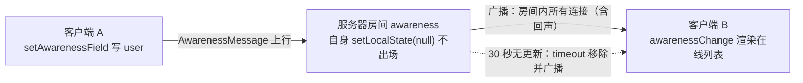

import { Canvas, Controls, Meta } from '@storybook/addon-docs/blocks';
import * as AwarenessCourse from './awareness.stories';

<Meta of={AwarenessCourse} name="Docs" />

# Awareness 在线状态

awareness 是叠在文档同步之上的「临时状态层」：谁在线、光标在哪、正在编辑什么、自定义的任意小状态。它与文档同步有三点本质区别，决定了它的一切用法——**临时**（不产生历史、服务器不落库，文档卸载即消失）、**覆盖**（每个 clientID 只能整体覆盖自己的状态，靠递增时钟仲裁，不做 CRDT 合并）、**有过期**（30 秒不更新就被各端移除，离开可以「等来」也可以「广播」）。本课覆盖 Hocuspocus 两侧：客户端经 `provider.awareness` 写入与监听、做在线列表，服务器经 `onAwarenessUpdate` 与 `beforeHandleAwareness` 钩子观察与过滤。读完你应能预测：改一个昵称，两端列表同帧更新；拔掉对端网络，约 30 秒后它从列表消失；正常关闭页面，则是立即消失。

版本基线为 Hocuspocus v4（4.7.x）。客户端 awareness API（`setAwarenessField`、两个事件）与 v3 相同；差异集中在服务器钩子 payload，正文以一句话标注。awareness 协议本身的内部编码与时钟仲裁属于 y-protocols（yjs 主题手册的范围），本课只讲 Hocuspocus 集成面上要用的部分。



| 输入或概念 | 默认值 | 回查要点 |
| --- | --- | --- |
| `provider.awareness` | 每个 provider 一个新的 `Awareness(document)` | 传 `awareness: null` 禁用，会连带破坏连接保活 |
| `clientID` | 借用 `document.clientID` | 房间内标识一个人，是在线列表的去重键 |
| `user` 字段 | 约定放 `name` 与 `color` | Collaboration Caret 读它渲染光标与名牌 |
| 本地保活重播 | 超过 15 秒未刷新时重播一次 | `outdatedTimeout / 2`，刷新对端的过期计时 |
| 过期时长 | 30 秒 | `outdatedTimeout` 常量，不可配置 |
| 自检间隔 | 每 3 秒 | `outdatedTimeout / 10`，重播与过期移除的执行点 |
| `awarenessUpdate` 事件 | 每次协议更新都触发 | payload 是 `states` 全量数组，保活重播也触发 |
| `awarenessChange` 事件 | 仅真实增删改触发 | 做在线列表用它，避免每 15 秒一次的无意义重渲染 |

## provider.awareness：写入与监听

provider 在构造时默认创建一个 `Awareness` 实例挂在文档上，经 `provider.awareness` 访问。所有在线状态都围绕它的一对操作展开：**写入**自己的状态（会自动上行广播），**监听**房间快照（渲染在线列表）。显式传 `awareness: null` 可以禁用——但 awareness 的周期消息同时是 provider 的保活心跳，禁用后挂机约 30 秒会被服务器断开（见 [HocuspocusProvider](?path=/docs/provider--docs) 课），一般不要禁。

### 写入：setAwarenessField 与 setLocalStateField

首选 `provider.setAwarenessField(key, value)`，它是 `awareness.setLocalStateField` 的薄封装，语义是**字段级合并**：重复调用不同的 key 互不覆盖，同 key 整体替换。底层还有两个更原始的入口：

```ts
// 约定：user 字段放 name 与 color，协同光标扩展会读它
provider.setAwarenessField('user', { name: '小明', color: '#4f7cff' });
// 字段级合并：不同字段互不覆盖
provider.setAwarenessField('editing', true);

// 等价底层写法：整体替换本地状态
provider.awareness.setLocalState({ user: { name: '小明', color: '#4f7cff' }, editing: true });
// 立即广播离开：所有对端马上移除你，不用等 30 秒过期
provider.awareness.setLocalState(null);
```

边界有一条真实的坑：`setLocalStateField` 在本地状态为 `null` 时是**静默 no-op**（源码行为）。`destroy()` 与页面 `pagehide` 都会把本地状态置空，之后想重新上线，必须先用 `setLocalState` 重建状态（哪怕空对象），再 `setAwarenessField` 写字段——直接调 `setAwarenessField` 不会报错，但也永远不生效。`user` 字段写对就够本课用了；光标与选区怎么渲染属于 [协同光标](?path=/docs/collaboration-caret--docs) 课。

React 项目写法不变：provider-react 的 hook 拿到 provider 后调同一套 `setAwarenessField`（见 [React 集成](?path=/docs/react-integration--docs) 课）。

### 监听：awarenessUpdate 与 awarenessChange

两个事件的 payload 完全相同——`states`，一份**全量快照数组**，每项含 `clientId` 和该端写入的全部字段。差异只在触发频率（源自 y-protocols 的两个内部事件）：

| 事件 | 触发时机 | 适合做什么 |
| --- | --- | --- |
| `awarenessUpdate` / `onAwarenessUpdate` | 每次协议更新：真实增删改，**加上每 15 秒的保活重播** | 调试、观察心跳 |
| `awarenessChange` / `onAwarenessChange` | 仅真实增删改（added / 深比较变化的 updated / removed） | 在线列表、成员面板 |

在线列表的最小写法：

```ts
const provider = new HocuspocusProvider({
  url: 'ws://127.0.0.1:1234',
  name: 'awareness-demo',
  onAwarenessChange: ({ states }) => {
    // states 形如：clientId 加该端写入的字段，直接映射成列表
    renderOnlineList(states.map((state) => state.user));
  },
});
provider.setAwarenessField('user', { name: '小明', color: '#4f7cff' });
```

订阅 `awarenessUpdate` 做列表是高频错误：即使没人操作，保活重播也会每 15 秒推你一次，列表无意义地反复重渲染——所以判断「谁在线」永远订阅 `awarenessChange`。构造回调与 `provider.on('…')` 双写法同 provider 课。另外，v4 的服务器在连接建立时就把房间内已有的 awareness 快照主动推给新连接（`Connection` 构造即发送，先于文档初始同步完成），所以新加入的成员马上能看到已在线的人，不用等他们的下一次重播。

下面的实例没有真实 WebSocket：客户端 A、客户端 B 与服务器房间是**三个真实 Awareness 实例**，经内存房间按 y-protocols 的编码与应用互通（`encodeAwarenessUpdate` / `applyAwarenessUpdate` 真实代码路径），15 秒重播与 30 秒过期都是实例内的真实计时，读数可逐项核对。

<Canvas of={AwarenessCourse.PresenceBoard} />
<Controls of={AwarenessCourse.PresenceBoard} />

| 读者操作 | 可观察证据 |
| --- | --- |
| 修改「客户端 A 昵称」 | A 端、B 端与服务器房间的列表同帧更新；`awarenessChange` 与 `awarenessUpdate` 计数各加一 |
| 静置约 15 秒不动 | `awarenessUpdate` 计数继续增长（保活重播），`awarenessChange` 计数不变 |
| 打开 Show code | 看到 `awareness-model.ts` 中三个真实 Awareness 实例的上行、房间广播与钩子计数 |

A 端面板的读数就是两个事件的分频器：等 15 秒，`awarenessUpdate` 涨、`awarenessChange` 不涨，这就是「在线列表订阅 change」的直观依据。服务器房间的 `onAwarenessUpdate` 计数同步增长，说明保活重播也会触发服务器钩子（下文服务器侧一节）。

## 过期与保活

过期机制由三个写死的数字组成（y-protocols 的 `outdatedTimeout = 30000`）：每个 Awareness 实例**每 3 秒**自检一次，做两件事——本地状态超过 **15 秒**没刷新就重播一次（时钟加一，对端把 30 秒计时清零）；某个远端超过 **30 秒**没有任何更新就把它移除（origin 标记为 `timeout`）。30 秒是常量，改不了；想要更短的离线判定只能在应用层或服务器钩子里自己做。

「从列表里消失」有四条路径，时机完全不同：

| 离开方式 | 列表里消失的时机 | 对应路径 |
| --- | --- | --- |
| 主动置空：`setLocalState(null)`、`destroy()`、页面 `pagehide` | 立即（广播 null） | 客户端上行移除消息，各端马上删 |
| 服务器感知到连接关闭 | 立即 | 服务器清理该连接带来的全部状态并广播 |
| 异常掉线：崩溃、断网、进程被杀 | 约 30 秒后 | 各端与房间按 `timeout` 移除 |
| 房间文档卸载 | 随房间消失 | 文档缓存回收，见 [文档生命周期](?path=/docs/document-lifecycle--docs) 课 |

页面隐藏与恢复分两种情况，行为不一样：

- **关闭 / 刷新 / 进入往返缓存**：v4 的 provider 在 `pagehide` 里立即广播移除本地状态并冲刷待发更新，不走 30 秒。但**没有** `pageshow` 或 `visibilitychange` 处理——从往返缓存恢复（浏览器后退）后不会自动回归，因为本地状态已被置空，内部重播条件不再成立；必须应用代码重建状态（先 `setLocalState` 再 `setAwarenessField`，见上文 no-op 边界）。
- **普通切后台**（标签页隐藏但页面还在）：浏览器节流后台定时器，15 秒重播可能迟到，对端最长 30 秒后按 `timeout` 移除你；回到前台后 3 秒自检触发补播，自动回归——这条路径不需要任何处理，但解释了「切出去一会儿就被下线」的现象。

下面的实例把三种离开方式做成同一个开关，对比「立即广播移除」与「30 秒过期移除」：两者最终结果相同，但触发条件与恢复行为不同。

<Canvas of={AwarenessCourse.LeaveAndExpiry} />
<Controls of={AwarenessCourse.LeaveAndExpiry} />

| 读者操作 | 可观察证据 |
| --- | --- |
| 把「A 的连接」切到异常失联 | 「A 在服务器最后活跃」秒数爬升；约 30 秒时服务器按 `timeout` 移除 A 并广播，B 端列表同步消失，时间线记录 removed |
| 切回连接中 | A 的下一次保活重播（最长约 18 秒：15 秒周期加最多 3 秒检查间隔）让它自动回归，服务器钩子最近 origin 回到 connection |
| 切到正常下线 | A 立即从所有列表消失（广播 null，不等 30 秒）；切回连接中也不会自动回归——实例替应用重新写入状态后才重新上线 |

区分证据就在同一个开关里：失联是「静默 + 30 秒倒计时 + 自动回归」，正常下线是「立即 + 不回归」，对应正文的两条离开路径。注意过期的判定方永远是「收到状态的一侧」：实例只断了 A 的上行，所以 A 端自己的列表毫无异常；真实断网里 A 同样收不到对端，它自己的列表也会在约 30 秒后清空对端。

## 服务器侧：awareness 钩子

服务器给每个房间文档挂一份自己的 Awareness，构造后立即 `setLocalState(null)`——服务器自己不出现在任何在线列表里。客户端的 awareness 消息以 connection origin 应用到房间实例，房间实例的每次更新再广播给**房间内所有连接**（包括发送者自己的回声，时钟比较让回声无害）。广播范围就是同文档名的房间，跨房间不串。服务器侧有两个钩子，一个事后观察，一个事前改写。

### onAwarenessUpdate：观察已应用的变化

钩子在房间 awareness 的**每一次更新之后**触发：客户端写入、15 秒保活重播、30 秒 `timeout` 移除、连接关闭清理，全都会走到这里。v4 payload：

| 字段 | 说明 |
| --- | --- |
| `documentName` / `document` | 房间名与服务器侧文档 |
| `added` / `updated` / `removed` | 本次变化的 clientID |
| `states` | 变化后的全量状态数组 |
| `awareness` | 服务器侧 Awareness 实例，可读 `getStates()`、可主动清理状态 |
| `transactionOrigin` | 来源标记：connection / redis / local，或 timeout、连接清理 |
| `connection` | `transactionOrigin` 为 connection 时的连接对象，`context` 在它身上 |

用途最典型的是在线人数服务：用 `states` 过滤出带 `user` 的条目计数，推给监控或运营面板；也可以做审计埋点。上面的两个实例读数里「服务器钩子」一行就是它的计数与最近 origin——保活重播、`timeout` 移除都会让计数跳动，对应真实服务器里这个钩子的真实触发频率。

v3 差异一句话：v3 的 payload 把 `connection`、`context`、`requestHeaders`、`requestParameters`、`socketId` 直接铺在顶层；v4 改为 `transactionOrigin` 加可选 `connection`，连接专属信息改从 `connection?.context` 取。tester/ 项目里的 v3 钩子签名按此对照迁移。

### beforeHandleAwareness：改写与拒绝

这个钩子在消息**应用与广播之前**触发，`states` 是按 `clientId` 键的可变 Map：改字段、删条目、或直接抛错拒绝整条更新（拒绝后什么都不应用、什么都不广播）。它才是「过滤敏感状态」的落点——`onAwarenessUpdate` 只读且事后，拦不住已经广播出去的消息。

```ts
const server = new Server({
  async beforeHandleAwareness({ states, context }) {
    for (const state of states.values()) {
      // 用服务器已验证的身份覆盖客户端自报的 user
      state.user = context?.user ?? null;
    }
  },
});
server.listen();
```

典型用法三类：身份盖章（客户端自报的 `user` 只是声明，以 `context` 里服务器验证过的为准）、剔除敏感字段或整个条目、只读会话直接抛错禁用 awareness 流量。

## 最佳实践

- **放进 awareness 的状态要小、可丢、可重建。** 整体覆盖语义、30 秒过期、不落库，三者叠加决定了它只适合「丢了无所谓、能随时重算」的数据；需要留存的内容走文档 update 或应用层。
- **在线列表订阅 `awarenessChange`，不用 `awarenessUpdate`。** 保活重播每 15 秒驱动一次 update；订阅错事件的表现就是列表周期性无意义重渲染。
- **不要自己写心跳。** 内部 15 秒重播已经同时承担 provider 的 30 秒静默保活（见 [HocuspocusProvider](?path=/docs/provider--docs) 课）；自己再叠加一层只会加重广播量。同理不要传 `awareness: null`。
- **身份以服务器为准。** 客户端自报的 `user` 可以是任何人；要可信身份，在 `beforeHandleAwareness` 里用 `context` 覆盖。
- **每个 provider 用自己的 awareness 实例。** 复用同一实例接多个 provider（不同文档名）时，一份 `states` 会混装两个房间的对端并互相转发——跨 provider 只共享 `document`，不共享 `awareness`。

## 常见问题

- 对端关掉页面后，光标或头像一直不消失
  说明对端是异常离场（没有广播 null，服务器也没收到 close），只能等 30 秒 `timeout`。离开路径务必调用 `provider.destroy()` 或至少 `awareness.setLocalState(null)`；服务器感知到连接关闭会立即清理该连接的全部状态。确认这些都做了仍残留，是对端进程还挂着连接——等过期即可，不算泄漏。
- 在线列表每约 15 秒闪一下或重复渲染
  订阅的是 `awarenessUpdate`——保活重播也会触发它。换成 `awarenessChange`，它只在真实增删改时触发（正文实例的两个计数器演示了这个差异）。
- 服务器 `onAwarenessUpdate` 里取不到 `context` 或 `requestHeaders`
  v4 把连接专属字段从 payload 顶层移除了。改从 `connection?.context` 取；来源判断用 `transactionOrigin`（connection / redis / local / timeout）。这是 v3 迁移的高频断点，见 [从 v3 迁移](?path=/docs/v3-migration--docs) 课。
- 两个文档的在线名单混在一起，互相看到对方房间的人
  多个 provider 复用了同一个 awareness 实例：一份 `states` 同时装着两个房间的对端，还会互相转发。每个 provider 用默认自建的 awareness（不要传同一个实例），需要自定义时按 provider 各建一个。
- 浏览器后退回到页面后，`setAwarenessField` 不生效，别人也看不到我
  `pagehide` 已把本地状态置空，而 `setLocalStateField` 对空状态是静默 no-op，v4 也没有 `pageshow` 重播。恢复钩子里先 `provider.awareness.setLocalState(空对象或完整状态)` 重建，再 `setAwarenessField` 写字段；或者干脆刷新页面。

## 总结回顾

摘要：

awareness 是与文档同步并行的临时状态层：不落库、按 clientID 整体覆盖、30 秒过期。客户端经 `provider.awareness` 拿到实例，`setAwarenessField`（底层 `setLocalStateField` / `setLocalState`）写入自己的状态，`user` 字段按约定放 `name` 与 `color`；监听侧 `awarenessUpdate` 与 `awarenessChange` 的 payload 同为 `states` 全量数组，差异在触发频率——在线列表订阅 change。保活与过期由三个常量驱动：每 3 秒自检、本地 15 秒未刷新重播、远端 30 秒无更新移除；离开有四条路径，主动置空与服务器感知断开立即生效，异常掉线等 30 秒，`pagehide` 立即广播但恢复后要重建状态。服务器侧每个房间挂一份不出场的 Awareness，`onAwarenessUpdate` 事后观察每一次更新（v4 payload 带 `transactionOrigin` 与可选 `connection`），`beforeHandleAwareness` 事前改写或拒绝，是过滤敏感状态与身份盖章的落点。

一句话：

> awareness 是按 clientID 覆盖、靠 15 秒重播续期、30 秒过期的临时状态层——在线列表订阅 `awarenessChange`，身份与过滤交给服务器侧钩子。

知识要点：

- awareness 与文档同步在哪三点上不同？`user` 字段的约定内容是什么？
- `setAwarenessField`、`awareness.setLocalStateField`、`setLocalState` 三者的关系是什么？`setLocalStateField` 在什么情况下静默失效？
- `awarenessUpdate` 与 `awarenessChange` 的 payload 与触发差异？在线列表该订阅哪个，为什么？
- 3 秒、15 秒、30 秒各是什么？离开的四种路径分别多久后从列表消失？
- 页面 `pagehide` 与普通切后台的行为差异是什么？往返缓存恢复后要怎么恢复在线状态？
- 服务器 `onAwarenessUpdate` 的 v4 payload 有哪些字段，v3 差异是什么？`beforeHandleAwareness` 能做哪三类事？

## 参考资料

- [Awareness 使用指南（官方文档）](https://tiptap.dev/docs/hocuspocus/guides/awareness)
- [Server 钩子：onAwarenessUpdate 与 beforeHandleAwareness（官方文档）](https://tiptap.dev/docs/hocuspocus/server/hooks)
- [Provider 配置：awareness 选项（官方文档）](https://tiptap.dev/docs/hocuspocus/provider/configuration)
- [Provider 事件：awarenessUpdate 与 awarenessChange（官方文档）](https://tiptap.dev/docs/hocuspocus/provider/events)
- [Upgrade to Hocuspocus v4（钩子 payload 精简说明）](https://tiptap.dev/docs/hocuspocus/getting-started/upgrade)
- [HocuspocusProvider.ts（v4 源码：setAwarenessField、两个事件的 states payload、pagehide、destroy 清理）](https://github.com/ueberdosis/hocuspocus/blob/main/packages/provider/src/HocuspocusProvider.ts)
- [server Document.ts（v4 源码：房间 awareness 置空自身、广播房间内全部连接、连接关闭清理）](https://github.com/ueberdosis/hocuspocus/blob/main/packages/server/src/Document.ts)
- [server Connection.ts（v4 源码：连接建立即推送房间内已有 awareness 快照）](https://github.com/ueberdosis/hocuspocus/blob/main/packages/server/src/Connection.ts)
- [server types.ts（v4 源码：onAwarenessUpdatePayload、beforeHandleAwarenessPayload、TransactionOrigin）](https://github.com/ueberdosis/hocuspocus/blob/main/packages/server/src/types.ts)
- [y-protocols/awareness.js（30 秒过期、15 秒重播、3 秒自检、change 与 update 事件差异）](https://github.com/yjs/y-protocols/blob/main/awareness.js)
