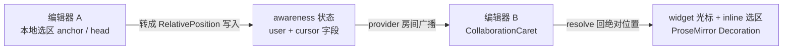

import { Canvas, Controls, Meta } from '@storybook/addon-docs/blocks';
import * as CaretCourse from './collaboration-caret.stories';

<Meta of={CaretCourse} name="Docs" />

# 协同光标

CollaborationCaret 扩展把 awareness 里的远端状态画进编辑器：别人的光标、选区高亮和名牌。它与 Collaboration 是分工关系——Collaboration 负责 Y.Doc 与编辑器文档之间的内容同步，CollaborationCaret 只消费 awareness：把你本地的选区发布出去，把别人的选区渲染回来。读完你应能预测：把光标点进编辑器，对面窗口立刻出现带名牌的光标跟手移动；点掉焦点，光标在对端立即撤下，但人还在线；改一个昵称，两边的名牌同帧更新。

版本基线为 Hocuspocus v4 + Tiptap 3.x。Tiptap v2 的同名扩展叫 collaboration-cursor（`CollaborationCursor`），v3 改名为 collaboration-caret（`CollaborationCaret`），包名、扩展名与 CSS 类前缀一起改了，位置模型与 provider、user 配置语义不变。awareness 本身的机制与过期语义在 [Awareness 在线状态](?path=/docs/awareness--docs) 课已讲清，本课不重复；Collaboration 与 provider 的接线见 [Tiptap 协同接入](?path=/docs/tiptap-setup--docs) 课。



| 输入或概念 | 默认值 | 回查要点 |
| --- | --- | --- |
| `provider` | `null`（必填） | 缺失时编辑器创建即抛错；扩展只读 `provider.awareness` |
| `user` | `name` 与 `color` 均为 `null` | 写入 awareness 的 `user` 字段；颜色必须六位 hex |
| `render` | 默认竖线光标 + 名牌元素 | 返回一个 HTMLElement；收到的颜色已被清洗成合法值 |
| `selectionRender` | 底色为 `user.color` 加 `70` 透明的 inline 标记 | 返回 DecorationAttrs；返回空对象即不画选区 |
| 未设置名字与颜色时 | `User: <clientId>` 与橙色 `#ffa500` | 渲染端兜底，保证有光标可看 |
| 样式 | 扩展不带默认 CSS | 类名前缀 `collaboration-carets__`；缺样式时是裸内联元素 |
| 在线用户列表 | `editor.storage.collaborationCaret.users` | 只读快照；`onUpdate` 选项已废弃，由它替代 |
| 身份更新命令 | `updateUser` | 旧 `user` 命令已废弃；awareness 状态置空后是静默 no-op |

## 光标模型

两个决定构成了全部行为：

**位置是相对的，不是数字偏移。** 发布出去的是 Yjs 的 RelativePosition——锚在某段内容（一个 item）的左侧或右侧。别人在光标前插入文字时，锚着的内容不动，光标就不动；只有光标所在内容本身被删掉，位置才解析失败。这一句话足够支撑本课的判断；RelativePosition 的编码与稳定性细节属 yjs 主题手册。

**状态就是 awareness 上的两个字段。** 扩展不建私有通道，一切都在 [Awareness 在线状态](?path=/docs/awareness--docs) 课讲过的那套机制上运行：

| 字段 | 内容 | 谁写、什么时候写 |
| --- | --- | --- |
| `user` | 身份信息：`name`、`color` 与任意自定义字段 | 编辑器创建时由扩展用 configure 里的 `user` 写入；之后由 `updateUser` 命令更新 |
| `cursor` | 本地选区 `{ anchor, head }` 两个 RelativePosition | 扩展内置的 yCursorPlugin 维护：编辑器**持有焦点**时随每次事务与焦点变化写入；失焦立即清空；编辑器销毁也清空 |

渲染侧（对端）每次 awareness 变化时整批重建 Decoration，条件与兜底是排查光标问题的依据：

- 遍历 awareness 的全部 states，**先排除自己**——所以你永远看不到「自己的」名牌光标，自己用的是编辑器原生光标；
- `cursor` 字段非空才会画；`anchor` 与 `head` 解析失败（内容被删）则这一轮不画；
- `user.color` 为 `null` 时按橙色 `#ffa500` 画，`user.name` 为 `null` 时显示 `User: <clientId>`；
- 位置收敛到文档范围内（不超过文档末尾），越界按边界画。

## 接入与配置

与 Collaboration 一起挂，`provider` 与 `user` 是仅有的两个必看选项：

```ts
import { Editor } from '@tiptap/core';
import { StarterKit } from '@tiptap/starter-kit';
import { Collaboration } from '@tiptap/extension-collaboration';
import { CollaborationCaret } from '@tiptap/extension-collaboration-caret';

const editor = new Editor({
  extensions: [
    // Collaboration 自带撤销历史，与 StarterKit 的 undoRedo 冲突，必须关掉
    StarterKit.configure({ undoRedo: false }),
    Collaboration.configure({ document: provider.document }),
    CollaborationCaret.configure({
      provider,
      user: { name: '小明', color: '#4f7cff' },
    }),
  ],
});
```

Caret 的渲染依赖 Collaboration 建立的 Y.Doc 绑定，所以两个扩展都在；`provider` 传 HocuspocusProvider，扩展只读它的 `provider.awareness`。浏览器里开两个窗口连同一文档即可互看光标——就是在 1.2 课双窗口接线上加本课扩展，无需新服务器配置。

下面的实例在同一页面内复现：两个编辑器分属两份 Y.Doc 与两个 Awareness 实例，经内存 relay 按真实编码互转，`provider` 以最小对象 `{ awareness }` 传入；扩展与 y-protocols 的代码路径全部真实，模拟的只是传输层。

<Canvas of={CaretCourse.CaretBoard} />
<Controls of={CaretCourse.CaretBoard} />

| 读者操作 | 可观察证据 |
| --- | --- |
| 点「同事光标 → 开头 / 结尾」 | 我的编辑器立即出现带「小红」名牌的竖线光标；同事自己的编辑器里仍是原生光标 |
| 点「同事选中第一句」 | 我这边第一句出现半透明底色的选区高亮，底色取自同事的颜色 |
| 在 Controls 改「同事昵称」或「同事颜色」 | 身份经 `updateUser` 即时写入 awareness；再点一次「同事光标」按钮让同事编辑器重新持焦，名牌即显示新昵称新颜色（点 Controls 会移走同事的焦点，光标先被撤下——这正是焦点语义） |
| 点进「同事的编辑器」再点回「我的编辑器」 | 同事的名牌光标随失焦立即消失（消失时机见下文）；而同事编辑器里出现了我的名牌光标 |
| 打开 Show code | 看到 `caret-model.ts`：两个编辑器接线、内存 relay 与快照读数 |

### user：身份信息与动态更新

configure 里的 `user` 只在编辑器创建时写入一次；运行期改身份用 `updateUser` 命令。它就是 3.4 课 `setAwarenessField('user', ...)` 的同一操作，字段可以随意扩展（头像、角色）：

```ts
editor.commands.updateUser({
  name: '老明',
  color: '#4f7cff',
  avatar: 'https://example.com/avatar.png',
});
```

读「房间里现在有谁」不必自己遍历 awareness，扩展维护着一份只读快照：

```ts
editor.storage.collaborationCaret.users
// [{ clientId: 42, name: '小明', color: '#4f7cff' }, ...]
```

它在每次 awareness 更新时刷新（含 15 秒保活重播），一人一条，`clientId` 加 `user` 的全部字段；旧的 `onUpdate` 选项已废弃，就是由它替代。做头像栏、协作名单用快照或直接订阅 `awarenessChange`（见 3.4 课）。

身份上有两个真实的坑：

- **颜色必须是 `#RRGGBB` 六位 hex。** 其他格式（`red`、`#fff`、CSS 变量）会被当非法处理：光标按 `transparent` 渲染（等于看不见）、选区直接不画，控制台还有一条 `A user uses an unsupported color format` 警告。这是防注入的清洗——`user` 来自对端，颜色只被放进样式属性，非法值一律拦下，不是 bug。
- **awareness 状态被置空后，`updateUser` 静默失效。** `destroy()`、页面 `pagehide`、手动 `setLocalState(null)` 之后，它底层的字段合并是 no-op：改了没有任何效果也不报错。先 `provider.awareness.setLocalState({})` 重建状态再更新（3.4 课同名坑的光标版）。

React 项目写法不变：`useEditor` 的 extensions 数组按同样方式配置两个扩展，命令调用一致（见 [React 集成](?path=/docs/react-integration--docs) 课）。

## 自定义渲染

`render` 与 `selectionRender` 分别替换光标与选区的画法，签名都只收 `user`：

| 选项 | 返回 | 默认行为 |
| --- | --- | --- |
| `render` | HTMLElement | `span.collaboration-carets__caret` 竖线加 `div.collaboration-carets__label` 名牌，边框与底色取 `user.color` |
| `selectionRender` | DecorationAttrs | 底色为 `user.color` 加 `70` 透明的 inline 标记 |

扩展不带默认样式——官方文档明确说缺了下面这段 CSS，光标就是一串裸内联元素：

```css
.tiptap .collaboration-carets__caret {
  border-left: 1px solid #0d0d0d;
  border-right: 1px solid #0d0d0d;
  margin-left: -1px;
  margin-right: -1px;
  position: relative;
  pointer-events: none;
}

.tiptap .collaboration-carets__label {
  position: absolute;
  top: -1.4em;
  left: -2px;
  font-size: 12px;
  font-weight: 600;
  line-height: normal;
  user-select: none;
  color: #0d0d0d;
  padding: 0.1rem 0.3rem;
  border-radius: 3px 3px 3px 0;
  white-space: nowrap;
}
```

自己画光标就是返回任意元素，`user` 里的自定义字段（如 `avatar`）随便用：

```ts
CollaborationCaret.configure({
  provider,
  user: { name: '小明', color: '#4f7cff' },
  render: (user) => {
    const caret = document.createElement('span');
    caret.classList.add('my-caret');
    caret.style.borderColor = user.color;
    // 按产品样式拼自己的 DOM，例如头像加名牌
    return caret;
  },
});
```

三条边界：

- **重建时机：** awareness 每次变化都整批重建 Decoration，`render` 被重新调用——别在里面做有副作用或昂贵的操作。
- **收到的颜色已清洗：** `render` 拿到的 `user.color` 若原本非法，已经是 `transparent` 而不是原值（防注入）；自定义渲染想要自己的兜底色，在函数里自己判断。
- **只画光标不画选区：** `selectionRender` 返回空对象即可——这是两个渲染各自的开关，互不牵连。

「消失时机」实例里同事的光标就是用自定义 `render` 画的（胶囊名牌样式），打开 Show code 看 `badgeRender`：同样的 awareness 数据，换一个函数就是另一种画法。

## 光标什么时候消失

光标消失与人下线是两件事，时机不同：

| 情形 | 对端看到的光标 | 人还在房间吗 |
| --- | --- | --- |
| 编辑器失焦 | 立即消失（`cursor` 字段清空并广播） | 在（`storage.users` 仍有他） |
| 正常离开：`editor.destroy()`、awareness 置空、页面 `pagehide` | 立即消失 | 不在（广播移除） |
| 异常掉线：崩溃、断网、进程被杀 | 约 30 秒后消失（awareness 过期移除） | 不在（30 秒 timeout） |
| 光标处的内容被删除 | 该位置解析失败，这一轮不画；对方重新点击后恢复 | 在 |

约 30 秒的过期属于 awareness 机制本身，[Awareness 在线状态](?path=/docs/awareness--docs) 课的四条离开路径与计时原样适用于光标；本实例演示前两条「立即」路径。

<Canvas of={CaretCourse.FocusAndLeave} />
<Controls of={CaretCourse.FocusAndLeave} />

| 读者操作 | 可观察证据 |
| --- | --- |
| 点「同事光标 → 结尾」，再点「同事失焦」 | 光标立即消失，但读数里 `storage.users` 仍列着小红、`cursor` 字段变为已清空——撤下光标不等于下线 |
| 点「同事离开房间」 | 名单同步移除小红，`cursor` 字段变为无状态——广播移除，不用等 30 秒 |
| 同事离开期间在 Controls 改「同事昵称」 | 什么都没变——置空后 `updateUser` 是静默 no-op |
| 点「同事回归」，再改「同事昵称」 | 回归按钮先重建 awareness 状态再 `updateUser`，此后改名重新生效，光标与名单一起回来 |

## 最佳实践

- **颜色由应用层分配并校验。** 扩展不做分配也不查重，两人同色就分不出谁是谁。常用做法：从 `clientID` 或用户名 hash 映射进一组预设色，并保证输出六位 hex——不合规的颜色会被清洗成隐形。
- **`user` 只放渲染需要的少量字段。** 它进 awareness：整体覆盖、30 秒过期、不落库。昵称、颜色、头像之外的身份可信性交给服务器 `beforeHandleAwareness` 盖章（见 [Awareness 在线状态](?path=/docs/awareness--docs) 课）。
- **不要自己写 `cursor` 字段。** 发布与清空（含焦点语义）由扩展内置插件负责，手写第二份只会和对端的重建时机打架；想让光标消失，让编辑器失焦即可。
- **名单类 UI 与光标绘制分离。** 头像栏、协作者列表订阅 `awarenessChange` 或读 `storage.users`；光标的 Decoration 交给扩展，不要试图在自己的 render 里顺带画名单。

## 常见问题

- 对端编辑器里完全看不到任何光标
  按顺序检查：扩展挂了没有——只装 Collaboration 不画光标；`provider` 传了没有——缺失时编辑器创建直接抛错；`provider.awareness` 是否被 `awareness: null` 禁用；对端编辑器获得过焦点没有——从未聚焦就没有 `cursor` 字段可画；样式写了没有——缺 CSS 时光标元素在 DOM 里但只是裸内联文字，名牌会挤进正文；以及你看的位置是不是自己——默认过滤自己，自己的名牌光标只存在于别人屏幕上。
- 控制台出现 `A user uses an unsupported color format`
  某个 `user.color` 不是 `#RRGGBB` 六位 hex（常见 `#fff`、`red`、CSS 变量）。修数据源即可，渲染端无需处理——扩展已按 `transparent` 清洗，选区不画。
- 改了昵称或颜色，名牌不变
  两个来源分别查：用的是 configure 里的 `user`——它只在创建时写一次，运行期改身份要走 `updateUser` 命令；或者 awareness 状态被置空过（离开、`pagehide`、`destroy` 后复用）——`updateUser` 静默 no-op，先 `provider.awareness.setLocalState({})` 重建再改。
- 从 Tiptap v2 升级后光标消失
  v3 把 collaboration-cursor 改名 collaboration-caret：包 `@tiptap/extension-collaboration-cursor` 改为 `@tiptap/extension-collaboration-caret`，扩展 `CollaborationCursor` 改为 `CollaborationCaret`，CSS 类前缀 `collaboration-cursor__` 改为 `collaboration-carets__`。老样式表里的类名要同步改。

## 总结回顾

摘要：

CollaborationCaret 与 Collaboration 分工：后者同步内容，前者消费 awareness——把你本地的选区转成两个 RelativePosition 写进 `cursor` 字段，身份写进 `user` 字段，对端解析后画成 widget 光标与 inline 选区。位置锚在内容上，并发输入不推走别人的光标，内容被删才解析失败。配置只需 `provider` 与 `user`；运行期身份用 `updateUser` 更新、用 `storage.collaborationCaret.users` 读取，awareness 状态置空后更新会静默失效。渲染由 `render` 与 `selectionRender` 定制，扩展不带默认样式，类名前缀 `collaboration-carets__`，非法颜色被清洗成 `transparent`。光标消失与人下线是两件事：失焦立即撤下光标但人在线，正常离开立即移除，异常掉线等 30 秒过期。

一句话：

> 协同光标就是 awareness 上的 `user` 与 `cursor` 两个字段——`user` 管身份、`cursor` 管相对位置，只有持有焦点的编辑器发布 `cursor`，光标消失不等于人离线。

知识要点：

- Collaboration 与 CollaborationCaret 的分工是什么？`user` 与 `cursor` 两个字段分别由谁在什么时候写入？
- 为什么并发输入不会把对端光标「推走」？光标所在内容被删后会看到什么？
- configure 的 `user`、`updateUser` 命令、`storage.collaborationCaret.users` 各自的用途与时机？awareness 状态置空后 `updateUser` 会发生什么？
- 颜色的合法格式是什么？非法时渲染结果如何？未设置名字与颜色时的兜底是什么？
- `render` 与 `selectionRender` 各定制什么？扩展为什么不带默认样式？
- 光标消失的三条路径分别多久？如何区分「光标撤下」与「人已离线」？
- v3 相对 v2 在包名、扩展名与样式类名上改了什么？

## 参考资料

- [CollaborationCaret extension（官方扩展文档：选项、updateUser 命令、样式）](https://tiptap.dev/docs/editor/extensions/functionality/collaboration-caret)
- [Upgrade v2 to v3（collaboration-cursor 改名 collaboration-caret 的官方说明）](https://tiptap.dev/docs/guides/upgrade-tiptap-v2)
- [extension-collaboration-caret 源码（选项默认值、颜色清洗、updateUser、storage.users）](https://github.com/ueberdosis/tiptap/blob/main/packages/extension-collaboration-caret/src/collaboration-caret.ts)
- [y-tiptap yCursorPlugin 源码（cursor 字段的发布与清空、渲染条件与兜底、排除自己）](https://github.com/ueberdosis/tiptap/blob/main/packages/y-tiptap/src/lib/plugins/yCursorPlugin.ts)
- [CursorAwarenessState 类型（awareness 状态里 user 与 cursor 的形状）](https://github.com/ueberdosis/tiptap/blob/main/packages/y-tiptap/src/types/CursorAwarenessState.ts)
- [Yjs Relative Positions（相对位置模型）](https://docs.yjs.dev/api/relative-positions)
- [y-protocols/awareness（30 秒过期与广播语义，3.4 课同一真源）](https://github.com/yjs/y-protocols/blob/main/awareness.js)
