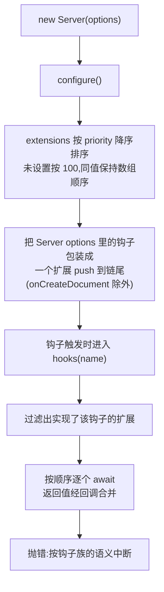

import { Meta } from '@storybook/addon-docs/blocks';

<Meta id="custom-extensions" title="进阶/自定义扩展" name="Docs" />

# 自定义扩展

官方扩展(SQLite 持久化、Throttle 限流、Logger 日志)没有专用挂载点,也没有第二套钩子系统:它们与你在 Server options 里直接写的钩子走同一条执行链。自定义扩展因此只有一种写法——实现 `Extension` 接口,把钩子写成类方法,放进 `extensions` 数组。本课回答三个问题:钩子怎么合并与排序(priority 规则与「配置钩子垫底」的唯一例外)、扩展怎么写(官方的构造器 options 模式)、25 个钩子在扩展链上的 await 与中断语义。读完你应能预测:同名钩子在扩展与 Server options 里都写时两处都会执行(扩展先、配置后);给扩展设 `priority: 200` 能插到官方扩展之前;Server options 里的 `onCreateDocument` 根本不会执行;`onChange` 里抛错不会「跳过后续钩子」,而是可能直接带走进程。

版本基线为 Hocuspocus v4(4.7.x,要求 Node 22+);v3 差异在正文一句话标注。扩展运行在服务端,Storybook 无法稳定复现,本课不设内嵌实例:证据为完整可复制的扩展实现与控制台输出(标注示意),全部行为对照 v4.7.1 源码(`packages/server`)、npm 发布产物与官方文档核实。



| 条目 | 默认值或规则 | 回查要点 |
| --- | --- | --- |
| `Extension.priority` | 未设置按 `100` | 数值大的先执行;同值保持 `extensions` 数组顺序 |
| `Extension.extensionName` | 缺省取类名 | 只用于启动横幅展示,运行时不参与逻辑 |
| 25 个钩子 | 全部可选,返回 `Promise` | 只实现需要的;`implements` 只是类型提示,不写也能跑 |
| 构造器 options | 无默认 | 官方模式:`Partial` 配置展开覆盖默认值(见「快速上手」) |
| Server options 钩子 | 充当排在最后的扩展 | 同名钩子两处都执行:扩展先、配置后 |
| `onCreateDocument` | 例外 | 只认 `extensions` 数组里的实现,配置级写法不执行(v4.7.x 核实) |

## 快速上手

写一个审计扩展,挂上服务器,连入一个文档就能看到钩子在扩展里触发的完整轨迹。

前置:按[安装](?path=/docs/install--docs)课装好 `@hocuspocus/server`;Node 22+,`npx tsx server.ts` 启动。

**1. 写扩展。** 新建 `audit-extension.ts`:

```ts
// audit-extension.ts —— 最小自定义扩展:加载时记录,变更时写审计行
// 输入:任意 provider 连入并编辑;预期:控制台出现扩展的加载与变更日志
import type { Extension, onChangePayload, onLoadDocumentPayload } from '@hocuspocus/server';

export interface AuditLogConfiguration {
  label: string; // 每行日志的前缀
}

export class AuditLog implements Extension {
  // 字段即默认值;构造器用 Partial 配置展开覆盖——官方扩展的同款模式
  configuration: AuditLogConfiguration = {
    label: '[audit]',
  };

  constructor(configuration?: Partial<AuditLogConfiguration>) {
    this.configuration = { ...this.configuration, ...configuration };
  }

  async onLoadDocument({ documentName }: onLoadDocumentPayload) {
    console.log(`${this.configuration.label} 加载 ${documentName}`);
  }

  async onChange({ documentName }: onChangePayload) {
    console.log(`${this.configuration.label} 变更 ${documentName}`);
  }
}
```

**2. 挂载并启动。** 扩展的唯一挂载点是 Server options 的 `extensions` 数组:

```ts
// server.ts
import { Server } from '@hocuspocus/server';
import { AuditLog } from './audit-extension';

const server = new Server({
  port: 1234,
  extensions: [new AuditLog({ label: '[审计]' })],
});

server.listen();
```

**3. 连入并编辑。** 用[第一个协同文档](?path=/docs/first-document--docs)课的 provider 连入 `example-doc`,编辑一两次。服务器控制台输出(示意,时间线取决于操作节奏):

```text
  Hocuspocus v4.7.1 running at:

  > HTTP: http://0.0.0.0:1234
  > WebSocket: ws://0.0.0.0:1234

  Extensions:
  - AuditLog
  Ready.
[审计] 加载 example-doc
[审计] 变更 example-doc
[审计] 变更 example-doc
```

三个观察点:挂载只有一处(`extensions` 数组),实例字段随实例存续,同一份扩展服务所有文档;启动横幅自动列出扩展名,取自 `extensionName ?? 类名`,仅作展示;钩子的触发时机与写在 Server options 里完全一致——那些时机与 payload 见[文档生命周期](?path=/docs/document-lifecycle--docs)课,本课只关心「谁来执行、按什么顺序」。

## 扩展与钩子的执行顺序

服务器只有一条钩子执行链。`configure()` 在启动时做两件事:

1. **排序**:扩展按 `priority` 降序排列,未设置按 100;数值相同的保持传入顺序(V8 的数组排序是稳定的)。
2. **包装配置钩子**:把 Server options 里的钩子包装成一个匿名扩展 push 到排序后的链尾——24 个钩子,`onCreateDocument` 不在名单里。

之后每个钩子触发时,执行器 `hooks()` 过滤出实现了该钩子的扩展,按上面的顺序逐个 await:上一步的 Promise 落定后才轮到下一步。三个直接推论:

- 同名钩子在扩展和 Server options 里都写:**两处都执行**,扩展先、配置后——不是覆盖。
- 官方扩展全部不设 priority(逐个核对过 v4.7.1 源码),顺序即注册顺序;官方要求 Throttle 排第一位,正是因为拒绝会中断链,同优先级下数组顺序说了算(见[限流与日志](?path=/docs/throttle-and-logger--docs)课)。
- 想插队就调 priority:日志类扩展垫底设 `priority: 50`,准入类扩展前置设 `priority: 200`。

一份能直接复制的顺序验证(三个扩展加一组配置钩子):

```ts
// order-check.ts —— 观察扩展与配置钩子的合并顺序:连入任意文档看打印顺序
import { Server } from '@hocuspocus/server';
import type { Extension } from '@hocuspocus/server';

class First implements Extension {
  priority = 200; // 数值大,排最前
  async onLoadDocument() {
    console.log('1. First(priority 200)');
  }
}

class Second implements Extension {
  priority = 50; // 低于默认值,排到最后
  async onLoadDocument() {
    console.log('3. Second(priority 50)');
  }
}

class Third implements Extension {
  async onLoadDocument() {
    console.log('2. Third(缺省 100)');
  }
}

new Server({
  port: 1234,
  // 数组故意按乱序传入:Second、Third、First
  extensions: [new Second(), new Third(), new First()],
  async onLoadDocument() {
    console.log('4. Server options(配置钩子,永远垫底)');
  },
}).listen();
```

控制台输出(示意,连入任意文档后):

```text
1. First(priority 200)
2. Third(缺省 100)
3. Second(priority 50)
4. Server options(配置钩子,永远垫底)
```

### onCreateDocument:只认 extensions 数组

钩子家族唯一的例外。它的职责是返回 Y.Doc 选项(与 Server 配置的 `yDocOptions` 合并),但配置钩子的包装对象里没有这个键——Server options 级的 `onCreateDocument` 在 v4.7.x **不会执行**,也不报错(npm 发布产物核对;官方 hooks 文档页也已不再列出它)。要定制新建文档,写成扩展:

```ts
import type { Extension } from '@hocuspocus/server';

class NoGc implements Extension {
  async onCreateDocument() {
    // 返回值与 Server 配置的 yDocOptions 合并,决定新建 Y.Doc 的选项
    return { gc: false };
  }
}
```

两条边界:

- 多个扩展都实现它时,链的终值是**最后一个**实现者的返回值(它没有合并回调,见「await 与返回值」);想叠加选项就在自己的实现里合并。
- v3 差异一句话:合并机制两版相同(v3.4.4 的配置包装同样不含 `onCreateDocument`),差异在钩子 payload,见[从 v3 迁移](?path=/docs/v3-migration--docs)课。

## 钩子全景

`Extension` 接口声明 25 个可选钩子,与 Server options 同名同 payload——配置里能写的扩展里都能写。按族回查,触发时机与 payload 细节以桥接课为准,此处只给扩展视角的一句话职责(顺序据 v4.7.1 源码核实):

| 族 | 钩子 | 扩展视角的一句话职责 | 详见 |
| --- | --- | --- | --- |
| 服务器 | `onConfigure` / `onListen` / `onDestroy` | 配置装配完成时;`listen()` 的 Promise 落定**之前**;`destroy()` 收尾完成时 | [文档生命周期](?path=/docs/document-lifecycle--docs)课(onDestroy) |
| HTTP 与升级入口 | `onRequest` / `onUpgrade` | 自答 HTTP 请求或接管 WebSocket 升级:处理完 reject 一个空拒绝即短路后续钩子与默认行为,中间件语义 | 本节下方说明 |
| 连接与鉴权 | `onConnect` / `connected` / `onAuthenticate` / `onTokenSync` | 返回值并入 context;拒绝回送 PermissionDenied,连接不断开 | [鉴权与上下文](?path=/docs/auth--docs)课 |
| 文档生命周期 | `onCreateDocument` / `onLoadDocument` / `afterLoadDocument` / `onChange` / `onStoreDocument` / `afterStoreDocument` / `onDisconnect` / `beforeUnloadDocument` / `afterUnloadDocument` | 与配置钩子逐字同名同 payload;唯一例外是上一节的 `onCreateDocument` | [文档生命周期](?path=/docs/document-lifecycle--docs)课 |
| 消息与同步 | `beforeHandleMessage` / `afterHandleMessage` / `beforeSync` | 在消息处理路径内被 await,抛错即拦截当条消息;`afterHandleMessage` 在 `beforeHandleMessage` 拒绝该消息时不触发 | 本节下方示例 |
| awareness 与 stateless | `beforeHandleAwareness` / `onAwarenessUpdate` / `onStateless` / `beforeBroadcastStateless` | `beforeHandleAwareness` 收到可变的 states Map,原地改写即随广播生效;stateless 两钩子管应用层消息的接收与广播前拦截 | [Awareness 在线状态](?path=/docs/awareness--docs) / [Stateless 消息](?path=/docs/stateless--docs)课 |

两个高频入口值得单独给出最小实现。[限流与日志](?path=/docs/throttle-and-logger--docs)课说过 Logger 没有消息流类别——消息级观测与请求头读取的入口就是 `beforeHandleMessage`:

```ts
// message-observer.ts —— 消息级观测:beforeHandleMessage 在每条消息进处理器前触发
import type { Extension, beforeHandleMessagePayload } from '@hocuspocus/server';

export class MessageObserver implements Extension {
  async beforeHandleMessage({
    documentName,
    requestHeaders,
  }: beforeHandleMessagePayload) {
    // v4 的 requestHeaders 是 Web API Headers 实例,用 get 读取(v3 是普通对象)
    console.log(
      `[observer] ${documentName} 收到消息,UA:${requestHeaders.get('user-agent') ?? '未知'}`,
    );
  }
}
```

`onRequest` 同理能补上 HTTP 层能力(健康检查、指标端点),照官方文档的中间件写法:处理完自己的响应后 `reject()` 一个**空拒绝**,后续钩子与默认的「Welcome to Hocuspocus!」响应都不会再执行。

### 抛错的中断语义

执行器对抛错只做两步:有 message 的错误先打一行 `[钩子名] message`,然后原样 rethrow。之后去哪由调用点决定——这是写扩展前必须记住的一张表(据 v4.7.1 源码核实):

| 抛错的钩子 | 中断范围与后果 |
| --- | --- |
| `onConnect` / `onAuthenticate` | 跳过链上其余实现者;回送 PermissionDenied,reason 取 `error.reason`(无则 `permission-denied`);连接不断开,provider 收到 `authenticationFailed`,重试按全新连接重跑 |
| `onLoadDocument` | 关闭该文档全部连接并销毁文档,文档不进缓存 |
| `onStoreDocument` / `afterStoreDocument` | 抛 `SkipFurtherHooksError`(来自 `@hocuspocus/common`):跳过其余存储钩子(含 `afterStoreDocument`),文档照常进入卸载——官方持久化扩展用它表示「由我处理」;抛其他错误:文档留在内存防丢,日志出现 `Caught error during storeDocumentHooks` |
| `onRequest` / `onUpgrade` | 空拒绝(`reject()` 不带参数):只短路后续钩子与默认响应,不报错;有内容的错误:按请求错误向上抛 |
| `beforeHandleMessage` / `beforeSync` / `beforeHandleAwareness` | 中断当前这条消息(或 awareness 更新)的处理,可用作消息防火墙 |
| `onChange` / `onAwarenessUpdate` / `beforeBroadcastStateless` | 调用点不 await 也不接错:错误成为 unhandled rejection(有 message 时先打一行日志);Node 默认配置下会终止进程——钩子体内自己兜底 |

`SkipFurtherHooksError` 只在存储链上有特殊待遇,普通错误与它的后果差异、防丢窗口的完整判断见[持久化扩展](?path=/docs/persistence-extensions--docs)课与[文档生命周期](?path=/docs/document-lifecycle--docs)课。

### await 与返回值

- **顺序保证**:链上一步的 Promise 落定才轮到下一步;钩子要异步就返回 Promise(`async` 方法即可)。
- **onLoadDocument 叠加**:每个实现者返回的 Y.Doc 或 Uint8Array 都会被 `applyUpdate` 进服务器文档——多个扩展各贡献各的,叠加而非覆盖;返回收到的同一个 document 则被跳过(避免把文档自身状态编码回去)。
- **context 合并**:`onConnect` / `onAuthenticate` 每个实现者的返回值作为增量并入 context(浅合并,后写覆盖),之后所有钩子可读,机制见[鉴权与上下文](?path=/docs/auth--docs)课。
- **无回调钩子取终值**:像 `onCreateDocument` 这类没有合并回调的钩子,await 的结果是链上最后一个实现者的返回值。
- **fire-and-forget 的三个钩子**:`onChange` / `onAwarenessUpdate` / `beforeBroadcastStateless` 的调用点不等待链完成,返回值无人接收——`onChange` 里启动的异步工作可能晚于落库甚至晚于文档卸载才完成;重活放 `onStoreDocument` 或自己防抖(见[文档生命周期](?path=/docs/document-lifecycle--docs)课)。

## 实用模式

### 给 context 注入数据

与配置钩子是同一机制,装进类就成了可复用的注入器:

```ts
// tenant-context.ts —— 从 URL 参数解析租户并注入 context,供之后所有钩子读取
import type { Extension, onConnectPayload } from '@hocuspocus/server';

export class TenantContext implements Extension {
  async onConnect({ requestParameters }: onConnectPayload) {
    // 返回值并入该连接的 context(粒度:一条连接 × 一个文档名)
    return { tenantId: requestParameters.get('tenant') ?? 'default' };
  }
}
```

边界:注入只发生在连接握手路径(`onConnect`、`onAuthenticate`);如果 `onLoadDocument` 里查外部存储时要用用户身份,就在 `onAuthenticate` 里先查好放进 context,别在加载钩子里重复鉴权。

### 封装可复用的持久化与鉴权

官方持久化扩展的骨架就是模板:`onLoadDocument` 读、`onStoreDocument` 写,介质经构造器注入。必填依赖不设默认值,缺了就在构造时暴露:

```ts
// snapshot-store.ts —— 快照持久化扩展骨架:读写回调经构造器注入
import type {
  Extension,
  onLoadDocumentPayload,
  onStoreDocumentPayload,
} from '@hocuspocus/server';
import * as Y from 'yjs';

export interface SnapshotStoreConfiguration {
  fetch: (documentName: string) => Promise<Uint8Array | undefined>;
  store: (documentName: string, update: Uint8Array) => Promise<void>;
}

export class SnapshotStore implements Extension {
  constructor(private configuration: SnapshotStoreConfiguration) {}

  async onLoadDocument({ documentName }: onLoadDocumentPayload) {
    const snapshot = await this.configuration.fetch(documentName);
    if (snapshot) return snapshot; // 返回二进制更新,服务器负责应用(v4 起支持)
  }

  async onStoreDocument({ documentName, document }: onStoreDocumentPayload) {
    await this.configuration.store(documentName, Y.encodeStateAsUpdate(document));
  }
}
```

失败语义两条路(详表见「抛错的中断语义」):存储失败抛普通错误,文档留在内存防丢;这份存储若只是镜像副本,抛 `SkipFurtherHooksError` 表示「由我处理」,文档照常卸载。三个官方持久化扩展的选型见[持久化扩展](?path=/docs/persistence-extensions--docs)课,鉴权封装(token 校验、`connectionConfig.readOnly` 降级)见[鉴权与上下文](?path=/docs/auth--docs)课——同一套返回值与 payload,装进类即成扩展。

### 扩展之间共享状态

- **自己的状态放实例字段。** 官方 Throttle 的滑动窗口表与封禁表就是实例字段:进程内存态,重启清零、多实例各数各的(见[限流与日志](?path=/docs/throttle-and-logger--docs)、[水平扩展](?path=/docs/scaling--docs)课)。
- **读同伴扩展靠 instance。** 钩子 payload 的 `instance` 指向服务器实例,`instance.configuration.extensions` 是排序后的扩展数组;`onConfigure` 是抓取的安全时机——此时排序已完成、配置钩子也已包装入列:

```ts
// metrics.ts —— 在 onConfigure 里抓取同伴扩展实例,之后读它的公开字段
import type { Extension, onConfigurePayload } from '@hocuspocus/server';
import { AuditLog } from './audit-extension';

export class Metrics implements Extension {
  private audit?: AuditLog;

  async onConfigure({ instance }: onConfigurePayload) {
    // extensions 数组此刻已按 priority 排序
    this.audit = instance.configuration.extensions.find(
      (extension): extension is AuditLog => extension instanceof AuditLog,
    );
  }

  // 之后任何钩子里:this.audit?.configuration.label 直接可用
}
```

类型上用 `instanceof` 收窄,不要按 `extensionName` 字符串匹配——它只为横幅展示而存在。共享状态是单进程语义,跨实例同步走 extension-redis(见[水平扩展](?path=/docs/scaling--docs)课)。

## 测试思路

官方仓库的测试不 mock 协议,而是「最小服务器实例 + 真实 provider 环回连接」(据 v4.7.1 的 `tests/` 目录核实,ava 跑器):

- **最小实例**:Server 配置 `quiet: true`、`port: 0`——随机空闲端口让测试可并发;收尾用 `closeConnections()` 加 `httpServer.close()`,刻意不调 `destroy()`,避免 `onDestroy`、`afterUnloadDocument` 在断言窗口外触发。
- **真实连接**:`HocuspocusProviderWebsocket` 用 `server.webSocketURL` 拼地址,`HocuspocusProvider` 用固定文档名连入,握手、同步、断开全走真协议。
- **断言模式**:把钩子当断言点,命中即 resolve 外层 Promise;测中断语义用「抛错扩展 + 不该被执行的扩展」组合,断言后者沉默;普通 Error 与非 Error 值(如字符串)都会中断链。

照官方 `tests/utils/` 的做法(源码见参考资料)搬两个辅助函数,就能一行搭建、一行连入:

```ts
// order.test.ts —— ava:断言「扩展先、配置钩子后」的合并顺序
import test from 'ava';
import {
  HocuspocusProvider,
  HocuspocusProviderWebsocket,
} from '@hocuspocus/provider';
import { Server } from '@hocuspocus/server';

test('onLoadDocument:扩展先于配置钩子', async (t) => {
  const order: string[] = [];

  await new Promise(async (resolve) => {
    const server = new Server({
      quiet: true,
      port: 0, // 随机空闲端口,测试可并发
      extensions: [
        {
          // 鸭子类型:有钩子方法即可,implements 只是类型提示
          async onLoadDocument() {
            order.push('extension');
          },
        },
      ],
      async onLoadDocument() {
        order.push('config');
        t.deepEqual(order, ['extension', 'config']); // 扩展先、配置后
        resolve(null);
      },
    });

    t.teardown(() => {
      // 不调 destroy():避免收尾钩子在断言窗口外触发(官方同款处理)
      server.hocuspocus.closeConnections();
      server.httpServer.closeAllConnections();
      server.httpServer.close();
    });

    const hocuspocus = await server.listen();

    new HocuspocusProvider({
      websocketProvider: new HocuspocusProviderWebsocket({
        url: hocuspocus.server!.webSocketURL,
      }),
      name: 'hocuspocus-test',
    });
  });
});
```

## 常见问题

- 同一个钩子「执行了两次」,或不知道两份逻辑哪份生效
  扩展与 Server options 的同名钩子会都执行,扩展先、配置后,叠加而非覆盖。要单份生效就只写一处;配置钩子没有 priority 可调,它永远垫底——想影响顺序就把配置钩子挪进扩展再设 priority。
- Server options 里写的 `onCreateDocument` 毫无反应
  v4.7.x 只执行 `extensions` 数组里的实现(配置包装对象不含这个键),不报错、不告警。把返回 Y.Doc 选项的逻辑挪进扩展,见「onCreateDocument:只认 extensions 数组」。
- `onChange` 钩子里抛错,整个进程跟着退出
  `onChange`、`onAwarenessUpdate`、`beforeBroadcastStateless` 三个钩子的调用点不 await 也不接错,错误落成 unhandled rejection,Node 默认按致命错误处理。钩子体内自己 try/catch 兜底;落库类逻辑挪去 `onStoreDocument`,那里有防丢与 `SkipFurtherHooksError` 语义。
- 调了 `priority`,执行顺序没变
  按序排查:priority 写在了 Server options 的钩子上(配置钩子整体垫底,没有优先级可言);写成了扩展外部的配置项(它必须是扩展实例的属性);方向记反了(数值大的先执行,不是小的)。
- 扩展的 `onLoadDocument` 明明取到了数据,客户端同步到的却是空文档
  异步取数后既没有 return、也没有写进 payload 的 `document`,服务器按空文档继续服务([文档生命周期](?path=/docs/document-lifecycle--docs)课讲过机制)。扩展场景同理:钩子返回 Promise 就会被链等待,不返回就等于声明「我没有内容」。

## 总结回顾

摘要:

自定义扩展没有独立机制:实现 `Extension` 接口、把钩子写成类方法、放进 `extensions` 数组,就与 Server options 钩子汇入同一条执行链。`configure()` 按 priority 降序排序扩展(缺省 100,同值按数组顺序),再把配置钩子包装成垫底的最后一个扩展——`onCreateDocument` 不在包装名单里,是唯一只认 `extensions` 数组的钩子。每个钩子触发时由执行器过滤实现者逐个 await;返回值有三条去向:`onLoadDocument` 的内容叠加应用、`onConnect` 与 `onAuthenticate` 的返回并入 context、无回调钩子只留最后一个返回值。抛错的中断语义按调用点分族:连接与鉴权回送 PermissionDenied、加载失败销毁文档、存储失败留内存防丢(`SkipFurtherHooksError` 表示「由我处理」)、消息钩子拦截当条消息,而 `onChange` 等三个钩子不被等待,抛错会变成可能带崩进程的 unhandled rejection。写扩展的三个常用件是构造器 Partial 配置、实例字段状态、经 `instance` 抓取同伴扩展;测试照搬官方做法——随机端口的静默实例加真实 provider 环回连接,钩子即断言点。

一句话:

> 扩展就是钩子的类封装——同一条按 priority 排序的执行链上,Server options 钩子是垫底的最后一个扩展,唯一的例外是只认 extensions 数组的 onCreateDocument。

知识要点:

- 扩展与 Server options 的同名钩子按什么顺序执行?priority 的默认值与排序方向是什么?
- `onCreateDocument` 与其他钩子的合并机制有何不同?配置级写法在 v4.7.x 会怎样?
- 25 个钩子分几族?哪些钩子的抛错会中断链,哪些会变成 unhandled rejection?
- 多个扩展都实现 `onLoadDocument` 时返回值怎么处理?`onConnect` 的返回值去了哪里?
- `SkipFurtherHooksError` 在哪条链上有特殊待遇?与普通错误的后果差异是什么?
- 官方测试如何搭建最小服务器与连接?为什么收尾刻意不调 `destroy()`?

## 参考资料

- [Custom extensions(官方指南:类结构、构造器 options 模式与注册方式)](https://tiptap.dev/docs/hocuspocus/guides/custom-extensions)
- [Server hooks(官方文档:各钩子语义、onRequest / onUpgrade 的空拒绝短路、「configuration as the last part of the chain」的顺序说明)](https://tiptap.dev/docs/hocuspocus/server/hooks)
- [types.ts(v4.7.1 源码:Extension 接口、25 个钩子与各 payload 字段定义)](https://github.com/ueberdosis/hocuspocus/blob/v4.7.1/packages/server/src/types.ts)
- [Hocuspocus.ts(v4.7.1 源码:configure() 的 priority 排序与配置钩子包装、hooks() 链式执行、loadDocument 与 storeDocumentHooks 的错误处理)](https://github.com/ueberdosis/hocuspocus/blob/v4.7.1/packages/server/src/Hocuspocus.ts)
- [ClientConnection.ts(v4.7.1 源码:onConnect / onAuthenticate 的 context 合并回调与拒绝路径)](https://github.com/ueberdosis/hocuspocus/blob/v4.7.1/packages/server/src/ClientConnection.ts)
- [Server.ts(v4.7.1 源码:onRequest / onUpgrade 的空拒绝短路、启动横幅的 extensionName 回退、onListen 触发时机)](https://github.com/ueberdosis/hocuspocus/blob/v4.7.1/packages/server/src/Server.ts)
- [Logger.ts(v4.7.1 源码:构造器 options 模式的官方范例)](https://github.com/ueberdosis/hocuspocus/blob/v4.7.1/packages/extension-logger/src/Logger.ts)
- [tests/(v4.7.1 官方测试目录:newHocuspocus、newHocuspocusProvider 辅助与钩子测试范例)](https://github.com/ueberdosis/hocuspocus/tree/v4.7.1/tests)
