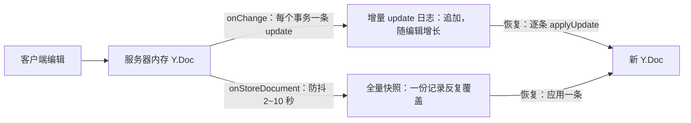

import { Canvas, Controls, Meta } from '@storybook/addon-docs/blocks';
import * as CustomPersistence from './custom-persistence.stories';

<Meta of={CustomPersistence} name="Docs" />

# 自定义持久化

Hocuspocus 把文档握在服务器内存里，进程一退出内容就消失；内核不自带任何存储——落库是你在两个钩子里自己写的代码：`onLoadDocument` 在文档载入内存时从你的存储读回，`onStoreDocument` 在编辑静默后把内存里的 Y.Doc 写回。往存储里写什么有两种模型：**增量 update 日志**（每次编辑追加一条二进制 update）与**全量快照**（整个文档合并成一份覆盖写）。读完你应能预测：选增量，存储条数随编辑增长、恢复时逐条合并，天然保留审计历史；选快照，存储里永远只有一份、停机最多丢 debounce 窗口内的编辑。

版本基线为 Hocuspocus v4（4.7.x，要求 Node 22+）；服务端依赖按 [安装](?path=/docs/install--docs) 课装好 `@hocuspocus/server` 与 `yjs`。



| 维度 | 增量 update 日志 | 全量快照 |
| --- | --- | --- |
| 落库钩子 | `onChange`（payload 的 `update` 字段） | `onStoreDocument`（`Y.encodeStateAsUpdate`） |
| 写入时机 | 每个事务立即追加 | 防抖后写回（v4 默认静默 2 秒、最迟 10 秒） |
| 恢复方式 | 逐条 `Y.applyUpdate`，乱序、重复均安全 | 应用一条快照 |
| 存储增长 | 随编辑次数增长，需定期 `Y.mergeUpdates` 压缩 | 一份记录覆盖写 |
| 历史审计 | 天然保留全部编辑 | 只留最终状态 |
| 官方扩展 | 无对应扩展 | extension-database / sqlite / s3 均为此模式 |

## 两种持久化模型

无论选哪种，底层模型都一样：**服务器内存中的 Y.Doc 是唯一真源，存储只是它的投影**。Hocuspocus 不关心投影长什么样——它只在每次文档变化后递给你一条增量 update（`onChange`），并在静默后邀请你写回完整状态（`onStoreDocument`）。两种模型的全部差异落在「写什么、怎么读」，选型就看三问：

- **恢复成本**：快照读一条就还原；增量要读整份日志，日志越长恢复越慢。
- **存储增长**：快照固定一份被覆盖；增量随编辑增长，必须配套压缩策略。
- **审计需求**：要回答「谁在什么时候改了什么」，追加增量日志天然保留历史；快照只留终态。

下面的实例把两种存储接在同一条编辑流上：每次修改「编辑文本」产生一次编辑事务，观察两边各写入什么、体量差多少，恢复出的内容是否一致。

<Canvas of={CustomPersistence.WritePaths} />
<Controls of={CustomPersistence.WritePaths} />

| 读者操作 | 可观察证据 |
| --- | --- |
| 连续修改「编辑文本」 | 增量日志条块逐次追加（u1、u2…），快照面板始终只有一块、覆盖次数递增 |
| 对照两个存储的字节读数 | 增量字节随编辑次数累积；快照字节只跟文档大小有关 |
| 观察「增量恢复」「快照恢复」读数 | 两种存储各自恢复出的内容始终与当前文本一致 |
| 打开 Show code | 看到该 Canvas 实际执行的 `persistence-model.ts`：两条写路径与恢复的真实 Yjs 调用 |

同一份编辑流，存储形态已经完全不同。接下来分别走通两条闭环。

### 全量快照

快照模式把内存 Y.Doc 的完整二进制状态（`Y.encodeStateAsUpdate` 的产物）作为一行记录覆盖写，恢复时应用这一条。完整闭环只需要两个钩子：

```ts
// server.ts —— 快照模式完整闭环（关系数据库、对象存储同理）
import { Server } from '@hocuspocus/server';
import * as Y from 'yjs';
import { db } from './store'; // 你自己的存储接入：loadSnapshot / saveSnapshot

const server = new Server({
  port: 1234,
  // 落库频率由服务器节流，不需要自己写防抖：
  debounce: 2000, // 静默 2 秒后落库（v4 默认值）
  maxDebounce: 10000, // 持续编辑时最迟 10 秒落库一次（v4 默认值）

  async onLoadDocument({ documentName, document }) {
    const row = await db.loadSnapshot(documentName);
    if (row) {
      Y.applyUpdate(document, row.state); // Buffer 与 Uint8Array 均可
    }
    // v4 起也可以直接 return 一个 Uint8Array，服务器替你应用
  },

  async onStoreDocument({ documentName, document }) {
    const state = Buffer.from(Y.encodeStateAsUpdate(document));
    await db.saveSnapshot(documentName, state); // UPSERT 覆盖同一行
  },
});

server.listen();
```

三个行为细节决定这个闭环在生产里怎么表现，均已在 v4 源码（`Hocuspocus.ts` 的 `storeDocumentHooks`）核实：

- **写入频率不用你管。** `onStoreDocument` 由服务器按 `debounce` / `maxDebounce` 自动防抖——每次新编辑重置 2 秒计时器，持续编辑则 10 秒封顶必存一次。调参依据见 [Server 配置](?path=/docs/server-config--docs) 课，钩子在文档生命周期中的触发时机见 [文档生命周期](?path=/docs/document-lifecycle--docs) 课。同一编辑流下两条路径的写入时机差异（示意时间线）：

```text
t=0.0s  编辑 A → onChange 触发（增量模式此刻追加；快照模式不动作）
t=0.5s  编辑 B → debounce 计时器重置
t=2.5s  静默满 2 秒 → onStoreDocument：快照覆盖写一次
```

- **payload 里只有最后一次修改的线索。** `onStoreDocument` 的 payload 提供 `lastContext` 与 `lastTransactionOrigin`（v3 里叫 `context` / `transactionOrigin`，改名是 v4 的破坏性变化）。要审计每次修改的来源与上下文，用 `onChange` 的 `transactionOrigin` 与 `context`。
- **钩子抛错不会丢数据。** 存储写入抛错时，文档被有意留在内存里防止数据丢失，存储恢复后下一次编辑会重新触发落库重试；`destroy()` 或 SIGTERM 关闭时会先把所有待落库文档立即补写一遍。代价是故障期间文档常驻内存——盯存储自己的错误日志，而不是反复重启服务器。

实战对照：tester/ 实验项目已跑通的 SQLite 持久化路径就是这套闭环的 v3 写法（sqlite3 驱动、payload 旧名），升级时按 v3 改名句与「从 v3 迁移」课对照。

边界：快照的写放大——每次落库都写整份文档，大文档加高频编辑时这份覆盖写是主要存储开销；官方三个持久化扩展采用的正是这一取舍。

### 增量 update 日志

增量模式把每次事务的 update 追加进日志，恢复时逐条应用。先澄清一个名字：**Hocuspocus 没有 `onUpdate` 服务器钩子**——想逐条拿 update，钩子叫 `onChange`，增量 update 在 payload 的 `update` 字段里。`Document` 类内部确实有一个 `onUpdate` 回调，但那是服务器驱动 `onChange` 与落库防抖的私有机制，不能在 Server config 里注册。

```ts
// server.ts —— 增量模式：追加、恢复与阈值压缩
import { Server } from '@hocuspocus/server';
import * as Y from 'yjs';
import { db } from './store'; // appendUpdate / loadUpdates / compactLog

const COMPACT_THRESHOLD = 500; // 日志超过 500 条时合并压缩

const server = new Server({
  async onLoadDocument({ documentName, document }) {
    const updates = await db.loadUpdates(documentName);
    // Yjs update 满足交换律与幂等性：顺序无所谓，重复应用也无害
    updates.forEach((update) => Y.applyUpdate(document, update));

    // 压缩时机：恢复读取时就地合并写回，缩短下一次恢复
    if (updates.length > COMPACT_THRESHOLD) {
      const merged = Y.mergeUpdates(updates); // 去重 + 压缩编码，小于逐条之和
      await db.compactLog(documentName, merged);
    }
  },

  async onChange({ documentName, update }) {
    await db.appendUpdate(documentName, update); // 每个事务一条
  },
});

server.listen();
```

两个支撑这个模式的 Yjs 性质，来自官方仓库「Document Updates」一节：update 是**可交换**且**幂等**的——可以以任意顺序、重复多次应用。落到存储上意味着：写库失败重发、消息队列乱序消费、恢复时按任何顺序 apply，都不会破坏一致性，也不需要序号去重。`Y.mergeUpdates` 负责压缩：把多条合并成一条，去掉重复信息并使用压缩编码，合并结果小于各条之和；合并不改变语义，放在 `onLoadDocument` 或后台任务里异步做即可。

下面的实例把同一份日志用五种读法恢复：原序、乱序、重复注入、合并、快照，核对恢复内容与实际应用的条数、字节数。

<Canvas of={CustomPersistence.RestoreStrategies} />
<Controls of={CustomPersistence.RestoreStrategies} />

| 读者操作 | 可观察证据 |
| --- | --- |
| 把「恢复方式」切到「乱序逐条」 | 应用顺序带按乱序排列，恢复内容仍与原文一致 |
| 切到「重复注入」 | 同一条 update 被虚线块重复应用三次，内容依旧一致（幂等） |
| 切到「mergeUpdates 合并」 | 应用条数变 1、字节读数小于日志总量，恢复内容不变 |
| 对照「应用 update」与「日志规模」读数 | 各策略的应用条数与字节差异一目了然 |

边界：`onChange` 每次文档变化（每个事务）都会触发，官方文档提醒它一秒内可能触发多次、重操作应自行防抖——逐条 await 写库在高频编辑下会把存储打穿，生产做法是内存缓冲加批量落库（取舍见最佳实践）。

## 二进制数据落库

无论增量还是快照，写进存储的都是 Yjs 的二进制 update（`Uint8Array`）。官方持久化指南对格式只有一条硬规则：**恢复真源必须是二进制**。只存 JSON 或 HTML 再在连接时转回 Yjs 文档是官方明确警告的反模式——JSON 只存结果不存协同历史，重建的文档与客户端的增量对不上合并，新连接会出现内容重复。JSON 可以作为额外卖的「视图副本」供查询与渲染，但恢复真源必须是二进制。

关系数据库与对象存储的对接要点：

- **列类型**：SQLite 用 `BLOB`，PostgreSQL 用 `bytea`，MySQL 用 `LONGBLOB`。Node 侧用 `Buffer.from(Y.encodeStateAsUpdate(doc))` 写入——`Buffer` 是 `Uint8Array` 的子类，读回来的 `Buffer` 可以直接传给 `Y.applyUpdate`，不需要额外转换。
- **官方的表就是模板**：extension-sqlite 的 schema 只有一张表 `documents(name, data blob, UNIQUE(name))`，按文档名 UPSERT 覆盖。自建快照表照抄这个形状即可。
- **对象存储天然契合快照**：一个文档一个对象（key = 前缀加文档名），`PutObject` 覆盖写正好对应快照语义，extension-s3 的默认 key 前缀就是 `hocuspocus-documents/`。对象不可追加，想在对象存储上放增量日志只能分片对象加清单，复杂度显著上升——通常退回快照模式。
- **恢复要演练**：落库成功不等于能恢复。定期把存储内容读进一份新 Y.Doc，核对内容与字节数（见最佳实践）。

## 与官方持久化扩展的边界

extension-database、extension-sqlite、extension-s3 共享同一个基类 `Database`，本质是替你写好的快照模式：`fetch` 在 `onLoadDocument` 时读回一份二进制数据，`store` 在防抖后收到 `Y.encodeStateAsUpdate` 的合并状态。它们解决「存到哪」，本课解决「存什么、怎么恢复」。

- **直接用扩展**：你的存储就是「一张表按名字存一份二进制」或「一个桶按 key 存对象」。几十行配置完成闭环，配置与选型见 [持久化扩展](?path=/docs/persistence-extensions--docs) 课。
- **自己写钩子**：需要增量日志与审计、对接消息队列或特殊存储、落库时还要做额外动作（缓存失效、全文索引）。扩展不满足时，回到本课的两个钩子自己组合。
- **混合**：用 extension-database 的 `store` 回调落快照，同时在 `onChange` 里追加增量——组合前先读下方最佳实践的混用规则。

## 最佳实践

- **想清楚崩溃窗口再选模式。** 快照模式默认最多丢 2～10 秒（`debounce` / `maxDebounce`），调小 `debounce` 或改增量模式可以把窗口缩到单条 update；不可丢失的业务两种手段叠加。
- **混用先定主从。** 快照为主、增量为辅是常见组合：落库快照后记下它的状态向量（`Y.encodeStateVectorFromUpdate`），此后只把 `Y.diffUpdate` 算出的差量追加进日志；恢复时先应用快照、再补差量。别让两条路径对同一份数据各写各的——没有状态向量做基准，快照会覆盖增量、增量会重复进快照。
- **压缩要有节奏。** 增量日志设阈值（条数或字节），超过即 `Y.mergeUpdates` 合并写回并删掉被合并的旧条目；压缩放在 `onLoadDocument` 或定时任务里异步做，不阻塞 `onChange`。
- **恢复演练纳入运维。** 存储格式迁移（换列类型、换存储引擎）前必做：从存储恢复到新 Y.Doc，核对内容一致、update 可应用；演练脚本同时充当备份有效性的检查。

## 常见问题

- 停机或崩溃后丢了最近几秒的编辑
  先看进程怎么停的：SIGTERM 或 `destroy()` 会把待落库文档立即补写一遍，`kill -9` 跳过一切。其次核对 `onStoreDocument` 里的异步写是否真的 `await`——进程不等未完成的 Promise，存储调用还在飞时退出，那条写就丢了。增量模式同理：`onChange` 里的追加必须被 `await`，否则崩溃窗口是整条未写完的缓冲。
- 只存了 JSON，客户端重连后内容重复、历史丢失
  把恢复真源换成二进制：落库存 `Y.encodeStateAsUpdate` 的产物，`onLoadDocument` 读回后 `Y.applyUpdate`。JSON 缺失协同历史，重建的文档与客户端增量合并时会产生重复内容；JSON 只能作为额外卖的视图副本。
- 想逐条追加 update，却找不到 `onUpdate` 钩子
  服务器钩子叫 `onChange`，增量 update 在 payload 的 `update` 字段。`onUpdate` 只是 `Document` 类的内部回调，不能注册在 Server config 里。
- `onStoreDocument` 报错后文档一直驻留内存、不再卸载
  有意设计：存储抛错时文档留在内存防止数据丢失，下一次编辑会重新触发落库重试。排查存储本身的错误日志（连接池、唯一约束、磁盘），修好后无需重启服务器。

## 总结回顾

摘要：

Hocuspocus 不自带存储，落库就是 `onLoadDocument`（文档载入内存时读回）与 `onStoreDocument`（编辑静默后写回）两个钩子。往存储里写什么有两种模型：增量 update 日志在 `onChange` 里逐条追加 `update`，靠 Yjs update 的可交换与幂等性容忍乱序与重复，用 `Y.mergeUpdates` 定期压缩，恢复成本随日志增长；全量快照在 `onStoreDocument` 里覆盖写 `Y.encodeStateAsUpdate` 的合并状态，存储一份、恢复一条，代价是 debounce 窗口（默认 2～10 秒）内的崩溃丢失与整份文档的写放大。恢复真源必须是二进制（`Uint8Array` / `Buffer`），JSON 只能当视图副本；官方三个持久化扩展都是快照模式的现成封装，需要审计或特殊存储时才回到钩子自己组合。

一句话：

> 落库只在两个钩子里发生——`onLoadDocument` 读、`onStoreDocument` 防抖写；增量还是快照，决定的是存储怎么写、恢复怎么读。

知识要点：

- 增量与快照分别用哪个钩子落库？恢复时各自要做什么？
- v4 的 `onStoreDocument` payload 用哪两个字段拿上下文与事务来源？v3 里叫什么？
- 为什么增量日志乱序、重复应用都不会坏？用什么 API 压缩日志，什么时机压缩？
- 为什么不能只存 JSON？官方扩展（database / sqlite / s3）对应哪种模式？
- 快照模式默认的崩溃窗口多长？怎么把它缩小？

## 参考资料

- [Hocuspocus Persistence 指南（官方文档）](https://tiptap.dev/docs/hocuspocus/guides/persistence)
- [Hocuspocus Server Hooks（官方文档）](https://tiptap.dev/docs/hocuspocus/server/hooks)
- [Hocuspocus Server Configuration（官方文档）](https://tiptap.dev/docs/hocuspocus/server/configuration)
- [Hocuspocus.ts（v4 源码：storeDocumentHooks 防抖、flushPendingStores、onLoadDocument 合并）](https://github.com/ueberdosis/hocuspocus/blob/main/packages/server/src/Hocuspocus.ts)
- [types.ts（v4 源码：onChangePayload / onStoreDocumentPayload / TransactionOrigin）](https://github.com/ueberdosis/hocuspocus/blob/main/packages/server/src/types.ts)
- [Document.ts（v4 源码：内部 onUpdate 回调与 saveMutex）](https://github.com/ueberdosis/hocuspocus/blob/main/packages/server/src/Document.ts)
- [extension-database Database.ts（v4 源码：fetch/store 与 encodeStateAsUpdate）](https://github.com/ueberdosis/hocuspocus/blob/main/packages/extension-database/src/Database.ts)
- [extension-sqlite SQLite.ts（v4 源码：documents 表 blob 快照 UPSERT）](https://github.com/ueberdosis/hocuspocus/blob/main/packages/extension-sqlite/src/SQLite.ts)
- [Yjs Document Updates（update 的可交换与幂等、Y.mergeUpdates）](https://github.com/yjs/yjs#document-updates)
