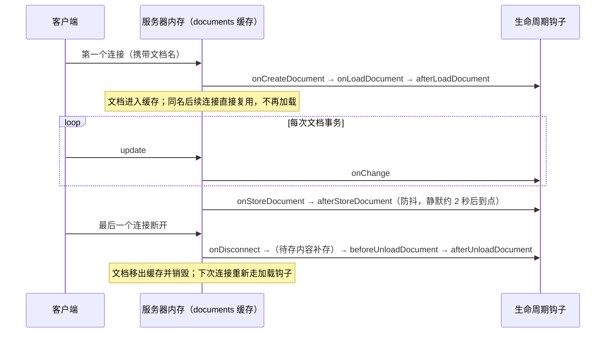
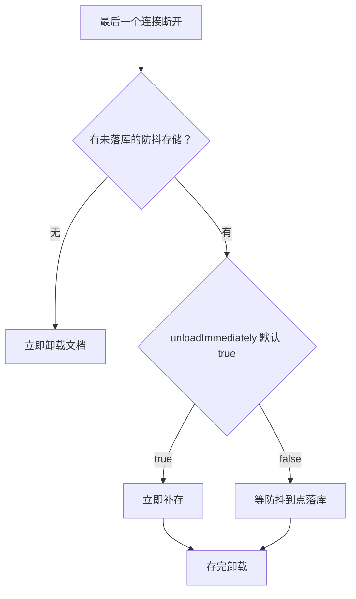

import { Meta } from '@storybook/addon-docs/blocks';

<Meta id="document-lifecycle" title="服务端核心/文档生命周期" name="Docs" />

# 文档生命周期

Hocuspocus 服务器里的 Y.Doc 不是每个连接一份，而是按文档名缓存的单例：第一个连接带着文档名进来时新建并从外部存储恢复内容，之后同名连接共享这一份文档，直到最后一个连接断开、补存完毕才移出内存。这条「进入缓存 → 服务连接 → 移出缓存」的一生由一组钩子串起——onCreateDocument、onLoadDocument、afterLoadDocument 负责加载，onChange 跟踪每次编辑事务，onStoreDocument 防抖落库，onDisconnect 与 beforeUnloadDocument、afterUnloadDocument 收尾卸载，onDestroy 在服务器关闭时最后触发。读完你应能预测：同一文档名的第二个连接不会再触发加载钩子；编辑静默约 2 秒后才落库；`timeout` 到点只会断开连接，不会卸载文档。

版本基线为 Hocuspocus v4（4.7.x，要求 Node 22+）。涉及 v3 差异处在正文中以一句话标注。



## 生命周期钩子参考表

下表按触发顺序列出文档生命周期钩子族的时机、关键 payload 与回查要点，默认值与机制均已对照 v4 源码（`packages/server/src`）核实。

| 钩子 | 触发时机 | 关键 payload | 回查要点 |
| --- | --- | --- | --- |
| `onCreateDocument` | 文档进入缓存前一次 | `documentName`、`requestHeaders`、`context`、`socketId` 等 | 返回值按 key 覆盖 config 的 `yDocOptions`；只认 `extensions` 数组实现（配置级写法静默不执行） |
| `onLoadDocument` | 创建后、开始服务前一次 | `document`、`documentName`、`context` | 返回 Y.Doc / Uint8Array（v4）或原地写 `document`；什么都不返回即空文档 |
| `afterLoadDocument` | 全部加载钩子成功后一次 | 同 `onLoadDocument` | 此时文档才算「打开」，适合记日志、复核权限 |
| `onChange` | 每次文档事务后，可每秒多次 | `update`、`transactionOrigin`、`context`、`clientsCount` | 重活自行防抖；来源用 `isTransactionOrigin` 判断 |
| `onStoreDocument` | `onChange` 之后经防抖节流到点 | `document`、`lastContext`、`lastTransactionOrigin` | 落库唯一入口；抛错则文档留在内存 |
| `afterStoreDocument` | `onStoreDocument` 成功后 | 同 `onStoreDocument` | 适合审计、通知、清理 |
| `onDisconnect` | 每条连接断开一次 | `clientsCount`、`socketId`、`context` | 文档卸载只看最后一条连接 |
| `beforeUnloadDocument` / `afterUnloadDocument` | 文档移出缓存前后各一次 | `documentName`、`document`（仅 before） | 卸载前最后一次接触文档内容的机会 |
| `onDestroy` | `destroy()` 关闭完成后一次 | `instance` | 此时全部文档已补存并卸载 |

不属于本课的相邻钩子：连接建立与鉴权（`onConnect`、`connected`、`onAuthenticate`）见 [鉴权与上下文](?path=/docs/auth--docs) 课；awareness（`onAwarenessUpdate`、`beforeHandleAwareness`）见 [Awareness 在线状态](?path=/docs/awareness--docs) 课；应用层消息（`onStateless`）见 [Stateless 消息](?path=/docs/stateless--docs) 课。

## 快速上手

给服务器接上全部生命周期钩子，跑一遍「连接 → 编辑 → 断开」就能观察到本课全部时序。

**1. 启动观测服务器。** 新建 `lifecycle-server.ts`：

```ts
// lifecycle-server.ts —— 观测文档生命周期：连接 → 加载 → 编辑 → 存储 → 卸载
// 前置：按「安装」课装好 @hocuspocus/server；Node 22+，npx tsx lifecycle-server.ts 启动
// 操作：用「第一个协同文档」课的 provider 连入 example-doc，编辑一两次，再关闭页面
// 预期：控制台按开场图的顺序打印各钩子；第二个同名连接不再出现加载钩子
import { Server } from '@hocuspocus/server';

const log = (name: string, extra = '') => console.log(`${name.padEnd(20)} ${extra}`);

const server = new Server({
  port: 1234,

  async onLoadDocument({ documentName, document }) {
    log('onLoadDocument', `—— 加载 ${documentName}`);
    return document; // 真实项目在这里查询外部存储；不返回内容就是空文档
  },
  afterLoadDocument({ documentName }) {
    log('afterLoadDocument', `—— ${documentName} 已可服务`);
  },
  onChange({ documentName, transactionOrigin }) {
    const source = isTransactionOrigin(transactionOrigin) ? transactionOrigin.source : 'unknown';
    log('onChange', `—— ${documentName} 事务来源 ${source}`);
  },
  onStoreDocument({ documentName }) {
    log('onStoreDocument', `—— ${documentName} 落库`);
  },
  onDisconnect({ documentName, clientsCount }) {
    log('onDisconnect', `—— ${documentName} 剩余连接 ${clientsCount}`);
  },
  beforeUnloadDocument({ documentName }) {
    log('beforeUnloadDocument', `—— ${documentName} 即将移出缓存`);
  },
  afterUnloadDocument({ documentName }) {
    log('afterUnloadDocument', `—— ${documentName} 已卸载`);
  },
});

server.listen();
```

`isTransactionOrigin` 从 `@hocuspocus/server` 导入即可（示例省略了这行 import）。

**2. 连入并编辑。** 用 [第一个协同文档](?path=/docs/first-document--docs) 课的最小客户端连入文档名 `example-doc`，在控制台执行一次编辑。**3. 关闭客户端页面。**

服务器控制台输出（示意时间线，时刻取决于操作节奏）：

```text
onLoadDocument       —— 加载 example-doc
afterLoadDocument    —— example-doc 已可服务
onChange             —— example-doc 事务来源 connection   ← 客户端编辑落进服务器文档
onStoreDocument      —— example-doc 落库                  ← 静默 2 秒，防抖到点
onDisconnect         —— example-doc 剩余连接 0            ← 关闭页面
onStoreDocument      —— example-doc 落库                  ← 断开时对待存内容立即补存
beforeUnloadDocument —— example-doc 即将移出缓存
afterUnloadDocument  —— example-doc 已卸载
```

三个观察点：加载钩子（onLoadDocument、afterLoadDocument）只在第一个连接时出现；`onChange` 与 `onStoreDocument` 是两条独立节流线（前者每事务一次，后者防抖到点一次）；断开路径会出现第二次 `onStoreDocument`，随后文档卸载。再开一个同名标签页连入，加载钩子不会再打印——这就是下一节的缓存语义。

## 加载：onLoadDocument 与文档缓存

文档第一次被请求时，服务器先查两级缓存：`loadingDocuments`（正在加载的去重表）和 `documents`（已加载的文档表）；两级都未命中才新建 Y.Doc，并依次触发 `onCreateDocument`、`onLoadDocument`、`afterLoadDocument`（其中 `onCreateDocument` 只认 `extensions` 数组里的实现，见下节）。加载成功后文档才进入 `documents` 缓存——同一文档名的并发连接共享同一次加载，拿到同一份 Y.Doc。

### onLoadDocument：从外部存储恢复文档

`onLoadDocument` 是把外部存储内容装进服务器的唯一时机，payload 携带一份空白的 `document`。v4 支持三种返回方式：

```ts
import * as Y from 'yjs';

const server = new Server({
  port: 1234,

  async onLoadDocument({ documentName, document }) {
    // 写法一（v4 新增）：直接返回二进制更新，官方存储扩展都用这种
    const update = await myDatabase.loadUpdate(documentName);
    if (update) return update;

    // 写法二：返回一份现成的 Y.Doc
    const ydoc = await myDocumentStore.load(documentName);
    if (ydoc) return ydoc;

    // 写法三：把更新应用进 payload 携带的 document，原地修改后返回它
    const snapshot = await myDatabase.loadSnapshot(documentName);
    if (snapshot) Y.applyUpdate(document, snapshot);
    return document;

    // 三种写法都没拿到数据：服务器按空文档继续服务，不报错
  },
});
```

返回值的处理逻辑（源码 `loadDocument`）：返回 Y.Doc 时服务器将其编码为更新再 `applyUpdate` 进新建文档；返回 Uint8Array 时直接应用；返回的就是传入的 `document` 本身则什么也不做。返回 undefined 或什么都不返回同样合法——文档保持空白，连接照常建立。

两条边界：

- 钩子抛错时，服务器会关闭该文档名的所有连接并销毁这份文档，它不会进入缓存；客户端表现为连接被断开，排查时先看服务端日志。
- 返回的是「更新」还是「全量快照」由你的存储格式决定，两种落库方式的取舍见 [自定义持久化](?path=/docs/custom-persistence--docs) 课。

v3 差异：v3 的 `onLoadDocument` 只支持返回 Y.Doc；返回 Uint8Array 是 v4 新增。

### onCreateDocument：定制 Y.Doc 选项（只认扩展实现）

`onCreateDocument` 在 `onLoadDocument` 之前触发，职责不是装内容，而是定制这份新建 Y.Doc 的选项。钩子返回的对象按 key 覆盖 config 的 `yDocOptions`（源码 `createDocument`：`{ ...configuration.yDocOptions, ...钩子返回值 }`）：

```ts
import { Extension } from '@hocuspocus/server';

// 归档文档关闭垃圾回收，保留删除历史（如服务端渲染需要完整历史）
class NoGcDocuments implements Extension {
  async onCreateDocument() {
    return { gc: false };
  }
}

const server = new Server({
  extensions: [new NoGcDocuments()],
});
```

它是钩子家族里**唯一不认配置级写法的成员**：`configure()` 把 Server options 里的钩子包装成链尾扩展时，包装对象不含 `onCreateDocument` 这个键——写在新 Server options 里的 `onCreateDocument` 类型检查能通过（`Configuration extends Extension`），但 v4.7.x 不会执行、也不报错。要定制文档，必须实现为扩展放进 `extensions` 数组（钩子执行链见 [自定义扩展](?path=/docs/custom-extensions--docs) 课）。

分工记忆：`onCreateDocument` 决定文档「怎么建」（Y.Doc 选项），`onLoadDocument` 决定文档「装什么」（内容）；两者都在每次文档进入缓存前各执行一次。

### 缓存语义：同名只加载一次

缓存命中后一切加载钩子都会被跳过，这是「钩子好像没执行」的最常见原因：

```ts
const hocuspocus = await server.listen(1234);

hocuspocus.getDocumentsCount(); // 当前驻留内存的文档数
hocuspocus.documents;           // 按文档名索引的缓存 Map，回查文档时直接用
```

- 同一文档名的加载钩子只在文档进入缓存前执行一次；期间到达的所有连接共享同一次加载结果，不会各加载各的。
- 缓存与连接数无关：文档移出缓存的时机由卸载路径决定（最后一个连接断开时补存并卸载），不是连接一断就立刻消失（见「卸载」一节）。
- 卸载不是删除：文档移出缓存后，下一个连接会重新触发加载钩子，外部存储的最新内容回到内存。

## 编辑：onChange 与事务来源

服务器文档每次 Yjs 事务（收到客户端 update、服务端写入、初始同步补传）结束后触发一次 `onChange`——一秒内多次编辑就是多次触发。它解决的是「文档变了，谁改的」：payload 里的 `update` 是本次事务的二进制更新，`transactionOrigin` 是结构化的事务来源，`context` 从来源解析（连接来源取该连接的 context，本地来源取 origin 自带的 context，其余为空对象）。

用 `isTransactionOrigin` 收窄类型后按 `source` 分派，v4 共三种来源：

```ts
import { isTransactionOrigin } from '@hocuspocus/server';

const server = new Server({
  async onChange({ documentName, transactionOrigin }) {
    if (!isTransactionOrigin(transactionOrigin)) return;

    switch (transactionOrigin.source) {
      case 'connection': // 某个 provider 连接写入（含初始同步补传的更新）
        break;
      case 'local': // 服务端经 DirectConnection 直接写入
        break;
      case 'redis': // extension-redis 从其他实例同步而来
        break;
    }
  },
});
```

服务端直接写入走 `openDirectConnection`，不经任何 WebSocket 连接：

```ts
const hocuspocus = await server.listen(1234);

const direct = await hocuspocus.openDirectConnection('example-doc');
await direct.transact((doc) => doc.getText('demo').insert(0, '来自服务器'));
await direct.disconnect(); // 默认立即落库并卸载
```

三条边界：

- `redis` 来源的变更不会触发存储钩子：存储责任在拥有真实客户端连接的那个实例，本实例只同步内存，避免同一份内容被两个实例重复落库。
- `local` 来源默认仍会触发存储钩子；在写入处带 `skipStoreHooks: true` 可跳过（如服务端只改元信息、不想触发落库的场景）。
- awareness 更新不走文档事务，不会触发 `onChange`（那是 `onAwarenessUpdate` 的事）。

v3 差异：v3 的 `onChange` 里 `transactionOrigin` 是连接对象本身（服务端写入时为 undefined），redis 用魔法字符串 `__hocuspocus__redis__origin__` 标记；v4 统一为结构化 `source`，用 `isTransactionOrigin` 判断。

## 存储：onStoreDocument 与防抖

`onChange` 与 `onStoreDocument` 是两条独立的节流线：前者每次事务必触发，后者由服务器按 `debounce`（默认 2000 毫秒，每次新变更重置计时）与 `maxDebounce`（默认 10000 毫秒，持续编辑时的落库封顶）防抖到点执行，机制细节见 [Server 配置](?path=/docs/server-config--docs) 课。这是落库的唯一入口，v4 起任何来源的文档变更都会安排落库（v3 只对 WebSocket 连接来源触发）。

```ts
import * as Y from 'yjs';

const server = new Server({
  async onStoreDocument({ documentName, document }) {
    // 全量快照写法；增量写法见「自定义持久化」课
    await myDatabase.save(documentName, Y.encodeStateAsUpdate(document));
  },
  async afterStoreDocument({ documentName }) {
    // 落库成功之后：记审计、发通知、清缓存
  },
});
```

payload 的两个 last 字段承载「最后一次变更」的信息：`lastContext` 是触发这次存储的事务所属连接的 context，`lastTransactionOrigin` 是那次事务的来源对象。v3 里这两个字段叫 `context`、`transactionOrigin`，且 payload 还带 `requestHeaders`、`socketId` 等连接字段——v4 全部移除，因为存储可能由无连接的来源触发。

三条边界：

- `onStoreDocument` 抛错时文档会留在内存不再卸载，服务器打印 `Caught error during storeDocumentHooks`，稍后的新变更会再次尝试落库——防丢数据的保护，看到这条日志先查存储回调。
- 钩子内抛出 `SkipFurtherHooksError`（来自 `@hocuspocus/common`）则跳过后续钩子但照常卸载。
- `destroy()` 优雅关闭前会立即执行所有待存的防抖任务，`kill -9` 会跳过——停服丢数据的完整判断在 [Server 配置](?path=/docs/server-config--docs) 课。

## 卸载：onDisconnect 与文档卸载

`onDisconnect` 每条连接断开触发一次，payload 的 `clientsCount` 报告剩余连接数。文档级的卸载决策只在最后一条连接断开后发生一次，分两条路径：



- 默认 `unloadImmediately: true`：有待存内容就立即补存（快速上手时间线里断开后的第二次 `onStoreDocument`），存完卸载；设为 `false` 则文档留在内存等防抖到点，适合断开后马上还会有人连回的热文档。
- 卸载时依次触发 `beforeUnloadDocument`（payload 带 `document`，是卸载前最后一次接触内容的时机）与 `afterUnloadDocument`，随后文档移出 `documents` 缓存并销毁。
- 文档没有独立的「超时卸载」：`timeout`（默认 60 秒）到点只断开空闲连接，之后走同一条 onDisconnect 路径；0 连接的文档只要没触发卸载判断就留在内存。
- `onDestroy` 只在服务器关闭时触发一次：`destroy()` 断开所有连接、补存全部待存文档、等卸载完成之后才轮到它，payload 只有 `instance`。

## 常见问题

- `onChange` 一秒触发几十次，钩子里的落库或转换把服务器拖慢
  把重活自行防抖后再执行（官方示例为转换 ProseMirror JSON 自己加了 4 秒 debounce）；落库需求不要放 `onChange`——`onStoreDocument` 已由服务器按 `debounce` / `maxDebounce` 节流，把存储逻辑挪过去即可。
- 客户端刷新或重连后内容全没了
  先查 `onLoadDocument`：异步加载了内容但既没有 return、也没有把它应用进 payload 的 `document` 时，服务器按空文档继续服务，还会把空文档当正常状态缓存起来。修复方式是补上返回值（见「加载」一节的三种写法）。
- 同一文档名的加载钩子「不再执行」
  这是缓存命中：加载钩子只在文档进入缓存前各执行一次，同名连接直接复用内存中的 Y.Doc。想强制重新加载，先让文档卸载（最后一个连接断开）或重启服务器。
- Server options 里写的 `onCreateDocument` 毫无反应
  它是唯一不认配置级写法的钩子：类型检查能通过，但 v4.7.x 不会执行、也不报错。把返回 Y.Doc 选项的逻辑实现成扩展放进 `extensions` 数组（见「onCreateDocument：定制 Y.Doc 选项」一节）。
- `onStoreDocument` 迟迟不触发或「漏触发」
  依次排查三种正常原因：防抖窗口未到（默认静默 2 秒后才落库）；变更来自 `redis` 来源同步（存储钩子被跳过，由拥有客户端连接的实例负责存储）；写入处带了 `skipStoreHooks: true`。都不是的话查钩子是否抛错——抛错后文档留在内存、不再卸载，服务端日志会出现 `Caught error during storeDocumentHooks`。

## 总结回顾

摘要：

文档按名字缓存在服务器的 `documents` Map 里，一生四个阶段：第一个连接新建 Y.Doc 并触发 `onCreateDocument`（只认扩展实现，返回值按 key 覆盖 `yDocOptions`）→ `onLoadDocument`（返回 Y.Doc / Uint8Array 或原地写入，从外部存储恢复内容）→ `afterLoadDocument`；此后每次文档事务触发 `onChange`，来源用 `isTransactionOrigin` 按 `connection` / `local` / `redis` 分派，redis 来源跳过存储；落库由 `onStoreDocument` → `afterStoreDocument` 承担，经 `debounce` / `maxDebounce` 防抖在 2～10 秒间到点，payload 用 `lastContext` / `lastTransactionOrigin` 携带最后一次变更的信息；最后一个连接断开时 `onDisconnect` 触发，待存内容按 `unloadImmediately` 决定立即补存还是等防抖，随后 `beforeUnloadDocument` / `afterUnloadDocument` 把文档移出缓存。卸载不是删除——下次连接重新加载；服务器关闭则由 `destroy()` 补存全部文档后触发 `onDestroy`。

一句话：

> 文档只加载一次、缓存复用、防抖落库、断开补存即卸载——钩子时序的每一步都能用一份打日志的观测服务器验证。

知识要点：

- 文档在什么时机被加载？同一文档名的第二个连接会触发加载钩子吗？
- `onLoadDocument` 的三种返回写法分别是什么？什么都不返回会发生什么？
- `onChange` 每次事务触发，三种事务来源如何区分？哪种来源不会触发存储钩子？
- `onStoreDocument` 的触发时机由哪两个配置决定？payload 的 `lastContext`、`lastTransactionOrigin` 在 v3 里叫什么？
- 最后一个连接断开后，文档按什么规则卸载？`timeout` 会不会卸载文档？

## 参考资料

- [Hocuspocus Server Hooks（官方文档）](https://tiptap.dev/docs/hocuspocus/server/hooks)
- [Upgrade to Hocuspocus v4（官方文档：origin 结构化、payload 改名、超时默认值变化）](https://tiptap.dev/docs/hocuspocus/getting-started/upgrade)
- [Hocuspocus.ts（v4 源码：createDocument/loadDocument 缓存与加载顺序、handleDocumentUpdate、storeDocumentHooks 防抖、unloadDocument）](https://github.com/ueberdosis/hocuspocus/blob/main/packages/server/src/Hocuspocus.ts)
- [types.ts（v4 源码：TransactionOrigin 三类来源、isTransactionOrigin、shouldSkipStoreHooks 与各钩子 payload 定义）](https://github.com/ueberdosis/hocuspocus/blob/main/packages/server/src/types.ts)
- [ClientConnection.ts（v4 源码：onDisconnect 触发时机与 timeout 计时）](https://github.com/ueberdosis/hocuspocus/blob/main/packages/server/src/ClientConnection.ts)
- [DirectConnection.ts（v4 源码：服务端写入的 local origin 与 disconnect 卸载选项）](https://github.com/ueberdosis/hocuspocus/blob/main/packages/server/src/DirectConnection.ts)
