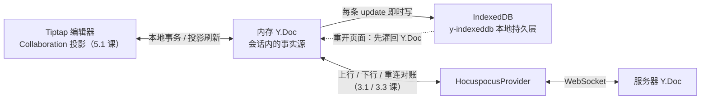
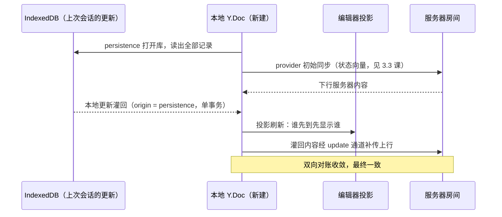

import { Canvas, Controls, Meta } from '@storybook/addon-docs/blocks';
import * as EditorOffline from './editor-offline.stories';

<Meta of={EditorOffline} name="Docs" />

# 离线编辑与恢复

本课给编辑器协同补上「断电期间」这一层。[断线与重连](?path=/docs/reconnection--docs) 课的结论是 provider 的补传只活在页面内存里——刷新、崩溃、关机都会连内存 Y.Doc 一起丢。浏览器侧的解法是 y-indexeddb：它不是新的同步通道，只是把内存 Y.Doc 的每条 update 即时写进 IndexedDB；页面重开后先把库里的更新灌回 Y.Doc，随后的上行、对账、合并全部复用 provider 已有的机制。编辑器接线与 [Tiptap 协同接入](?path=/docs/tiptap-setup--docs) 课完全一致，多出来的只是一层与 provider 平行的本地持久层。读完本课你应能预测：断线编辑后关掉浏览器再打开内容为什么还在、编辑器创建时机如何改变观感、哪些「看起来丢内容」是真的丢了。

版本基线：Hocuspocus v4（4.7.x）+ Tiptap 3.x + y-indexeddb 9.x。y-indexeddb 属 Yjs 生态、与 Hocuspocus 版本无关，v3 与 v4 在本课主题上没有差异。



y-indexeddb 的 API 面很小，全部回查入口在这一张表：

| API / 机制 | 签名或默认值 | 回查要点 |
| --- | --- | --- |
| `new IndexeddbPersistence(name, ydoc)` | 构造函数 | name 即 IndexedDB 数据库名，约定与 provider 的房间名一致；构造即注册 update 监听并异步恢复，**不需要手写 `ydoc.on('update', ...)`** |
| `whenSynced` | Promise，resolve 为实例 | 库内容灌回 Y.Doc 后 resolve，库为空也 resolve；编辑器挂载时机的依据 |
| `'synced'` 事件 | 与 `whenSynced` 同源 | 恢复的更新以 persistence 实例为 origin 应用，不回写库 |
| `get` / `set` / `del` | 按 key 存取 | custom 存储放本地元数据（如阅读位置）；只存本地、不上传 |
| `destroy()` | 无参数 | 停止写入并关闭连接，**库数据保留**；`ydoc.destroy()` 会级联触发 |
| `clearData()` | 返回 Promise | destroy 后删除整个数据库：这台设备上不再要这份文档 |
| `clearDocument(name)` | 静态函数 | 拿不到实例时按库名直接删除数据库 |
| `PREFERRED_TRIM_SIZE` | `500` | 库中更新条数达到后约 1 秒（防抖）压实为一条全量快照并清理旧记录 |

## 离线工作流的三层

同一份文档有三层去处，职责与写入时机各管一段：

| 层 | 对象 | 职责 | 写入时机 |
| --- | --- | --- | --- |
| 会话事实源 | 内存 Y.Doc（编辑器经 Collaboration 投影其上） | 承载当前文档状态，编辑器、本地层、远端层都只跟它打交道 | 编辑事务、服务器下行、本地恢复灌回都即时进入 |
| 本地持久层 | IndexeddbPersistence | 每条 update 存进 IndexedDB，重开页面时灌回 | Y.Doc 每产生一条 update 即时写库——同步完成，不依赖网络 |
| 远端同步层 | HocuspocusProvider | 上行、下行、重连对账（3.1 / 3.3 课已讲） | 连接可用时随发随传；断线期间积压在 Y.Doc 里 |

两条关键判断：

- **同一条 update 的三个去向相互独立。** 写库随 update 同步发生，上行取决于连接——「本地已保存」与「服务器已收到」是两个独立确认。离线的本质是第二个确认被推迟，而不是第一个失败。
- **分工边界。** provider 管「断线期间」，补传靠状态向量对账；y-indexeddb 管「断电期间」，留存靠本地落盘。本课不重写补传协议，只讲编辑器侧多了这一层之后如何接线、何时恢复、观感如何。

## 接线 y-indexeddb

### 绑定 Y.Doc 与 provider

```ts
import * as Y from 'yjs';
import { IndexeddbPersistence } from 'y-indexeddb';
import { HocuspocusProvider } from '@hocuspocus/provider';

const ydoc = new Y.Doc();

// 本地持久层：name 即 IndexedDB 数据库名，约定与 provider 的房间名一致；
// 构造函数自己挂 update 监听并异步恢复，不需要手写 ydoc.on('update')
const persistence = new IndexeddbPersistence('example-document', ydoc);

// 远端层：共用同一份 Y.Doc（document 的归属见 3.1 课）
const provider = new HocuspocusProvider({
  url: 'ws://127.0.0.1:1234',
  name: 'example-document',
  document: ydoc,
});
```

三处要点：

- **绑定关系是「平行监听者」。** IndexeddbPersistence 与 provider 都只是同一份 Y.Doc 上的普通监听者，互不感知、互不替代；Collaboration 仍绑这份 ydoc，编辑器一侧不多任何东西。
- **构造顺序不敏感。** persistence 与 provider 谁先创建都行——update 合并保证收敛（原理见下一节）；真正敏感的是编辑器的创建时机，同样见下一节。
- **一文档一库。** 库名就是恢复时的查找键；库名与房间名不一致 = 找不到旧数据，这是「丢内容」的第一大来源（排查见常见问题）。

### 写入与压实

- **每条 update 一行记录。** 除 origin 为 persistence 自身的（恢复灌回，避免回写循环）都写入——本地编辑与服务器下行的内容都留存，因此重开页面能恢复「上次会话见过的完整状态」。
- **压实有界。** 库中条数达到 `PREFERRED_TRIM_SIZE`（500）后，约 1 秒防抖写入一条全量快照并删除已读旧记录——库不会无限膨胀，重开时需要读取与灌回的条数有界。
- **本地元数据用 custom 存储。** `persistence.get / set / del` 按 key 存取，不上传、不参与合并，适合存阅读位置、本地折叠状态这类「只属于这台设备」的数据。

### 生命周期与清理

| 动作 | 库数据 | 用途 |
| --- | --- | --- |
| `persistence.destroy()` | 保留 | 停写并关闭连接；`ydoc.destroy()` 级联触发它，路由卸载时无需单独处理 |
| `persistence.clearData()` | 删除 | 登出、换账号、这份文档在这台设备上不要了 |
| `clearDocument(name)` | 删除 | 拿不到实例时按库名删除（如批量清理已知文档） |

IndexedDB 按 origin（同域）存储：同一浏览器的所有标签页、所有页面读同一份库。这意味着清理是应用责任——登出不清库，等于把上一个账号的文档留给下一个账号。

## 恢复顺序与竞态

### 重开页面发生了什么

页面重开后，新建的 Y.Doc 上有两个异步源同时开工：



竞态不影响结果，顺序影响观感：

- **收敛与顺序无关。** update 合并可交换、应用幂等——先本地后远端、先远端后本地，最终状态相同（update 模型见参考资料 yjs 文档）。这正是「构造顺序不敏感」的原因。
- **补传不等下一轮对账。** 灌回的更新以 persistence 为 origin 应用，而 provider 转发一切 origin 不是自己的更新——灌回与上行同时发生；整段灌回在一个 Yjs 事务里完成，provider 侧看到的是一条合并 update。

### 空文档闪烁与内容回跳观感

- **编辑器建得早的代价是观感跳动。** 不等恢复就挂载编辑器：首帧可能是空文档（离线重开）或服务器版本（在线重开），恢复灌回到达后内容再变化；基于内容初始化的逻辑（UniqueID、恢复阅读位置）可能拿到中间态。
- **消除办法是等待信号。** 编辑器等 `persistence.whenSynced` 再挂载；要连远端内容一起齐，再等 provider 的 `synced`（3.1 课的信号语义）。中间态顺序不保证、但不会回退——已应用的修改不会被后到的旧更新撤销。
- **「回跳 / 丢内容」的真实来源几乎总是本地层缺失。** 库名不一致、隐私模式、清了站点数据：重开只见服务器版本，离线编辑真的不在了。这不是 CRDT 回退，是留存层没接上（排查见常见问题）。

下面的实例把这条工作流跑起来（模拟语义：文档页内没有真实 WebSocket 服务器与 provider，MiniRelay 用内存房间与状态向量对账扮演服务器与 provider 的搬运职责，协议与断线与重连课一致；IndexeddbPersistence、编辑器接线与 update 通道是真实代码路径，数据真实落盘，库名按本课隔离、离开本页时自动清除）：断线编辑、重开页面，观察本地恢复与补传合并。

<Canvas of={EditorOffline.OfflineWorkflow} />
<Controls of={EditorOffline.OfflineWorkflow} />

| 读者操作 | 可观察证据 |
| --- | --- |
| 首次进入 | 编辑器显示服务器预填底稿（初始同步下行），「本地库恢复」为已恢复 |
| 输入「本端插入文本」或直接键入 | 本地与服务器内容同步更新，「本会话落库」递增 |
| 把「服务器可达」切到离线后继续编辑 | 本端照常可编辑，本地与服务器内容分叉，「离线积压」递增 |
| 选「会话操作 → 重开页面」 | 编辑器与 Y.Doc 重建后内容从本地库恢复：离线编辑仍在；「本会话落库」从零重新累计——恢复灌回不重复计数（回写循环抑制） |
| 切回「服务器可达」 | 一次对账：离线编辑上行合并，「离线积压」归零，两侧内容一致 |
| 离线状态下重开页面（时机为「立即创建」） | 编辑器先显示空文档，恢复完成后内容弹入——「本地库恢复」从恢复中翻到已恢复 |
| 把「编辑器创建时机」切到「等本地恢复完成」再重开 | 先出现「等待本地库恢复…」占位，编辑器一次到位、首帧即完整内容 |
| 选「清空本地库并重开」（在线时） | 恢复后只剩服务器底稿：留存层删除后，离线编辑无法找回 |
| 打开 Show code | 看到 offline-workflow.ts 中 openSession 的接线顺序与 MiniRelay 的对账实现 |

## 冲突与合并

离线编辑没有特殊身份：它们就是普通的 update，与在线编辑走同一条合并路径。重连后按状态向量双向对账（协议见 3.3 课），CRDT 规则保证无丢失收敛——同一位置并发插入按稳定规则排序共存，并发删除与插入时插入存活（合并语义属 yjs 主题手册，这里只取结论）。

用户观感上拿到的是「合并结果」，不是「谁覆盖谁」：两处离线插入会同时出现；你改过的段落与同事在服务器上的修改各自保留可见的部分。实例里「服务器内容」视图追平「本地内容」且两侧一致，就是合并完成的直接证据。

一条边界：合并发生在 Y.Doc 层，编辑器投影自动刷新——应用侧不需要、也不应该写「合并逻辑」；能控制的只有何时把它展示给用户（上一节的挂载时机）。

## 最佳实践

- **需要跨会话离线的文档，第一天就接 y-indexeddb。** 接线只有一行、不改变任何上层逻辑，后补的成本出现在丢过一次数据之后。库名与房间名在同一处常量定义，杜绝两处手写不一致。
- **编辑器等 `whenSynced` 挂载，需要远端内容再等 provider 的 `synced`。** 本地恢复是毫秒级的，等待成本远低于内容弹入的观感损耗；两处等待都用 loading 占位表达。
- **登出与换账号时 `clearData()`。** IndexedDB 按 origin 共享，同域所有页面读同一份库；不清除等于把上一个账号的文档留给下一个账号。
- **React 项目复用同一段接线。** 一句话：把 persistence、provider、editor 的创建放进 `useEffect`（依赖为文档名），清理按「editor → ydoc（级联 persistence）」顺序销毁，`whenSynced` 之后再用状态位挂载编辑器。

## 常见问题

- 重开页面后内容回到旧版本，或离线编辑「丢了」
  先核对库名与房间名是否来自同一处常量——两处手写不一致时，恢复读到的是空库或别的文档；再确认测试环境不是隐私模式或存储受限（本地层缺失时页面只剩服务器版本）。定位原则：已应用的更新不会被后到的旧更新撤销，CRDT 不会真的「回退」，现象来自留存层没接上。
- 离线期间新建的文档，重连后多出了模板内容
  服务器在房间首次创建时执行 onLoadDocument 预填（5.1 课的机制），预填下行与客户端离线写好的内容合并并存。处理：允许离线新建的应用把模板初始化放在客户端创建文档时写入，服务器不对这类文档预填；或接受模板与内容并存的产品语义。
- IndexedDB 满了或被浏览器清掉会怎样
  写入失败不影响内存编辑，但本地留存静默停止；存储压力下浏览器可能整库清除（未申请持久化的 best-effort 存储优先被清）。用 `navigator.storage.persist()` 申请持久化存储降低概率；定位上要清楚 y-indexeddb 是缓冲不是备份，重要内容以服务器为准。
- 多个标签页同时打开同一文档会互相覆盖吗
  不会破坏：IndexedDB 事务保证写安全，两个标签页各自往同一个库追加更新，重开时读全量合并（重复更新应用幂等）。但 y-indexeddb 不做跨标签页广播，断线时两个标签页各自为政；实时互通仍靠 provider 经服务器中转。

## 总结回顾

摘要：

本课把编辑器协同的离线工作流补全为三层：内存 Y.Doc 是会话内的事实源，y-indexeddb 把每条 update 即时写进 IndexedDB（与网络无关的同步落盘），provider 负责远端上行与重连对账。接线只有一行 `IndexeddbPersistence(name, ydoc)`：库名约定与房间名一致，构造函数自己挂 update 监听；库中每条 update 一行、达到 500 条后防抖压实为全量快照；`destroy` 只关库保留数据，`clearData` / `clearDocument` 才真正删除。重开页面时两个异步源竞争写同一份新建 Y.Doc——服务器初始同步与本地库恢复顺序不确定，但 update 合并可交换、应用幂等，最终状态相同；灌回在一个事务里完成，并经 provider 的 update 通道立即补传。观感层面，编辑器等 `whenSynced` 挂载可消除空文档闪烁；「内容回跳」的真实来源几乎总是本地层缺失（库名不一致、隐私模式、清库）而非 CRDT 回退。离线编辑没有特殊身份，重连后按状态向量双向对账、CRDT 无丢失合并，用户拿到的是合并结果。

一句话：

> y-indexeddb 不是新的同步通道，它只是把每条 update 即时写进浏览器：重开后先灌回内存 Y.Doc，之后的上行、对账、合并全是 provider 已有机制——「本地已保存」与「服务器已收到」从此是两个独立的确认。

知识要点：

- 离线工作流分哪三层？各自的职责与写入时机是什么？「本地已保存」和「服务器已收到」为什么是两个独立确认？
- 绑定 y-indexeddb 需要手写 update 监听吗？库名与 provider 房间名是什么关系？
- 库里的更新如何存储与压实？`destroy` 与 `clearData` / `clearDocument` 各删什么？
- 重开页面后本地恢复与服务器初始同步的先后影响最终结果吗？补传为什么不需要等下一轮对账？
- 编辑器应该在什么时机挂载？空文档闪烁与「内容回跳」观感分别来自哪里？
- 离线期间的编辑与在线编辑在合并上有什么区别？多标签页共用同一库名安全吗？

## 参考资料

- [Offline support（Tiptap 官方指南：y-indexeddb 接线）](https://tiptap.dev/docs/guides/offline-support)
- [Collaborative editing（Hocuspocus 官方指南：编辑器 + provider 接线与 offline 一节）](https://tiptap.dev/docs/hocuspocus/guides/collaborative-editing)
- [y-indexeddb 仓库（README：API、synced 事件、clearData 与元数据存储）](https://github.com/yjs/y-indexeddb)
- [y-indexeddb 源码（fetchUpdates 恢复流程、PREFERRED_TRIM_SIZE 压实、origin 循环抑制、destroy 级联）](https://github.com/yjs/y-indexeddb/blob/master/src/y-indexeddb.js)
- [Collaboration 扩展（Tiptap 编辑器文档：document / field 绑定与「同步后再挂载」的提醒）](https://tiptap.dev/docs/editor/extensions/functionality/collaboration)
- [Document Updates（yjs 官方文档：update 可交换、可结合、幂等的合并语义）](https://docs.yjs.dev/api/document-updates)
- [StorageManager.persist()（MDN：申请持久化存储，降低 IndexedDB 被自动清除的概率）](https://developer.mozilla.org/docs/Web/API/StorageManager/persist)
