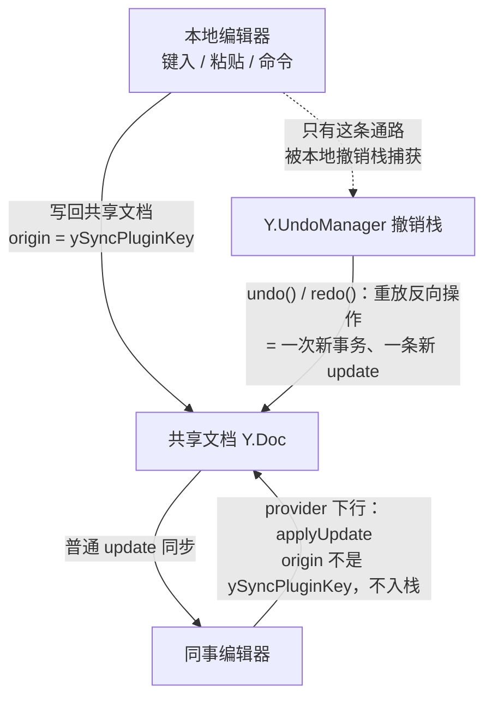

import { Canvas, Controls, Meta } from '@storybook/addon-docs/blocks';
import * as EditorUndo from './editor-undo.stories';

<Meta of={EditorUndo} name="Docs" />

# 编辑器撤销与历史

协同场景下，撤销/重做的作用域从「整篇文档的历史」收缩为「本编辑器的本地历史」：按 Ctrl+Z 只回退自己这台编辑器产生的变更，同事的并发编辑不会被吞掉；而每一次撤销本身，又是一条广播给所有人的新 Yjs 更新，不是把文档滚回过去。本课围绕 Tiptap 的 Collaboration 扩展讲清三件事：撤销怎么接线（StarterKit 自带的单机历史必须让位）、作用域按什么判定（trackedOrigins 语义）、撤销与服务器和离线补传的关系。[Tiptap 协同接入](?path=/docs/tiptap-setup--docs) 课已接过 provider 与文档的线，本课在其上补历史这一层。Yjs `Y.UndoManager` 自身的栈与合并机制属 yjs 主题手册，这里只讲编辑器协同集成面上必须知道的部分。

版本基线为 Hocuspocus v4（4.7.x）+ Tiptap 3.x。撤销/重做完全是编辑器侧行为，Hocuspocus 服务器只看到普通 update，v3 与 v4 没有差异；Tiptap 2 的写法差异（history 扩展）在正文一句话标注。



| 配置 / 命令 | 默认值 | 回查要点 |
| --- | --- | --- |
| StarterKit `undoRedo` | 启用 | 协同接线必须 `undoRedo: false`（Tiptap 2 写法 `history: false`），撤销交给 Collaboration |
| `yUndoOptions.trackedOrigins` | `Set([ySyncPluginKey])` | 集合内的 origin 对应的变更才进本地撤销栈，其余（含远端）一律不记 |
| `yUndoOptions.undoManager` | `null`（扩展自建） | 多编辑器共享同一 Y.Doc 时注入独立实例隔离 |
| `yUndoOptions.protectedNodes` | `Set(['paragraph'])` | 撤销不删除这些节点类型的非空结构 |
| yjs `captureTimeout` | `500` ms | 连续输入合并为一步撤销；输入规则转换后自动另起一步 |
| `editor.commands.undo()` / `redo()` | — | 对应栈为空时返回 `false`；按钮禁用态用 `editor.can().undo()` 判断 |
| 快捷键 | `Mod-z` / `Mod-y` / `Shift-Mod-z` | Windows/Linux 为 Ctrl+Z、Ctrl+Y 或 Shift+Ctrl+Z，macOS 为 Cmd 组合 |

表中 `ySyncPluginKey` 是 y-tiptap 内部同步插件的 key 实例：编辑器把本地事务写回 Yjs 时以它为 origin，因此「默认 trackedOrigins」等价于「只记本编辑器写回的变更」。

## 关闭单机历史，由 Collaboration 接管

StarterKit 自带的 UndoRedo 扩展（v2 里叫 History）基于 prosemirror-history，为单机文档设计：它维护一套深度 100 条、按 500ms 分组的单文档栈，把所有本地事务一锅端当成「你的修改」。协同编辑接入 Collaboration 后，撤销要换 Yjs 的 `Y.UndoManager` 来做——它能区分变更来自谁。所以接线第一步是关闭单机历史：

```ts
import { Editor } from '@tiptap/core';
import { Collaboration } from '@tiptap/extension-collaboration';
import StarterKit from '@tiptap/starter-kit';

const editor = new Editor({
  extensions: [
    // 关闭 StarterKit 自带的单机历史，undo / redo 由 Collaboration 扩展接管
    StarterKit.configure({ undoRedo: false }),
    Collaboration.configure({ document: ydoc }),
  ],
});
```

v3 里 StarterKit 的这个开关叫 `undoRedo`；v2 差异一句话：v2 的 StarterKit 集成的是 history 扩展，写法为 `history: false`。

不关会怎样：Collaboration 不会阻止你，但会在创建时打印警告（源码原文：`"@tiptap/extension-collaboration" comes with its own history support and is not compatible with "@tiptap/extension-undo-redo".`），此后两套历史栈并存——本地输入同时进 `Y.UndoManager` 和 prosemirror-history 的栈，Ctrl+Z 的落点随两栈状态漂移（撤销栈为空时命令返回 `false`，按键可能落到旧历史栈上），一次撤销回退多少步变得不可预期。修复方式只有一种：按上面关掉。

React 写法一句话：把同样的 extensions 数组换到 `useEditor({ extensions: [...] })` 即可，命令与快捷键行为一致，provider 生命周期由官方 provider-react 管理。

### 接管后的命令与快捷键

Collaboration 扩展注册了两个命令与三个快捷键，行为与单机历史不同的一点是「栈空返回 false」而非报错：

| 入口 | 行为 |
| --- | --- |
| `editor.commands.undo()` | 回退撤销栈顶的一步；栈空返回 `false` |
| `editor.commands.redo()` | 重做重做栈顶的一步；栈空返回 `false` |
| `Mod-z` | 调 `undo()`（Windows/Linux Ctrl+Z，macOS Cmd+Z） |
| `Mod-y` / `Shift-Mod-z` | 调 `redo()`（Windows/Linux Ctrl+Y 或 Shift+Ctrl+Z，macOS Cmd+Y / Shift+Cmd+Z） |

工具栏按钮、菜单项的可用态用 `editor.can().undo()` / `editor.can().redo()` 判断，栈空时它们与命令返回值一致为 `false`。

## 撤销只回退自己的变更

作用域的判定机制是事务 origin：Collaboration 为每个编辑器实例建一个 `Y.UndoManager`，默认 `trackedOrigins: new Set([ySyncPluginKey])`——只有「本编辑器把本地事务写回 Yjs」这条通路会进撤销栈。远端更新经 provider 的 `applyUpdate` 写入文档，origin 不同，永远不会入栈。三条推论：

- **同事的并发编辑不进你的栈。** 你撤销时，Yjs 只重放你自己那几步的反向操作，同事刚写入的内容原地不动；反过来，你先撤销、同事后插入，他的插入也不会被你的撤销步骤吃掉。
- **作用域是编辑器实例，不是用户。** 每个标签页、每台设备各有一个撤销域；同一用户开两个 tab，互相也不在对方的撤销栈里。CollaborationCaret 配置的 user 身份只管光标展示，不参与撤销判定。
- **撤销栈深度等于「你的步数」。** 与同事的编辑量无关，读数上是干净的本地计数。

下面的实例用两个真实 Tiptap 编辑器加内存 relay 模拟这条链路（模拟语义：文档页内没有 WebSocket 服务器，relay 按服务器转发语义复刻 update 通道、用对方文档标记 origin；同事的插入由 Controls 输入驱动，不模拟同事的撤销操作）：在本地键入、让同事插入、再撤销，核对谁的变更进了谁的撤销栈。

<Canvas of={EditorUndo.UndoScope} />
<Controls of={EditorUndo.UndoScope} />

| 读者操作 | 可观察证据 |
| --- | --- |
| 初始加载 | 两个编辑器共享底稿「协同会议纪要」，撤销栈 0 步、两端一致 |
| 在本地编辑器键入 | 撤销栈深度增长（500ms 内的连打合并为一步）；同事编辑器同步显示 |
| 在「同事插入文字」输入 | 同事内容出现在两端；本地撤销栈深度不变——远端更新不入栈 |
| 点「撤销」或 Controls 选「撤销 undo」 | 只回退本地步骤：同事刚插入的内容原地保留，两端内容重新一致 |
| 看上行计数 | 撤销一次，「本地上行 update」加一——撤销也是一条普通更新 |
| 点「重做」 | 本地步骤回来，同事内容仍不受影响 |
| 重做后再在本地键入一次 | 重做栈读数归 0——新的本地编辑清空重做栈 |
| 打开 Show code | 看到 `undo-demo.ts` 中 relay 的 origin 标记与两个编辑器的扩展接线 |

### 撤销步的合并与结构保护

哪些输入算「一步」、撤销时不删什么，由三处默认值共同决定，一般无需改动但回查常用：

- **`captureTimeout: 500`（yjs 默认）。** 两次变更间隔小于 500ms 就合并进同一个撤销步，连续键入因此回退为整句；Collaboration 在输入规则转换（如键入 `# ` 自动变标题）后自动调 `stopCapturing()`，让转换前后的输入拆成两步。
- **`addToHistory: false` 的事务不入栈。** 想让某段程序化修改（自动填充、格式化脚本）不进撤销栈，在事务元数据里带上它即可。
- **`protectedNodes: Set(['paragraph'])`。** 撤销要删除插入的段落结构时，非空段落默认保留，文档骨架不会被删穿；空段落仍可被撤销掉。需要调整时通过 `yUndoOptions` 覆盖。

接线示例：`Collaboration.configure({ document: ydoc, yUndoOptions: { trackedOrigins: [myOrigin] } })` 会把 `myOrigin` 追加进默认集合（注意是追加而非替换，`ySyncPluginKey` 始终在集合里）。

### 多编辑器共享文档的边界

一个页面用多个编辑器挂同一份 Y.Doc（多字段、预览面板）时有个反直觉的默认行为：如果两个编辑器读写**同一个字段**，它们各自创建的 `Y.UndoManager` 会互相捕获对方的本地事务——因为写回 origin 都是同一个 `ySyncPluginKey`，撤销步会互相污染。各编辑器读写不同字段则不受影响（撤销栈只追踪自己字段上的变更）。共享同一字段又需要独立撤销时，给每个编辑器经 `yUndoOptions.undoManager` 注入独立实例，scope 指向各自的类型。

## 撤销是新的更新，不是版本回滚

`undo()` 的执行过程是在 Yjs 事务里重放反向操作：文档产生一次新事务、一条新 update，经 provider 上行，服务器转发给所有端并按普通变更持久化。服务器（Hocuspocus v4）没有撤销概念——`onUpdate` / `onStoreDocument` 看到的与普通编辑无异，持久化里存的就是撤销后的状态。对所有端而言，你的撤销就是一次新编辑，这也解释了实例里同事编辑器会同步移除被撤销文字的现象。

由此三条边界：

- **撤销不能恢复服务器历史版本，也回退不了别人的编辑。** 版本级回退属于快照与备份的领域：自托管部署靠持久化层做快照，Tiptap 云另有 Version History / 快照扩展，不在本课范围。
- **离线时撤销照常可用。** 离线编辑的 origin 仍是本地，撤销栈不受断线影响；恢复连接后，撤销产生的更新与离线编辑一起按状态向量双向补传（对账路径见[断线与重连](?path=/docs/reconnection--docs) 课）。
- **栈活在编辑器实例内存里。** 刷新页面、销毁编辑器即清零；网络重连不动编辑器，栈保留。任何一次新的本地编辑会立即清空重做栈（yjs 语义）；查看历史快照（同步插件的 snapshot 模式）时 `undo()` / `redo()` 直接返回 `false`，快照视图是只读投影。

## 最佳实践

- **把 `undoRedo: false` 当协同接线清单的第一项。** 协同项目从模板起步时就关掉，别等控制台警告出现再查——两套栈并存的问题在测试环境很难复现，上生产才暴露。
- **程序化修改用显式 origin 分流。** 想纳入撤销的自动化写入用 `ydoc.transact(fn, myOrigin)` 并把 `myOrigin` 追加进 `yUndoOptions.trackedOrigins`；不想被撤销的（协同高亮、统计标记）带 `addToHistory: false`，不要混在用户事务里。
- **撤销粒度用 `captureTimeout` 与 `stopCapturing` 调，不自建第二套栈。** 默认 500ms 合并已接近主流编辑器手感；「一次粘贴加格式化算一步」这类需求在格式化命令后调 `stopCapturing()` 即可。
- **别拿 undo 做数据恢复。** 本地历史只到本次会话为止，刷新即清零；跨会话的恢复靠服务器持久化与快照，两个机制回答的是不同问题。

## 常见问题

- Ctrl+Z 没反应，或一下回退了好多步
  先看控制台有没有 collaboration 与 undo-redo 不兼容的警告：有就是 StarterKit 的单机历史没关，两套栈并存导致快捷键落点漂移，按第一节关闭 `undoRedo`。已关仍无反应时用 `editor.can().undo()` 确认撤销栈是否为空——栈空时命令返回 `false`，属正常行为而非故障。
- 撤销把同事刚写的内容也弄没了
  默认配置下不会发生（远端更新不入本地栈）。真实原因几乎总是「远端内容被你的一次本地事务整体覆盖」：全选后粘贴、整篇 `setContent`、AI 改写等操作都被记成你的变更，undo 自然回退它们。处理方式：整篇覆盖类操作前先确认，或拆成显式的程序化修改并用独立 origin（不进撤销栈）。
- 刷新页面后撤销栈没了，同事重连后还能撤销吗
  栈在编辑器内存里，随页面刷新或编辑器销毁而清零；网络重连不重建编辑器，栈保留。已经同步进文档的内容不需要撤销来找回——撤销管的是本次会话里的悔棋，不是数据恢复；重做栈则会在任何一次新的本地编辑后清空。
- 一个页面挂了两个编辑器（同一份 Y.Doc），撤销互相影响
  两个编辑器读写同一字段时，各自的 `Y.UndoManager` 会因 origin 相同而互相捕获对方的本地事务。给每个编辑器经 `yUndoOptions.undoManager` 注入独立实例；若只是读写不同字段，则无需处理。

## 总结回顾

摘要：

协同编辑的撤销由 Collaboration 扩展接管：接线时必须用 `undoRedo: false` 关闭 StarterKit 自带的单机历史，否则两套栈并存、快捷键行为不可预期。作用域按事务 origin 判定——默认 `trackedOrigins` 只含 y-tiptap 的同步插件 key，本编辑器写回的变更入栈，远端更新永远不入栈，因此 undo 只回退自己的变更，作用域是编辑器实例而非用户身份。撤销步由 `captureTimeout`（默认 500ms）合并连续输入，输入规则转换后自动另起一步，非空段落结构默认受 `protectedNodes` 保护。undo/redo 在 Yjs 里重放反向操作，产生的是广播给所有人的新 update：服务器把它当普通变更转发与持久化，离线时撤销照常可用、恢复后一并补传。栈活在编辑器实例内存里，刷新即清零、重连保留、新的本地编辑清空重做栈。

一句话：

> 协同下的撤销作用域是本编辑器的本地历史：undo 只回退 origin 命中 trackedOrigins 的本地变更，同事的并发编辑不受影响；而撤销本身又是一条广播给所有人的新 Yjs 更新，不是文档回滚。

知识要点：

- 接入 Collaboration 时为什么要关闭 StarterKit 的 undoRedo？不关会看到什么警告与现象？
- 撤销作用域按什么判定？trackedOrigins 的默认值是什么、等价于哪种「只记」语义？
- 为什么同事的编辑不会被你的 undo 吞掉？作用域与用户身份（CollaborationCaret 的 user）是什么关系？
- captureTimeout 如何合并撤销步？输入规则转换后为什么另起一步？哪些事务不入栈？
- 撤销在网络与服务器眼里是什么？离线时能不能撤销自己的编辑？
- 撤销栈与重做栈分别在什么时候清空？刷新、重连、新编辑各影响哪一个？
- 什么场景需要注入自定义 undoManager 或追加 trackedOrigins？

## 参考资料

- [Collaboration 扩展（官方文档：undoRedo 冲突提示、undo / redo 命令与快捷键）](https://tiptap.dev/docs/editor/extensions/functionality/collaboration)
- [UndoRedo 扩展（官方文档：单机历史的 depth / newGroupDelay 默认值与「协同下不应使用」的说明）](https://tiptap.dev/docs/editor/extensions/functionality/undo-redo)
- [StarterKit（官方文档：`undoRedo: false` 关闭写法）](https://tiptap.dev/docs/editor/api/extensions/starter-kit)
- [collaboration.ts（Tiptap v3 源码：undo / redo 命令、yUndoOptions 透传、onCreate 兼容警告、输入规则后 stopCapturing）](https://github.com/ueberdosis/tiptap/blob/develop/packages/extension-collaboration/src/collaboration.ts)
- [yUndoPlugin.ts（@tiptap/y-tiptap 源码：UndoManager 默认 trackedOrigins、captureTransaction、protectedNodes deleteFilter）](https://github.com/ueberdosis/tiptap/blob/develop/packages/y-tiptap/src/lib/plugins/yUndoPlugin.ts)
- [Y.UndoManager（yjs 官方文档：trackedOrigins、captureTimeout 500ms、stopCapturing 与栈语义）](https://docs.yjs.dev/api/undo-manager)
