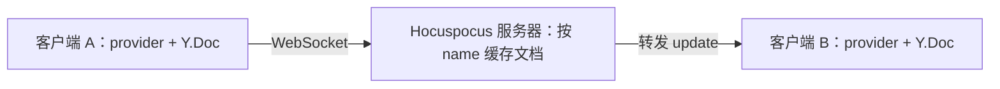
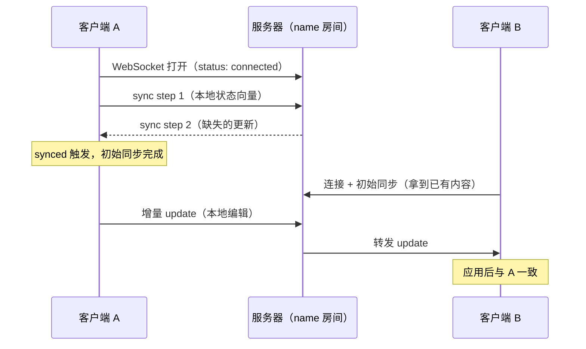

import { Canvas, Controls, Meta } from '@storybook/addon-docs/blocks';
import * as FirstDocument from './first-document.stories';

<Meta of={FirstDocument} name="Docs" />

# 第一个协同文档

Hocuspocus 的协同由两端组成：服务器按文档名缓存一份 Y.Doc 并转发更新，provider 把浏览器里的一份 Y.Doc 接到服务器上。本课把两端跑起来，在两个浏览器上下文之间完成第一次实时同步。读完后你应该能预测：两端连同一服务器、用同一文档名，一端编辑，另一端立即出现；文档名不同，则永远互不相通。



| 输入或概念 | 默认值或取值 | 回查要点 |
| --- | --- | --- |
| `url` | `''` | 服务器的 WebSocket 地址，本地示例用 `ws://127.0.0.1:1234` |
| `name` | `''` | 文档名即房间标识：相同汇聚，不同隔离 |
| `document` | 自动创建 `new Y.Doc()` | 传入自己的 Y.Doc 时，经 `provider.document` 访问 |
| Server 的 `port` | `80` | 本地示例显式传 `1234`，避免低端口权限问题 |
| `status` 事件 | `connecting` / `connected` / `disconnected` | 只反映 WebSocket 连接状态，不校验文档名 |
| `synced` | 初始同步完成后触发一次 | 不代表服务器已把内容持久化 |

## 快速上手

前置：Node 22+（v4 基线）；依赖按 [安装](?path=/docs/install--docs) 课装好——服务端 `@hocuspocus/server`，客户端 `yjs` 与 `@hocuspocus/provider`。

**1. 启动服务器。** 新建 `server.ts`：

```ts
import { Server } from '@hocuspocus/server';

const server = new Server({
  port: 1234,
  async onConnect({ documentName }) {
    console.log(`客户端连入文档：${documentName}`);
  },
});

server.listen();
```

启动后（如 `npx tsx server.ts`），服务器终端出现启动画面，能看到 `Hocuspocus v4.x running at:` 以及 `HTTP` 与 `WebSocket` 两行地址。

**2. 客户端接入。** 新建 `client.ts`，在两个浏览器标签页里运行同一段代码：

```ts
import * as Y from 'yjs';
import { HocuspocusProvider } from '@hocuspocus/provider';

const ydoc = new Y.Doc();
const provider = new HocuspocusProvider({
  url: 'ws://127.0.0.1:1234',
  name: 'first-document',
  document: ydoc,
});

provider.on('status', ({ status }) => console.log('连接状态:', status));
provider.on('synced', () => console.log('初始同步完成'));

const ytext = ydoc.getText('demo');
ytext.observe(() => {
  document.body.textContent = ytext.toString();
});

// 挂到 window 上，方便在两个标签页的控制台里分别编辑
Object.assign(window, { ytext });
```

**3. 验证闭环。** 在标签页 A 的控制台执行 `ytext.insert(0, '来自 A 的内容')`。

| 步骤 | 在哪里看 | 可观察结果 |
| --- | --- | --- |
| 服务器启动 | 服务器终端 | 启动画面的 HTTP / WebSocket 地址 |
| 标签页接入 | 服务器终端 | `onConnect` 打印「客户端连入文档：first-document」 |
| 标签页接入 | 浏览器控制台 | `connecting` 到 `connected`，随后打印「初始同步完成」 |
| A 编辑 | 标签页 B 页面 | 立即显示「来自 A 的内容」 |

两个标签页就是两个独立的浏览器上下文，各持一份 Y.Doc；同一页面里建两个 provider 也会同步，但验证协作请用两个标签页。这套最小写法在 v3 同样成立，v3 的服务器钩子签名等差异见 [从 v3 迁移](?path=/docs/v3-migration--docs) 课。

## 同步过程模型

同步分三个阶段。**连接建立**：WebSocket 打开，`status` 变为 `connected`。**初始同步**：provider 发出 sync step 1（本地状态向量），服务器以它为基准回以 sync step 2（对方缺失的更新），完成后 `synced` 触发一次。**增量 update 流**：此后每次本地编辑都编码成一条 update 上行，服务器应用到房间文档并转发给同房间的其他连接，对端应用后内容一致。从网络收到的更新不会再次上行——provider 用事务 origin 区分本地与网络来源，这也是消息不会在两端之间循环的原因。



`status` 与 `synced` 是两个判断点：

- `status` 由底层共享连接 HocuspocusProviderWebsocket 触发并转发给每个 provider，取值 `connecting`、`connected`、`disconnected`；断开后重连会在三者之间循环。
- `synced` 只在初始同步完成时触发一次，之后可读 `provider.synced`；连接关闭时回到 `false`，重连会重走一次初始同步。
- 边界：`synced` 只代表与服务器完成首次握手；内容是否落库要看服务器的 onChange、onStoreDocument 钩子，见 [文档生命周期](?path=/docs/document-lifecycle--docs) 与 [自定义持久化](?path=/docs/custom-persistence--docs) 课。

下面的实例用两个真实 Y.Doc 加一个内存房间复现这条链路（真实部署把传输层换成 WebSocket 服务器，同步逻辑相同）：修改输入观察增量转发，读数核对两端内容与消息计数。

<Canvas of={FirstDocument.SyncFlow} />
<Controls of={FirstDocument.SyncFlow} />

| 读者操作 | 可观察证据 |
| --- | --- |
| 修改「客户端 A 输入」 | 客户端 B 的内容同步变化，「增量 update」计数加一 |
| 对照两端读数 | 同名房间内「两端内容」始终显示一致 |
| 打开 Show code | 看到 `sync-model.ts` 里初始同步与增量转发的完整实现 |

provider 还有重连间隔、`flushDelay`、`forceSyncInterval` 等连接参数，见 [HocuspocusProvider](?path=/docs/provider--docs) 课。

## 文档名的房间语义

服务器把文档缓存在以 name 为键的 Map 里：连接进来先按 name 找房间，找不到就创建一份。相同 name 的所有连接共享同一份服务器文档，互相转发 update；不同 name 各自一份，互不相通。是否同房间只取决于两端 provider 传入的 name 字符串，与页面路径、标签页数量无关。

```ts
// 同一页面里接入两个房间：彼此独立
const roomA = new HocuspocusProvider({ url: 'ws://127.0.0.1:1234', name: 'demo-doc' });
const roomB = new HocuspocusProvider({ url: 'ws://127.0.0.1:1234', name: 'other-doc' });
```

把上一节的实例换一个视角：客户端 B 的文档名可以切换。同名时它通过初始同步拿到 A 的全部内容；异名时它面对的是一份空房间文档，收不到 A 的任何编辑。

<Canvas of={FirstDocument.RoomIsolation} />
<Controls of={FirstDocument.RoomIsolation} />

| 读者操作 | 可观察证据 |
| --- | --- |
| 把「客户端 B 文档名」切到「异名 other-doc」 | B 的内容清空，「两端内容」变为隔离，「增量 update」计数停止增长 |
| 再切回「同名 demo-doc」 | B 立刻经初始同步拿到 A 的全部内容，「两端内容」回到一致 |
| 对照「初始同步」计数 | 每次接入都加一：换房间就是重新接入 |

name 的房间边界只在同一服务器进程内成立：换端口就是换进程，属于不同服务器，不存在共享房间。

## 常见问题

- `status` 显示 `connected`，但另一端一直没有内容
  先逐字符核对两端 provider 的 `name` 是否一致（含大小写与空格）。`status` 只反映 WebSocket 已连上，不校验文档名；name 不同时各进各的房间，永远不会同步。
- 把 `url` 写成页面地址（如 `http://localhost:5173`）后连不上
  `url` 必须是 Hocuspocus 服务器的 WebSocket 地址（如 `ws://127.0.0.1:1234`）。Vite 等开发服务器的端口只是页面端口，不是协同服务器的端口。
- 一直停在 `connecting`，或控制台报 WebSocket 连接失败
  先确认服务器进程在跑（终端能看到启动画面），再核对 `url` 的主机与端口是否和启动画面一致；服务器未启动时，`status` 会在 `connecting` 与 `disconnected` 之间反复。

## 总结回顾

摘要：

本课用最小代码把 Hocuspocus 的两端跑通：服务器 `new Server({ port }).listen()` 按 name 缓存文档并转发更新，浏览器端 `new HocuspocusProvider({ url, name, document })` 把一份 Y.Doc 接进同名房间。同步分三段——连接建立、初始同步（sync step 1 换回 sync step 2，完成时 `synced` 触发）、增量 update 流；`status` 只反映连接状态，`name` 决定谁和谁同步。跑通之后，任何一端的编辑都会实时出现在同房间的另一端。

一句话：

> provider 连上服务器后，name 相同的 Y.Doc 自动汇成一致：初始同步补齐历史，增量 update 保持实时。

知识要点：

- 快速上手的两端各需要哪几行代码，每一步的可观察结果在哪里看？
- 同步的三个阶段分别发生什么，`synced` 在哪个时刻触发？
- `status` 的三个取值分别对应什么连接状态？
- `name` 如何决定两个客户端是否同步？
- `connected` 但内容不同步时，应按什么顺序排查？

## 参考资料

- [Hocuspocus Provider 安装](https://tiptap.dev/docs/hocuspocus/provider/install)
- [Hocuspocus Provider 配置](https://tiptap.dev/docs/hocuspocus/provider/configuration)
- [Hocuspocus Provider 事件](https://tiptap.dev/docs/hocuspocus/provider/events)
- [Hocuspocus 介绍](https://tiptap.dev/docs/hocuspocus/introduction)
- [ueberdosis/hocuspocus 仓库（README 的 Server 示例）](https://github.com/ueberdosis/hocuspocus)
