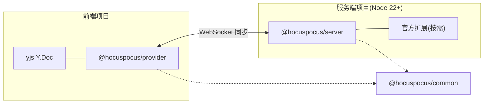

import { Meta } from '@storybook/addon-docs/blocks';

<Meta id="install" title="快速上手/安装" name="Docs" />

# 安装

Hocuspocus 的能力分散在一组 `@hocuspocus/*` 包里:服务端只需要 `@hocuspocus/server`,浏览器端只需要 `@hocuspocus/provider`,持久化、限流、webhook 等能力由官方扩展按需加装。本课先建立包全景,再完成一次最小安装:装好 server、启动进程、用 curl 验证服务器真的在监听——HTTP 根路径会返回 `Welcome to Hocuspocus!`。

版本基线:Hocuspocus v4(当前 4.7.x,要求 Node 22 及以上)。本课所有命令与默认值均按 v4 官方文档与源码核对。



包全景与安装时机:

| 包名 | 职责 | 何时安装 |
| --- | --- | --- |
| `@hocuspocus/server` | WebSocket 协同服务器:文档管理、连接、鉴权与生命周期钩子 | 服务端项目,必装 |
| `@hocuspocus/provider` | 客户端连接器:连接服务器、同步 Y.Doc、awareness | 需要连服务器的前端项目 |
| `@hocuspocus/provider-react` | provider 的 React 绑定(hooks 封装) | React 前端,叠加在 provider 之上 |
| `@hocuspocus/common` | server 与 provider 共享的消息类型与协议工具 | 不直接安装,随两个主包自动带入 |
| `@hocuspocus/transformer` | Y.Doc 与 JSON、HTML、ProseMirror 文档互转 | 做导入导出、服务端渲染时 |
| `@hocuspocus/cli` | 开发用命令行服务器,内置 Logger,可选 SQLite/S3/webhook | 本地试用、联调 webhook,免写脚本 |
| `@hocuspocus/extension-sqlite` | 文档持久化到 SQLite | 本地或小型部署的持久化 |
| `@hocuspocus/extension-database` | 通过回调把文档存进任意数据库 | 对接自有数据库 |
| `@hocuspocus/extension-s3` | 文档快照存 S3 对象存储 | 对象存储后端 |
| `@hocuspocus/extension-redis` | 多实例间同步,支撑水平扩展 | 多实例生产部署 |
| `@hocuspocus/extension-throttle` | 消息限流防护 | 生产环境防滥用 |
| `@hocuspocus/extension-logger` | 在控制台观察协议消息流 | 开发调试 |
| `@hocuspocus/extension-webhook` | 文档创建、存储等时机回调外部 HTTP 服务 | 与外部系统联动 |

依赖关系只有两条需要记住:

- server 与 provider 都把 `yjs` 和 `y-protocols` 列为 peer 依赖(要求 `yjs ^13.6.8`、`y-protocols ^1.0.6`),npm 7 及以上会自动安装;
- 两个主包都依赖 `@hocuspocus/common`,它承载共享的消息类型与协议底层,你不需要直接安装它。

## 快速上手

从零到一个在监听的协同服务器,只需要四步。

创建一个普通 Node 项目并安装 server 包:

```bash
mkdir hocuspocus-demo
cd hocuspocus-demo
npm init -y
npm install @hocuspocus/server
```

创建 `server.mjs`,内容是最小服务器脚本:

```js
// server.mjs:最小 Hocuspocus 服务器
import { Server } from '@hocuspocus/server'

const server = new Server({
  port: 1234,
})

server.listen()
```

显式写 `port` 是因为 Server 的默认端口是 80:小于 1024 的端口在 Linux 上需要 root 权限才能绑定,开发时一般换成 1234 这类高位端口,也与官方示例和 CLI 的默认端口一致。

启动服务器:

```bash
node server.mjs
```

终端会打印 HTTP 与 WebSocket 两组监听地址和已加载的扩展,最后以 `Ready.` 结束。保持进程运行,另开一个终端验证:

```bash
curl http://127.0.0.1:1234
```

输出:

```
Welcome to Hocuspocus!
```

收到 200 状态码和这行文本,就说明协同服务器已经起来了。v4 没有专门的 `/health` 端点:普通 HTTP 请求统一进入 `onRequest` 钩子,没有钩子接管时就返回这句欢迎语(状态码 200,`text/plain`)。需要自定义健康检查时,在 `onRequest` 钩子里自行响应即可。

边界:这个进程目前只有协同内核,没有任何持久化,重启后文档内容不保留;给文档落库是扩展的事,见「自定义持久化」与「持久化扩展」两课。

## 服务器:@hocuspocus/server

`@hocuspocus/server` 是协同后端本体:它维护文档、管理 WebSocket 连接、驱动鉴权与生命周期钩子。安装一个包即可获得完整服务端能力,TypeScript 类型已内置,不需要额外的 `@types` 包。

与启动直接相关的配置默认值:

| 选项 | 默认值 | 说明 |
| --- | --- | --- |
| `port` | `80` | 特权端口,Linux 非 root 会绑定失败,开发时显式配置 |
| `quiet` | `false` | `false` 时启动打印欢迎画面,`true` 则静默启动 |
| `stopOnSignals` | `true` | 收到 Ctrl+C(SIGINT)等信号时走 Server 的停机流程 |

v4 的一个背景变化:传输层从 `ws` 换成了 `crossws`,因此同一份 server 代码可以跑在 Node、Bun、Deno 与 Cloudflare Workers 上;新旧版本的线协议互通,v3 的 provider 可以直连 v4 服务器。端口、超时、debounce 等其余选项见「Server 配置」一课。

## 客户端:@hocuspocus/provider

只有需要连接 Hocuspocus 服务器的项目——浏览器页面、Node 客户端、测试脚本——才安装 provider;纯服务端项目不需要它。

```bash
npm install yjs @hocuspocus/provider
```

`yjs` 必须写进安装命令:provider 声明了对 `yjs ^13.6.8` 的 peer 依赖,官方安装指引始终把两者放在一起。

最小连接代码(浏览器或任意前端打包环境):

```js
import * as Y from 'yjs'
import { HocuspocusProvider } from '@hocuspocus/provider'

const ydoc = new Y.Doc()

const provider = new HocuspocusProvider({
  url: 'ws://127.0.0.1:1234',
  name: 'example-document',
  document: ydoc,
})
```

装好后先不用急着跑:连接建立后的 status 事件、synced 时机与两个浏览器上下文间的实时同步,是「第一个协同文档」与「HocuspocusProvider」两课的主线。React 项目再叠加 `@hocuspocus/provider-react`,它只是 provider 的 hooks 封装,不替代 provider 本身。

## 开发 CLI:@hocuspocus/cli

不想写任何脚本时,`@hocuspocus/cli` 用一条命令起一个本地服务器,适合快速试用和本地联调 webhook:

```bash
npx @hocuspocus/cli
```

默认监听 1234 端口,并且总是挂上 extension-logger,终端能直接看到协议消息流。常用参数:

| 参数 | 作用 | 默认 |
| --- | --- | --- |
| `--port`、`-p` | 监听端口 | `1234` |
| `--sqlite`、`-s` | 启用 SQLite 持久化,不带值时使用内存数据库 | 不启用 |
| `--webhook`、`-w` | 把 webhook 事件转发到指定 URL | 不启用 |
| `--s3` | 启用 S3 存储,必须配合 `--s3-bucket`(或环境变量 `S3_BUCKET`) | 不启用 |

例如起一个带 SQLite 持久化的 8080 端口实例:

```bash
npx @hocuspocus/cli --port 8080 --sqlite
```

边界:CLI 面向本地开发与演示;生产部署应使用自己的 Server 进程,见「生产部署」一课。

## 常见问题

- 自己 `new Server()` 启动报 `listen EACCES`,而 `npx @hocuspocus/cli` 一切正常。
  Server 构造函数的默认端口是 80,小于 1024 的端口在 Linux 上需要 root 权限;CLI 的默认端口则是 1234。给自建服务器显式配置 `port`,开发环境用 1234,与官方示例保持一致。

- `npm install` 时打印 `EBADENGINE` 或 Unsupported engine 警告。
  把 Node 升级到 22 或更高(可用 nvm 切换)再安装。v4 在 server 包里声明了 `engines` 为 `node 22 及以上`,npm 默认只警告不拦截,但版本差距大时运行阶段可能直接语法报错。

- 安装时报 `ERESOLVE`,提示与 yjs 的 peer 依赖冲突。
  server 与 provider 都要求 peer 依赖 `yjs ^13.6.8`、`y-protocols ^1.0.6`,项目里锁着更旧版本的 yjs 时会冲突。先用 `npm ls yjs` 查当前版本,再把项目 yjs 升到 13.6.8 以上。

- 项目是 CommonJS,`require('@hocuspocus/server')` 可以吗?
  可以。v4 同时发布 ESM 与 CJS 构建,`require` 和 `import` 都能拿到 `Server`;TypeScript 项目直接具名导入,类型声明已内置。

## 总结回顾

摘要:

Hocuspocus 按"一端一个主包"组织依赖:服务端安装 `@hocuspocus/server` 启动 WebSocket 协同服务器(默认端口 80,要求 Node 22 及以上),前端安装 `yjs` 与 `@hocuspocus/provider` 建立连接;持久化、限流、webhook、Redis 同步等能力来自七个官方扩展,`transformer` 负责文档格式互转,`common` 是两个主包共享的协议底层,`cli` 让你零脚本起一个本地服务器。最小闭环是:安装 server、`listen()` 启动、curl 根路径看到 `Welcome to Hocuspocus!`。

一句话:

> 装包只分两端:服务端装 `@hocuspocus/server`,客户端装 `yjs` 与 `@hocuspocus/provider`,其余包按需加装。

知识要点:

- server、provider、common、transformer、cli 与七个官方扩展各自负责什么?哪些需要手动安装,哪些自动带入?
- v4 对 Node 版本的要求是什么?Server 与 CLI 的默认端口分别是多少?
- 如何验证服务器已启动?v4 有没有专门的 `/health` 端点,HTTP 根路径返回什么?
- 为什么安装 provider 时要同时安装 yjs?版本要求是多少?

## 参考资料

- [Hocuspocus Overview](https://tiptap.dev/docs/hocuspocus/getting-started/overview)
- [Upgrade to Hocuspocus v4](https://tiptap.dev/docs/hocuspocus/getting-started/upgrade)
- [Server Configuration](https://tiptap.dev/docs/hocuspocus/server/configuration)
- [Server Examples](https://tiptap.dev/docs/hocuspocus/server/examples)
- [Provider Installation](https://tiptap.dev/docs/hocuspocus/provider/install)
- [ueberdosis/hocuspocus 仓库](https://github.com/ueberdosis/hocuspocus)
