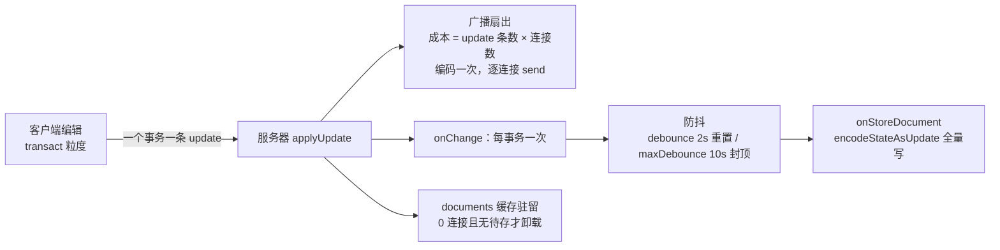

import { Canvas, Controls, Meta } from '@storybook/addon-docs/blocks';
import * as Performance from './performance.stories';

<Meta of={Performance} name="Docs" />

# 性能与内存

Hocuspocus 服务器的性能与内存问题，几乎都能定位到一条链路上的三个环节：一条 update 进来，先被**广播**给房间里的每条连接（成本随 update 条数乘连接数增长），再被**防抖落库**（每次写整份快照，成本随文档大小增长），文档本身则**驻留**在缓存里（内存随驻留文档数累积）。debounce 调优、大文档管理与监控指标，都是给这三笔账选参数、装读数。读完你应能预测：默认输入 11 个字符、4 个客户端连接，逐字符事务会产生 44 次广播 send；切成整段一个事务就收敛到 4 次；而两种粒度的落库次数都是 1——写频率由防抖决定，与编辑次数无关。

版本基线为 Hocuspocus v4（4.7.x，要求 Node 22+）；本课参数默认值均对照 v4 源码核实，v3 的默认值差异（如 timeout 默认 30 秒）见 [Server 配置](?path=/docs/server-config--docs) 课。链路中的广播、防抖与文档缓存机制在浏览器实例里按 v4 源码语义建模演示，服务端进程的内存行为用代码清单说明。



## 成本链路：一条编辑花在哪

每一次编辑在服务器侧展开成三笔账，调优前先知道钱花在哪：

- **广播**：每条 update 发给房间内全部连接。v4 源码里广播不排除发送者（update 幂等，回发无害）；编码结果按 messageAddress（文档名加会话 id 的路由键）缓存，未启用会话感知时整次广播只编码一次。所以网络成本是 update 条数 × 连接数，编码成本通常只有一份。
- **落库**：`onChange` 每个事务触发一次，真正的存储调用被防抖到点；每次落库在快照模式下写 `Y.encodeStateAsUpdate` 的完整状态，成本与文档大小成正比、与期间编辑了多少次无关。
- **驻留**：加载过的文档留在 `documents` 缓存，加上 Yjs 历史（gc 决定留多少）与 awareness 状态，直到卸载条件满足才释放。

三个环节各有独立的节流参数与监控读数。先给一张回查表（默认值均对照 v4 源码核实；机制细节见 [Server 配置](?path=/docs/server-config--docs) 课）：

| 参数 / 入口 | 默认值 | 何时调整 |
| --- | --- | --- |
| `debounce` / `maxDebounce` | `2000` / `10000` 毫秒 | 丢失窗口与落库频率的权衡 |
| `flushDelay` / `flushMaxBytes` | `0`（合并当前事件循环突发）/ `1048576`（1 MiB） | 出站广播的突发合并 |
| `unloadImmediately` | `true` | 最后连接断开后是否多驻留一个防抖窗口 |
| `yDocOptions.gc` | `true` | 删除历史的内存取舍 |
| `getDocumentsCount()` / `getConnectionsCount()` | — | 驻留文档与连接数的监控读数 |

### 广播：扇出与合批

先看服务器的真实行为，再看两个节流位置的分工：

- **update 条数由事务粒度决定。** Yjs 一个 `transact` 产生一条 update——客户端把一批改动放进一个事务，就只有一条 update 进服务器；逐字符提交就是每字符一条。这是第一节流位，作用在源头。
- **扇出由连接数决定。** 每条 update 广播给房间内每条连接，send 次数等于条数乘连接数；编码按 messageAddress 缓存复用，扇出不放大编码成本，但放大网络与每连接的写 socket 开销。
- **flushDelay 合并突发。** 默认 `0` 不是"定时两秒"，而是用 `setImmediate` 把**同一轮事件循环内**到达的 update 合并成一条再广播（内部用 `Y.mergeUpdates`），缓冲达到 `flushMaxBytes`（默认 1 MiB）时提前冲刷；awareness 更新同样进窗口，并在窗口内坍缩为最终状态。设 `false` 则逐条立即广播。这是第二节流位，只影响出站网络，不影响落库。

```ts
const server = new Server({
  port: 1234,
  // 广播合批（v4 默认 0：合并同一轮事件循环内的突发，不是定时批次）
  flushDelay: 0,
  flushMaxBytes: 1024 * 1024, // 缓冲达到 1 MiB 提前冲刷
});
```

下面的实例把一次编辑展开成时间轴：左边看客户端发出多少条 update，中间看广播扇出多少次 send，右边看防抖后的落库。所有读数都可用公式核对。

<Canvas of={Performance.Fanout} />
<Controls of={Performance.Fanout} />

| 读者操作 | 可观察证据 |
| --- | --- |
| 把「客户端连接数」从 4 调到 8 | 广播 send 读数按 update 条数 × 8 倍增，update 条数不变 |
| 把「编辑粒度」切到「整段一个事务」 | update 条数收敛为 1，send 收敛为连接数，恢复核对仍一致 |
| 把「编辑文本」加长到 51 字符以上 | 打字时间轴超过 10 秒，maxDebounce 封顶出现第二次落库 |
| 打开 Show code | 看到该 Canvas 实际执行的 `fanout-model.ts`：事务粒度、逻辑时间轴与防抖调度 |

注意落库读数：无论 44 条 update 还是 1 条，落库次数都是 1——落库频率与 update 条数解耦，这是下一小节的主题。

### 落库：防抖与写放大

防抖机制本身（`debounce` 2000 毫秒每次编辑重置、`maxDebounce` 10000 毫秒封顶）见 [Server 配置](?path=/docs/server-config--docs) 课，落库钩子的触发时序见 [文档生命周期](?path=/docs/document-lifecycle--docs) 课；本课讲两个参数的**权衡**与**大文档的代价**：

- **丢失窗口换写频率。** 调小 `debounce`，崩溃时最多丢几百毫秒，但存储写入变密；调大则写入稀疏、丢失窗口拉长。`maxDebounce` 是持续编辑时的保底——v4 源码里封顶判断发生在新 update 到达时：待存时间已达上限就立即落库，再按新起点重新防抖。默认配置下未落库窗口在 2～10 秒之间。
- **写放大随文档大小增长。** 快照模式每次落库写整份文档：几 MB 的文档每 2～10 秒做一次 `encodeStateAsUpdate` 全量序列化，意味着 CPU 尖峰、瞬时内存翻倍和持续的存储带宽。[自定义持久化](?path=/docs/custom-persistence--docs) 课的两种模型在这里分野：大文档、高频编辑优先改增量 update 日志（`onChange` 逐条追加），配定期 `Y.mergeUpdates` 压缩控制恢复成本；官方三个持久化扩展都是快照模式，小文档直接用，大文档要自己接增量。

实例里的落库读数就是这两点的证据：落库次数只由防抖时间轴决定，快照字节只由文档大小决定。

### 内存：文档驻留与 awareness

内存行为发生在 Node 进程里，Storybook 实例无法复现，这里用源码核实的模型与代码清单说明。

**文档驻留模型。** 服务器用三个 Map 管理文档：`documents`（已加载）、`loadingDocuments`（加载中）、`unloadingDocuments`（卸载中）。文档移出缓存要同时满足三个条件（源码 `shouldUnloadDocument`）：没有待执行的落库防抖、`saveMutex` 空闲、连接数为 0。`timeout` 到点只断开连接，不会卸载文档——0 连接的文档一直驻留，这是 [文档生命周期](?path=/docs/document-lifecycle--docs) 课核实的结论，也是内存视角最重要的一条。

**驻留策略参数。** 两个配置决定驻留多久、驻留多大：

```ts
// residence-server.ts —— 文档驻留策略：断开后不立即卸载，等防抖到点
import { Server } from '@hocuspocus/server';

const server = new Server({
  port: 1234,
  // 默认 true：最后连接断开立即补存并卸载
  // false：文档驻留到防抖落库完成再卸载，热文档回连省一次加载
  unloadImmediately: false,
  yDocOptions: {
    gc: true, // 默认值：回收已删除内容；需要完整删除历史（如服务端渲染）才设 false
  },
});

server.listen();
```

- `unloadImmediately: false` 让文档在防抖窗口内多驻留一会，适合断开后马上有人连回的热文档；代价是这段时间内存不释放。
- `gc: false` 关闭 Yjs 垃圾回收，保留全部删除历史：长驻留的大文档会随编辑历史持续增长，只在确实需要完整历史时使用。
- **多文档没有内置上限。** v4 没有"最大驻留文档数"配置，驻留量靠监控读数与部署策略控制：官方 Scalability 指南的思路是按文档名把用户分片到多个独立实例（配合 [水平扩展](?path=/docs/scaling--docs) 课的 extension-redis），而不是单实例硬扛。

**awareness 的内存。** 每份驻留文档各持有一个 awareness 实例，每个在线客户端占两条 Map 记录（状态本体与时间戳）；连接断开时其客户端状态被移除，30 秒未刷新的状态被过期清理（y-protocols 的 `outdatedTimeout`，每 3 秒检查一轮）。单项成本很小，但 awareness 更新频率高——它走同一条 `flushDelay` 合批路径，窗口内坍缩为最终状态。在线状态协议本身见 [Awareness 在线状态](?path=/docs/awareness--docs) 课。

## 监控指标

v4 没有现成的指标端点，监控要从实例方法与钩子自采。可用入口如下：

| 指标 | 采集入口 | 说明 |
| --- | --- | --- |
| 驻留文档数 | `hocuspocus.getDocumentsCount()` | `documents` 缓存的大小，内存增长的第一读数 |
| 连接数 | `hocuspocus.getConnectionsCount()` | 全部文档的去重 socket 数加直连数 |
| 单条 update 大小与频率 | `onChange` payload 的 `update` | 广播扇出与写流量的原始信号 |
| 落库体积与耗时 | `onStoreDocument` 内对 `encodeStateAsUpdate` 计时 | 写放大的直接读数 |
| 堆内存 | `process.memoryUsage().heapUsed` | 配合驻留文档数判断增长来源 |
| 全量事件流 | extension-logger | 开发期观察钩子流，见 [限流与日志](?path=/docs/throttle-and-logger--docs) 课 |
| 文档变更外发 | extension-webhook `change` 事件 | 把事件导到外部指标管道，见 [Webhook 事件](?path=/docs/webhooks--docs) 课 |

两个实例方法在 `listen()` resolve 的 Hocuspocus 对象上（源码核实：`getDocumentsCount` 就是 `documents.size`）。最小采集服务器：

```ts
// metrics-server.ts —— 在钩子与定时器里采集性能指标的最小服务器
import { Server } from '@hocuspocus/server';
import * as Y from 'yjs';

// 指标管道占位：接入自己的 metrics 库（如 prom-client）时替换实现
const metrics = {
  gauge(name: string, value: number) {
    /* 上报 gauges */
  },
  observe(name: string, value: number) {
    /* 上报直方图 */
  },
};

const server = new Server({
  port: 1234,

  async onChange({ documentName, update, clientsCount }) {
    // 每次文档事务一条 update：房间写流量与广播扇出的原始信号
    metrics.observe('update_bytes', update.length);
    metrics.gauge(`room_clients{document="${documentName}"}`, clientsCount);
  },

  async onStoreDocument({ document }) {
    const start = performance.now();
    const snapshot = Y.encodeStateAsUpdate(document);
    metrics.observe('store_bytes', snapshot.length); // 快照体积 = 写放大读数
    metrics.observe('store_ms', performance.now() - start);
  },
});

async function main() {
  const hocuspocus = await server.listen(1234);

  // 进程级定时采样：驻留文档、连接数、堆内存
  setInterval(() => {
    metrics.gauge('documents', hocuspocus.getDocumentsCount());
    metrics.gauge('connections', hocuspocus.getConnectionsCount());
    metrics.gauge('heap_used', process.memoryUsage().heapUsed);
  }, 15000);
}

main();
```

webhook 的 `change` 事件自带与落库同构的防抖（默认 2000 毫秒、封顶 10000 毫秒），外发频率不会比落库更密，适合当指标与审计管道而不是逐条遥测。

## 最佳实践

- **按顺序优化，不要一步跳到加机器。** 先合并客户端事务（减少 update 条数，作用于扇出源头），再调 `flushDelay`（合并服务器出站突发），最后才是按文档名分片多实例（见 [水平扩展](?path=/docs/scaling--docs) 课）。落库频率交给 `debounce` / `maxDebounce`，别拿 `flushDelay` 调存储——它只管出站广播。
- **大文档走增量，快照留给小文档。** 快照模式的写放大随文档大小线性增长；大文档改增量 update 日志加定期压缩（见 [自定义持久化](?path=/docs/custom-persistence--docs) 课）。确需快照时调大 `debounce` 减少全量序列化次数，并用 `store_bytes` 指标确认代价。
- **内存排查先看驻留数再看单文档。** `getDocumentsCount()` 上涨是驻留泄漏（存储钩子抛错、待存卡住），驻留稳定还涨才查 `gc: false` 的历史累积或单个文档膨胀；盲目重启只清表象，根因还在。
- **上生产前先接三个读数。** documents、connections、heap_used 三个 gauge 配上告警，再配合 [生产部署](?path=/docs/production-deploy--docs) 课的进程守护，内存与连接问题在用户感知前就能发现。

## 常见问题

- 连接数正常，堆内存却持续增长
  先查 `getDocumentsCount()` 是否同步上涨。最常见原因是存储钩子抛错——文档为防丢数据被有意留在内存，服务端日志出现 `Caught error during storeDocumentHooks`，修好存储后无需重启；其次是大批 0 连接文档卡在待存状态。驻留数稳定还涨，再查 `gc: false` 与 `unloadImmediately: false` 拉长的驻留窗口，最后才是单文档过大。
- 大文档首连、重连都很慢
  首连要做两件全量工作：`onLoadDocument` 从存储恢复整个文档，初始同步把整份状态下发给新连接。增量日志的恢复时间随日志长度增长——把压缩节奏跑起来（`Y.mergeUpdates` 定期合并）；超大且冷的文档考虑迁移到独立实例或归档，避免与热文档挤在同一进程。
- 客户端正常打字，服务器 CPU 却被广播打满
  查编辑粒度：逐字符一个事务会把 update 条数放大为字符数，扇出再乘以连接数。让客户端把一批改动放进一个 `transact`（粘贴、撤销、成段输入都是天然批次），服务端保留默认的 `flushDelay` 合并突发；高频 awareness 更新同样依赖这个合批窗口的最终态坍缩，不要设 `flushDelay: false`。

## 总结回顾

摘要：

一条编辑在服务器上展开成三笔账。广播按 update 条数乘连接数扇出，条数由客户端事务粒度决定、扇出由房间人数决定，服务端用默认 `flushDelay` 把同一轮事件循环内的突发合并成一条（awareness 在窗口内坍缩为最终状态）；落库由 `debounce` 2 秒重置、`maxDebounce` 10 秒封顶控制，与 update 条数解耦，快照模式每次写整份文档，大文档应改增量日志加压缩；内存按 `documents` 缓存累积，卸载要同时满足无待存、saveMutex 空闲、0 连接，`timeout` 只断连，多文档没有内置上限，靠监控读数与按文档名分片控制。监控从 `getDocumentsCount`、`getConnectionsCount`、`heap_used` 三个读数入手，钩子里采 update 与落库指标，logger 与 webhook 负责事件流与外发。

一句话：

> 广播按 update 条数乘连接数增长、落库按文档大小节流到防抖点、内存按驻留文档累积——先合并事务，再动配置，全程用读数说话。

知识要点：

- 一条编辑的 update 在服务器上产生哪三笔成本？广播 send 次数的公式是什么？
- 为什么事务粒度决定 update 条数？`flushDelay` 默认值合并的是什么、不合并会怎样？
- `debounce` 与 `maxDebounce` 如何权衡丢失窗口与写放大？大文档为什么倾向增量落库？
- 文档从缓存卸载要满足哪三个条件？`timeout` 会不会卸载文档？
- v4 有没有内置最大驻留文档数配置？监控最先看哪三个读数？

## 参考资料

- [Server Configuration（官方文档：debounce / maxDebounce / timeout 默认值与说明）](https://tiptap.dev/docs/hocuspocus/server/configuration)
- [Scalability Guide（官方文档：extension-redis 与按文档名分实例的官方思路）](https://tiptap.dev/docs/hocuspocus/guides/scalability)
- [Hocuspocus.ts（v4 源码：documents 三级缓存、shouldUnloadDocument、storeDocumentHooks 防抖、getDocumentsCount / getConnectionsCount、defaultConfiguration 默认值）](https://github.com/ueberdosis/hocuspocus/blob/main/packages/server/src/Hocuspocus.ts)
- [Document.ts（v4 源码：broadcast 单次编码逐连接发送、flushDelay / flushMaxBytes 合批、awareness 窗口坍缩）](https://github.com/ueberdosis/hocuspocus/blob/main/packages/server/src/Document.ts)
- [debounce.ts（v4 源码：防抖重置与 maxDebounce 到点立即执行的算法）](https://github.com/ueberdosis/hocuspocus/blob/main/packages/server/src/util/debounce.ts)
- [Yjs README：Document Updates（update 可交换与幂等、Y.mergeUpdates 压缩）](https://github.com/yjs/yjs#document-updates)
- [y-protocols awareness.js（outdatedTimeout 30 秒过期清理与检查周期）](https://github.com/yjs/y-protocols/blob/master/awareness.js)
