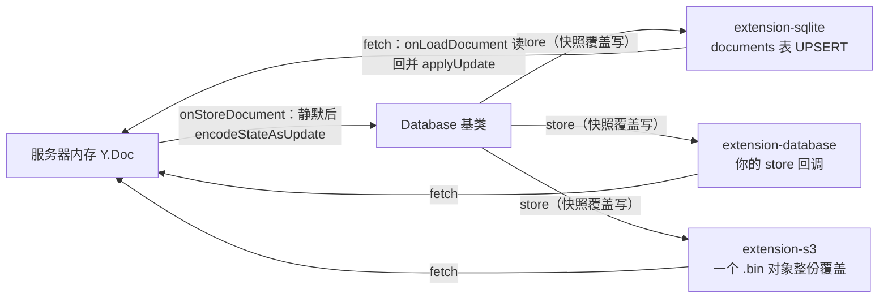

import { Meta } from '@storybook/addon-docs/blocks';

<Meta id="persistence-extensions" title="官方扩展/持久化扩展" name="Docs" />

# 持久化扩展

「自定义持久化」课讲清了落库的两个钩子与两种写入模型；本课回答下一个问题：**存到哪、用哪个官方扩展**。`extension-sqlite`、`extension-database`、`extension-s3` 三个扩展共享同一个基类 `Database`（来自 `@hocuspocus/extension-database`），本质都是替你写好的快照模式：`fetch` 在 `onLoadDocument` 时读回一份二进制，`store` 在编辑静默后收到整份 `Y.encodeStateAsUpdate` 的合并状态。三者的全部差异落在存储介质与驱动上——选型就是选介质。读完你应能预测：不传 `database` 的 SQLite 扩展重启后内容全丢；S3 里每个文档是一个 `.bin` 对象、每次落库整份覆盖；同时挂载两个持久化扩展不是二选一，而是各存一份快照。

版本基线为 Hocuspocus v4（4.7.x，要求 Node 22+）。本课的扩展都运行在 Node 服务端，Storybook 无法稳定复现运行时行为，因此不设内嵌实例：证据用配置清单、三扩展对照表与存储状态示意承载，关键行为均对照 v4 源码（`packages/extension-*`）与官方文档核实。工作区 `tester/server.js` 是 v3 写法（锁定 3.4.4），v3 差异处在 `extension-sqlite` 一节单独对照。



| 扩展 | 存储介质 | 行为模式 | 驱动依赖 | 适用场景 |
| --- | --- | --- | --- | --- |
| `extension-sqlite` | 本地 SQLite 文件（默认 `:memory:` 内存） | 快照覆盖写 | better-sqlite3（v4 起随包安装） | 本地开发、单机原型 |
| `extension-database` | 任意存储：自带客户端接 PostgreSQL、MySQL、MongoDB 等 | 快照覆盖写 | 无内置，自备驱动 | 把快照落进已有数据库 |
| `extension-s3` | S3 与 S3 兼容对象存储（MinIO、DigitalOcean Spaces 等） | 快照覆盖写 | @aws-sdk/client-s3（随包安装） | 生产环境、多实例共享存储 |

三个都是快照模式——增量 update 日志没有官方扩展，需要审计历史或消息队列对接时，回到 [自定义持久化](?path=/docs/custom-persistence--docs) 课的两个钩子自己组合。

## 快速上手

安装扩展与驱动（v4 起 better-sqlite3 是 `@hocuspocus/extension-sqlite` 的正式依赖，按官方指引显式装在项目根目录，便于版本对齐与出问题时的 rebuild）：

```bash
npm install @hocuspocus/extension-sqlite better-sqlite3
npm install -D @types/better-sqlite3
```

挂上扩展，传一个文件名：

```ts
// server.ts —— 最小落盘配置
import { Server } from '@hocuspocus/server';
import { SQLite } from '@hocuspocus/extension-sqlite';

const server = new Server({
  extensions: [
    new SQLite({
      database: 'db.sqlite', // 不传则默认 :memory:，重启即丢
    }),
  ],
});

server.listen();
```

连接 provider 随便编辑几个字，等落库防抖（默认静默 2 秒）过后，用 sqlite3 命令行观察存储状态：

```bash
sqlite3 db.sqlite "SELECT name, LENGTH(data) FROM documents"
```

```text
my-document|418
```

每次落库都是对 `documents` 表的一次 UPSERT 覆盖写：一行一个文档，`data` 列是整份 Yjs 二进制状态。启动时若忘传文件名，日志会给出黄色警告——`The SQLite extension is configured as an in-memory database. All changes will be lost on restart!`

## Database 基类

三个扩展都是 `Database`（`@hocuspocus/extension-database`）的子类，快照管线只有两步，对应 [自定义持久化](?path=/docs/custom-persistence--docs) 课的两个钩子：

- **读**：`onLoadDocument` 时调用 `fetch({ documentName })`，返回的 `Uint8Array` 被 `Y.applyUpdate` 应用到内存文档；返回 `null` 表示新文档。
- **写**：编辑静默后（Server 的 `debounce` / `maxDebounce` 防抖，v4 默认 2～10 秒，见 [Server 配置](?path=/docs/server-config--docs) 课）调用 `store({ documentName, state })`，其中 `state = Buffer.from(Y.encodeStateAsUpdate(document))`。

`Database` 自身的默认实现是 `fetch` 返回 `null`、`store` 空操作——只装 `extension-database` 而不实现这两个回调，等于没有持久化。`extension-sqlite` 与 `extension-s3` 做的事，就是把这两个默认值换成对应介质的具体实现：

| 扩展 | fetch 做什么 | store 做什么 |
| --- | --- | --- |
| `extension-sqlite` | 查 `documents` 表，`prepare().get()` 取 `data` 列 | UPSERT 覆盖 `documents` 表 |
| `extension-database` | 返回 `null`（由你实现） | 空操作（由你实现） |
| `extension-s3` | `GetObjectCommand`，404 返回 `null` | `PutObjectCommand` 覆盖写 |

与 2.4 课的分工：那节课解决「存什么、怎么恢复」（增量还是快照、二进制规则、恢复演练），本课解决「存到哪」。扩展只覆盖快照模式；配置量到几十行为止，超出它的边界（增量日志、消息队列、落库时附带动作）就回到钩子自己组合。

### extension-sqlite

零配置即可运行，但默认不落盘。配置项（对照 `packages/extension-sqlite/src/SQLite.ts`）：

| 选项 | 类型 | 默认值 | 说明 |
| --- | --- | --- | --- |
| `database` | string | `':memory:'` | 文件名落盘；`':memory:'` 匿名内存库；空字符串是匿名磁盘库（同样不持久） |
| `schema` | string | 见下方建表语句 | 建表 DDL，`onConfigure` 时 `db.exec` 执行 |
| `fetch` / `store` | 函数 | 基于默认表实现 | 换表结构时成对覆盖 |

默认建表语句——自建快照表照抄这个形状即可：

```sql
CREATE TABLE IF NOT EXISTS "documents" (
  "name" varchar(255) NOT NULL,
  "data" blob NOT NULL,
  UNIQUE(name)
)
```

两个贴着配置的边界：

- **`CREATE TABLE IF NOT EXISTS` 不是迁移。** 表已存在时这条 DDL 直接跳过，改 `schema` 不会给旧表加列、改列；要动已有表结构，自己跑 `ALTER TABLE`。
- **默认查询硬编码 `documents` 表。** 想换表名或加列，`schema`、`fetch`、`store` 必须一起覆盖，且 `fetch` / `store` 回调拿不到扩展内部的连接，要自备 better-sqlite3 句柄。绝大多数场景只传 `database` 就够了。

**从 v3 升级（对照 `tester/server.js`，锁定 3.4.4）。** `database` 选项名 v3 / v4 一致，tester 里的 `new SQLite({ database: 'db.sqlite' })` 原样可用；变化在驱动与查询写法：

| 维度 | v3（sqlite3 驱动） | v4（better-sqlite3 驱动） |
| --- | --- | --- |
| API 形态 | 回调式 `db.get(sql, params, callback)` | 同步 `db.prepare(sql).get(params)` |
| 绑定参数键名 | 带 `$` 前缀：`{ $name, $data }` | 不带前缀：`{ name, data }`（SQL 占位符 `$name` 本身不变） |
| 依赖来源 | 自行安装 sqlite3 | better-sqlite3 随扩展包安装 |

官方升级命令：

```bash
npm uninstall sqlite3
npm install @hocuspocus/extension-sqlite@^4.0.0 better-sqlite3
npm install -D @types/better-sqlite3
```

已有的 `.sqlite` 数据文件完全兼容，不需要迁移数据。

### extension-database

它不绑定任何数据库产品，也没有内置 ORM 或查询构造器：`fetch` 和 `store` 就是你写的两个 async 函数，客户端自备——PostgreSQL、MySQL、MongoDB 都行，只要返回 Promise。列类型等二进制落库细节见 [自定义持久化](?path=/docs/custom-persistence--docs) 课。

```ts
// server.ts —— extension-database：自带客户端的两个回调
import { Server } from '@hocuspocus/server';
import { Database } from '@hocuspocus/extension-database';
import { pool } from './pg'; // 任意驱动，示例用 pg

const server = new Server({
  extensions: [
    new Database({
      async fetch({ documentName }) {
        const { rows } = await pool.query(
          'SELECT data FROM documents WHERE name = $1',
          [documentName],
        );
        return rows[0]?.data ?? null;
      },
      async store({ documentName, state }) {
        await pool.query(
          'INSERT INTO documents (name, data) VALUES ($1, $2) ' +
            'ON CONFLICT (name) DO UPDATE SET data = $2',
          [documentName, state],
        );
      },
    }),
  ],
});

server.listen();
```

唯一硬规则：**`fetch` 必须返回当初 `store` 存进去的那份二进制，或 `null`**。返回现场构建的 Y.Doc（比如把存的 JSON 用 `TiptapTransformer.toYdoc` 转回文档）会生成全新历史，客户端增量合并时出现内容重复。JSON / HTML 快照只做查询视图，恢复真源保持二进制；互转工具见路线 7.1「数据转换」课。SQLite 场景不必绕这条路——`extension-sqlite` 就是官方写好的 SQLite 版 `fetch` / `store`。

### extension-s3

快照写进对象存储：每次落库对 `{prefix}{documentName}.bin` 做一次 `PutObjectCommand` 整份覆盖（Content Type `application/octet-stream`），没有增量对象；读取用 `GetObjectCommand`，对象不存在（404 / `NoSuchKey`）返回 `null`，即新文档的正常路径。默认 key 前缀为 `hocuspocus-documents/`：

```text
hocuspocus-documents/
├── my-document.bin      # 整份 Yjs 状态，每次落库覆盖
└── another-doc.bin
```

配置项（对照 `packages/extension-s3/src/S3.ts`）：

| 选项 | 类型 | 默认值 | 说明 |
| --- | --- | --- | --- |
| `bucket` | string | 无 | 必填，构造时缺失直接抛错 |
| `region` | string | `'us-east-1'` | AWS 区域 |
| `prefix` | string | `'hocuspocus-documents/'` | key 前缀，多环境用不同前缀隔离 |
| `credentials` | 对象 | 无 | `accessKeyId` + `secretAccessKey`；缺省走 AWS 默认凭证链 |
| `endpoint` | string | 无 | S3 兼容服务（MinIO、Spaces、Wasabi）的地址 |
| `forcePathStyle` | boolean | `false` | MinIO 等需要 `true`（path-style 寻址） |
| `s3Client` | S3Client | 无 | 传入自建客户端后，其余连接选项被忽略 |

AWS 上最小配置只有 `bucket`；凭证链依次尝试显式 `credentials`、环境变量（`AWS_ACCESS_KEY_ID` / `AWS_SECRET_ACCESS_KEY` / `AWS_REGION`）、EC2 / Lambda 的 IAM 角色。本地 MinIO 的完整形态：

```ts
new S3({
  bucket: 'hocuspocus-documents',
  endpoint: 'http://localhost:9000',
  forcePathStyle: true, // MinIO 必需
  credentials: { accessKeyId: 'minioadmin', secretAccessKey: 'minioadmin' },
})
```

启动即自检：`onConfigure` 会用 `HeadObjectCommand` 探测桶（探不到 `test-connection` 这个 key 属预期，不算错误），凭证加载失败给黄色警告，其余连接失败记为错误日志——桶名、region、IAM 配错在启动日志就能看到，不用等第一次落库。最小 IAM 权限：桶内对象的 `s3:GetObject` / `s3:PutObject` / `s3:HeadObject`，桶本身的 `s3:HeadBucket`。

多实例部署时 S3 常与 extension-redis 成对出现：Redis 管实例间实时同步，S3 做持久化真源，见「水平扩展」课（路线 6.3）。

## 组合挂载

多个持久化扩展同时挂载不会互相覆盖，也谈不上二选一。服务器对钩子的处理方式（对照 `packages/server/src/Hocuspocus.ts`）：

- 扩展按 `priority` 降序排序（缺省 100），`Server` 配置对象里的钩子排在最后；优先级相同时按 `extensions` 数组顺序执行。
- 同名钩子依次 `await`（promise 链），不是并行。
- `onLoadDocument`：每个 `fetch` 依次执行，返回的二进制按顺序 `Y.applyUpdate` 叠加到同一份文档。
- `onStoreDocument`：所有实现者都执行——挂 SQLite + S3 两个扩展，每次落库各写一份完整快照。

| 场景 | 实际行为 |
| --- | --- |
| 同时挂 `extension-sqlite` + `extension-s3` | 恢复时两次 fetch 依次叠加应用；落库时两边各存一份快照 |
| 扩展钩子与 Server 配置钩子同名 | 扩展先执行，配置钩子最后 |
| 某个 `fetch` 抛错 | 钩子链中断，该文档被销毁、其连接关闭 |
| 某个 `store` 抛错 | 文档留在内存防丢，下次编辑重新触发落库；抛 `SkipFurtherHooksError`（来自 `@hocuspocus/common`）表示「由我处理」，跳过后续 store 钩子，文档照常进入卸载流程 |

所以「主库 + 备份」「本地 + 云端」这类组合是天然支持的，但要有主从意识：两份快照来自同一份内存文档，内容一致；而任何一个 store 抛错都会让文档滞留内存——混合挂载前先读 [自定义持久化](?path=/docs/custom-persistence--docs) 课的混用规则。

## 最佳实践

- **开发用 sqlite，生产换 database / s3。** 三个扩展对外行为一致（同样的防抖、同样的快照语义），迁移只是换 `extensions` 数组里的一项，业务钩子不用动。官方对 `extension-sqlite` 的定位就是本地开发的最小配置；上生产选 `extension-s3`（托管对象存储）或 `extension-database`（复用已有数据库运维）。
- **凭证不进代码。** S3 优先用 IAM 角色，其次环境变量；`credentials` 明文对象只留给本地 MinIO 这类一次性环境。
- **S3 用 `prefix` 隔离环境，开版本化兜底覆盖写。** 每次落库都是 PutObject 覆盖，误删或误覆盖没有后悔药——桶版本化（Versioning）、生命周期策略与跨区域复制是官方建议的可靠性手段。
- **快照窗口与写放大是三扩展共用的取舍。** 默认最多丢 2～10 秒（`debounce` / `maxDebounce`），每次落库写整份文档；调参与增量混合方案见 [自定义持久化](?path=/docs/custom-persistence--docs) 课的最佳实践，本课不重复。

## 常见问题

- 重启服务器后所有文档消失，启动日志有黄色 in-memory 警告
  给 `SQLite` 的 `database` 传文件名（如 `db.sqlite`）。默认值 `:memory:` 是匿名内存库，句柄关闭即清空——「装了持久化扩展」不等于「落了盘」。
- 升级 Node 后启动报 `Could not locate the bindings file`
  better-sqlite3 的预编译二进制与当前 Node 版本不匹配，执行 `npm rebuild better-sqlite3 --build-from-source` 重建；需要 C++ 工具链（macOS 装 Xcode CLT，Debian / Ubuntu 装 build-essential，Windows 装 VS Build Tools）。
- 从 v3 带过来的自定义 `fetch` / `store` 启动即报错，或查不到数据
  驱动换了：sqlite3 的回调 API 改成 better-sqlite3 的 `prepare().get()` / `.run()`；绑定对象的键名去掉 `$` 前缀——`{ $name: documentName }` 改成 `{ name: documentName }`（SQL 里的 `$name` 占位符不用动）。
- S3 启动就有连接警告，或每次落库都失败
  先看启动自检日志，再依次核对：桶名与 region 是否匹配、凭证是否有效、IAM 是否含 `s3:GetObject` / `s3:PutObject` / `s3:HeadObject` 与 `s3:HeadBucket`；连 MinIO 超时基本是漏了 `forcePathStyle: true`。
- `extension-database` 恢复出的文档内容重复、历史错乱
  `fetch` 返回的不是当初存入的那份二进制（常见于现场用 transformer 把 JSON / HTML 转回 Y.Doc）。恢复真源必须是原样二进制；转换产物只做查询视图。

## 总结回顾

摘要：

三个官方持久化扩展是快照模式的现成封装：都继承 `@hocuspocus/extension-database` 的 `Database` 基类，在 `onLoadDocument` 里用 `fetch` 读回二进制、在防抖后的 `onStoreDocument` 里用 `store` 覆盖写整份 `Y.encodeStateAsUpdate` 状态，差异只在介质——`extension-sqlite` 落本地 SQLite 文件（v4 起驱动为 better-sqlite3，绑定参数去 `$` 前缀，默认 `:memory:` 必须传文件名才落盘）、`extension-database` 由你自带客户端实现两个回调（`fetch` 必须原样返回存入的二进制）、`extension-s3` 把每个文档覆盖写成 `{prefix}{documentName}.bin` 对象。多个扩展同时挂载时按 `priority` 降序依次执行，读叠加、写各存一份，没有互相覆盖。

一句话：

> 三扩展一个基类、一条快照管线，选型就是选介质；sqlite 给开发，database / s3 给生产。

知识要点：

- 三个扩展共享哪个基类？`fetch` 与 `store` 分别在哪个钩子时机被调用？
- `extension-sqlite` 的 `database` 默认值是什么？怎样才会真正落盘？
- v4 的 SQLite 扩展换了哪个驱动？自定义 SQL 的参数绑定要改什么？数据库文件要迁移吗？
- `extension-database` 的 `fetch` 为什么必须返回当初存入的同一份二进制？
- `extension-s3` 默认把对象写到哪个 key？连 MinIO 需要哪两个配置？
- 同时挂两个持久化扩展，恢复与落库各发生什么？执行顺序由什么决定？

## 参考资料

- [SQLite 扩展（官方文档）](https://tiptap.dev/docs/hocuspocus/server/extensions/sqlite)
- [Database 扩展（官方文档）](https://tiptap.dev/docs/hocuspocus/server/extensions/database)
- [S3 扩展（官方文档）](https://tiptap.dev/docs/hocuspocus/server/extensions/s3)
- [v4 升级指南（官方文档：SQLite 换 better-sqlite3 等破坏性变化）](https://tiptap.dev/docs/hocuspocus/getting-started/upgrade)
- [extension-sqlite SQLite.ts（v4 源码：配置默认值、建表与 UPSERT）](https://github.com/ueberdosis/hocuspocus/blob/main/packages/extension-sqlite/src/SQLite.ts)
- [extension-database Database.ts（v4 源码：fetch/store 管线）](https://github.com/ueberdosis/hocuspocus/blob/main/packages/extension-database/src/Database.ts)
- [extension-s3 S3.ts（v4 源码：key 命名、凭证与启动自检）](https://github.com/ueberdosis/hocuspocus/blob/main/packages/extension-s3/src/S3.ts)
- [Hocuspocus.ts（v4 源码：扩展 priority 排序与钩子链执行）](https://github.com/ueberdosis/hocuspocus/blob/main/packages/server/src/Hocuspocus.ts)
- [types.ts（v4 源码：Extension 接口的 priority 字段）](https://github.com/ueberdosis/hocuspocus/blob/main/packages/server/src/types.ts)
