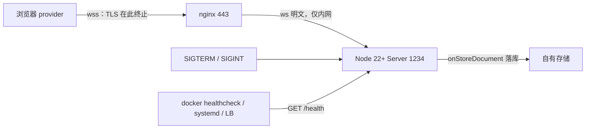

import { Meta } from '@storybook/addon-docs/blocks';

<Meta id="production-deploy" title="部署与扩展/生产部署" name="Docs" />

# 生产部署

生产环境里的 Hocuspocus 就是一个普通 Node 进程：拓扑是「客户端 → 反向代理（nginx）→ Node 进程」，持久化与监控都走常规 Node 运维。真正的特殊性只有一条——它承接的是**长连 WebSocket**：反向代理必须显式放行协议升级、放宽空闲超时；进程管理必须保证 `SIGTERM` 能到达进程并留足补落库时间；探活端点要自己在 `onRequest` 钩子里挂。本课按这条链路给出可直接复制的 nginx、Dockerfile、docker-compose 与 pm2/systemd 配置，以及每个默认值背后的判断依据。读完你应能预测：漏掉 `Upgrade` 头时握手拿到的是 200 而不是 101、空闲连接约 60 秒会被代理掐断、pm2 默认 1.6 秒宽限会在补落库之前就 `SIGKILL`。

版本基线为 Hocuspocus v4（4.7.x，要求 Node 22+）。v3 差异处以一句话标注。



部署清单与生产基线：

| 层 | 关键项 | 生产基线 | 本课落点 |
| --- | --- | --- | --- |
| 进程 | Node 版本 | Node 22+（`engines` 硬要求），镜像从 `node:22` 起选 | 进程管理 |
| 进程 | 关闭方式 | `SIGTERM` → `destroy()` 优雅关闭（默认接管信号） | 优雅关闭 |
| 代理 | WebSocket 升级 | 显式转发 `Upgrade` / `Connection` 头（hop-by-hop） | 放行 WebSocket 升级 |
| 代理 | 空闲超时 | `proxy_read_timeout` 默认 60 秒掐空闲隧道 | 空闲超时 |
| 端口 | 监听 | 进程绑高位端口（如 1234），443 留给 nginx；80 为特权端口 | 反向代理 |
| 持久化 | 未落库窗口 | 崩溃最多丢最近 2～10 秒（`debounce` ～ `maxDebounce`） | 优雅关闭 |
| 健康检查 | 端点 | v4 无内置 `/health`，用 `onRequest` 自挂 | 健康检查 |
| 日志 | 输出 | `quiet: true` + stdout 结构化日志，交给容器/journald 收集 | 健康检查 |

多实例与负载均衡不在本课展开：单实例先按本课跑稳，多实例同步与会话粘滞见「水平扩展」一课。

## 反向代理

nginx 对普通 HTTP 的默认配置不能直接代理 Hocuspocus：WebSocket 升级用的 `Upgrade` 与 `Connection` 是逐跳头（hop-by-hop），nginx 不会自动转发；升级成功后连接变成一条长驻隧道，空闲判定也不走普通请求的超时。这一节的三个配置点——升级头、空闲超时、TLS——就是「让隧道建立、保持、加密」的全部。

### 放行 WebSocket 升级

浏览器发起 `wss://` 连接时先发一个带 `Upgrade: websocket` 头的 HTTP 请求，服务器回 101 后同一端口切换为 WebSocket。nginx 只有在显式转发这两个头时才会跟随升级，并对 101 响应建立隧道：

```nginx
# /etc/nginx/conf.d/hocuspocus.conf
map $http_upgrade $connection_upgrade {
  default upgrade;
  ''      close;      # 客户端没带 Upgrade 头（普通 HTTP 请求）时按普通代理处理
}

server {
  listen 443 ssl;
  server_name collab.example.com;

  location / {
    proxy_pass http://127.0.0.1:1234;
    proxy_http_version 1.1;                  # 1.29.7 之前必须显式声明
    proxy_set_header Upgrade $http_upgrade;  # 逐跳头不会自动转发，必须显式 set
    proxy_set_header Connection $connection_upgrade;
  }
}
```

可核对行为：配置生效后，`curl -i -H "Upgrade: websocket" -H "Connection: Upgrade" -H "Sec-WebSocket-Key: dGhlIHNhbXBsZSBub25jZQ==" -H "Sec-WebSocket-Version: 13" https://collab.example.com`（示意）应看到 `101 Switching Protocols`；若返回 200 和欢迎文本，说明请求被当成了普通 HTTP——九成是漏了 `Upgrade` 头或 `proxy_http_version` 仍是默认的 1.0。

### 空闲超时：60 秒掐断的坑

这是 Hocuspocus 代理部署最高频的故障：隧道建立成功，但**后端连续 60 秒没有向客户端发任何数据**时，nginx 按默认的 `proxy_read_timeout` 关闭连接。现象是「用户挂机约一分钟后掉线重连」，而直连服务器端口不复现。

容易被 awareness 误导：provider 约 15 秒重播一次 awareness 状态，但这只是客户端 → 服务器方向的上行；`proxy_read_timeout` 看的是**服务器 → 客户端**的下行数据。单人浏览、无人编辑时下行没有广播，隧道照样在 60 秒被掐。处理动作按序：

```nginx
    proxy_read_timeout 3600s;   # 下行空闲上限：至少大于 Server 的 timeout（60 秒），按业务放宽
    proxy_send_timeout 3600s;   # 上行同理：禁用 awareness 的客户端会受这个默认值影响
```

判断依据：现象只出现在过代理的链路且间隔接近 60 秒，就是这两个默认值；调大后 nginx 无需重载文档，`nginx -s reload` 平滑生效。

### wss 与 TLS 终止

TLS 在 nginx 终止，到 Node 进程是内网明文 `ws`——这与鉴权无关：token 走的是 WebSocket 协议消息而不是 URL（见 [鉴权与上下文](?path=/docs/auth--docs) 课），代理不参与校验。浏览器对 `wss` 的证书校验与 `https` 一致，两个真实坑点：

- **证书链不完整**：只挂叶子证书、缺中间证书时，`https` 可能在部分环境侥幸可用，`wss` 握手直接失败。用 `openssl s_client -connect collab.example.com:443` 核对返回的证书链与 `Verify return code: 0`，配置里使用 fullchain 文件。
- **误以为 http2 影响 ws**：浏览器的 WebSocket 始终按 HTTP/1.1 Upgrade 协商，`listen 443 ssl http2` 不拦截它，无需为协同单独开虚拟服务器。

## 进程管理

进程层的三个问题：跑在什么镜像里、谁负责拉起与重启、停机时如何不丢数据。三者共同的锚点是 Node 22+ 与信号语义——镜像版本决定进程能不能跑，信号能不能到达决定优雅关闭会不会发生。

### Docker 镜像与 Compose

先核对一个事实：截至 v4（4.7.x），官方仓库 main 分支**没有提供应用镜像的 Dockerfile**——根目录 `docker-compose.yml` 只有一个 `redis:6-alpine` 服务，供 extension-redis 本地联调用（多实例场景见「水平扩展」一课）。生产镜像需要自建，两个要点：

- **基础镜像从 `node:22` 起选**：v4 的 server 包声明 `engines: node >= 22`，选 `node:22-bookworm-slim`（glibc，原生依赖兼容性稳）或 `node:22-alpine`（更小，musl 下原生依赖需重编译）。
- **`CMD` 用 exec 形式**：`CMD ["node", "dist/server.mjs"]` 让 node 直接作为容器的 PID 1，`SIGTERM` 直达进程；shell 形式 `CMD node dist/server.mjs` 会以 `/bin/sh` 为 PID 1，它不转发信号，10 秒宽限耗尽后 node 被 `SIGKILL`，优雅关闭形同虚设。

```dockerfile
# 构建阶段：装依赖并编译
FROM node:22-bookworm-slim AS build
WORKDIR /app
COPY package*.json ./
RUN npm ci
COPY . .
RUN npm run build        # 产出 dist/server.mjs

# 运行阶段：只带生产依赖与产物
FROM node:22-bookworm-slim
WORKDIR /app
ENV NODE_ENV=production
COPY package*.json ./
RUN npm ci --omit=dev
COPY --from=build /app/dist ./dist
EXPOSE 1234
# exec 形式：node 是 PID 1，SIGTERM 直达进程触发 destroy()
CMD ["node", "dist/server.mjs"]
```

配套 compose 的关键不是启动，而是内存限额与停机宽限：

```yaml
services:
  hocuspocus:
    build: .
    restart: unless-stopped
    ports:
      - "127.0.0.1:1234:1234"    # 只对宿主机开放，公网入口在 nginx
    environment:
      NODE_ENV: production
    mem_limit: 1g                # 限额必须给文档内存留余量，见「最佳实践」
    stop_grace_period: 30s       # docker stop 默认 10 秒，放宽给补落库留时间
    healthcheck:
      # slim 镜像没有 curl，用 Node 22 内置的 fetch 探活
      test: ["CMD", "node", "-e", "fetch('http://127.0.0.1:1234/health').then((r) => { if (!r.ok) process.exit(1) }).catch(() => process.exit(1))"]
      interval: 30s
      timeout: 5s
      retries: 3
```

可核对行为（示意）：`docker compose up` 后 `docker compose ps` 显示 `healthy`；`docker compose stop` 的日志里能看到 Server 的关闭输出先于容器退出完成。Hocuspocus 自己注册了信号处理，容器内无需额外 init 进程转发信号。

### pm2 与 systemd

裸机或虚拟机部署二选一。pm2 的默认值是给短请求服务设计的，对长连服务要显式放宽：

```js
// ecosystem.config.js
module.exports = {
  apps: [{
    name: 'hocuspocus',
    script: 'dist/server.mjs',
    // 默认 kill_signal 是 SIGINT（Server 也能优雅响应），显式写 SIGTERM 更贴合常规运维
    kill_signal: 'SIGTERM',
    kill_timeout: 10000,        // 默认 1600ms，1.6 秒经常不够补落库，超时后 SIGKILL
    max_memory_restart: '1G',   // 内存兜底；pm2 触发的重启同样走本表信号
    env: { NODE_ENV: 'production' },
  }],
};
```

systemd 的默认值反而贴合长连服务，写一个普通服务单元即可：

```ini
# /etc/systemd/system/hocuspocus.service
[Unit]
Description=Hocuspocus collaboration server
After=network-online.target

[Service]
User=hocuspocus
WorkingDirectory=/srv/hocuspocus
ExecStart=/usr/bin/node dist/server.mjs
Environment=NODE_ENV=production
Restart=on-failure
# 默认 KillSignal=SIGTERM、TimeoutStopSec=90s：对优雅关闭已经够用
# 不要用 root 跑：进程绑 1234 这类高位端口，80/443 留给 nginx

[Install]
WantedBy=multi-user.target
```

`Restart=on-failure` 在人为 `systemctl stop`（干净退出、退出码 0）时不会重启，只有异常退出才拉起。日志经 stdout 进 journald，`journalctl -u hocuspocus -f` 查看。

### 优雅关闭

机制本体在 [Server 配置](?path=/docs/server-config--docs) 课已核对过：`destroy()` 关闭监听、断开连接、把所有待落库文档立即补存（`flushPendingStores()`，对每个驻留文档立即执行被 `debounce` 推迟的 `onStoreDocument`，即使 `unloadImmediately: false` 也会在退出前落库）、等文档卸载后触发 `onDestroy`；`stopOnSignals` 默认接管 `SIGINT`/`SIGQUIT`/`SIGTERM`，`destroy()` 幂等，重复信号安全。生产部署只需要补一个判断——**宽限期预算**：

- 补落库不是从零存一遍，量级是「驻留文档数 × 单次存储 I/O 耗时」，正常秒级完成；
- 各层宽限期都要覆盖它：pm2 默认 1600ms 最紧，docker `stop` 默认 10 秒次之，systemd 默认 90 秒最宽；
- 宽限期耗尽后的 `SIGKILL` 会跳过补落库，丢掉 `debounce` 窗口内（默认 2～10 秒）的编辑——这与 `kill -9` 是同一条铁律，只是这里多了 OOM Killer 这个隐形触发者（见「常见问题」）。

对照本课配置：compose `stop_grace_period: 30s`、pm2 `kill_timeout: 10000` 都在给这条预算留余量。

## 健康检查

先接住一个核实过的结论：v4 **没有内置 `/health` 端点**（[安装](?path=/docs/install--docs) 课已验证）——所有普通 HTTP 请求进入 `onRequest` 钩子，没有钩子接管时统一返回 200 的 `Welcome to Hocuspocus!`。这意味着两层探活语义要分开：

- **进程探活**：默认欢迎响应已经能证明「进程活着、HTTP 层在监听」，TCP 探测或直接 GET 根路径即可，不必写代码；
- **服务探活**：要进一步确认协同服务可用（可带文档数等指标），用 `onRequest` 自挂端点。

### 用 onRequest 挂探活端点

v4 里 `onRequest` 与 `onUpgrade` 是仅有的两个仍用 Node 类型的钩子（`IncomingMessage`/`ServerResponse`），因为它们在 WebSocket 升级之前工作在 HTTP 层；其余钩子的 payload 已换成 web 标准 `Request`（v3 里所有钩子都是 Node 类型，差异见「从 v3 迁移」一课）。最小探活端点：

```ts
// server.ts —— 在 onRequest 里挂 /health，其余请求照常放行
import { Server } from '@hocuspocus/server'

const server = new Server({
  port: 1234,
  quiet: true,
  onRequest(data) {
    const { request, response, instance } = data
    // 只接管 /health：其余请求 resolve 放行，继续默认流程（欢迎响应）
    if (request.url?.split('?')[0] !== '/health') {
      return Promise.resolve()
    }
    response.writeHead(200, { 'Content-Type': 'text/plain' })
    response.end(`ok documents=${instance.getDocumentsCount()}`)
    // reject 阻断钩子链：响应已由本钩子写出，不再走默认响应
    return Promise.reject()
  },
})

server.listen()
```

可核对行为（示意）：`curl http://127.0.0.1:1234/health` 返回 `ok documents=3`；`curl http://127.0.0.1:1234/` 仍是 `Welcome to Hocuspocus!`。文档数随浏览器开关协同页面变化，可以当最粗粒度的内存水位读数。

### 探活的接入位置

同一个端点，三层消费方按需接入：

- **Docker healthcheck**：compose 示例里的 `healthcheck` 就是它，依赖 slim 镜像没有 curl 的事实改用 `node -e fetch`；
- **systemd 与裸机**：`onRequest` 与 WebSocket 同端口，无独立管理端口需要放行；外部拨测直接 GET `https://collab.example.com/health`；
- **负载均衡**：单实例阶段用不到；多实例时 LB 的健康检查决定摘除速度，注意探活通过不代表 WebSocket 隧道可用，摘除前还要等存量连接排空（见「水平扩展」一课）。

日志的落点也在进程层决定：生产用 `quiet: true` 关掉启动横幅，让业务日志走 stdout，交给 `docker logs` 或 journald 收集；`extension-logger` 观察协议消息流属于开发调试手段（见 [限流与日志](?path=/docs/throttle-and-logger--docs) 课），不要在生产常驻。

## 最佳实践

- **把停机时间预算当一张表算。** 未落库窗口上限是 `maxDebounce`（10 秒），补落库耗时是「文档数 × 存储 I/O」，各层宽限期必须盖过两者之和：pm2 默认 1600ms、docker `stop` 默认 10 秒、systemd 默认 90 秒、compose 用 `stop_grace_period` 显式覆盖。统一放宽到 30 秒量级最省心，代价只是滚动发布慢半分钟。
- **内存限额给文档驻留留余量。** 协同进程的内存 ≈ 驻留文档 × 文档大小 + 未落库窗口内的增量；`mem_limit` / `max_memory_restart` 压到贴着常态水位时，一次批量导入就可能触发 OOM Kill——它是不留补落库机会的 `SIGKILL`。限额之外配合 `/health` 的文档数与专项监控（见「性能与内存」一课）定位增长来源。

## 常见问题

- 过了 nginx 的客户端每隔约 60 秒掉线重连，直连服务器端口不复现
  把 `proxy_read_timeout`（必要时 `proxy_send_timeout`）调大到超过 `Server` 的 `timeout` 并覆盖业务空闲时长。依据：这两个默认值都是 60 秒，而 awareness 的约 15 秒重播只保上行，救不了下行空闲判定。
- 常规重启或发布后，用户反馈最近一两分钟的编辑丢失
  逐层核对宽限期：先确认停止路径发的是 `SIGTERM`/`SIGINT`（docker shell 形式 `CMD` 会吞信号、pm2 默认宽限只有 1.6 秒），再确认宽限期大于补落库耗时。判断依据：日志里没有 `onDestroy` 输出，就是进程没走完优雅关闭就被 `SIGKILL`。
- 容器反复 OOM Kill（`docker inspect` 看到 `OOMKilled: true`）
  不要只调大限额：先用 `/health` 的文档数与「性能与内存」一课的指标定位是文档驻留增长还是未落库积压。急迫处理是把 `mem_limit` 提到常态水位两倍以上；根因通常是 debounce 落库失败导致文档滞留内存（查存储回调的报错日志，见 [Server 配置](?path=/docs/server-config--docs) 课）。
- 浏览器报 `wss` 握手失败，但同域名 `https` 打开正常
  按序查两处：`curl -i` 带上 `Upgrade` 头请求，看返回的是 101 还是 200——200 说明代理漏转 `Upgrade`/`Connection` 头；再用 `openssl s_client -connect` 看证书链是否完整、是否用了 fullchain。证书链问题修复后无需动 Node 进程，TLS 终止在 nginx。

## 总结回顾

摘要：

生产部署 Hocuspocus 的拓扑是普通 Node 服务的拓扑，难点全部来自长连 WebSocket。反向代理一侧，`Upgrade`/`Connection` 是逐跳头必须显式转发，`proxy_read_timeout` 默认 60 秒会掐断下行空闲的隧道（awareness 只保上行，救不了它）；TLS 在 nginx 终止，证书用 fullchain，鉴权不受影响。进程一侧，官方不提供应用镜像，自建 Dockerfile 从 `node:22` 起选并用 exec 形式 `CMD` 保证 `SIGTERM` 到达；pm2 要放宽 `kill_timeout`，systemd 默认值即够用；`SIGTERM` 触发的 `destroy()` 会补落库再退出，各层宽限期要盖过「文档数 × 存储 I/O」的补落库耗时。健康检查没有内置端点，欢迎响应可探进程，`onRequest` 自挂 `/health` 可探服务并带出文档数；日志用 `quiet` + stdout 交给容器与 journald。

一句话：

> 代理放行升级、放宽空闲，进程收好 `SIGTERM`、留足宽限——这两件事做对，Hocuspocus 的生产部署就没有特殊之处。

知识要点：

- nginx 代理 WebSocket 必须显式配置哪几项？默认 60 秒掐断的是哪个方向的空闲？
- 为什么 `CMD` 必须用 exec 形式？shell 形式下 10 秒宽限结束后发生什么？
- pm2 与 systemd 的哪些默认值需要放宽或确认？各自的判断依据是什么？
- 优雅关闭的宽限期预算怎么算？`SIGKILL` 会丢掉什么？
- v4 如何做健康检查？`onRequest` 钩子的接管语义是什么？

## 参考资料

- [Server Hooks（官方文档：onRequest 用法与 Node 类型说明）](https://tiptap.dev/docs/hocuspocus/server/hooks)
- [Server Configuration（官方文档）](https://tiptap.dev/docs/hocuspocus/server/configuration)
- [Scalability Guide（官方文档：多实例分片与 extension-redis 入口）](https://tiptap.dev/docs/hocuspocus/guides/scalability)
- [nginx WebSocket proxying（官方文档：Upgrade 头与 60 秒空闲默认值）](https://nginx.org/en/docs/http/websocket.html)
- [docker-compose.yml（main 分支：官方仅提供 redis 联调服务）](https://github.com/ueberdosis/hocuspocus/blob/main/docker-compose.yml)
- [Server.ts（v4 源码：信号接管与 destroy 幂等关闭）](https://github.com/ueberdosis/hocuspocus/blob/main/packages/server/src/Server.ts)
- [Hocuspocus.ts（v4 源码：flushPendingStores 补落库）](https://github.com/ueberdosis/hocuspocus/blob/main/packages/server/src/Hocuspocus.ts)
- [PM2 Graceful Start/Shutdown（kill_signal / kill_timeout 默认值）](https://pm2.keymetrics.io/docs/usage/signals-clean-restart)
