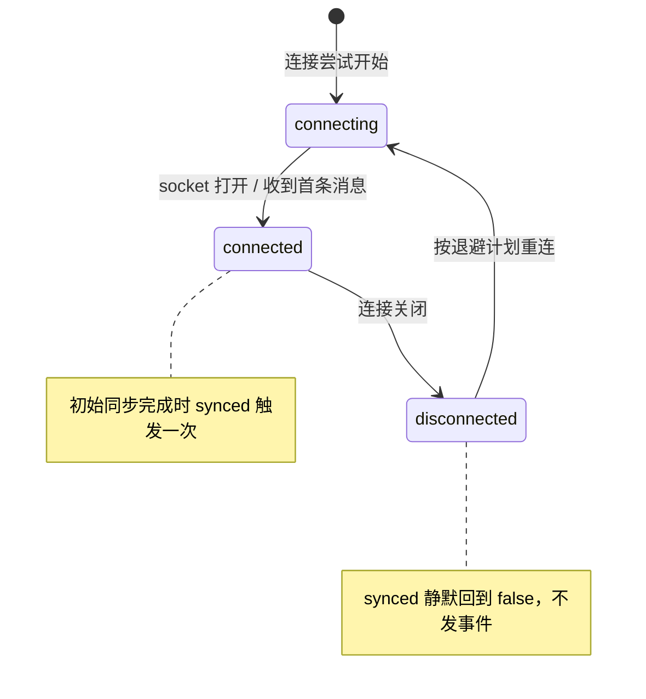

import { Canvas, Controls, Meta } from '@storybook/addon-docs/blocks';
import * as ProviderSim from './provider.stories';

<Meta of={ProviderSim} name="Docs" />

# HocuspocusProvider

provider 是浏览器这一侧的文档连接器：把一份 Y.Doc 接到服务器上的同名文档，管一条 WebSocket 的生死，把「链路」与「文档」两组信号用事件递给你。[第一个协同文档](?path=/docs/first-document--docs) 已跑通最小闭环，本课从 provider 自身的配置与事件全景展开，讲清三件最容易被混在一起的事：`status` 只回答链路通不通，`synced` 才回答文档就绪没有，`destroy()` 负责「人走带门」。读完你应能预测：服务器下线后控制台会按什么顺序打出事件、禁用 awareness 后挂机约 30 秒会发生什么、销毁前后的事件差异。

版本基线为 Hocuspocus v4（4.7.x，要求 Node 22+，仅约束服务端）；provider 的 v3 差异在正文以一句话标注。



配置分两层：provider 自身管「文档怎么接」，连接层 `HocuspocusProviderWebsocket` 管「socket 怎么连」。默认情况下 provider 自己创建并托管一条连接，所以两层配置都能写在 provider 的构造参数里。

| 配置项 | 默认值 | 用途与调整时机 |
| --- | --- | --- |
| `url` | `''` | 服务器 WebSocket 地址；末尾斜杠默认被裁剪，`preserveTrailingSlash: true` 可保留 |
| `name` | `''` | 文档名，即服务器上的房间标识 |
| `token` | `''` | 鉴权令牌；字符串、返回 string 或 Promise 的函数均可 |
| `document` | 内部 `new Y.Doc()` | 外部传入时多个 provider 可共享同一份文档，经 `provider.document` 访问 |
| `awareness` | `new Awareness(document)` | 在线状态实例；传 `null` 禁用会破坏保活，静默约 30 秒即被断开重连 |
| `websocketProvider` | 自动创建并托管 | 多文档共享一条连接时显式传入，见 [共享 WebSocket 连接](?path=/docs/shared-websocket--docs) 课 |
| `forceSyncInterval` | `false` | 设为毫秒数后周期性重发 sync step 1 对账，防静默丢更新 |
| `flushDelay` | `false` | 设为毫秒数后合批出站的 document / awareness 消息；`false` 表示每次变更立即发送 |
| `sessionAwareness` | `false` | 在文档名中嵌入唯一 sessionId，让同名连接互不串线；要求 v4 服务器 |

连接层配置只在 provider 自建 socket 时写在 provider 参数里（运行时整体透传）；显式共享连接时要写在 `HocuspocusProviderWebsocket` 上：

| 配置项 | 默认值 | 用途与调整时机 |
| --- | --- | --- |
| `WebSocketPolyfill` | 浏览器原生 `WebSocket` | Node 等没有原生 WebSocket 的运行时传入 `ws` 包 |
| `messageReconnectTimeout` | `30000` | 超过该毫秒数没收到服务器任何消息，客户端主动断开（close code 4408）并重连 |
| `delay` / `factor` | `1000` / `2` | 重连退避基数与倍数：1s、2s、4s…… |
| `minDelay` / `maxDelay` | `1000` / `30000` | 退避上下限；`jitter` 开启时在 `minDelay` 与当前延迟之间取随机值 |
| `jitter` | `true` | 给退避加随机抖动，防止大量客户端同一时刻重连 |
| `maxAttempts` | `0` | 重连次数上限，`0` 为无限重试 |
| `timeout` | `0` | 重连总期限（毫秒），`0` 为不限 |
| `onMaxAttemptsFailed` | `() => null` | 放弃重连时的回调；属连接层事件，不经 provider 转发 |

## 连接生命周期与事件

provider 的事件来自两层。**连接层**（`HocuspocusProviderWebsocket`）发出 `open`、`connect`、`status`、`disconnect`、`close`，再转发给挂在它上面的每个 provider——共享连接时，所有 provider 收到的是同一份连接层事件。**文档层**（provider 自己）发出 `synced`、`awarenessUpdate`、`stateless` 等。注册有双写法：构造参数 `onXxx`（构造时注册，不会晚到）与 `provider.on('事件名')`（可随时挂卸，配 `off` 解绑）。

| 构造回调 | `.on()` 事件名 | payload | 触发时机 |
| --- | --- | --- | --- |
| `onOpen` | `open` | `event` | WebSocket 连接创建时 |
| `onConnect` | `connect` | — | provider 成功连上服务器 |
| `onStatus` | `status` | `status` | 连接状态变化（见下节） |
| `onAuthenticated` | `authenticated` | `scope` | 认证成功，`scope` 为 read-write 或 readonly |
| `onAuthenticationFailed` | `authenticationFailed` | `reason` | 认证失败 |
| `onMessage` | `message` | `event`、`message` | 收到服务器消息 |
| `onOutgoingMessage` | `outgoingMessage` | `message` | 消息即将发出（调试协议流用） |
| `onSynced` | `synced` | `state` | 初始同步完成（见下节） |
| `onUnsyncedChanges` | `unsyncedChanges` | `number` | 未同步变更计数变化 |
| `onClose` | `close` | `event` | 连接关闭；v4 起 `event` 只有 `code` 与 `reason` |
| `onDisconnect` | `disconnect` | `event` | provider 断开连接 |
| `onAwarenessUpdate` | `awarenessUpdate` | `added`、`updated`、`removed` | awareness 状态更新（增删改的 clientID） |
| `onAwarenessChange` | `awarenessChange` | `states` | awareness 状态快照变化（做在线列表用） |
| `onStateless` | `stateless` | `payload` | 收到 stateless 应用层消息，见 [Stateless 消息](?path=/docs/stateless--docs) 课 |
| `onDestroy` | `destroy` | — | provider 销毁之前 |
| —（仅连接层） | `maxAttemptsFailed` | `error` | 重连次数用尽；绑定在 `HocuspocusProviderWebsocket` 上 |

事件全景的职责分工：`status` 与 `close` 回答「链路」，`synced` 回答「文档」，`awarenessUpdate` / `onAwarenessChange` 回答「人在不在」，`stateless` 承载协同之外的应用层消息，鉴权细节见 [鉴权与上下文](?path=/docs/auth--docs) 课。

### status：链路状态机

`status` 取值只有三个，发出时机全部在连接层：每次连接尝试开始发 `connecting`；socket 打开或收到首条消息时发 `connected`；连接关闭时发 `disconnected`。两个容易误判的地方：

- `status` 不校验文档名与鉴权结果。鉴权失败的连接也会先经历 `connected`，随后才被服务器以 close code 关闭——链路通不等于能用。
- 断开的原因要看 `close` 事件的 `code`：`4401` 未授权、`4403` 禁止访问、`4408` 静默超时（`messageReconnectTimeout` 到点）、`4205` 服务器主动重置、`1009` 单条消息过大。
- `disconnect()` 不直接产生 `disconnected`——它关闭 socket，由 close 事件带出状态变化；而 `destroy()` 连监听一起移除，之后不会再有任何事件。

v3 差异：v4 起 `close` 事件的类型只剩 `code` 与 `reason`（`target`、`type` 被移除），且 provider 不再从 `ws` 包 re-export `Event`、`MessageEvent`、`CloseEvent` 类型，需要时从 `@hocuspocus/common` 导入或用 Web 标准类型。这是 v3 到 v4 仅有的两条 provider 侧破坏性变化，tester/ 项目锁定的 v3 provider 构造参数写法在 v4 延续，回查时只需注意 `onClose` 的 payload 形态。

下面的实例按 v4 源码语义复现这台状态机（模拟语义：文档页内没有真实 WebSocket 服务器，这里用计时器扮演网络与服务器，事件名称与先后顺序与真实 provider 一致）：开关服务器可达性，观察事件时间线上 `connecting` 到 `connected` 到 `disconnected` 的流转、退避重连（1s 起、每次翻倍、封顶 30s）与恢复后的重新 synced。

<Canvas of={ProviderSim.StatusMachine} />
<Controls of={ProviderSim.StatusMachine} />

| 读者操作 | 可观察证据 |
| --- | --- |
| 初始加载 | 时间线依次出现 `status: connecting`、`status: connected`、`unsyncedChanges: 1`、`synced 事件` |
| 把「服务器可达」切到离线 | `status: disconnected` 与重连计划出现；等待中重连间隔逐次翻倍 |
| 切回在线 | 下一次重连成功：`connecting` 到 `connected`，随后重新 `synced` |
| 打开 Show code | 看到 `status-machine.ts` 中按 v4 源码顺序复刻的事件发出点 |

退避参数（`delay`、`factor`、`maxAttempts`、`jitter`）的调节与离线补传行为是独立主题，见 [断线与重连](?path=/docs/reconnection--docs) 课。

### synced：文档就绪信号

provider 用一个 `unsyncedChanges` 计数追踪「还有多少变更没和服务器对齐」：每次初始同步开始时计数被重置为 1 并发出 sync step 1，服务器回包（sync step 2）后计数归零，此刻 `synced` 变为 `true`——**并且只在 false 变 true 的那一刻触发一次 `synced` 事件**。连接关闭时 `synced` 静默回到 `false`（不发事件）；重连成功后会重走一次初始同步。

三个直接推论，都是实际会踩的位置：

- 判断「能不能安全读写文档」用 `provider.synced` 属性或 `synced` 事件，不要用 `status`；判断「内容有没有落库」看服务器的 `onStoreDocument` 钩子（见 [文档生命周期](?path=/docs/document-lifecycle--docs) 课），与 provider 无关。
- 晚于初始同步注册的 `on('synced')` 监听不会收到补发——事件只在状态变化时发出。晚挂载的场景（路由切换后重新接线）直接读 `provider.synced` 兜底。
- 怀疑两边中途漂移（长连接、弱网）时调 `provider.forceSync()` 主动对账；`forceSyncInterval` 就是它的定时版。

| 问题 | 该看什么 |
| --- | --- |
| 链路通了吗 | `status === 'connected'` |
| 文档就绪了吗 | `provider.synced === true` 或等 `synced` 事件 |
| 内容存下来了吗 | 服务器的 `onChange` / `onStoreDocument`，provider 侧无信号 |

## document 的归属

不传 `document` 时，provider 在内部 `new Y.Doc()` 并挂在 `provider.document` 上，生命周期由 provider 托管；传入自己的 Y.Doc 时，provider 只挂监听、不接管生命周期，多个 provider 可以共享同一份文档（例如同页多视图各自接线）。两种写法的选择就看一句话：文档归你管，还是归 provider 管。

与 Yjs 事务的关系只需一句：本地事务产生 update，provider 把它编码上行；从网络收到的 update 以 provider 为 origin 应用，不会再次上行——这条 origin 循环抑制规则在 [第一个协同文档](?path=/docs/first-document--docs) 课的实例里已演示，Yjs 事务本身属于 yjs 主题。

两个归属带来的边界：

- **默认每个 provider 一条连接。** 不传 `websocketProvider` 时，同页 N 个 provider（哪怕同名文档）默认是 N 条 WebSocket 与 N 份本地 Y.Doc。
- **销毁顺序是先 provider 后 document。** `document.destroy()` 会连带销毁挂在它上面的 awareness（y-protocols 源码行为），先销毁文档会让 provider 手里的 awareness 引用悬空。正确顺序：

```ts
provider.destroy();
ydoc.destroy();
```

## destroy 与清理

什么时候必须调 `destroy()`：SPA 路由切换或组件卸载、切换文档重新接入、测试用例收尾。整页关闭不需要手动调——v4 在 window 上注册了 `pagehide` 监听，页面隐藏时移除本地 awareness 状态并冲刷待发更新（源码注释：页面没了，等待发送的定时器永远不会触发）。

`destroy()` 按源码顺序做八件事，每一件都对应一种「不调就会漏」的资源：

1. 触发 `destroy` 事件；
2. 清掉 `forceSyncInterval` 的定时器；
3. 移除本地 awareness 状态（reason 为 provider destroy）并销毁 awareness 实例；
4. 冲刷缓冲中的待发更新（`flushDelay` 合批的内容此刻发出；socket 已关时由连接层安全排队）；
5. 解绑 document 的 update 监听；
6. 移除全部事件监听，并从连接层 detach；
7. 自建 socket 时一并 `destroy()` 它——清连接检查定时器、停掉在途重连、关闭 WebSocket；
8. 移除 window 上的 `pagehide` 监听。

不调用的泄漏表现：连接与重连定时器常驻（断网时反复重连一个已废弃的文档）；document 的 update 监听把废弃 provider 持续拉活收消息；window 上的 `pagehide` 监听随 provider 数量累积；awareness 清理不发生，对端要等状态过期才看不到你。

下面的实例对比两种销毁时机，并在销毁后让服务器离线一次：销毁过的 provider 对后续网络变化毫无反应，时间线在 destroy 之后不再出现任何 status 或 synced 事件。

<Canvas of={ProviderSim.DestroyTiming} />
<Controls of={ProviderSim.DestroyTiming} />

| 读者操作 | 可观察证据 |
| --- | --- |
| 选「连接进行中（立即）」 | 时间线上没有 `status: connected`，`synced` 停在 false：初始同步永远没完成 |
| 选「synced 之后」 | 先看到完整时序（connected、synced），再出现 destroy 清理序列 |
| 观察两种选择的时间线尾部 | destroy 之后仅有脚本的「服务器离线」提示，无任何 status 事件（读数恒为 0 条） |

React 项目不手动管理这套时序，provider-react 的 hooks 托管创建与销毁，一句话写法见 [React 集成](?path=/docs/react-integration--docs) 课。

## 最佳实践

- **三层信号分层使用。** 链路层看 `status`、文档层看 `synced`、落库看服务器钩子——把 `connected` 当「可以读写文档」用，是协同 UI 出现竞态读写的高发原因。
- **单页多文档先定连接拓扑。** 默认一 provider 一条 socket，适合文档数少、独立开关的场景；文档多且同开关时，显式建一个 `HocuspocusProviderWebsocket` 共享连接，把重连与鉴权收敛到一条链路（写法与取舍见 [共享 WebSocket 连接](?path=/docs/shared-websocket--docs) 课）。
- **销毁与宿主生命周期绑定。** provider 的创建与销毁放在同一段生命周期里（挂载建、卸载毁），销毁顺序先 provider 后 document；不确定时机时至少保证唯一入口，避免「每次渲染新建、从不销毁」的累积泄漏。

## 常见问题

- `status` 显示 `connected`，`synced` 却迟迟不来
  先查鉴权：服务器 `onAuthenticate` 拒绝时连接会被以 `4401` / `4403` 关闭，而 `status` 在此之前可能已经历过 `connected`。给 provider 挂 `onAuthenticationFailed` 与 `close` 看 `code`；再核对服务器日志，`onLoadDocument` 抛错也会让初始同步走不完（见 [鉴权与上下文](?path=/docs/auth--docs) 与 [文档生命周期](?path=/docs/document-lifecycle--docs) 课）。
- 后挂的 `provider.on('synced')` 回调再也不触发
  `synced` 事件只在 false 变 true 时发一次，晚于初始同步的监听没有补发。改读 `provider.synced` 属性判断，或调 `provider.forceSync()` 重新对账。
- 挂机约 30 秒后必被断开，控制台反复重连
  `messageReconnectTimeout`（默认 `30000`）内没收到服务器任何消息就强制断开（`4408`）重连。正常保活靠 awareness：其内部检查会让本地状态约每 15 秒重播一次，这条消息会刷新静默计时。把 `awareness` 设为 `null`、或自定义层吞掉了 awareness 消息，都会失去保活——恢复 awareness，或自行以低于 30 秒的节奏发消息。
- 同一页面多个 provider 用了同名文档，编辑总是「晚一拍」，断网时两端内容分叉
  默认每个 provider 各建一份 Y.Doc 与一条连接；同名只是让服务器把它们当同一房间，两份本地文档要经服务器往返才能一致，断网时静默分叉。要么把同一个 `document` 传给多个 provider，要么用 `HocuspocusProviderWebsocket` 共享连接（见 [共享 WebSocket 连接](?path=/docs/shared-websocket--docs) 课）。
- 组件卸载回调里刚 new 完就 `destroy()`，`synced` 永远不触发
  销毁会移除全部监听并拆除自建连接——初始同步还没完成，`synced` 自然不会来（上文实例的第一种选择）。把创建与销毁放回同一段生命周期，或等 `onSynced` 后再销毁；React 项目交给 provider-react 托管（见 [React 集成](?path=/docs/react-integration--docs) 课）。

## 总结回顾

摘要：

provider 的配置分两层——文档层（`url`、`name`、`token`、`document`、`awareness`、`forceSyncInterval`、`flushDelay` 等）与连接层（`WebSocketPolyfill`、`messageReconnectTimeout`、退避与抖动参数），默认 provider 自建并托管一条连接，两层配置都写在构造参数里。事件同样分两层：连接层发 `status`（connecting、connected、disconnected 三态）、`close`（v4 起只剩 code 与 reason）并转发给每个 provider，文档层发 `synced`、`awarenessUpdate`、`stateless` 等。`status` 只保证链路，`synced` 才保证文档就绪，它由 `unsyncedChanges` 计数归零驱动、只在变 true 时触发一次，晚挂的监听要用 `provider.synced` 属性兜底。保活依赖 awareness 的周期重播刷新 `messageReconnectTimeout`（默认 30 秒）的静默计时。`destroy()` 按固定顺序清空定时器、awareness、监听与自建连接，是 SPA 卸载时唯一可靠的收尾；销毁顺序先 provider 后 document。

一句话：

> `status` 只保证链路，`synced` 才保证文档；provider 用完必须 `destroy()`——定时器、awareness、监听与连接都只在销毁里拆。

知识要点：

- v4 的 provider 配置分哪两层？`awareness`、`websocketProvider`、`forceSyncInterval` 的默认值分别是什么？
- `status` 的三个取值分别由谁、在什么时机发出？为什么它不等于「文档就绪」？
- `close` 事件的 payload 在 v4 有哪些字段？`4401`、`4403`、`4408`、`1009` 各代表什么？
- `synced` 事件由什么机制驱动、为何只触发一次？晚注册的监听怎么办？
- awareness 与 `messageReconnectTimeout` 如何配合保活？禁用 awareness 会发生什么？
- `destroy()` 依次清理哪些资源？不调用会留下什么？provider 与 document 的销毁顺序是什么？

## 参考资料

- [Hocuspocus Provider 安装（官方文档）](https://tiptap.dev/docs/hocuspocus/provider/install)
- [Hocuspocus Provider 配置（官方文档）](https://tiptap.dev/docs/hocuspocus/provider/configuration)
- [Hocuspocus Provider 事件（官方文档）](https://tiptap.dev/docs/hocuspocus/provider/events)
- [HocuspocusProvider.ts（v4 源码：配置转发、synced 计数、destroy 顺序、pagehide）](https://github.com/ueberdosis/hocuspocus/blob/main/packages/provider/src/HocuspocusProvider.ts)
- [HocuspocusProviderWebsocket.ts（v4 源码：status 状态机、messageReconnectTimeout 检查、重连退避）](https://github.com/ueberdosis/hocuspocus/blob/main/packages/provider/src/HocuspocusProviderWebsocket.ts)
- [provider types.ts（v4 源码：WebSocketStatus 枚举与回调参数类型）](https://github.com/ueberdosis/hocuspocus/blob/main/packages/provider/src/types.ts)
- [CloseEvents.ts（@hocuspocus/common：CloseEvent 只有 code 与 reason，4401/4403/4408 常量）](https://github.com/ueberdosis/hocuspocus/blob/main/packages/common/src/CloseEvents.ts)
- [Upgrade to Hocuspocus v4（CloseEvent 形态缩减、ws 类型 re-export 移除）](https://tiptap.dev/docs/hocuspocus/getting-started/upgrade)
- [y-protocols/awareness（本地状态约 15 秒重播、30 秒过期——保活依据）](https://github.com/yjs/y-protocols)
