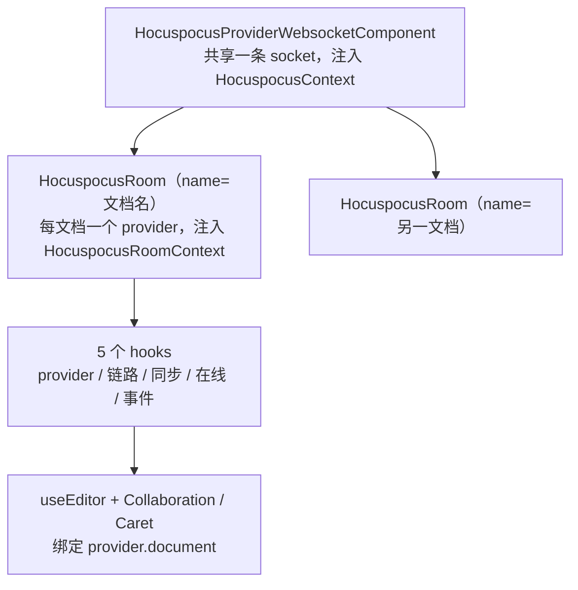

import { Canvas, Controls, Meta } from '@storybook/addon-docs/blocks';
import * as ReactIntegration from './react-integration.stories';

<Meta of={ReactIntegration} name="Docs" />

# React 集成

本课是手册中唯一以 React 写法为主体的课程。协同的数据链路不因框架改变：编辑器投影 Y.XmlFragment、provider 搬运 update、服务器汇流广播，这些在 [Tiptap 协同接入](?path=/docs/tiptap-setup--docs) 课已全部讲清。React 形态要回答的只有两个新问题：**provider 交给谁创建与销毁**（裸形态里组件作者自己扛，官方 `@hocuspocus/provider-react` 里交给两层 Context 组件树）；**provider 的事件信号怎么变成组件状态**（自己 useState 接事件，还是读封装好的 hooks）。读完本课你应能预测：切换文档名时哪个实例会重建、哪个不会；StrictMode 双重挂载后裸 provider 为什么会「死」而官方绑定能幸存；status 与 synced 各该从哪个 hook 读。

版本基线：`@hocuspocus/provider-react` 4.7.1（Hocuspocus v4 新增的官方包，peer 依赖 `@hocuspocus/provider` ^4.7.1、react ^18 || ^19）+ React 19 + Tiptap 3.x。v3 时代没有官方 React 绑定，工作区 tester/ 的裸 provider 写法正是 v3 形态；涉及版本差异时正文一句话标注。Tiptap 自身的基础（schema、扩展开发、编辑器命令）不在本课边界，编辑器协同接线细节见 5.1/5.2 课。



`@hocuspocus/provider-react` 的全部导出就这一张表，也是本课的回查入口：

| 导出 | 类别 | 职责与返回 |
| --- | --- | --- |
| `HocuspocusProviderWebsocketComponent` | 组件 | 创建（或接收）共享的 `HocuspocusProviderWebsocket` 并注入 Context；props 二选一：`url` 或 `websocketProvider` |
| `HocuspocusRoom` | 组件 | 按文档名创建并托管 `HocuspocusProvider`，注入房间 Context；全套 `on*` 事件 props |
| `HocuspocusContext` / `HocuspocusRoomContext` | Context | 两层注入的载体，应用代码一般不直接消费 |
| `useHocuspocusProvider` | hook | 返回当前房间的 provider 实例；必须在 `HocuspocusRoom` 内调用 |
| `useHocuspocusConnectionStatus` | hook | `'connecting' \| 'connected' \| 'disconnected'`，即 3.1 课的链路信号 |
| `useHocuspocusSyncStatus` | hook | `'synced' \| 'syncing'`，由 `unsyncedChanges` 计数驱动，即文档就绪信号 |
| `useHocuspocusAwareness` | hook | 在线用户数组（`clientId` + awareness 自定义字段），见 3.4 课 |
| `useHocuspocusEvent` | hook | 订阅任意 provider 事件，handler 身份变化不重挂订阅 |

## 两种接入形态

不管哪种形态，provider 的职责不变（连接、鉴权、重连与销毁清单见 [HocuspocusProvider](?path=/docs/provider--docs) 课），变化的是三件事：**实例由谁持有、销毁由谁负责、事件由谁翻译成状态**。裸形态把三件事全部交给组件作者；provider-react 把它们收进组件树。

### 裸 provider：useMemo + useEffect

不用 provider-react 时（v3 只有这条路，tester/ 现状即此），provider 建在组件里但必须「渲染期稳定」：

```tsx
function CollaborativePage() {
  // Y.Doc 与 provider 不能在渲染函数体里直接 new——每次渲染都会换实例
  const [ydoc] = useState(() => new Y.Doc());
  const [connectionStatus, setConnectionStatus] = useState('connecting');

  const provider = useMemo(
    () =>
      new HocuspocusProvider({
        url: 'ws://127.0.0.1:1234',
        name: 'example-document',
        document: ydoc,
        // 事件 → 状态要自己接（hooks 时代这步由 useHocuspocusConnectionStatus 代劳）
        onStatus: ({ status }) => setConnectionStatus(status),
      }),
    [ydoc],
  );

  // 销毁自己扛：先 provider 后 document（顺序依据见 3.1 课）
  useEffect(() => () => provider.destroy(), [provider]);
  useEffect(() => () => ydoc.destroy(), [ydoc]);

  // …编辑器与状态条
}
```

三个不可省的点：实例放进 `useState` 惰性初始化器或 `useMemo`（保证渲染期稳定）；销毁放在 `useEffect` 清理里且遵守先 provider 后 `document` 的顺序；每个要展示的信号都要手动 `on*` 回调加 `useState`。这套写法能跑通，但生命周期完全押在组件作者的纪律上——StrictMode、忘记销毁、双组件树都是它的雷区，逐条见「StrictMode 与生命周期」和常见问题。

### provider-react：两层 Context 组件树

官方绑定把 provider 收进两层组件：外层 `HocuspocusProviderWebsocketComponent` 管共享 socket，内层 `HocuspocusRoom` 按文档名托管 provider，创建与销毁都由组件树接管，hooks 在树下取用。

| 组件 | 关键 props | 行为 |
| --- | --- | --- |
| `HocuspocusProviderWebsocketComponent` | `url` 或 `websocketProvider`（二选一） | `url` 时自建 socket 并在卸载时销毁（内部用 ref 保证 StrictMode 下只建一次，卸载用延迟销毁）；传自建实例时不代管销毁，责任归调用方 |
| `HocuspocusRoom` | `name`（必填）、`document`、`token`、`sessionAwareness`、`flushDelay`、15 个 `on*` 事件 props | 挂载时创建 provider 并 attach，卸载时延迟销毁；`name`、`document`、`token` 变化时重建 provider，socket 不动 |

两个要点：socket 级选项（`maxAttempts`、`messageReconnectTimeout`、退避参数等）**不是组件 props**——需要时自己 `new HocuspocusProviderWebsocket` 传入，销毁责任随之归你；`on*` 事件 props 是「命令式」出口，官方推荐的状态读法是下一节的 hooks，两者可在同一棵树上混用（命令式做副作用，hooks 做展示）。

下面的实例在页内用 mock 服务器扮演传输层（文档页没有真实服务器，消息帧格式与处理顺序对应 v4 协议），渲染的是**真实的 provider-react 组件与 hooks**：三个指示灯分别读自 `useHocuspocusConnectionStatus` / `useHocuspocusSyncStatus` / `useHocuspocusAwareness`，左下读数取自 `useHocuspocusProvider`，右侧时间线汇集 socket 层与文档层事件。

<Canvas of={ReactIntegration.HooksDashboard} />
<Controls of={ReactIntegration.HooksDashboard} />

| 读者操作 | 可观察证据 |
| --- | --- |
| 初始加载 | 时间线依次出现 `status: connecting`、`status: connected`、`synced 事件`；「在线」显示 2 人（本机 + mock 服务器扮演的同事小李） |
| 在「本地编辑内容」输入文字 | 「同步」短暂变为「同步中…」后回到「已同步」：update 上行、服务器 SyncStatus 确认、`unsyncedChanges` 归零 |
| 把「服务器可达」切到离线 | 链路变「已断开」，时间线出现 `status: disconnected` 与按 1s、2s、4s 退避的重连尝试；「同事小李」因断线从在线列表移除 |
| 恢复在线 | 下一次重连成功后重新 `synced`，离线期间的编辑补传归零 |
| 切换「文档名」 | 时间线出现 `provider destroy`（旧实例让位）；「Provider 身份」变化（新 provider 新 Y.Doc），链路指示灯与 socket 实例不动；切回原文档时内容块从服务器恢复 |
| 开发服务下观察 StrictMode（默认开） | 挂载 effect 出现「挂载→清理→挂载」两轮，但时间线上没有 `provider destroy`：延迟销毁被取消，链路只走一轮 |

最后一行是本课最重要的机制证据，但它依赖 React 开发构建（`npm run storybook`）；静态生产构建里 StrictMode 不做双重调用，这一差异只在开发服务中可见。

## hooks 速查

5 个 hooks 共享同一个前提：都要求在 `HocuspocusRoom` 树内调用（内部从 `HocuspocusRoomContext` 取 provider，出了树直接抛错）。`useHocuspocusProvider` 只是读 Context；`useHocuspocusEvent` 用 effect 加稳定 ref 维护订阅；其余 3 个状态 hooks 都基于 `useSyncExternalStore`——订阅 provider 事件、渲染期读快照，并发渲染下不会读到撕裂状态。读法与 3.1 课的信号分层一一对应：链路读 connectionStatus、文档读 syncStatus、在线读 awareness。

### useHocuspocusProvider

返回当前房间的 provider，是其余 4 个 hooks 的地基。典型用途是把 provider 交给编辑器扩展、读 `provider.document`：

```tsx
function Editor() {
  const provider = useHocuspocusProvider();

  const editor = useEditor({
    extensions: [
      StarterKit.configure({ undoRedo: false }),
      Collaboration.configure({ document: provider.document }),
    ],
  });

  return <EditorContent editor={editor} />;
}
```

在 `HocuspocusRoom` 外调用会抛出 `useHocuspocusProvider must be used within a HocuspocusRoom`——把组件挪进 Room 的子树即可，不要绕过 Context 手动传实例。

### useHocuspocusConnectionStatus 与 useHocuspocusSyncStatus

两个指示灯各管一层，源码语义与 3.1 课完全对齐：

- `useHocuspocusConnectionStatus()`：快照直读共享 socket 的 `status`，取值 `connecting` / `connected` / `disconnected`。链路通不等于文档就绪——鉴权失败的连接也会先经历 `connected`。
- `useHocuspocusSyncStatus()`：订阅 `synced` 与 `unsyncedChanges` 事件，快照按 `provider.unsyncedChanges > 0` 映射为 `'syncing' | 'synced'`。断线期间本地继续编辑会让它停在 `syncing`，重连补传确认后归零——实例里「服务器可达」开关演示的就是这条。

```tsx
function StatusHeader() {
  const connection = useHocuspocusConnectionStatus();
  const sync = useHocuspocusSyncStatus();

  return (
    <header>
      <span>{connection === 'connected' ? '已连接' : connection === 'connecting' ? '连接中…' : '已断开'}</span>
      <span>{sync === 'synced' ? '全部已保存' : '保存中…'}</span>
    </header>
  );
}
```

### useHocuspocusAwareness

返回在线用户数组，每个元素含 `clientId` 与 awareness 里注入的自定义字段（如 `name`、`color`）。本机状态用 `provider.setAwarenessField` 注入（真实项目里由登录用户信息填充）：

```tsx
function PresenceBar() {
  const users = useHocuspocusAwareness();

  return (
    <div>
      {users.map((user) => (
        <span key={user.clientId} style={{ backgroundColor: user.color as string }}>
          {user.name as string}
        </span>
      ))}
    </div>
  );
}
```

awareness 的过期与重播机制（约 15 秒重播、30 秒过期）见 [Awareness 在线状态](?path=/docs/awareness--docs) 课；hook 内部已把快照按版本缓存，不会每次渲染都重建数组。

### useHocuspocusEvent

需要 hooks 清单之外的任意 provider 事件（鉴权失败、`close`、`stateless` 等）时用它。handler 存进 ref，订阅不随 handler 身份重建——不需要把回调包成 `useCallback`：

```tsx
function AuthGuard() {
  const navigate = useNavigate();

  useHocuspocusEvent('authenticationFailed', (data) => {
    // 认证失败：清掉本地凭据，回登录页
    clearToken();
    navigate('/login');
  });

  return null;
}
```

## useEditor 接线

编辑器协同的接线原则在 5.1/5.2 课已定：`undoRedo: false`、`Collaboration.configure({ document: provider.document })`、`CollaborationCaret.configure({ provider, user })`。React 侧只剩三条差异规则：

- **扩展集用稳定引用。** `useEditor` 只按 deps 数组判断是否重建，不比较选项对象——每次渲染新建 `extensions` 数组本身不会触发重建，但把它变成模块常量或 `useMemo`，deps 才能正确表达「扩展集变了才重建」的意图。
- **deps 数组决定编辑器生死。** `useEditor(options, deps)` 的 deps 变化会销毁并重建编辑器——焦点与光标丢失、Y.XmlFragment 重新投影。把渲染期不稳定的对象（每次内联新建的 `user` 等）放进 deps，是「编辑器莫名重置」的高发原因。
- **SSR 关闭即时渲染。** 服务端渲染传 `immediatelyRender: false`；不显式传入时，源码会在检测到 SSR / Next.js 的开发环境里兜底关闭并给出警告。

```tsx
// 模块级常量：与协同无关的静态扩展
const baseExtensions: Extensions = [
  StarterKit.configure({
    // Collaboration 自带撤销历史，StarterKit 的必须关（Tiptap 2 中叫 history）
    undoRedo: false,
  }),
];

// user 由上层用 useState 惰性初始化保持稳定（tester/ 的做法）
function CollaborativeEditor({ user }: { user: CollabUser }) {
  const provider = useHocuspocusProvider();

  // provider 来自 Context：只在换房间时变化，恰好是编辑器该重建的时机
  const extensions = useMemo(
    () => [
      ...baseExtensions,
      Collaboration.configure({ document: provider.document }),
      CollaborationCaret.configure({ provider, user }),
    ],
    [provider, user],
  );

  const editor = useEditor({ extensions }, [extensions]);

  return <EditorContent editor={editor} />;
}
```

另有一条 v3 专属差异：`useEditor` 默认 `shouldRerenderOnTransaction: false`，编辑器键入不再触发 React 重渲染（v2 是每个事务都重渲染）；需要把编辑器状态同步到 React UI 时用 `useEditorState` 做选择器订阅，而不是改回全量重渲染。

## StrictMode 与生命周期

provider-react 宣称 StrictMode 安全，机制在 4.7.1 源码里是两条：

- **socket 一次。** `HocuspocusProviderWebsocketComponent` 把自建 socket 存在 `useRef` 里——StrictMode 的双重渲染共享同一个 ref，实例只建一次；卸载时 `setTimeout(0)` 排定销毁，再次挂载的 effect 先 `clearTimeout` 取消它。
- **provider 延迟销毁。** `HocuspocusRoom` 卸载时不立即 `destroy()`，同样排定一个 `setTimeout(0)`；StrictMode 的「挂载→清理→挂载」里，第二次挂载会取消排定，provider 幸存、连接与监听原样保留。真卸载时排定的销毁照常执行。

对照裸 provider 在 StrictMode 下的死法：第一次清理**同步**执行了 `provider.destroy()`——监听全拆、连接关停；第二次挂载复用的还是 `useMemo`/`useState` 里的**已销毁实例**，没有重连逻辑会再拉起它，于是页面永远停在 `connecting`。修复路径按优先级：换 provider-react 组件树；或把 provider 提升到组件外（模块级/上层管理）；至少也要把销毁改成同样的延迟取消模式。tester/ 的入口（`main.tsx`）没有包 `StrictMode`，所以项目没暴露这条，一旦开启就会现形。

实例里的「StrictMode」开关展示的就是这一对照：开发服务下开着它，挂载日志两轮而 destroy 为零；关掉后挂载日志只剩一轮。

## 对照 tester/

工作区 tester/ 是 React 19 + Tiptap 3.19 + Hocuspocus **3.4.4** 的真实组合（`src/routes/CollaborativeEditor.tsx`），它的写法逐条对应到 v4 provider-react 形态：

| tester/ 现状 | provider-react 形态 |
| --- | --- |
| `useMemo` 创建 `HocuspocusProvider`，`useEffect` 清理里 `destroy()` | `HocuspocusProviderWebsocketComponent` + `HocuspocusRoom` 托管创建与延迟销毁 |
| `onStatus` 回调里 `setStatus` 接链路状态 | `useHocuspocusConnectionStatus()` 直接读 |
| `onSynced` 回调里准备 fragment、`useState` 驱动渲染 | Room 树内读 `provider.document`（synced 后的初始化语义见 5.1 课） |

顺带指出该文件里两处真实问题：给 Editor 传的 `content: '<p>开始协同编辑...</p>'` 会被 Yjs 投影覆盖而静默丢失（5.1 课的结论，这行在 tester 里不生效）；`Collaboration.configure({ provider })` 的 `provider` 是遗留参数，不参与绑定（v3 写法按 v3 对照阅读）。升级到 v4 + provider-react 的改动点就是上表两行；v3 到 v4 的服务端与钩子差异属于迁移主题，入口见 [从 v3 迁移](?path=/docs/v3-migration--docs) 课。

## 最佳实践

- **Context 放在应用根部或路由层。** `HocuspocusProviderWebsocketComponent` 只应出现一次；多个 `HocuspocusRoom` 兄弟并列，共享一条 socket。切文档改 `name` prop，不要手动 `destroy()` 再建。
- **socket 级选项自建实例时，销毁责任跟实例走。** 传了自建 `HocuspocusProviderWebsocket`，就要在同等生命周期里调它的 `destroy()`（停重连定时器、关连接）。
- **状态分层沿用 3.1 课。** 链路读 `useHocuspocusConnectionStatus`、文档就绪读 `useHocuspocusSyncStatus`、在线读 `useHocuspocusAwareness`、其余事件用 `useHocuspocusEvent`——不要把 `status` 当文档就绪用，也不要绕过 hooks 手写 `useState` + `on*` 的重复接线。
- **编辑器重建要显式。** `useEditor` 的 deps 默认留空加稳定引用；要重建时（换房间、换扩展集、换用户）把对应值写进 deps，别放渲染期新对象。需要编辑器状态进 React UI 用 `useEditorState`，不靠每个事务的全量重渲染。

## 常见问题

- 开发模式开启 StrictMode 后，页面永远停在「连接中」，或只有第一批事件
  裸 provider 已在第一次清理时被同步 `destroy()`，第二次挂载拿到的是销毁实例。换 provider-react 组件树，或把 provider 提到组件外持有；机制与延迟销毁的写法见「StrictMode 与生命周期」。
- 编辑器反复重建、光标与焦点频繁丢失
  `useEditor` 的 deps 数组里放了渲染期不稳定的对象——内联的 `user`、每次新建的数组或对象字面量。deps 只留真正要触发重建的值并用稳定引用（换房间的 `provider`、惰性初始化的 `user`）；没有重建需求时留空 deps。
- 服务器日志里同一文档出现成倍连接
  页面渲染了不止一棵组件树（比如多个页面各自包了一个 `HocuspocusProviderWebsocketComponent`），每棵树各建一条 socket。把它提升到根部共享；socket 级选项需求不同时改为共享一个自建实例传入。
- hooks 抛出 `must be used within a HocuspocusRoom`
  5 个 hooks 都从 `HocuspocusRoomContext` 取 provider，必须在 Room 子树内调用。把用到 hooks 的组件作为 `HocuspocusRoom` 的子级渲染，而不是试图在 Room 外通过其他方式取 provider。

## 总结回顾

摘要：

React 形态不改变协同链路：编辑器仍投影 `provider.document` 里的 Y.XmlFragment，update 仍由 provider 搬运。改变的是 provider 的持有方式与信号的订阅方式——官方 `@hocuspocus/provider-react`（v4 新增，4.7.1）用两层 Context 组件树接管生命周期：`HocuspocusProviderWebsocketComponent` 持有一条共享 socket（url 或自建实例二选一），`HocuspocusRoom` 按文档名托管 provider，`name`/`document`/`token` 变化即重建 provider 而 socket 不动；5 个 hooks（provider、链路、同步、在线、事件）全部要求在 Room 树内调用，内部用 `useSyncExternalStore` 把 3.1 课的事件分层翻译成组件状态。StrictMode 安全来自延迟销毁：卸载排定 `setTimeout(0)` 销毁、再挂载取消；裸 `useMemo` + `useEffect` 写法在 StrictMode 下会同步销毁实例导致永远连不上。编辑器侧 `useEditor` 的 deps 数组决定编辑器生死，扩展集用稳定引用；Tiptap 3 默认不再每个事务重渲染 React。

一句话：

> React 化只换掉 provider 的持有者与信号的订阅方式——provider 的创建销毁交给两层 Context 组件树，事件到状态交给 hooks，链路、文档、在线的分层语义原封不动。

知识要点：

- provider-react 的两层 Context 各注入什么？`HocuspocusProviderWebsocketComponent` 与 `HocuspocusRoom` 的关键 props 与行为分别是什么？
- 5 个 hooks 各返回什么值？分别对应 3.1 课的哪条信号？在 Room 外调用会怎样？
- 切换文档名时，socket 与 provider 各自发生什么？哪种状态该用哪个 hook 读？
- StrictMode 双重挂载下，provider-react 为什么能幸存、裸 provider 为什么会「死」？
- `useEditor` 的 deps 数组如何影响编辑器生命周期？哪些值不该放进去？
- tester/ 的裸 provider 写法对应 provider-react 的哪些改动点？

## 参考资料

- [Hocuspocus React Bindings（官方 provider-react 文档：组件、hooks 与 StrictMode 说明）](https://tiptap.dev/docs/hocuspocus/provider/react)
- [Collaborative editing（官方指南：React 一节的完整接线示例）](https://tiptap.dev/docs/hocuspocus/guides/collaborative-editing)
- [provider-react 源码（monorepo packages/provider-react：结构与导出）](https://github.com/ueberdosis/hocuspocus/tree/main/packages/provider-react)
- [HocuspocusRoom.tsx（v4 源码：provider 创建、name 变化重建、延迟销毁）](https://github.com/ueberdosis/hocuspocus/blob/main/packages/provider-react/src/HocuspocusRoom.tsx)
- [HocuspocusProviderWebsocketComponent.tsx（v4 源码：socket 一次创建与延迟销毁）](https://github.com/ueberdosis/hocuspocus/blob/main/packages/provider-react/src/HocuspocusProviderWebsocketComponent.tsx)
- [provider-react hooks 源码（useSyncExternalStore 订阅与快照实现）](https://github.com/ueberdosis/hocuspocus/tree/main/packages/provider-react/src/hooks)
- [Tiptap React 安装（useEditor / immediatelyRender / useEditorState）](https://tiptap.dev/docs/editor/getting-started/install/react)
- [useEditor 源码（deps 数组销毁重建编辑器的实现）](https://github.com/ueberdosis/tiptap/blob/main/packages/react/src/useEditor.ts)
- [Tiptap 性能指南（v3 起 shouldRerenderOnTransaction 默认 false）](https://tiptap.dev/docs/guides/performance)
- [Collaboration 扩展（undoRedo 必须关闭的依据）](https://tiptap.dev/docs/editor/extensions/functionality/collaboration)
