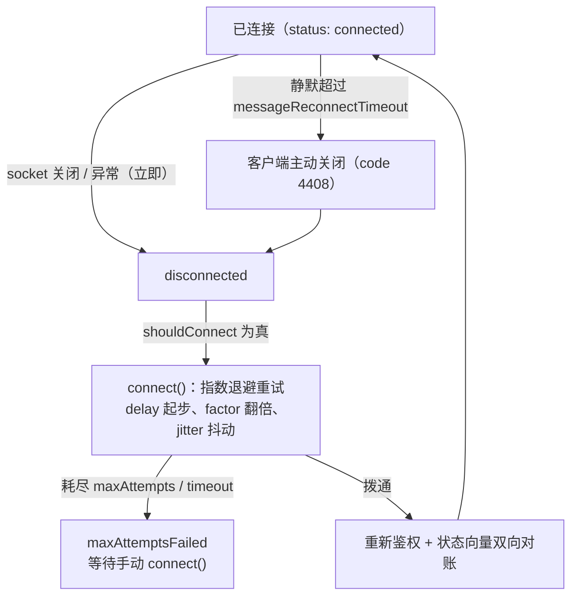
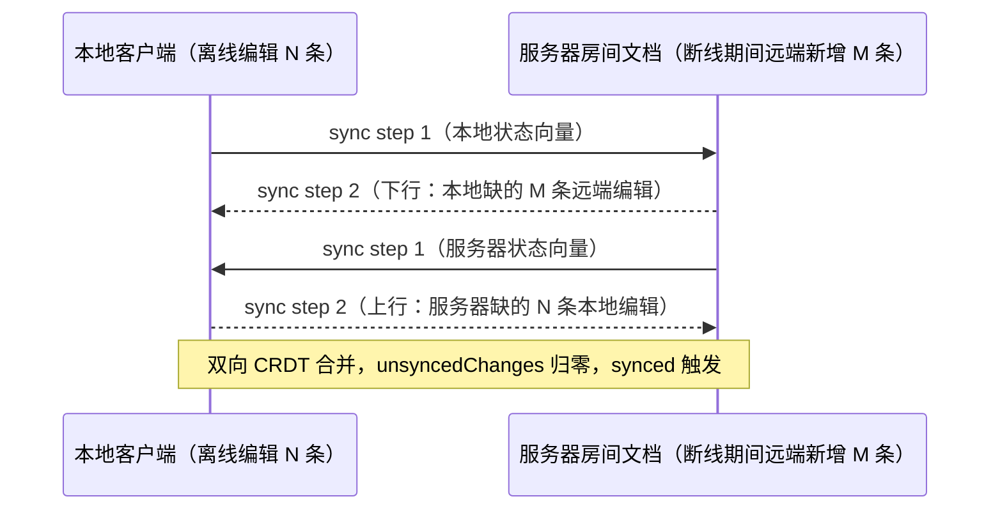

import { Canvas, Controls, Meta } from '@storybook/addon-docs/blocks';
import * as ReconnectionSim from './reconnection.stories';

<Meta of={ReconnectionSim} name="Docs" />

# 断线与重连

断线在协同编辑里不是异常而是常态：网络抖动、笔记本休眠、服务器重启都会打断链路。provider 的契约是——链路断了自动按计划重试；重试期间本地 Y.Doc 照常可编辑，编辑内容一条不丢；恢复连接后按状态向量双向对账补传，两端自动收敛。[HocuspocusProvider](?path=/docs/provider--docs) 课已讲过 status 状态机与事件时序，本课聚焦数据面三件事：断线怎么被发现、重连按什么节奏进行、断线期间的编辑如何补传。读完你应能预测：静默多久会被判死、重连间隔如何增长、恢复后内容怎样收敛、哪些操作会停止自动重连。

版本基线为 Hocuspocus v4（4.7.x）。服务端判活机制在 v4 有实质变化，v3 差异在正文一句话标注。



| 参数或机制 | 默认值 | 回查要点 |
| --- | --- | --- |
| `messageReconnectTimeout` | `30000` | 客户端静默上限：超过没收到**任何**消息就主动断开重连，检查每 `messageReconnectTimeout / 10` 跑一次 |
| `delay` / `initialDelay` | `1000` / `0` | 重试基础间隔（毫秒）与首轮附加延迟 |
| `factor` | `2` | 每次失败后间隔的倍率，指数退避 |
| `minDelay` / `maxDelay` | `1000` / `30000` | 退避下限与上限，`maxDelay: 0` 为不封顶 |
| `jitter` | `true` | 在 `minDelay` 与当前间隔之间取随机值，防集体同步重连 |
| `maxAttempts` | `0` | 单轮重试次数上限，`0` 为无限；耗尽发出 `maxAttemptsFailed` |
| `timeout` | `0` | 单轮重试总预算（毫秒），`0` 为不限 |
| 服务端 `timeout` | `60000` | 服务器空闲健康检查周期（v3 为 `30000`）；预鉴权阶段是从建连起的绝对截止时间 |

上表前七项是连接层 `HocuspocusProviderWebsocket` 的选项；provider 自建连接时（默认）可直接写在 provider 构造参数里，共享连接时写在 socket 上（见 [共享 WebSocket 连接](?path=/docs/shared-websocket--docs) 课）。

## 断线如何被检测

两条检测路径互补：传输层事件即时但不总可靠——半开连接（TCP 已死、浏览器还没抛 close）不会触发任何事件；应用层静默检查周期性兜底，最坏情形下 `messageReconnectTimeout` 加一个检查间隔内必然发现。v4 起服务端不再发应用层 Ping 探活（源码注释：空闲检查替代了应用层 ping/pong，仅为兼容旧版保留 Pong 应答路径），「链路活着」由消息本身定义——awareness 状态约每 15 秒重播一次，正常页面天然满足（禁用 awareness 的 30 秒陷阱见 [HocuspocusProvider](?path=/docs/provider--docs) 课）。

### socket 关闭与异常

网络抖动、服务器重启、代理切断都会触发底层 close/error。连接层立即把 status 发为 `disconnected`（3.1 课的状态机），并马上进入重连计划。客户端**不区分**「被服务器踢」与「网断了」——close 事件在 v4 只带 `code` 与 `reason`，处置方式相同：重连。原因判断与各 close code 的含义见下文「服务器主动断开」。

### 静默超时检查

`messageReconnectTimeout`（默认 `30000`）是客户端的自我检测：连接层每 `messageReconnectTimeout / 10`（默认 3 秒）跑一次检查，三种情况跳过——未连接、从未收到过消息、最近有消息；否则主动关闭连接走重连。连续检测未通过超过两次后，按 code 4408 强制终止（源码注释：规避 WebKit 不触发 close 事件的缺陷）。这个检查是半开连接的唯一兜底：界面长时间显示「已连接」却收不到任何更新时，最迟 30 秒出头就会被强制重连拉回正轨。

## 自动重连

### 退避与重试预算

链路断开后，只要 `shouldConnect` 仍为真（没调过 `disconnect()`、没 `destroy()`），连接层先安排一次延迟 `delay`（默认 1 秒）的重连尝试；`connect()` 内部用重试循环执行真正的预算：间隔从 `delay` 起步、按 `factor` 逐次翻倍，被 `minDelay` / `maxDelay` 夹紧，`jitter` 开启时取区间随机值；`maxAttempts` 限定单轮次数、`timeout` 限定单轮总预算（默认都是 0，即永不放弃）。中途调用 `disconnect()` 会立即中止在途重试。

单轮预算耗尽后，连接层发出 `maxAttemptsFailed`——它只在 socket 上触发、不转发给 provider（多文档共享的归属逻辑见 [共享 WebSocket 连接](?path=/docs/shared-websocket--docs) 课），此后不再自动尝试，恢复入口是手动 `connect()` 重启一轮。

### 重连成功后：重新鉴权与重新同步

每次 socket 打开——包括每一次重连——provider 都从头执行三步（`onOpen` 的源码顺序）：

1. 复位鉴权状态（`isAuthenticated = false`）；
2. `sendToken()`：token 配置为函数时会重新求值，重连即换新凭据，token 过期场景由此兜底；
3. `startSync()`：`unsyncedChanges` 重置为 1，发出 sync step 1（携带本地状态向量）与本地 awareness 状态。

服务器随后把客户端缺失的内容下行（sync step 2），并反过来请求自己缺的部分——双向补齐后 `unsyncedChanges` 归零，`synced` 事件触发一次（断开时它已静默回 false，3.1 课讲过）。重连的连接对服务器是全新接入，`onConnect` / `onAuthenticate` 重跑一遍（[鉴权与上下文](?path=/docs/auth--docs) 课的握手原样成立）。

重连期间的 status 序列与退避时间线已在 3.1 课实例演示，本课实例聚焦数据面。

## 离线编辑与补传

核心判断：**断线断的是链路，不是文档。** Y.Doc 是独立于连接的对象——socket 关闭期间本地编辑照常产生 update 并就地应用于本地文档，编辑器照常可写。provider 侧没有离线持久化队列：`flushDelay` 的合批缓冲在 socket 关闭时直接丢弃（源码注释：重连后的同步握手会按状态向量从文档中对账这些变更）——update 已经在 Y.Doc 里，丢缓冲不丢数据。

恢复后的对账是双向的状态向量交换：



三条推论：

- **补传是双向的。** 断线期间远端同事的编辑恢复后一次性下行，本地离线编辑一次性上行，合并顺序由 CRDT 规则确定收敛，不需要人工处理冲突。
- **对账入口可手动、可定时。** `forceSync()` 与 `forceSyncInterval` 走同一条状态向量对账路径（3.1 课提过），怀疑长时间连接中途漂移时主动触发。
- **内存兜底只到页面生命周期为止。** 刷新、关标签页、崩溃会连 Y.Doc 一起丢——补传管「断线期间」，不管「断电期间」。

下面的实例按真实同步协议语义模拟这条链路（模拟语义：文档页内没有真实 WebSocket 服务器，这里用三个 Y.Doc 扮演本地客户端、服务器房间与始终在线的远端同事，重连对账按状态向量双向交换复刻，断网为瞬时切换、不模拟退避等待）：制造断线、两侧各自编辑，观察恢复后一次对账如何双向补传并收敛。

<Canvas of={ReconnectionSim.OfflineCatchup} />
<Controls of={ReconnectionSim.OfflineCatchup} />

| 读者操作 | 可观察证据 |
| --- | --- |
| 初始加载 | 本地与服务器内容一致（初始同步），徽标为「已连接」 |
| 输入「本地编辑」或「远端同事编辑」 | 两侧内容同步更新，箭头显示实时上行 / 实时下行 |
| 把「链路状态」切到断网 | 徽标变为「自动重连中」，双向箭头变虚线中断 |
| 断网期间继续两侧输入 | 本地照常更新并计入「待上行」；远端编辑只落在服务器并计入「待下行」，两端内容分叉 |
| 切回「在线」 | 一次状态向量对账：最近补传显示上行 N / 下行 M，两侧内容重新一致 |
| 改用「disconnect()」断开再切回「在线」 | 断开期间徽标为「已停止重连」；恢复被记为手动 connect()，补传同样收敛 |
| 打开 Show code | 看到 `offline-catchup.ts` 中按状态向量双向对账的实现 |

### 与 y-indexeddb 的分工

provider 不管持久化。跨会话的离线留存交给 y-indexeddb：它把每条 update 即时写入 IndexedDB，页面重新打开时先灌回 Y.Doc，再由 provider 经上面的对账路径上行。官方 Offline support 指南的方案就是这一段接线：

```ts
import * as Y from 'yjs';
import { IndexeddbPersistence } from 'y-indexeddb';
import { HocuspocusProvider } from '@hocuspocus/provider';

const ydoc = new Y.Doc();
// 本地落盘：每条 update 即时写入 IndexedDB，刷新、离线、崩溃都不丢
const persistence = new IndexeddbPersistence('example-document', ydoc);
// 恢复在线后由 provider 对账补传，两者互不替代
const provider = new HocuspocusProvider({
  url: 'ws://127.0.0.1:1234',
  name: 'example-document',
  document: ydoc,
});
```

分工一句话：provider 管「断线期间的补传」，y-indexeddb 管「断电期间的留存」。编辑器侧的接入与合并语义是 [离线编辑与恢复](?path=/docs/editor-offline--docs) 课的主题。

## 强制断开与服务器断开

### disconnect() 与 connect()

`disconnect()` 的语义是「我主动下线，别再自动重连」，按连接层源码顺序做四件事：置 `shouldConnect = false` → 清掉在途重连定时器 → 关闭 socket → 清空待发消息队列。之后网络恢复也不会有任何自动尝试，恢复入口是显式 `connect()`。与 `destroy()` 的边界：`disconnect` 保留实例、文档与监听，随时可恢复；`destroy` 拆掉一切、不再有任何事件（3.1 课的八步清理）。`autoConnect: false` 则是构造时就不建连，等手动 `connect()`。共享连接时这对方法只在 `HocuspocusProviderWebsocket` 上（3.2 课讲过归属）。

### 服务器主动断开

服务器侧主动断开连接的来源（经 v4 源码核对）：

| close code | 常量 | 来源 |
| --- | --- | --- |
| `4408` | `ConnectionTimeout` | 空闲健康检查到点：超过 `timeout`（默认 60000）没收到任何消息 |
| `4205` | `ResetConnection` | 未鉴权消息队列超限、消息解码失败等连接重置 |
| `1009` | `MessageTooBig` | 单条消息超过上限 |

鉴权失败的常规路径不是 close，而是 PermissionDenied 消息（provider 发 `authenticationFailed`、连接保持），`4401` / `4403` 常量用于鉴权相关的致命路径；判断细节见 3.1 与 [鉴权与上下文](?path=/docs/auth--docs) 课。

服务端判活在 v4 有实质变化：以 `timeout` 为周期做空闲健康检查——鉴权前它是从建连起的**绝对**截止时间（入口流量刷不掉它，防止连接挂着不鉴权）；鉴权后转为空闲检查，靠客户端持续消息喂活（awareness 约 15 秒的重播即是）。源码注释明确这套检查替代了应用层 ping/pong。v3 差异一句话：v3 服务端 `timeout` 默认 `30000`，v4 提高到 `60000`（升级文档列在非破坏性变更中）。

被踢之后客户端的表现与网断完全一致：close → disconnected → 自动重连，重连连接对服务器是全新接入、重新走一遍鉴权。

## 最佳实践

- **两端超时一起规划。** `messageReconnectTimeout` 是客户端「多久收不到消息就自我了断」，服务端 `timeout` 是「多久没消息就踢人」；默认 30000 小于 60000，让客户端先于服务器发现断链、主动重连。调大客户端静默上限时两端一起动——只调客户端、调过服务端值，只会先被踢（4408）再重连，检测反而更慢。
- **弱网给重试设预算。** 桌面长连用默认 0 / 0（永不放弃）即可；移动端可设 `maxAttempts` 与 `timeout`，监听 socket 上的 `maxAttemptsFailed` 展示离线态与重试按钮，`connect()` 重启一轮。
- **按离线时长选持久化。** 秒级抖动靠自动补传即可；可能跨刷新、跨崩溃的离线（通勤、弱网长会话）一开始就接 y-indexeddb——丢过一次再补，代价远高于开头多一行接线。

## 常见问题

- 页面切后台或电脑休眠后再回来，界面显示已连接却迟迟收不到更新
  这是半开连接：TCP 已死但浏览器还没抛 close 事件。静默检查最迟在 `messageReconnectTimeout` 加一个检查间隔内强制断开并重连；系统休眠期间定时器停摆，唤醒后第一轮检查按时间戳对比即可发现静默超时，无需额外处理。等不及可在页面可见性恢复时机主动 `disconnect()` 再 `connect()`。
- 服务器一恢复，整批客户端同时涌进来，服务被打挂（重连风暴）
  保持 `jitter: true`（默认）：每端在 `minDelay` 与当前间隔之间取随机延迟，天然错峰；需要更长恢复窗口时调大 `maxDelay`。关闭 jitter 或自己写固定间隔重试，等于主动制造同步洪峰。
- 设置了 `maxAttempts`，重试耗尽后 provider 再也不连了
  这是预算机制的指定行为：单轮耗尽后发出 `maxAttemptsFailed`（只在连接层），之后不再自动尝试。在该回调里展示离线 UI，用 `connect()` 手动重启一轮；要「永不放弃」就保持默认 `maxAttempts: 0`。
- 断线期间调用了 `destroy()`，离线编辑还会补传吗
  不会。销毁会停掉在途重连并清掉全部监听——销毁即放弃补传，不存在「保存并同步」。离线编辑只存在于 Y.Doc：文档归你管时内容还在内存，接了 y-indexeddb 才真正落盘；要补传就等恢复同步完成后再销毁。

## 总结回顾

摘要：

断线由两条路径检测：传输层 close/error 即时触发，静默检查（`messageReconnectTimeout`，默认 30000，按其十分之一周期检查）为半开连接兜底。断开后只要 `shouldConnect` 为真就进入重连：延迟 `delay` 起步、按 `factor` 指数退避、`jitter` 抖动错峰，`maxAttempts` 与 `timeout` 构成单轮预算，耗尽发出 `maxAttemptsFailed` 并等待手动 `connect()`。每次重连成功，provider 重新执行鉴权与同步：token 重新求值、sync step 1 携带状态向量出发，断线期间的编辑经双向状态向量对账一次性补传、CRDT 合并收敛——provider 没有持久化队列，内容始终在 Y.Doc 里，这就是丢缓冲不丢数据的原因。`disconnect()` 主动断开并停止自动重连，`connect()` 恢复；服务器侧 v4 用空闲健康检查（默认 60000，v3 为 30000）替代应用层 ping/pong 判活，被踢与网断在客户端看来是同一件事。内存兜底只到页面生命周期为止，跨会话的离线留存交给 y-indexeddb。

一句话：

> 断线断的是链路，不是文档：本地 Y.Doc 照常可编辑，恢复连接后按状态向量双向对账、一条不丢；跨会话的留存才是 y-indexeddb 的事。

知识要点：

- 断线由哪两条路径检测？`messageReconnectTimeout` 的检查周期与三种跳过条件是什么？
- 重连间隔如何从默认值增长？`jitter`、`maxDelay`、`maxAttempts`、`timeout` 各管什么？
- 单轮重试耗尽后发生什么？`maxAttemptsFailed` 在哪里监听、如何恢复重连？
- 重连成功后 provider 依次做哪三件事？离线编辑靠什么机制双向补传？
- `disconnect()` 与 `destroy()` 的语义差别是什么？哪个之后还能 `connect()` 恢复？
- v4 服务端如何判活？默认多久断开空闲连接？与 v3 有何差异？
- provider 的补传兜底到什么时刻为止？跨会话离线靠什么、与本课机制的分工边界在哪里？

## 参考资料

- [Provider Configuration（官方文档：重连参数默认值、jitter 语义与 maxAttemptsFailed 的处理建议）](https://tiptap.dev/docs/hocuspocus/provider/configuration)
- [HocuspocusProviderWebsocket.ts（v4 源码：静默检查与 4408 强制关闭、attempt 重试与退避默认值、disconnect 清理）](https://github.com/ueberdosis/hocuspocus/blob/main/packages/provider/src/HocuspocusProviderWebsocket.ts)
- [HocuspocusProvider.ts（v4 源码：onOpen 重新鉴权与 startSync、关闭时丢弃合批缓冲的注释）](https://github.com/ueberdosis/hocuspocus/blob/main/packages/provider/src/HocuspocusProvider.ts)
- [ClientConnection.ts（v4 源码：空闲检查替代应用层 ping/pong、预鉴权绝对截止、ConnectionTimeout 终止）](https://github.com/ueberdosis/hocuspocus/blob/main/packages/server/src/ClientConnection.ts)
- [CloseEvents.ts（@hocuspocus/common：4401 / 4403 / 4408 / 4205 / 1009 关闭码常量）](https://github.com/ueberdosis/hocuspocus/blob/main/packages/common/src/CloseEvents.ts)
- [Server Configuration（官方文档：服务端 timeout 默认 60000 与空闲健康检查语义）](https://tiptap.dev/docs/hocuspocus/server/configuration)
- [Upgrade to Hocuspocus v4（服务端 timeout 30 秒到 60 秒、CloseEvent 缩减等升级差异）](https://tiptap.dev/docs/hocuspocus/getting-started/upgrade)
- [Offline support（官方指南：y-indexeddb 离线留存与恢复后自动同步）](https://tiptap.dev/docs/guides/offline-support)
- [y-protocols/awareness（本地状态约 15 秒重播——静默检查的保活依据）](https://github.com/yjs/y-protocols)
