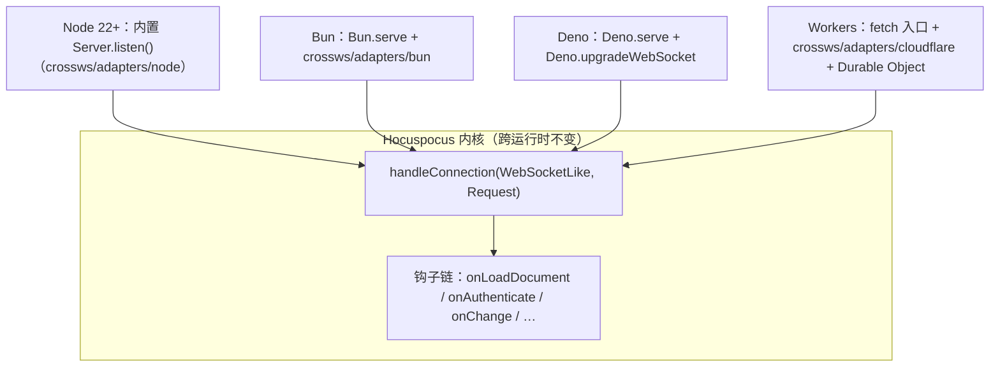

import { Meta } from '@storybook/addon-docs/blocks';

<Meta id="runtimes" title="部署与扩展/跨运行时" name="Docs" />

# 跨运行时

v4 把 Node 专用的 `ws` 库换成了 crossws——一个通用 WebSocket 适配器——之后，Hocuspocus 被拆成两层：内核 `Hocuspocus` 只认 `WebSocketLike`（`send` / `close` / `readyState` 三个成员）与 web 标准 `Request`，与运行时彻底解耦；内置 `Server.listen()` 只是官方在 Node 上写好的那份接线代码。于是同一份钩子与扩展配置，可以接到 Bun、Deno、Cloudflare Workers 的 WebSocket 入口上。**跨运行时是 v4 的新能力**：v3 绑定 Node 的 `ws` 库，没有这个选项。本课给出每个运行时经核实的入口写法、Workers 上 Durable Object 扮演的角色，以及一张逐项标注来源的能力/限制对照表。读完你应能预测：离开 Node 的改动全部集中在「接线层」而非钩子层；Workers 上内存驻留不可靠，持久化钩子从可选变成必选；`extension-sqlite` 这类原生模块扩展在 Workers 上直接不可用。



四个运行时的入口速查：

| 运行时 | 升级入口 | WebSocket 适配 | 状态 |
| --- | --- | --- | --- |
| Node 22+ | node:http 的 upgrade 事件 | 内置 Server 自带（crossws/adapters/node） | 默认形态，见「生产部署」课 |
| Bun | `Bun.serve` 的 fetch | `crossws/adapters/bun` | 官方示例（playground 与文档 examples 页同源） |
| Deno | `Deno.serve` 的 fetch | 原生 `Deno.upgradeWebSocket` | 官方示例（同上） |
| Cloudflare Workers | Worker 的 fetch 入口 | `crossws/adapters/cloudflare` + Durable Object | 官方声明支持；官方未给示例，写法依 crossws 文档整理 |

## 跨运行时模型

crossws 的职责只有一个：把各运行时五花八门的 WebSocket API 适配成统一的 `Peer` 与钩子（open / message / close / error）。v4 的解耦就落在这里——内核不再 import `ws`，`handleConnection` 只要求 `WebSocketLike` 三成员与 web `Request`（模型详见「接入现有服务器」课）。两个经源码核实的事实决定了本课的全部写法：

- **内置 `Server` 固定使用 Node。** `Server.ts` 顶部写死 `import crossws from "crossws/adapters/node"`，并基于 `node:http` 创建服务器——离开 Node 就不能用内置 `Server.listen()`，必须用 `Hocuspocus` 类自己接线。官方对此的表述：内置 `Server` 照旧只服务 Node 用户，其他运行时直接用 `Hocuspocus` 配合任意 `WebSocketLike` 调 `handleConnection()`。
- **钩子链本身跨运行时不变。** v4 钩子 payload 用 web 标准 `Request` / `Headers`；连接空闲超时用纯 JS 的 `setInterval` 检查最后活跃时间。这两样在 Bun、Deno、Workers 上都有等价实现，所以「文档生命周期」「鉴权与上下文」等课的全部钩子代码原样可用。

Node 之外还有个常被漏掉的变体：官方把 uWebSockets.js 列在支持列表里，它属于 Node 系（经 crossws 的 Node 适配器），不是独立运行时。

**什么时候值得离开 Node：** 边缘部署（Workers 把协同服务放到离用户近的位置）、低成本常驻（Bun 单二进制、内存占用低）、技术栈统一（全站已用 Bun/Deno）。反过来的理由同样具体：内置 Server 的信号接管与优雅关闭、完整的扩展生态（尤其原生模块与长连 TCP 依赖）、进程长命带来的文档内存驻留可靠性。判断的锚点是驻留模型——文档一直驻留在进程内存里，运行时越「短命」，持久化钩子就越必须是第一公民。

## 各运行时接入

三条接线共享同一副骨架，与「接入现有服务器」课的四件事完全一致：检查升级头 → 调 `handleConnection` → 转发 message 与 close → 处理活跃保活。差异只在升级入口和 WebSocket 适配层：

| 接线四件事 | Bun | Deno | Cloudflare Workers |
| --- | --- | --- | --- |
| 升级检查 | fetch 里看 `upgrade` 头 | fetch 里看 `upgrade` 头 | fetch 里看 `upgrade` 头 |
| 拿到服务端 WebSocket | crossws 的 open 钩子（经适配器） | `Deno.upgradeWebSocket` 返回的 socket | crossws 的 open 钩子（经适配器） |
| 转发 message / close | crossws 的 message / close 钩子 | socket 的 message / close 事件 | crossws 的 message / close 钩子 |
| 活跃保活 | crossws 心跳映射 Bun 原生 keepalive | 原生 keepalive 自动 pong | 无 WS 层 ping，靠 awareness 约 15 秒重播 |

下面的代码都把钩子换成一句 `onLoadDocument` 打日志做可观察信号：provider 连入后控制台出现 `[onLoadDocument] example-document`（示意），用「第一个协同文档」课的浏览器代码即可验证。

### Bun

官方示例用 crossws 的 Bun 适配器，`Bun.serve` 的 `websocket` 选项直接接适配器暴露的 handler，fetch 里分流升级请求：

```ts
// bun-server.ts —— 官方示例（playground/backend/src/bun.ts 与文档 examples 页同源）
// bun add @hocuspocus/server crossws && bun run bun-server.ts
import { Hocuspocus } from '@hocuspocus/server'
import crossws from 'crossws/adapters/bun'

const hocuspocus = new Hocuspocus({
  async onLoadDocument({ documentName }) {
    console.log('[onLoadDocument]', documentName)
  },
})

const ws = crossws({
  hooks: {
    open(peer) {
      // Bun 的 ServerWebSocket 是 Proxy：直接把 peer.websocket 传给内核，
      // 方法调用会因 this 绑定丢失而失败。官方示例改用 peer 自身的
      // send/close 包一层 WebSocketLike，readyState 仍从 peer.websocket 读。
      const wsLike = {
        get readyState() {
          return peer.websocket.readyState ?? 3 // 3 = CLOSED
        },
        send(data: any) {
          peer.send(data)
        },
        close(code?: number, reason?: string) {
          peer.close(code, reason)
        },
      }
      const clientConnection = hocuspocus.handleConnection(
        wsLike,
        peer.request as Request,
      )
      ;(peer as any)._hocuspocus = clientConnection
    },
    message(peer, message) {
      ;(peer as any)._hocuspocus?.handleMessage(message.uint8Array())
    },
    close(peer, event) {
      ;(peer as any)._hocuspocus?.handleClose({ code: event.code, reason: event.reason })
    },
    error(peer, error) {
      console.error('WebSocket error for peer:', peer.id, error)
    },
  },
})

Bun.serve({
  port: 8000,
  websocket: ws.websocket, // crossws 适配器实现的 Bun websocket handler
  fetch(request, server) {
    if (request.headers.get('upgrade') === 'websocket') {
      return ws.handleUpgrade(request, server) // 升级交给 crossws，之后走 open 钩子
    }
    return new Response('Welcome to Hocuspocus!')
  },
})
```

可核对行为（示意）：`bun run bun-server.ts` 后控制台输出 `Listening on ws://127.0.0.1:8000`，provider 连入时打印 `[onLoadDocument] example-document`。

两条边界：

- **保活由 crossws 心跳代劳**：crossws 的 `idleTimeout` 默认 30 秒，在 Bun 上映射为原生 WebSocket idle timeout（自动发 keepalive ping，标准客户端自动 pong）。内核自己的空闲超时（默认 60 秒，见「Server 配置」课）靠入站消息喂——awareness 本地状态约 15 秒重播一次即是（与「生产部署」课同源：y-protocols 以 30 秒过期时间的一半作为续播周期）；若客户端禁用了 awareness，参照内置 Server 的做法在 open 钩子里接 `touch()`。
- **没有内置信号接管**：`stopOnSignals` 是内置 Server 的选项。自己接线时自己监听：

```ts
// 进程模型与 Node 相同：退出前补落库再退（内置 Server.destroy 的等价动作）
process.on('SIGINT', shutdown)
process.on('SIGTERM', shutdown)
async function shutdown() {
  hocuspocus.closeConnections()   // 断开所有连接，触发 onDisconnect
  hocuspocus.flushPendingStores() // 立即执行被 debounce 推迟的 onStoreDocument
  process.exit(0)
}
```

### Deno

官方示例不用 crossws，直接用 Deno 原生的 `Deno.upgradeWebSocket`——Deno 的服务端 WebSocket 自带 `send` / `close` / `readyState`，天然满足 `WebSocketLike`，直传给内核：

```ts
// deno-server.ts —— 官方示例（playground/backend/src/deno.ts 与文档 examples 页同源）
// deno run --allow-net deno-server.ts
import { Hocuspocus } from '@hocuspocus/server'

const hocuspocus = new Hocuspocus({
  async onLoadDocument({ documentName }) {
    console.log('[onLoadDocument]', documentName)
  },
})

Deno.serve((req) => {
  if (req.headers.get('upgrade') !== 'websocket') {
    return new Response(null, { status: 501 }) // 普通 HTTP 请求直接拒绝
  }

  const { socket, response } = Deno.upgradeWebSocket(req)
  socket.binaryType = 'arraybuffer' // 关键：二进制帧以 ArrayBuffer 到达才能转 Uint8Array

  const clientConnection = hocuspocus.handleConnection(socket, req)

  socket.addEventListener('message', (event) => {
    clientConnection.handleMessage(new Uint8Array(event.data))
  })
  socket.addEventListener('close', (event) => {
    clientConnection.handleClose({ code: event.code, reason: event.reason })
  })

  return response
})
```

可核对行为（示意）：启动后 provider 连入打印 `[onLoadDocument] example-document`；不带升级头的 `curl http://127.0.0.1:8000` 得到 501。

三个要点：

- **`socket.binaryType = 'arraybuffer'` 不是可省的装饰**：漏掉它，`event.data` 不是 `ArrayBuffer`，`new Uint8Array(event.data)` 抛错，同步第一步就断。
- **依赖引入走 npm 兼容**：`@hocuspocus/server` 经 package.json 或 `npm:` 说明符引入即可，Deno 2 会装进 node_modules 并提供 node: 兼容。
- **退出清理用 `Deno.addSignalListener('SIGINT', …)`**，动作与上一节 Bun 的 `shutdown` 相同（`closeConnections` + `flushPendingStores`）。

### Cloudflare Workers

先接住核实过的官方状态：v4 的发布说明、文档 overview 与 usage 页都把 Cloudflare Workers 列入支持列表（「你可以把协同服务部署到边缘、跑在 Workers 上」），但官方文档与仓库**没有提供 Workers 示例**（已核对文档站全部页面清单与 playground 目录）。下面的写法按 crossws 官方 Cloudflare 适配器文档与 Hocuspocus 接线模型整理，标注为示意：

```ts
// worker.ts —— 依 crossws 官方 Cloudflare 适配器文档 + Hocuspocus 接线模型整理
import { DurableObject } from 'cloudflare:workers'
import { Hocuspocus } from '@hocuspocus/server'
import crossws from 'crossws/adapters/cloudflare'

const hocuspocus = new Hocuspocus({
  async onLoadDocument({ documentName }) {
    console.log('[onLoadDocument]', documentName)
  },
})

const ws = crossws({
  hooks: {
    open(peer) {
      const clientConnection = hocuspocus.handleConnection(
        peer.websocket as any, // Cloudflare 的服务端 WebSocket 天然满足 WebSocketLike
        peer.request as Request,
      )
      ;(peer as any)._hocuspocus = clientConnection
    },
    message(peer, message) {
      ;(peer as any)._hocuspocus?.handleMessage(message.uint8Array())
    },
    close(peer, event) {
      ;(peer as any)._hocuspocus?.handleClose({ code: event.code, reason: event.reason })
    },
  },
})

export default {
  async fetch(request, env, context) {
    if (request.headers.get('upgrade') === 'websocket') {
      return ws.handleUpgrade(request, env, context)
    }
    return new Response('Welcome to Hocuspocus!')
  },
}

// Durable Object：承载全部 WebSocket 连接与 pub/sub，角色见下文
export class $DurableObject extends DurableObject {
  constructor(state, env) {
    super(state, env)
    ws.handleDurableInit(this, state, env)
  }
  fetch(request) {
    return ws.handleDurableUpgrade(this, request)
  }
  webSocketMessage(client, message) {
    return ws.handleDurableMessage(this, client, message)
  }
  webSocketClose(client, code, reason, wasClean) {
    return ws.handleDurableClose(this, client, code, reason, wasClean)
  }
}
```

wrangler 配置要点（依 crossws 文档，默认绑定名与类名是 `$DurableObject`）：

```ini
# wrangler.toml
name = "hocuspocus-worker"
main = "worker.ts"
compatibility_date = "2024-09-23"        # 需 nodejs_compat：内核 import 了 node:crypto
compatibility_flags = ["nodejs_compat"]

[[durable_objects.bindings]]
name = "$DurableObject"
class_name = "$DurableObject"

[[migrations]]
tag = "v1"
new_classes = ["$DurableObject"]
```

**Durable Object 的角色——有状态文档驻留需要它。** 推理链有两环，都有官方出处：

- **平台侧（crossws 文档核实）**：不导出 DO 类或绑定不可用时，crossws 走 fallback 模式——每条连接是独立的 Worker 调用，**彼此拿不到对方的 socket**，连 pub/sub 都不支持。导出 DO 后，默认单一实例（名为 `crossws`）让全部连接落在同一个 DO 上，`peer.publish()` 天然全局可达；socket 还能以 hibernation API 挂在 DO 上——休眠期间 socket 存活、内存堆被回收。
- **内核侧（「文档生命周期」课的驻留模型）**：Hocuspocus 的 Y.Doc 驻留在实例内存，同一文档的所有连接必须命中同一份内存才能互相同步。这正好要求「所有连接落同一个 DO」——fallback 模式下两个用户各自命中一个随机 Worker，文档内存不共享，协同直接不工作。

**Workers 的限制逐条过：**

- **内存驻留不可靠，持久化钩子必选。** isolate 随时可能被驱逐；DO 休眠时 socket 虽然活着，内存堆会被回收。唤醒后的第一件事是重新 `onLoadDocument`——文档历史完全取决于外部存储里存了什么（落库方式见「自定义持久化」「持久化扩展」两课）。Node 上「重启最多丢 debounce 窗口（约 2～10 秒）」的预算（见「生产部署」课）在 Workers 上要按「随时驱逐」重新估计。
- **无文件系统、无原生模块。** `extension-sqlite` 依赖 `better-sqlite3` 原生插件，Workers 起不来；读文件、写本地 SQLite 的思路整体不适用，存储换成 Workers 原生的 D1 / KV / R2 / DO storage，经 `extension-database` 的 fetch / store Promise 接入。
- **CPU 与内存配额。** 内存上限每 isolate 128 MB，CPU 时间免费版 10 ms、付费版默认 30 秒（可调）——对「转发同步消息」这种轻活足够，但大文档初始化、批量合并要控制在这条线内。
- **没有优雅关闭。** Workers 没有 `SIGTERM`，「生产部署」课的信号与宽限预算概念整体不适用；数据安全的全部责任落在 `onStoreDocument` 的及时性上。

## 能力与限制对照

跨运行时选型的回查表，每一格都能追溯到来源：

| 能力 | Node 22+ | Bun | Deno | Workers | 依据 |
| --- | --- | --- | --- | --- | --- |
| 内置 `Server.listen()` | 可用 | 不可用 | 不可用 | 不可用 | Server.ts 写死 crossws/adapters/node 与 node:http |
| extension-sqlite（better-sqlite3 原生模块） | 可用 | 可用（N-API 插件；可改用 bun:sqlite） | 视版本（Deno 2 需 node_modules 并允许构建脚本） | 不可用 | 包依赖 better-sqlite3；Workers 不支持原生插件 |
| extension-database（fetch / store Promise） | 可用 | 可用 | 可用 | 可用 | v4 起是通用 Promise 接口，随你自备的存储客户端走 |
| extension-s3（aws-sdk v3 客户端） | 可用 | 可用 | 可用 | 未验证（SDK 有官方 Workers 接入示例，扩展本身未被官方覆盖） | 包依赖 @aws-sdk/client-s3 |
| extension-redis（ioredis 长连 TCP） | 可用 | 可用 | 可用（node:net 兼容，无官方示例） | 不可用（workerd 里没有 ioredis 用的持久 TCP） | 包依赖 ioredis；多实例同步见「水平扩展」一课 |
| extension-webhook / logger / throttle | 可用 | 可用 | 可用 | 可用（throttle 计数按 isolate/DO 各自独立） | 依赖只有 fetch 与控制台输出 |
| 文档内存驻留 | 进程长命，可靠 | 同 Node | 同 Node | 随时驱逐 / DO 休眠回收内存堆 | 内核驻留模型 + Workers 平台限制 |
| 优雅关闭（补落库后退出） | destroy() + 信号接管 | 自己接信号 | 自己接信号监听 | 概念不适用 | Server.ts 的 stopOnSignals / destroy |

## 最佳实践

- **内核与接线分文件。** 钩子、扩展配置是一份跨运行时代码，每个运行时只写一份薄接线入口（官方三个示例的公共结构正是如此）。迁移动作集中在接线层：换升级入口与 WebSocket 适配，内核一行不动。
- **上边缘之前先接持久化。** Workers 的驱逐与休眠让内存驻留从「缓存优化」变成「不可依赖」；先在 Node 或 Bun 上把 `onLoadDocument` / `onStoreDocument` 链路验证通，再上 Workers，最后把存储端换成边缘原生的 D1 / R2 / DO storage。
- **自己接线就没有信号接管。** 内置 Server 的 `stopOnSignals` 与 `destroy()` 补落库不会替你执行；Bun / Deno 上按本课代码补信号处理，别把「生产部署」课的优雅关闭预算当成免费能力。

## 常见问题

- 把 Node 侧的扩展配置原样带上 Workers，`wrangler deploy` 构建失败或运行时报原生模块错误
  按对照表逐项换成 Workers 可用的形态：`extension-sqlite` 换成 `extension-database` 的 fetch / store 接 D1 / KV / R2；`extension-redis` 在 Workers 上没有替代（多实例同步本来也不适用于 Workers 的单 DO 拓扑）。判断依据：`better-sqlite3` 是 N-API 原生插件、`ioredis` 要持久 TCP，两者在 workerd 里都没有实现路径。
- Workers 上重新部署（或 DO 休眠后唤醒）之后，用户反馈文档内容回到旧版本
  内存里的 Y.Doc 随 isolate 驱逐 / DO 休眠一起消失，唤醒后从存储重新加载——存储里缺的就是丢的。把 `onStoreDocument` 的落库目标接到外部存储并确认它在每次变更后真的执行；若历史数据没进存储，补做一次全量迁移。判断依据：丢的量级与 debounce 窗口、部署时点吻合，说明文档从未离开过内存。
- Bun 下连接刚建立就异常，或调用 WebSocket 方法报 `not a function`
  把 `peer.websocket` 直接传给了 `handleConnection`。Bun 的 `ServerWebSocket` 是 Proxy，跨对象调用会丢 `this` 绑定；按官方示例用 `peer.send` / `peer.close` 包一层 `wsLike` 再传入。
- Deno 下 provider 显示已连接但内容永不同步，message 处理抛错
  `socket.binaryType` 没设成 `arraybuffer`，二进制帧的 `event.data` 不能直接 `new Uint8Array(...)`。补上这一行即可——Yjs 同步消息全是二进制。
- Workers 部署时报 `node:crypto` 相关错误
  没开 Node 兼容：内核 import 了 `node:crypto`。在 wrangler 配置里把 `compatibility_date` 设到 `2024-09-23` 之后并加 `nodejs_compat`（`2026-08-04` 之后的新项目默认已开启）。

## 总结回顾

摘要：

v4 用 crossws 替换 `ws` 后，Hocuspocus 拆成「内核 + 接线」两层：内核只认 `WebSocketLike` 与 web `Request`，钩子链跨运行时不变；内置 `Server.listen()` 写死 Node 适配器，离开 Node 就按「接入现有服务器」的模型自己接线。Bun 用 `Bun.serve` 接 crossws 适配器（注意 ServerWebSocket Proxy 的 `wsLike` 包装）；Deno 用原生 `Deno.upgradeWebSocket` 直传（关键是 `binaryType = 'arraybuffer'`）；Workers 走 crossws 的 cloudflare 适配器加 Durable Object——DO 是有状态文档驻留的前提，fallback 模式下连接互相隔离、协同不工作。Workers 的边界要当成常态对待：无原生模块与文件系统、内存 128 MB、CPU 有配额、isolate 随时驱逐，持久化钩子因此必选，优雅关闭概念不适用；Bun / Deno 与 Node 同进程模型，退出前自己补 `closeConnections` + `flushPendingStores`。

一句话：

> 跨运行时的成本全在接线层与运行时能力边界：钩子代码一份走天下，持久化与原生依赖决定你能走到哪个运行时。

知识要点：

- v4 的跨运行时能力靠什么实现？内置 `Server` 在哪些运行时可用？
- Bun 接线为什么不能直接传 `peer.websocket`？官方的包装做法是什么？
- Deno 接线里哪一行决定二进制消息能否被处理？
- Cloudflare Workers 上为什么需要 Durable Object？fallback 模式下会发生什么？
- 对照表里哪些扩展在 Workers 上不可用，各自的判断依据是什么？
- Bun / Deno 上退出前的补落库动作是什么？Workers 上为什么没有等价概念？

## 参考资料

- [Server Usage（官方：跨运行时支持声明与 handleConnection 用法）](https://tiptap.dev/docs/hocuspocus/server/usage)
- [Server Examples（官方：Bun 与 Deno 接线示例原文）](https://tiptap.dev/docs/hocuspocus/server/examples)
- [Getting Started Overview（官方：Node / Bun / Deno / Workers 自 v4 起支持）](https://tiptap.dev/docs/hocuspocus/getting-started/overview)
- [Hocuspocus 4 稳定版发布说明（官方：crossws 替换 ws、部署到边缘的表述）](https://tiptap.dev/blog/release-notes/hocuspocus-4-stable-release)
- [RELEASE_NOTES_V4.md（仓库：跨运行时改造与应用层 Ping/Pong 说明）](https://github.com/ueberdosis/hocuspocus/blob/main/RELEASE_NOTES_V4.md)
- [playground/backend/src/bun.ts（官方 Bun 示例源码）](https://github.com/ueberdosis/hocuspocus/blob/main/playground/backend/src/bun.ts)
- [playground/backend/src/deno.ts（官方 Deno 示例源码）](https://github.com/ueberdosis/hocuspocus/blob/main/playground/backend/src/deno.ts)
- [Server.ts（v4 源码：内置 Server 写死 crossws/adapters/node、stopOnSignals 与 destroy）](https://github.com/ueberdosis/hocuspocus/blob/main/packages/server/src/Server.ts)
- [ClientConnection.ts（v4 源码：空闲超时实现、touch 语义、node:crypto）](https://github.com/ueberdosis/hocuspocus/blob/main/packages/server/src/ClientConnection.ts)
- [crossws Adapters（适配器总览与 idleTimeout 默认值）](https://crossws.h3.dev/adapters)
- [crossws Cloudflare 适配器（DO 导出、fallback 模式、休眠与 pub/sub）](https://crossws.h3.dev/adapters/cloudflare)
- [crossws Bun 适配器（websocket handler 与 idleTimeout 映射）](https://crossws.h3.dev/adapters/bun)
- [Cloudflare Workers Limits（128 MB 内存、CPU 配额）](https://developers.cloudflare.com/workers/platform/limits/)
- [Cloudflare Workers Node.js 兼容（nodejs_compat 标志与 node:crypto 支持）](https://developers.cloudflare.com/workers/runtime-apis/nodejs/)
- [extension-sqlite 文档（v4 起 better-sqlite3 依赖）](https://tiptap.dev/docs/hocuspocus/server/extensions/sqlite)
- [y-protocols awareness（outdatedTimeout 30 秒、约 15 秒续播周期）](https://github.com/yjs/y-protocols/blob/main/awareness.js)
