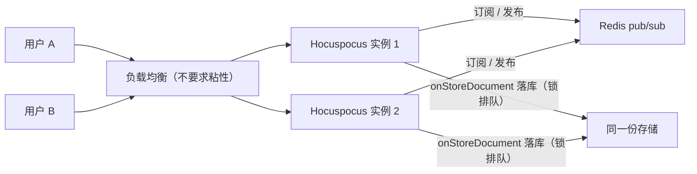
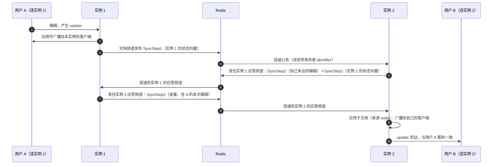

import { Meta } from '@storybook/addon-docs/blocks';

<Meta id="scaling" title="部署与扩展/水平扩展" name="Docs" />

# 水平扩展

单实例的 Hocuspocus 把所有文档放在一个进程的内存里；水平扩展就是让 N 台实例"看起来像一台"。官方给的构件是 `@hocuspocus/extension-redis`：所有实例连同一个 Redis，实例间用 pub/sub 互通消息——文档可以被任意实例加载，一条编辑经实例间同步收敛到一致，awareness 在线列表与 stateless 消息同样跨实例。它明确不做两件事：不减少 CPU（官方文档原话警告：每个实例都处理所有消息）、不负责存储（落库仍由每个实例自己的持久化钩子完成，扩展只加了一把跨实例互斥锁）。读完你应能预测：负载均衡不需要粘性会话（重连换实例只是加载稍慢，内容经 Redis 收敛）；一条编辑的 Redis 消息数随"驻留该文档的实例数"线性放大；多实例下"只有一台在落库、另一台静默"是设计行为而非故障。

版本基线为 Hocuspocus v4（4.7.x，要求 Node 22+）。v3 差异处以一句话标注。



extension-redis 的配置项与默认值（其余 ioredis 选项经 `options` 原样透传）：

| 选项 | 默认值 | 用途与回查要点 |
| --- | --- | --- |
| host / port | `127.0.0.1` / `6379` | Redis 连接地址，官方示例里显式写出 |
| prefix | `hocuspocus` | 全部键与频道的命名空间，结构见「频道与实例标识」 |
| identifier | `host-` 加进程内随机 UUID | 实例互滤消息的标记，保持默认，不要手写固定值 |
| lockTimeout | `1000` | 落库互斥锁的 TTL（毫秒），到期自动释放 |
| disconnectDelay | `1000` | 卸载前、本地写入落库后的等待（毫秒），给最后的实例间同步留时间 |
| awaitInitialSyncTimeout | `1000` | 加载文档时等待其他实例发来状态的毫秒上限；设为 `0` 关闭等待 |
| nodes / redis / createClient | 无 | Redis Cluster 节点数组 / 复用已有实例（duplicate 两条） / 自建客户端工厂；pub 与 sub 各需一条连接 |

## 单实例的边界

文档驻留在单个进程的内存里（缓存模型见 [文档生命周期](?path=/docs/document-lifecycle--docs) 课）：第一个连接触发加载，文档留在 `documents` Map，最后一个连接断开后卸载。单实例时"所有用户连同一台"是这个模型的隐含前提；水平扩展要解决的正是这句话——**任意用户连任意实例，都要看到同一份文档、同一个在线列表。**

装上 extension-redis 后，内存模型本身不变：文档依旧驻留内存，只是允许同时驻留在多台实例上，每台各持一份完整副本，靠 Yjs 的对称同步收敛成一致。由此可以读出扩展的能力边界：

- **不减少 CPU。** 官方 scalability 指南明说：每个实例都处理所有消息，Redis 相连的服务器不会降低单机负载。
- **不节省内存。** 每个驻留该文档的实例都持有一份完整副本。
- **不替代存储。** 扩展自己不落库，持久化仍走每个实例的钩子链（见「落库与锁」）。

它换来的是可用性形态：滚动发布或单实例故障时，用户只需重连到另一台，已落库的内容从存储恢复、未落库的内容从对端内存拉回，编辑不丢。如果瓶颈是 CPU 或内存，官方推荐的路线不是本扩展，而是按文档标识分片路由（见「最佳实践」）。

## 快速上手

最小闭环：两个实例连同一个 Redis，各挂一份持久化，两个浏览器连不同端口打开同一个文档名。

```ts
// server.ts —— server-1 与 server-2 唯一的差别是 name 与 port
import { Server } from '@hocuspocus/server'
import { Redis } from '@hocuspocus/extension-redis'
import { SQLite } from '@hocuspocus/extension-sqlite'

const server = new Server({
  name: process.env.NAME ?? 'server-1',
  port: Number(process.env.PORT ?? 1234),
  quiet: true,
  extensions: [
    // 两台实例必须连同一个 Redis；identifier 保持默认随机值
    new Redis({ host: '127.0.0.1', port: 6379 }),
    new SQLite({ database: './hocuspocus.sqlite' }), // 选型见「持久化扩展」课
  ],
})

server.listen()
```

```bash
# 本地 Redis：官方仓库根目录的 docker-compose.yml 就是一个 redis:6-alpine 服务
docker compose up -d redis

# 两个终端分别启动实例（验证阶段直连端口即可，不必先上负载均衡）
NAME=server-1 PORT=1234 node dist/server.mjs
NAME=server-2 PORT=1235 node dist/server.mjs
```

可核对行为（示意）：

- 两个浏览器分别连 `ws://127.0.0.1:1234` 与 `ws://127.0.0.1:1235` 打开同一个文档名，任一侧输入，另一侧约两次 Redis 往返内（毫秒级）出现同样内容；
- `redis-cli PUBSUB NUMSUB hocuspocus:example-doc` 返回 `2`——两台实例都已订阅该文档频道（这个命令也是扩展自己判断"有没有对端"用的）；
- 观察落库日志：同一时刻只有持锁的实例在写库，另一台静默跳过——不是故障，见「落库与锁」。

## 实例间同步

机制由四个构件组成，先建立整体模型再逐个展开：

- **文档频道** `prefix:文档名`——实例加载文档时订阅、卸载时退订，实例间的文档级消息都走它；
- **实例标识 identifier**——每条消息自带发布者标识，接收方丢弃自己的消息；
- **应答频道** `prefix#reply:identifier`——每实例一条，定向应答只发给请求方；
- **事务来源 `redis`**——从其他实例同步来的变更带这个来源，防循环、跳过落库。

### 频道与实例标识

扩展在构造时创建两条 ioredis 连接：pub 用于发布，sub 用于订阅（Redis 的订阅必须是独立连接，`createClient` 工厂因此会被调用两次）。三类键全部以 `prefix` 开头：

- 文档频道 `hocuspocus:example-doc`：该文档的公告与广播（SyncStep1 公告、awareness 更新、stateless 转发）都发在这里，订阅者是所有驻留此文档的实例；
- 应答频道 `hocuspocus#reply:host-xxxx`：实例进程启动即订阅、终身不变，差量、awareness 应答这类"只给请求方"的消息发往请求方的应答频道；
- 锁键 `hocuspocus:example-doc:lock`：落库互斥（见「落库与锁」）。

消息封装是 `[identifier 长度][identifier][Yjs 二进制]`：Redis 无法在订阅侧排除发布者自己，发布到文档频道的消息会被投递给全部订阅者（包括发布者），所以每条消息自带标识、各实例按 identifier 丢弃自己的消息——这也是 identifier 不能重复的原因。

### 一条编辑的跨实例路径

同步走的是 y-sync 的对称交换，不是单向转发。以实例 1 上的用户 A 编辑、实例 2 上有用户 B 为例：



三个要点：

- **对称交换一次带走双向差量。** 第 5 步里实例 2 回的不只是"应答"：它同时发来自己的状态向量请求，实例 1 把对方缺的内容（含刚发生的编辑）定向回写。两侧谁有对方没有的编辑，都会在这一来一回中互相补齐，Yjs 按 CRDT 合并出一致结果。
- **应答是定向的。** 差量发往请求方的应答频道而不是文档频道——SyncStep2 是按请求方的状态向量算的，带着完整的删除集，被无关实例听到会把它没见过的删除应用到自己从未有过内容上（仓库 issue #1151 记录的误同步，v4 用应答频道修复）。
- **不会循环。** 从其他实例同步来的变更以 `redis` 来源进入文档事务：`onChange` 里 `source` 为 `redis`（[文档生命周期](?path=/docs/document-lifecycle--docs) 课已核对的分派），扩展对这种来源直接返回不再发布，同步链到此为止。

同一轮事件循环内的多次编辑与 awareness 变化会合并成一次发布（SyncStep1 带的是文档当前状态向量，后一条覆盖前一条，无损）。

v3 差异：v3（3.4.x）的应答发回文档频道（所有实例都会处理别人的应答，即 #1151 的来源）、加载时不等待对端、事务来源是魔法字符串 `__hocuspocus__redis__origin__`；v4 改为实例专属应答频道、加载可等待、结构化来源，差异入口见 [从 v3 迁移](?path=/docs/v3-migration--docs) 课。

### 文档加载与初始同步

实例加载文档（第一个连接、或故障转移后的重连）时，扩展在 `afterLoadDocument` 里做三件事：

1. 订阅文档频道；
2. 向文档频道发布 SyncStep1（自己的状态向量）和 awareness 查询；
3. 若 `awaitInitialSyncTimeout` 大于 0 且 `PUBSUB NUMSUB` 显示还有其他订阅者，**阻塞加载**，直到某个对端把它的内存状态发到本实例的应答频道，或超时（默认 1000 毫秒）放行。

这保证了故障转移场景下第一个进来的用户能立即看到其他实例上未落库的编辑；冷加载（没有对端订阅）不做等待，不多花一毫秒。设为 `0` 恢复 v3 的 fire-and-forget 行为：加载立刻完成，对端状态晚一步到达。

### awareness 与 stateless 中继

- **awareness（在线状态，机制见 [Awareness](?path=/docs/awareness--docs) 课）：** 本实例上任何客户端的 awareness 变化经 `onAwarenessUpdate` 合并后，向文档频道广播一条 awareness 更新；其他实例把它应用进自己的 `document.awareness`，再广播给自己的客户端。加载时发出的 awareness 查询则让新实例立刻拿到全部在线状态。**在线列表因此跨实例成立**：任一实例上查询，都能看到所有实例上的用户。保活链路是"来源客户端约 15 秒重播 → 驻留实例 → Redis → 其他实例"；来源客户端断开时，驻留实例清除其状态并广播下线，各实例的在线列表随之清人。
- **stateless（应用层消息，见 [Stateless 消息](?path=/docs/stateless--docs) 课）：** `broadcastStateless` 触发 `beforeBroadcastStateless` 钩子后，扩展把 payload 以服务器内部 opcode 广播到文档频道；其他实例用 `relayStateless`（跳过该钩子的中继版）分发给自己的客户端。钩子只在发起实例触发一次，不会每台实例各响一遍。

### 落库与锁

先回答"谁负责落库"：**扩展不落库，落库的是每个实例自己的持久化钩子。** 规则有三层：

- **调度权在有真实写入的实例。** `redis` 来源的变更天然跳过存储钩子（`shouldSkipStoreHooks` 对 `redis` 返回 true），所以只有发生 connection / local 来源写入的实例会安排落库——通常就是握着客户端连接的那台。
- **锁保证同一时刻一个写者。** 扩展的 `priority` 是 1000（高于持久化扩展的默认 100），它的 `onStoreDocument` 先于你的落库钩子执行：先抢 `prefix:文档名:lock` 的 redlock（TTL 为 `lockTimeout`，默认 1000 毫秒）。抢到，你的持久化扩展照常落库；抢不到，扩展抛 `SkipFurtherHooksError`，本实例整条落库钩子链被**静默**跳过（不打印错误日志），文档照常走卸载判断——数据由持锁的那台安全写入。同一文档挂两个客户端在两台实例时，两台都会轮流调度落库，锁把它们排成串行；全量快照写法下两次都是当时的完整合并状态，增量写法下各存各自收到的 update、并集即全量（两种写法见 [自定义持久化](?path=/docs/custom-persistence--docs) 与 [持久化扩展](?path=/docs/persistence-extensions--docs) 课）。
- **同步优先于卸载。** 最后一个连接断开时，`beforeUnloadDocument` 把卸载推迟 `disconnectDelay`（默认 1000 毫秒），让最后的实例间同步跑完；DirectConnection 这类本地写入的 `afterStoreDocument` 也同样延迟，避免"写完就卸、对端还没拿到"。

因此**每个实例必须挂同一套持久化扩展、连同一个存储**——任何一台都可能成为某个文档的落库者。服务器优雅关闭时，扩展取消未决发布并断开 pub/sub 与 redlock 连接；停机顺序与宽限期见 [生产部署](?path=/docs/production-deploy--docs) 课。

## 负载均衡下的行为

### 粘性会话是否必需

**正确性上不需要。** 任何实例都能加载任何文档，用户被负载均衡分到哪台，改动都经 Redis 收敛到一致——不必为 Hocuspocus 配置 `ip_hash` 之类的会话粘滞。

无粘性时用户重连的完整路径：负载均衡把重连接到另一台实例 → 该实例加载文档（从存储恢复，再按 `awaitInitialSyncTimeout` 从对端拉回未落库内容）→ provider 与新实例做初始同步、补发离线增量（补传语义见 [断线与重连](?path=/docs/reconnection--docs) 课）。用户的感知是这次重连稍慢（多一次存储加载，至多等 1 秒对端同步），不是内容回退。

仍然必需的是反向代理三件事——Upgrade 头、空闲超时、TLS 终止——多实例只是把「生产部署」课里的后端从 1 台换成 N 台。多一台要管理的还有：LB 摘除实例前，存量 WebSocket 连接要等排空，探活通过不等于隧道可用。

### 转发放大

一条编辑的 Redis 消息量（估算）：

- 写入实例向文档频道发布 1 条 SyncStep1 公告（Redis 投递给全部订阅者，含发布者自己，按 identifier 丢弃）；
- 每个驻留该文档的其他实例各回 1 条定向应答；
- 写入实例再对每个对端各回 1 条定向差量。

合计约 `1 + 2(N-1)` 条（N 为驻留该文档的实例数），awareness 变化每轮另加 1 条频道广播（同轮合并），首次加载另有每个对端一条 awareness 应答。关键结论：**放大系数由驻留实例数决定，不是在线用户数**——每个订阅了文档频道的实例都参与应答与回写，哪怕它此刻一个客户端都没有。

这笔账加上"每台各持一份内存副本"，就是官方那句"Redis 相连不降低 CPU"的机制解释：扩展买的是"任意实例可服务任意文档"的可用性，付出的成本随驻留实例数增长。

## 最佳实践

- **先选路线再装扩展。** 官方 scalability 指南给出两条互斥的判断：瓶颈是 CPU 或内存 → 部署多台独立实例，按文档标识把同一文档的用户路由到同一台（普通哈希路由即可，不需要本扩展，天然零放大）；诉求是高可用、滚动发布不掉编辑 → extension-redis。装了扩展再想省 CPU，方向就错了。
- **identifier 保持默认，prefix 按部署隔离。** identifier 手写成相同值会让实例互相丢弃消息（静默不同步）；两套部署共用一个 Redis 又共用默认 prefix，同名文档会跨部署合并、落库锁互抢。
- **实例配置保持同构。** 每台挂同一套持久化扩展、连同一个存储、连同一个 Redis；扩展的 `priority` 不用动（Redis 是 1000，天然先于持久化扩展抢锁）。
- **把 Redis 当共享依赖运维。** Redis 断连即实例隔离（见「常见问题」），生产环境按 Redis 自身的标准做主从 / 哨兵，并把 `PUBSUB NUMSUB` 当轻量探针观测文档房间。

## 常见问题

- 两个实例各自能看到自己用户的编辑，对方用户的编辑"轮流消失"
  多实例没装或没配对 extension-redis。处理：每台安装并连同一个 Redis，核对 host / port；两台实例的文档各自演化，落库还在互相覆盖（快照后写者胜），修好扩展后以存储里的最新快照为底收敛。对照本课「快速上手」的 `PUBSUB NUMSUB` 验证。
- 多实例下日志里几乎只有一台实例在落库，另一台长期静默
  正常行为，不用处理。`redis` 来源的变更跳过存储钩子，锁竞争失败的实例整条落库链静默跳过（`SkipFurtherHooksError` 不打印日志）；数据由持锁实例写入同一存储。要核存储健康，看持锁实例与存储本身的错误日志。
- Redis 断连期间各实例表现不同，恢复后内容会分叉吗
  断连期间实例隔离：各自继续服务自己的客户端，跨实例同步停摆，其他实例的在线列表约 30 秒后清掉远端用户（awareness 过期按本地计时）。ioredis 默认自动重连并重新订阅；恢复后的下一次本地编辑触发对称交换，两侧差量按 CRDT 合并收敛，无需人工干预。要做的是给 Redis 连接加监控，而不是重启实例。
- 在线列表里看不到其他实例上的用户
  按序查三处：实例是否都装了扩展且 prefix 一致（未装扩展时 awareness 不中继）；是否处于 Redis 断连后的 30 秒过期窗口；`beforeHandleAwareness` 钩子是否拒绝了中继来的更新（该钩子对 redis 来源同样生效）。
- 手工固定了 identifier 或两套部署共用了一个 Redis 后出现怪象
  identifier 相同 → 实例互滤消息，静默不同步，改回默认随机值；共用 Redis 又共用默认 prefix → 同名文档跨部署串台合并、落库锁互抢，给每套部署单独的 prefix。
- 重连后换了一台实例，首屏闪过旧内容
  新实例还在等对端同步就先开了局。确认 `awaitInitialSyncTimeout` 没被设成 `0` 或过小（默认 1000 毫秒）；对端很多时宁可调大这个值，也别退回 fire-and-forget。

## 总结回顾

摘要：

单实例的文档驻留模型决定了水平扩展要解决"任意用户连任意实例看到同一份文档"。extension-redis 用四件构件实现它：以 `prefix` 命名的文档频道承担房间广播，identifier 让实例互滤自己的消息，实例专属应答频道承载定向差量（修复了 v3 应答全频道广播的误同步），`redis` 事务来源防循环并跳过落库。编辑经对称交换收敛：公告状态向量、对端回差量加反向请求、再定向回写，一轮 `1 + 2(N-1)` 条消息，awareness 与 stateless 同样跨实例中继，在线列表全局成立。落库责任仍在每个实例自己的持久化钩子，redlock 把同一文档的写入排成串行，锁失败的实例静默跳过。负载均衡不需要粘性会话：重连换实例只是加载时多等至多 `awaitInitialSyncTimeout`（1 秒）；扩展买的是可用性，不省 CPU、不省内存，成本随驻留实例数放大。

一句话：

> extension-redis 把 N 台实例的文档房间接成一个逻辑房间——一致性靠实例间对称同步收敛而不是粘性会话，代价随驻留实例数放大，CPU 与存储一个都没省。

知识要点：

- extension-redis 解决什么问题？官方明确说它不解决什么？
- 三类键（文档频道、应答频道、锁键）的结构与各自承载什么消息？
- 一条编辑如何在实例间走完全程？`redis` 来源为什么不会造成循环转发？
- 多实例时谁负责落库？锁在防什么？"只有一台在落库"为什么正常？
- 负载均衡为什么不需要粘性会话？无粘性时重连的完整路径是什么？
- 转发放大由什么决定？什么时候应该改用按文档分片路由？

## 参考资料

- [Scalability Guide（官方文档：两条扩展路线与本扩展的定位）](https://tiptap.dev/docs/hocuspocus/guides/scalability)
- [extension-redis（官方文档：配置项、一致加载语义与多实例示例）](https://tiptap.dev/docs/hocuspocus/server/extensions/redis)
- [Redis.ts（v4 源码：频道结构、对称交换、redlock 与全部默认值）](https://github.com/ueberdosis/hocuspocus/blob/main/packages/extension-redis/src/Redis.ts)
- [MessageReceiver.ts（v4 源码：SyncStep1 应答、awareness 应用与 relayStateless）](https://github.com/ueberdosis/hocuspocus/blob/main/packages/server/src/MessageReceiver.ts)
- [types.ts（v4 源码：shouldSkipStoreHooks 对 redis 来源的存储跳过）](https://github.com/ueberdosis/hocuspocus/blob/main/packages/server/src/types.ts)
- [issue #1151（应答定向到实例专属频道的修复缘由）](https://github.com/ueberdosis/hocuspocus/issues/1151)
- [docker-compose.yml（main 分支：官方提供的 redis 本地联调服务）](https://github.com/ueberdosis/hocuspocus/blob/main/docker-compose.yml)
