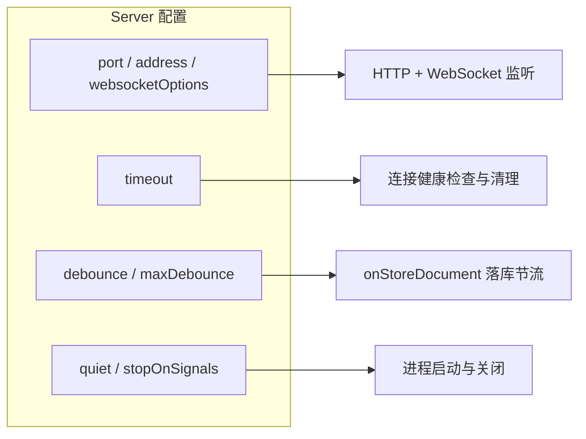

import { Meta } from '@storybook/addon-docs/blocks';

<Meta id="server-config" title="服务端核心/Server 配置" name="Docs" />

# Server 配置

Hocuspocus 服务器的一切行为都由传给 `new Server()` 的一份 config 决定：端口绑在哪、空连接多久清理、编辑内容隔多久落库、停服时怎么收尾。本课逐项核对 v4 的全部核心配置项与默认值，并讲清 `listen()` 启动、`destroy()` 优雅关闭与 `quiet` 静默模式。读完你应能预测：改 `port` 后启动屏会显示什么、调小 `debounce` 后落库日志会变密、`SIGTERM` 之后进程为什么"晚一点"才退出。

版本基线为 Hocuspocus v4（4.7.x，要求 Node 22+）。涉及 v3 差异处在正文中以一句话标注。



## 核心配置参考表

v4 的配置分两层：`Server` 自有的网络与进程项（`ServerConfiguration`），以及与钩子共享的核心项（`Configuration`）。下表逐项对照 v4 源码（`packages/server/src/Server.ts` 与 `types.ts` 中的 `defaultConfiguration`）核实，默认值均来自源码，未凭记忆填写。

| 选项 | 类型 | 默认值 | 何时调整 |
| --- | --- | --- | --- |
| `port` | `number` | `80` | 本地开发与容器内改高位端口；也可用 `listen(port)` 运行时覆盖 |
| `address` | `string` | 未设（绑定全部网卡，URL 显示 `0.0.0.0`） | 只对内网或本机开放时设 `127.0.0.1` |
| `websocketOptions` | `Record<string, any>` | 空对象 | 需要透传底层 WebSocket 参数时，如 `maxPayload` 限制单帧大小 |
| `timeout` | `number` | `60000`（v3 为 `30000`） | 空连接清理太慢调小，弱网客户端被误断调大 |
| `debounce` | `number` | `2000` | 落库要求更实时调小；写入存储代价高调大 |
| `maxDebounce` | `number` | `10000` | 持续编辑时保证最迟落库的间隔，按业务对数据新鲜度的要求调整 |
| `unloadImmediately` | `boolean` | `true` | 设 `false` 时最后一个连接断开后等 debounce 到点再落库再卸载 |
| `quiet` | `boolean` | `false` | 生产环境不需要启动横幅时设 `true` |
| `stopOnSignals` | `boolean` | `true` | 想自己接管 SIGINT/SIGTERM（如编排器先做别的事）时设 `false` |
| `name` | `string` | `null` | 多实例日志中区分进程时设置 |
| `extensions` | `Extension[]` | `[]` | 挂官方扩展或自定义扩展（持久化、限流、日志等） |
| `yDocOptions` | 对象 | `gc: true`、`gcFilter: () => true` | 需要调整 Y.Doc 垃圾回收行为时 |
| `flushDelay` | `number \| false` | `0` | 高频更新时合并出站广播；`false` 关闭合批。注意这是广播合批，不影响落库 |
| `flushMaxBytes` | `number` | `1048576`（1 MiB） | 缓冲的文档更新达到该字节数就提前广播 |
| `maxUnauthenticatedQueueSize` | `number` | `5242880`（5 MiB） | 未认证连接缓冲字节数上限，超出即断开，防护内存耗尽 |
| `maxUnauthenticatedQueueMessages` | `number` | `1000` | 未认证连接缓冲消息条数上限，超出即断开 |
| `maxPendingDocuments` | `number` | `100` | 单条未认证连接可挂起的文档数上限，限制扇出 |

前三组会在下文展开；`unloadImmediately` 的完整卸载时序属于文档生命周期（见「文档生命周期」一课）；`maxUnauthenticated*` 三项是 v4 针对未认证连接缓冲的 DoS 防护，通常不需要动。

## 快速上手

已按「安装」一课装好 `@hocuspocus/server` 后，最小服务器只需两步：传 config，调 `listen()`。

```ts
// server.ts —— 最小可运行的 Hocuspocus 服务器
import { Server } from '@hocuspocus/server';

const server = new Server({
  port: 1234,
});

server.listen().then((hocuspocus) => {
  console.log(`WebSocket 地址：${hocuspocus.webSocketURL}`);
});
```

要求 Node 22+，用任意 TS 运行器启动：

```bash
npx tsx server.ts
```

控制台输出（示意，版本与地址以实际为准）：

```text
Hocuspocus server 4.7.x
  HTTP:  http://0.0.0.0:1234
  WS:    ws://0.0.0.0:1234
Ready.
WebSocket 地址：ws://0.0.0.0:1234
```

v4 启动屏除两个 URL 外还会列出已注册的扩展名；`quiet: true` 时以上横幅全部不打印。此时用任意 HTTP 客户端访问监听端口会得到一段 200 的纯文本欢迎响应，WebSocket 路径则等待 provider 接入——最小闭环到此完成。

## 网络与连接

这一组选项决定服务器绑在哪里、底层 WebSocket 怎么配。它们只影响「连接怎么进来」，不触碰文档状态。

### port 与 address

`port` 默认 `80`。`listen()` 时传入端口参数可临时覆盖 config，不必重建 Server：

```ts
const server = new Server({ port: 80 }); // 配置默认 80

await server.listen(3000); // 本次监听改为 3000
```

`address` 不设置时绑定全部网卡，启动屏的 URL 显示 `0.0.0.0`；设为 `127.0.0.1` 后只有本机能连上：

```ts
await new Server({ port: 1234, address: '127.0.0.1' }).listen();
```

输入 → 控制台输出（示意）：

```text
  HTTP:  http://127.0.0.1:1234
  WS:    ws://127.0.0.1:1234
```

边界：`80` 与 `443` 属于特权端口，本地开发通常直接改高位端口而不是提权；生产环境服务器一般放在反向代理后面（见「生产部署」一课），`port` 只需要和代理 upstream 对上。

### websocketOptions

v4 把底层 WebSocket 参数收进 config 的 `websocketOptions` 字段，转发给服务器的 WebSocket 层（v4 底层经 crossws 实现，因此同一份代码可跑在 Node 之外的运行时，见「跨运行时」一课）。典型用途是限制单帧大小，防止超大 update 打爆内存：

```ts
const server = new Server({
  port: 1234,
  websocketOptions: {
    maxPayload: 1024 * 1024, // 单帧上限 1 MiB
  },
});
```

v3 差异：v3 中它是构造函数的第二个参数 `new Server(config, websocketOptions)`，v4 并入 config 对象；从 v3 项目（如 tester/ 的旧写法）迁移时需要挪位置，其余见「从 v3 迁移」一课。

## 连接超时 timeout

`timeout` 默认 `60000` 毫秒（v3 是 `30000`，v4 放宽到 60 秒），同一个值扮演两个角色：服务器每隔 `timeout` 做一次连接健康检查，而一条连接「静默超过 `timeout`」就会被判定超时并断开。

判断基准分两段，这是最容易误判的地方：

- 认证前：从建连那一刻起算绝对期限。客户端即使不断发消息也无法给这条连接续命，配合参考表中的 `maxUnauthenticated*` 限制，防止未认证连接耗尽内存。
- 认证后：改为按「最后一条收到的消息」计时。正常的 provider 间隔约 30 秒发送 awareness 更新，足以保活，因此 `60000` 的默认值不会误断健康连接。

输入 → 控制台输出：客户端连上后既不认证也不发消息，服务端在 `onConnect` 与 `onDisconnect` 钩子里打日志（示意时间线）：

```text
t=0s     [onConnect]      连接建立，等待认证
t=60s    [onDisconnect]   连接被超时关闭
```

把 `timeout` 调小能更快清理僵死连接，代价是弱网或长时间本地计算的客户端更容易被误断；调大则相反。注意文档本身不会因 `timeout` 卸载——超时只断连接，文档缓存与卸载时序属于「文档生命周期」一课。

## 存储节流：debounce 与 maxDebounce

协同编辑会产生海量微小 update，若每次 `onChange` 都执行 `onStoreDocument` 落库，存储会被打穿。`debounce`（默认 `2000` 毫秒）把存储调用防抖：每次新 update 都重置计时器，静默满 2 秒才真正落库。`maxDebounce`（默认 `10000` 毫秒）是封顶：持续不断的编辑最多把存储推迟到 10 秒，到点必存一次。

输入 → 控制台输出：在 `onStoreDocument` 中打日志，客户端按以下节奏编辑（示意时间线）：

```text
t=0.0s   第 1 次编辑
t=0.5s   第 2 次编辑      ← 每次编辑都把 2s 计时器重置
t=1.0s   第 3 次编辑
（之后静默）
t=3.0s   [onStoreDocument] 存储 my-doc   ← 只落库一次
```

持续编辑超过 10 秒时，`maxDebounce` 保证第 10 秒出现一次存储，之后计时重新开始。两个值决定的是「进程崩溃时最多丢多新的内容」：默认配置下，未落库窗口在 2～10 秒之间。

两个贴近本点的边界：

- 最后一个连接断开且有未落库变更时，默认 `unloadImmediately: true` 会立即执行存储并卸载文档，不必等 debounce；设 `false` 则尊重 debounce 时间，文档在内存里多驻留一会。
- `flushDelay` / `flushMaxBytes` 名字里虽有 flush，管的是出站广播的合批，与落库无关，别用来调存储频率。

## 启动与停止

Server 的进程生命周期由一个方法开启、一个方法收尾，外加两个开关：`stopOnSignals` 控制信号接管，`quiet` 控制启动输出。

### listen()

`listen(port?: number, callback?)` 返回 `Promise<Hocuspocus>`，resolve 值就是核心实例，启动后的回查入口都在它身上：

```ts
const hocuspocus = await server.listen(1234);

hocuspocus.httpURL;           // http://0.0.0.0:1234
hocuspocus.webSocketURL;      // ws://0.0.0.0:1234
hocuspocus.getDocumentsCount(); // 当前驻留内存的文档数
```

第二个参数是 `onListen` 回调，与注册 `onListen` 扩展钩子等价，收到的 payload 里有实际绑定的端口；钩子抛错会让 `listen()` 的 Promise reject。

### destroy() 与优雅关闭

`destroy()` 是唯一的收口：关闭 HTTP 服务、断开所有连接、立即执行所有待执行的 debounce 存储（`flushPendingStores()`，这是 v4 优雅关闭的关键——待落库的文档不会丢）、等所有文档卸载干净，最后触发 `onDestroy` 钩子。重复调用是安全的，多次调用共享同一次关闭。

`stopOnSignals` 默认 `true`，服务器自己接管 `SIGINT`、`SIGQUIT`、`SIGTERM`：收到信号后执行同一套 `destroy()` 流程再以退出码 0 退出。输入 → 控制台输出（示意）：

```bash
kill -TERM <pid>
```

```text
[onStoreDocument] 存储 my-doc   ← 把 2s 内未落库的编辑补上
[onDestroy]        服务器已关闭
echo $?            → 0
```

对照坑点：`kill -KILL`（`-9`）不给进程执行 destroy 的机会，debounce 窗口内的最近编辑会丢。容器环境应保证 SIGTERM 能到达进程并避免用 `kill -9` 做常规重启。

### quiet 静默模式

`quiet: true` 只做一件事：不打印启动横幅（`NODE_ENV=testing` 时同样静默），监听、钩子与日志扩展不受影响。生产容器里通常配合结构化日志开启：

```ts
const server = new Server({ port: 1234, quiet: true });
```

输入 → 控制台输出：启动后横幅消失，只剩你自己的日志输出，启动屏证据从「有 URL 与 Ready.」变为「无输出」。

## 常见问题

- 启动报 `EADDRINUSE`，端口被占用
  换端口或先找到占用进程：`lsof -i :1234` 查看谁占着，结束后重启；`port` 改不动时用 `listen(3000)` 临时换端口验证是不是端口问题。
- 客户端连接约 60 秒后被断开
  先查客户端是否完成了认证：认证前 `timeout` 是从建连起的绝对期限，不认证的连接 60 秒必断；已认证的连接被断则说明确实静默超过了 `timeout`，弱网环境调大该值，或确认客户端 awareness 正常发送。
- 停服或重启后，最近的编辑丢失了
  检查进程是怎么被停的：只有 `SIGTERM`/`SIGINT` 或手动 `destroy()` 会触发 `flushPendingStores()` 补落库，`kill -9` 会直接跳过；另外 `onStoreDocument` 抛错时文档会留在内存不再卸载，查存储回调的报错日志而不是怀疑 config。

## 总结回顾

摘要：

Server 的全部行为由一份 config 决定：`port`/`address`/`websocketOptions` 决定连接从哪进来（v4 起 WebSocket 参数并入 config，底层经 crossws）；`timeout` 同时是健康检查间隔与空闲阈值，认证前按建连时刻绝对计时、认证后按最后消息计时，v4 默认从 30 秒放宽到 60 秒；`debounce`/`maxDebounce` 把 `onStoreDocument` 防抖在 2～10 秒之间，决定了崩溃时最多丢多新的内容。`listen()` 启动并返回带 `httpURL`、`webSocketURL` 等回查入口的实例；`destroy()` 与默认接管的 `SIGTERM` 走同一套优雅关闭——断连接、立即补落库、等文档卸载再退出；`quiet` 只关启动横幅。其余选项（卸载时机、Y.Doc 选项、广播合批、未认证连接防护）在参考表中各有落点。

一句话：

> 改 config 之前先回参考表核默认值，停服永远走 `destroy()` 或 SIGTERM——`kill -9` 会跳过补落库，丢掉 debounce 窗口内的编辑。

知识要点：

- v4 的 `websocketOptions` 放在哪里？与 v3 的写法差异是什么？
- `timeout` 对未认证与已认证连接的计时基准有何不同？
- `debounce` 与 `maxDebounce` 分别约束什么？默认值下未落库窗口多长？
- `destroy()` 依次做哪几件事？为什么优雅关闭能保住最近编辑？
- `quiet`、`stopOnSignals` 各关闭或接管什么？

## 参考资料

- [Hocuspocus Server 配置（官方文档）](https://tiptap.dev/docs/hocuspocus/server/configuration)
- [Server.ts（v4 源码：ServerConfiguration 默认值、listen/destroy、启动屏与信号处理）](https://github.com/ueberdosis/hocuspocus/blob/main/packages/server/src/Server.ts)
- [types.ts（v4 源码：Configuration 类型与 defaultConfiguration）](https://github.com/ueberdosis/hocuspocus/blob/main/packages/server/src/types.ts)
- [ClientConnection.ts（v4 源码：timeout 健康检查与认证前后计时基准）](https://github.com/ueberdosis/hocuspocus/blob/main/packages/server/src/ClientConnection.ts)
- [Document.ts（v4 源码：flushDelay/flushMaxBytes 出站广播合批）](https://github.com/ueberdosis/hocuspocus/blob/main/packages/server/src/Document.ts)
