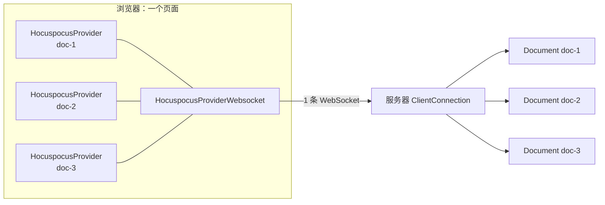
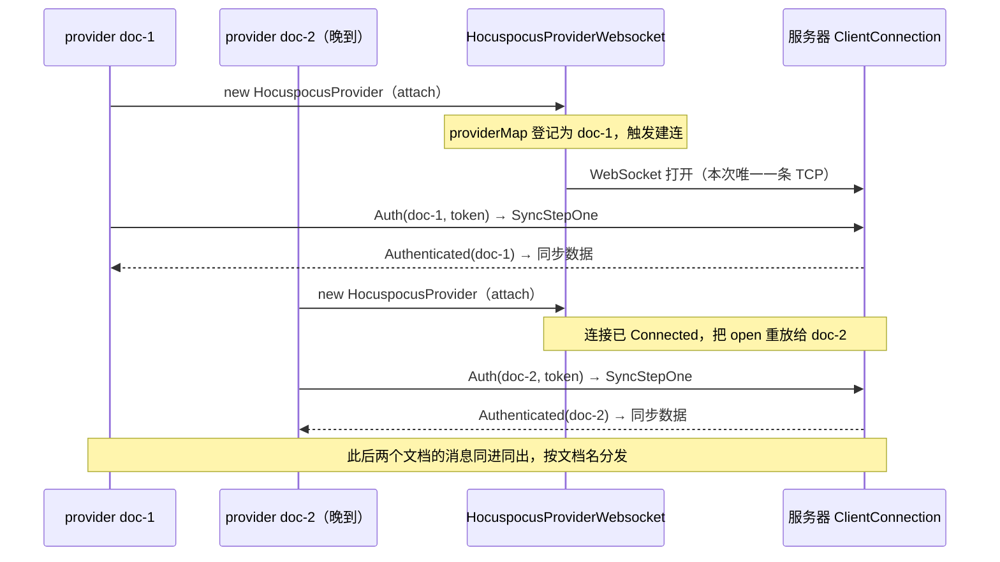
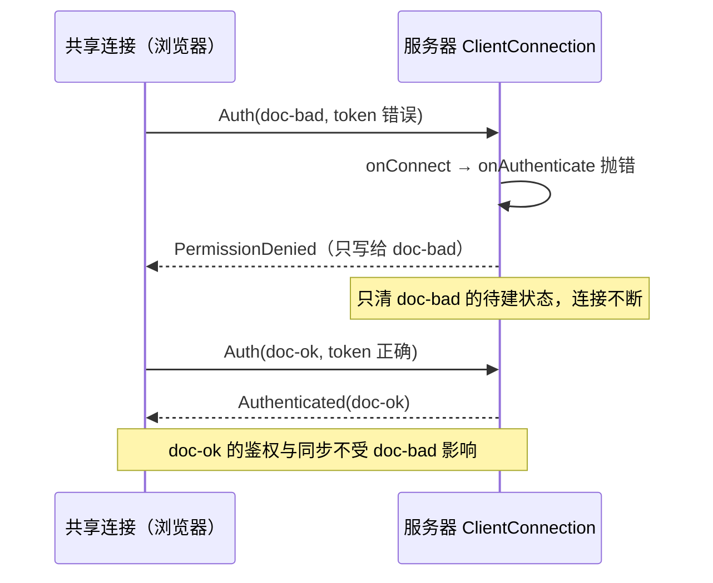

import { Meta } from '@storybook/addon-docs/blocks';

<Meta id="shared-websocket" title="客户端 Provider/共享 WebSocket 连接" name="Docs" />

# 共享 WebSocket 连接

[3.1 的独立写法](?path=/docs/provider--docs)里每个 provider 自带 `url`：一个页面开几个文档，就有几条 WebSocket——每条各付一次握手与心跳，服务器各养一份连接状态，浏览器对同一主机的并发连接数也有上限（HTTP/1.1 常见为 6 条），多文档工作区很容易撞上。Hocuspocus 的协议从设计上就是多路复用的：每条业务消息都以文档名开头，一条连接足以承载任意多个文档。本课讲复用的载体 `HocuspocusProviderWebsocket`——先把它建出来，再把各个 `HocuspocusProvider` 用 `websocketProvider` 选项挂上去。读完你应能预测：断网时所有文档同时掉线、恢复时只重连一次；错误的 token 只废掉它自己那个文档；销毁最后一个 provider 后连接仍挂着，得你亲手销毁 socket。

核心模型是「两类两层」：连接级的一切（建连、重试、心跳检查、关闭）属于 `HocuspocusProviderWebsocket`；文档级的一切（token、鉴权、同步、单个文档的关闭）仍属于每个 `HocuspocusProvider`。共享只发生在连接层，文档之间互不知晓。

版本基线为 Hocuspocus v4（4.7.x，要求 Node 22+）。`websocketProvider` 写法 v3 已有，v3 差异处以一句话标注。



| 选项或概念 | 默认值 | 回查要点 |
| --- | --- | --- |
| `url` | 必填 | 服务器 WebSocket 地址；末尾斜杠默认被去掉，`preserveTrailingSlash` 设 `true` 可保留 |
| `autoConnect` | `true` | 构造即建连；设 `false` 后连 `attach()` 也不会触发建连，要手动 `connect()` |
| `WebSocketPolyfill` | 全局 `WebSocket` | Node 端运行时传入 `ws` 等实现 |
| `messageReconnectTimeout` | `30000` | 这么久没收到**任何**消息就断开重连，检查间隔为其 1/10 |
| `delay` / `factor` | `1000` / `2` | 重试基础间隔（毫秒）与指数倍率 |
| `maxAttempts` | `0`（不限） | 重试上限，耗尽发出 `maxAttemptsFailed` |
| `minDelay` / `maxDelay` | `1000` / `30000` | 退避下限与上限 |
| `jitter` | `true` | 退避加随机抖动，防止集体同步重连 |
| `timeout` | `0`（不限） | 重试总预算（毫秒），到期放弃 |
| `onMaxAttemptsFailed` | 空函数 | 只在 socket 上触发，不转发给 provider |
| `providerMap` | 空 `Map` | 已挂接的 provider，按 effectiveName（默认即文档名）登记 |

## 复用一条连接

两种写法的分工：给 provider 传 `url`，它会自己创建并持有 socket（3.1 的写法，类内部叫 `manageSocket`）；传 `websocketProvider`，则复用你创建的实例，provider 只负责文档。判据就一条：这个页面要不要同时开多个文档。

| 写法 | provider 配置 | 底层发生什么 | 适合 |
| --- | --- | --- | --- |
| 独立 provider | `url` + `name` | provider 自建、自毁一个 `HocuspocusProviderWebsocket` | 单文档页面 |
| 共享连接 | `websocketProvider` + `name` | 挂到你创建的 socket 实例上，随挂随摘 | 一页多文档的工作区 |

### 创建共享连接

一个页面通常只需要一个实例：

```ts
import { HocuspocusProviderWebsocket } from '@hocuspocus/provider';

// 连接级单例：拥有那条 WebSocket，页面卸载时由你销毁
const socket = new HocuspocusProviderWebsocket({
  url: 'ws://127.0.0.1:1234',
});
```

`autoConnect` 默认 `true`，构造即开始建连，重试参数（上表 `delay` 到 `timeout`）也在这里配置。它同时是一个 `EventEmitter`，连接级监听直接挂在实例上：

```ts
socket.on('status', ({ status }) => console.log('连接状态:', status));
socket.on('maxAttemptsFailed', ({ error }) => console.error('放弃重连:', error));
```

### 把 provider 挂上去

每个文档一个 provider，不再传 `url`，改传 `websocketProvider`：

```ts
import * as Y from 'yjs';
import { HocuspocusProvider } from '@hocuspocus/provider';

const providerA = new HocuspocusProvider({
  websocketProvider: socket, // 挂到共享连接
  name: 'example-document',
  document: new Y.Doc(),
});

const providerB = new HocuspocusProvider({
  websocketProvider: socket,
  name: 'other-document',
});
```

挂接（`attach`）时发生的事，经 v4 源码核对：

- provider 构造时向 socket 登记（`providerMap` 按 effectiveName），并把 socket 的 `connect` / `status` / `open` / `close` / `disconnect` / `destroy` 事件转发给自己——所以 `onStatus`、`synced` 这些事件语义与 3.1 完全一致，只是底层换成了共享连接。
- 连接未就绪时挂接：只要 `shouldConnect`（`autoConnect` 默认即真）就顺带触发建连；`autoConnect: false` 时 `attach()` 不会建连，需要手动 `socket.connect()`。
- 活连接上晚到的文档：挂接时 socket 已 `Connected`，socket 会把保存的 open 事件**重放**给新 provider——它立即发 token、开始同步，TCP 不重开。



分发机制正是复用的基础：每条业务消息以文档名（`effectiveName`）开头，socket 收到消息时按这个名字把原始事件转给对应 provider；不带文档名的连接级 Ping 由 socket 自己应答 Pong，不惊动任何文档。

### 与独立 provider 混用

独立写法底下就是本课这个类——3.1 的 `new HocuspocusProvider({ url, name })` 会自己创建一个 `HocuspocusProviderWebsocket` 并在 `destroy()` 时一并销毁。所以两者混用完全合法：页面上可以有一个独立 provider（自己的连接）加一组共享 socket 上的 provider。但这已经是两条 TCP 连接，混用通常只该出现在迁移期；老代码逐个文档改成 `websocketProvider` 写法即可。

v3 差异：`websocketProvider` 选项与 `HocuspocusProviderWebsocket` 类在 v3（如 tester/ 锁定的 3.4.4）就已存在，写法一致；差异集中在同名处理与 `sessionAwareness`，见下节。

## 同名文档与 sessionAwareness

socket 上的登记键是 provider 的 `effectiveName`：默认就是文档名。两个同名 provider 挂同一条连接时，v4 直接抛错（源码原文）：

```text
Cannot attach two providers with the same effective name "example-document".
Use sessionAwareness: true to multiplex providers with the same document name.
```

例外是「顶替」：同名登记已存在但对方尚未通过鉴权（比如认证失败后挂着），新 provider 可以替换它。这也解释了销毁重建要讲究顺序——旧 provider 已认证却还没 `destroy()`，新 provider 的构造就会抛错；热更新、React StrictMode 双挂载都是典型触发场景。

真正需要「同一条连接上同名多开」（比如同一文档开两个编辑视图）时，给两个 provider 都设 `sessionAwareness: true`：每个实例带一个随机 `sessionId`，消息路由键变成「文档名 + 空字符 + sessionId」，服务器按完整键区分会话。注意版本前提——官方文档明确该选项只在连接支持 session awareness 的 v4 服务器时开启，连 v3 服务器保持 `false`。

v3 差异：v3 的登记直接按文档名覆盖，同名 provider 不报错，但两者会互相抢消息、行为不可预测；v4 改为抛错并提示正确做法。

## 断线是连接级事件

一条连接承载全部文档，断线自然一次殃及全部：网络抖动或服务器重启时，socket 的 `close` 事件转发给每个 provider，各自复位 `isAuthenticated` 与 `synced`、清掉远端 awareness 状态——这些复位动作与 3.1 单文档时相同，只是 N 个文档同一时刻一起发生。

恢复也只有一个动作：重连的重试循环（`delay`、`factor`、`maxAttempts`、`jitter` 等参数）整个属于 socket，连上后每个 provider 重放 open——重新发 token、重新同步。也就是说 N 个文档共享一次重连，而不是 N 条连接各自为战。两个结论：

- `maxAttemptsFailed` 只在 socket 上触发。官方文档给出的理由正是「一条 socket 会被多个文档共享」，所以这个事件不转发给 provider；要提示用户「连接放弃重连」，监听 `socket.on('maxAttemptsFailed')`，重试入口是 `socket.connect()`。
- 心跳检查也是连接级的：`messageReconnectTimeout`（默认 30 秒）内共享连接上没收到**任何**消息就断开重连。静默文档不会喂心跳，消息才会——awareness 状态约 15 秒广播一次，保证页面上至少一个 provider 开着 awareness（默认即开）就不会误伤；源码注释明确警告全关 awareness 会破坏这套检查。

重连间隔的调参、离线期间编辑内容的补传属于 [断线与重连](?path=/docs/reconnection--docs) 课，这里只需记住归属：断线重连是 socket 的事，文档只负责跟着复位与重放。

## 鉴权按文档进行

token 是 provider 的配置，不是 socket 的。每次 socket 打开，每个挂着的 provider 各发一条带自己文档名的 Auth 消息，服务器按文档依次跑 `onConnect` → `onAuthenticate`——2.3 讲过的握手在共享连接下原样成立，且 token 可以按文档不同（公共文档匿名、私有文档带 JWT）。token 配置为函数时，每次 socket 打开都重新求值，重连自然换新凭据。

服务器侧，一条 socket 只有一个 `ClientConnection`，但每个文档有独立的待建状态与 `context`——「一条连接 × 一个文档名」的粒度不变。由此可以准确回答「单文档鉴权失败影响面有多大」（经 v4 源码 `ClientConnection.ts` 核对）：

- 服务器只把 PermissionDenied 写给失败的那个文档名，只清理它的待建状态，连接与其他文档完全不受影响；
- 客户端对应 provider 发出 `authenticationFailed` 事件，保持挂接、停在「已连接但未同步」（3.1 与 2.3 讲过被拒不等于断线）；
- 该文档后续若重连或重建 provider，服务器把它当成全新的首次接入重新走握手。



边界：多个文档同时等待鉴权时，未认证缓冲上限（2.3 讲过的 `maxUnauthenticatedQueueSize` 等三项）按整条连接合计计算，且待建文档数受 `maxPendingDocuments`（默认 100）约束——超限服务器直接断开整条连接，殃及所有文档。正常业务不会触到，但脚本化批量挂载时要留意。

## 销毁与连接归属

provider 的销毁在共享模式下只做文档级清理（经 v4 源码核对）：

```ts
providerA.destroy();
// 内部次序：flush 未发更新 → detach
//   → 向服务器发 CloseMessage（只关这一个文档的连接，
//     服务器以 code 1000、reason "provider_initiated" 关闭该文档）
//   → 从 providerMap 移除
// 共享 socket 不受影响，providerB 照常工作
```

推论有两个。其一，销毁全部 provider 后共享连接**不会自己关**——`manageSocket` 为 `false` 时 provider 的 `destroy()` 不会碰 socket，页面上会留下一条空连接，不用了要手动 `socket.destroy()`。其二，顺序不能反：先 `socket.destroy()` 会把 `shouldConnect` 置否并关掉底层连接，剩余 provider 之后再发的消息只会静默入队（底层 `webSocket` 已是 `null`，只入队不发送、不再重连、不报任何错），界面看起来正常、`synced` 却永远是 `false`。正确次序：


另外两个销毁相关的边界：

- 挂接模式下 provider 的 `connect()` / `disconnect()` 已废弃，调用只会得到控制台警告——连接的开关只在 socket 上。
- 摘除文档走的是 CloseMessage 而不是断 TCP，所以「关一个文档」与「断线」是两回事：前者只影响该文档的 `synced`，后者才是连接级事件。

## 最佳实践

- **按页面文档数量选择写法。** 一页一个文档：直接用 3.1 独立写法，销毁语义自动正确。一页多个文档（工作区、多面板）：一个 `HocuspocusProviderWebsocket` 加 N 个 provider；官方 React 绑定也是同构形态——一层组件共享一个 socket 实例（见 [React 集成](?path=/docs/react-integration--docs) 课）。
- **socket 当应用级单例管理。** 谁创建谁销毁：放在页面级或应用级持有，不要放进会频繁重挂载的组件里 `new`——每次重挂载既重建 TCP，又容易踩同名抛错。组件卸载只 `destroy()` 自己的 provider。
- **重试预算设在连接层。** `maxAttempts`、`onMaxAttemptsFailed`、「重试」按钮都挂 socket：所有文档一起受益，也避免每个文档各自维护一套重试 UI。
- **同一条 socket 上的文档名保持唯一。** 文档名天然是路由键；确需同名多开才开 `sessionAwareness: true`，并确认服务器是 v4。

## 常见问题

- 挂第二个文档时构造 provider 抛错 `Cannot attach two providers with the same effective name`
  先检查两个 provider 的 `name` 是否相同：同一 socket 上同名即抛错。若是有意同名多开，给两个 provider 都设 `sessionAwareness: true`（仅 v4 服务器）。更常见的诱因是旧 provider 未 `destroy()` 就建新的（热更新、React StrictMode 双挂载）——先销毁旧的再挂新的；只有旧的尚未通过鉴权时，新 provider 才能把它顶替掉。
- 最后一个 `provider.destroy()` 之后，网络面板里 WebSocket 还连着
  这是指定行为：共享连接的生命周期独立于文档，销毁 provider 只 detach（发 CloseMessage 关掉该文档）不断 TCP。确认页面不再需要协同就手动 `socket.destroy()`，或把「最后一个 provider 销毁时顺带销毁 socket」的逻辑封装到你的连接管理层。
- 页面静置半分钟左右，连接被断开又自动重连
  `messageReconnectTimeout`（默认 30 秒）内共享连接上没有收到任何文档的消息就触发健康检查断开。静默文档不喂心跳——保证至少一个 provider 开着 awareness（默认即开，约 15 秒一跳），或按业务调大该值；调参见 [断线与重连](?path=/docs/reconnection--docs) 课。
- 服务器重启后所有文档同时掉线，是共享连接放大了故障吗
  同时掉线是连接级的必然，不是共享引入的缺陷；恢复时只重连一次、每个文档各自重放鉴权与同步，总开销低于 N 条连接各自重试。真正要区分的是影响范围：连接级故障（断网、重启）殃及全部，文档级故障（单个 token 失效、单个文档名无权限）只影响自己。

## 总结回顾

摘要：

一个页面要开多个文档时，用 `HocuspocusProviderWebsocket` 把 N 条 WebSocket 收成一条：socket 实例拥有连接级的一切——构造即建连（`autoConnect`）、指数退避重试、`messageReconnectTimeout` 心跳检查、`maxAttemptsFailed` 与手动 `connect()` / `destroy()`；每个文档的 `HocuspocusProvider` 用 `websocketProvider` 选项挂上去（`attach`），登记按 `effectiveName`，晚到文档直接在活连接上重放 open 完成鉴权与同步。同名 provider 挂同一连接会被 v4 抛错拒绝，同名多开需 `sessionAwareness: true` 且仅限 v4 服务器；断线重连是连接级事件，所有文档一起掉线、共享一次重连；鉴权按文档进行，token 归 provider，单文档被拒只废自己；销毁先逐个 `provider.destroy()`（只关该文档），确认不用后再 `socket.destroy()`，顺序反了剩余 provider 会静默卡死。

一句话：

> 共享的是连接，不是文档——连接级的事归 `HocuspocusProviderWebsocket`，token、鉴权、同步与单个文档的关闭仍归每个 `HocuspocusProvider`。

知识要点：

- 一页多文档为什么该共享连接？共享后客户端与服务器各少了什么、多了什么？
- provider 怎么挂到共享连接上？晚到的文档如何在不重开 TCP 的情况下完成鉴权与同步？
- 两个同名 provider 会发生什么？`sessionAwareness` 的作用与版本前提是什么？
- 断网后各文档的复位与恢复次序是什么？重连重试由谁执行、`maxAttemptsFailed` 在哪监听？
- 一个文档鉴权失败的影响面有多大？token 与 `context` 是按连接还是按文档？
- 销毁的正确次序是什么？先销毁 socket 会发生什么、为什么没有任何报错？

## 参考资料

- [Provider Configuration（websocketProvider 选项、重试参数与 maxAttemptsFailed 的连接级语义）](https://tiptap.dev/docs/hocuspocus/provider/configuration)
- [Provider Overview（provider 自 v2 起支持一条连接同步多个文档）](https://tiptap.dev/docs/hocuspocus/provider/overview)
- [React bindings（一层组件共享一个 HocuspocusProviderWebsocket 的官方形态）](https://tiptap.dev/docs/hocuspocus/provider/react)
- [HocuspocusProviderWebsocket.ts（v4 源码：attach/detach、默认值、消息分发与 destroy）](https://github.com/ueberdosis/hocuspocus/blob/main/packages/provider/src/HocuspocusProviderWebsocket.ts)
- [HocuspocusProvider.ts（v4 源码：manageSocket、事件转发、effectiveName 与销毁次序）](https://github.com/ueberdosis/hocuspocus/blob/main/packages/provider/src/HocuspocusProvider.ts)
- [ClientConnection.ts（v4 源码：按文档鉴权、PermissionDenied 影响面、待建文档上限）](https://github.com/ueberdosis/hocuspocus/blob/main/packages/server/src/ClientConnection.ts)
- [MessageReceiver.ts（v4 源码：CloseMessage 只关对应文档的连接）](https://github.com/ueberdosis/hocuspocus/blob/main/packages/server/src/MessageReceiver.ts)
- [routingKey.ts（@hocuspocus/common 源码：sessionAwareness 的路由键编解码）](https://github.com/ueberdosis/hocuspocus/blob/main/packages/common/src/routingKey.ts)
- [HocuspocusProviderWebsocket.ts（v3.4.4 源码：v3 同名登记为静默覆盖，写法其余一致）](https://github.com/ueberdosis/hocuspocus/blob/v3.4.4/packages/provider/src/HocuspocusProviderWebsocket.ts)
