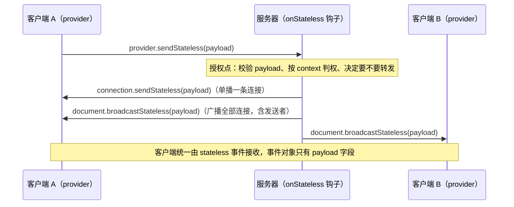

import { Canvas, Controls, Meta } from '@storybook/addon-docs/blocks';
import * as StatelessStories from './stateless.stories';

<Meta of={StatelessStories} name="Docs" />

# Stateless 消息

协同文档本身解决「内容怎么一致」，但评论提醒、点赞、控制信令这类应用层消息不该混进 Y.Doc，也不该为它们另开一条 WebSocket。stateless 消息就是 Hocuspocus 在同一条连接上留出的旁路：客户端用 `provider.sendStateless` 把任意字符串上行给服务器，服务器的 `onStateless` 钩子接收并决定处理逻辑，再用 `connection.sendStateless`（单播）或 `document.broadcastStateless`（房间广播）下发，客户端统一由 `stateless` 事件接收。它与文档同步是两条独立通道——消息不进 Y.Doc、不持久化、没有确认与重试。读完你应能预测：广播会不会把发送者自己再回显一遍、把「不回应」的服务器换成单播后谁会收到、断线期间发出的消息最终去了哪里。

版本基线为 Hocuspocus v4（4.7.x，要求 Node 22+，仅约束服务端）。stateless 这组 API 的形态在 v3 已经存在、与 v4 一致，v4 的新增处（`relayStateless`、对客户端伪造广播消息的拒绝）在正文以一句话标注。



这组 API 共两个钩子、四个方法，全部收发都走文档所在的房间，payload 一律是字符串：

| 调用 | 方向 | 参数与 payload | 回查要点 |
| --- | --- | --- | --- |
| `provider.sendStateless(payload)` | 客户端 → 服务器 | `payload: string` | 任意时机可调；连接未建立时排队，重连成功后补发 |
| `onStateless`（服务器钩子） | 服务器接收 | `{ connection, documentName, document, payload }` | 每条上行消息触发一次；不注册时消息被静默吞掉 |
| `connection.sendStateless(payload)` | 服务器 → 一条连接 | `payload: string` | 单播，只有目标连接的 provider 触发 `stateless` 事件 |
| `document.broadcastStateless(payload, filter?)` | 服务器 → 文档全部连接 | `payload: string`、`filter?: (conn) => boolean` | 房间广播，包含发送者；每次广播先触发 `beforeBroadcastStateless` |
| `document.relayStateless(payload, filter?)` | 多实例中继 | 同上 | 跳过 `beforeBroadcastStateless`；v4 新增，extension-redis 跨实例转发用 |
| `provider.on('stateless')` | 客户端接收 | `{ payload }` | 单播与广播共用同一事件；payload 不含 documentName，按 provider 归属文档 |
| `beforeBroadcastStateless`（服务器钩子） | 服务器观察 | `{ document, documentName, payload }` | 广播出站前的观察点；`relayStateless` 不触发 |

## 快速上手

一个最小回声服务器加一个浏览器客户端，就能观察本课的完整闭环。

**1. 启动服务器。** 新建 `stateless-server.ts`：

```ts
// stateless-server.ts —— 收上行、回单播、再广播一条
// 前置：按「安装」课装好 @hocuspocus/server；Node 22+，npx tsx stateless-server.ts 启动
// 操作：用下面的客户端连入，等 synced 后发送一次
import { Server } from '@hocuspocus/server';

const server = new Server({
  port: 1234,

  async onStateless({ payload, connection, document }) {
    console.log(`收到上行：${payload}`);

    // 单播：只回给发送者这条连接
    connection.sendStateless(`ack:${payload}`);
    // 广播：发给房间里的全部连接，发送者自己也会收到
    document.broadcastStateless('{"type":"notify","text":"有新消息"}');
  },
});

server.listen();
```

**2. 连入并发送。** 新建 `stateless-client.ts`，在浏览器里运行：

```ts
// stateless-client.ts —— 发一条、收两条
import { HocuspocusProvider } from '@hocuspocus/provider';

const provider = new HocuspocusProvider({
  url: 'ws://localhost:1234',
  name: 'example-doc',
  onStateless: ({ payload }) => {
    console.log('收到下发：', payload);
  },
});

// 等 synced 后再发：连接未建立时消息会排队，等重连成功才补发
provider.on('synced', () => {
  provider.sendStateless('{"type":"comment:new","text":"hello"}');
});
```

浏览器控制台出现两条下发——单播回执与广播回显，广播那条发送者自己也收到了：

```text
收到下发： ack:{"type":"comment:new","text":"hello"}
收到下发： {"type":"notify","text":"有新消息"}
```

三步对应的机制：上行消息按文档名路由进服务器，`onStateless` 钩子在消息处理链上被等待；单播与广播的差别只在「发给谁」，客户端侧没有区别。接下来按这条链路展开。

## 客户端：发送与接收

provider 承担上行与接收两端。上行方法只有一个参数：

```ts
provider.sendStateless('{"type":"comment:new","text":"hello"}');
```

- payload 只能是字符串。要传对象就先 `JSON.stringify`，约束见「payload 约定与限制」一节。
- 消息按 provider 的文档名路由：线格式是「文档名 + 消息类型 + payload」，所以必须先指定 `name`（文档名与连接配置见 [HocuspocusProvider](?path=/docs/provider--docs) 课）。
- **连接未建立时不丢：** socket 未打开时消息进入连接层队列，重连成功后按序补发；主动 `disconnect()`、销毁连接或 provider `destroy()` 后队列被清空，之后再调 `sendStateless` 会被静默丢弃。

接收端有两种等价写法：构造参数 `onStateless`（构造时注册，不会晚到）与 `provider.on('stateless', ...)`（可随时挂卸）：

```ts
const provider = new HocuspocusProvider({
  url: 'ws://localhost:1234',
  name: 'example-doc',
  onStateless: ({ payload }) => {
    // 单播与广播在这里没有区别，只有 payload
    console.log(payload);
  },
});
```

两个接收边界：

- 事件对象只有 `payload` 一个字段，不带文档名——provider 本身就绑定一个文档，按 provider 归属即可；多文档共用一条连接的写法见 [共享 WebSocket 连接](?path=/docs/shared-websocket--docs) 课，各 provider 仍只收到自己文档名的消息。
- 收到的永远是字符串，需要结构化数据时在回调里 `JSON.parse`（并捕获解析失败）。

React 项目不直接管理 provider 生命周期，用 provider-react 拿到 provider 实例后调用同样的 `sendStateless` 与 `onStateless`，一句话写法见 [React 集成](?path=/docs/react-integration--docs) 课。

## 服务端：onStateless 钩子

`onStateless` 在服务器收到一条上行 stateless 消息后触发，每条一次，钩子返回 Promise：

```ts
import { Server } from '@hocuspocus/server';

const server = new Server({
  async onStateless({ connection, documentName, document, payload }) {
    console.log(`${documentName} 收到：${payload}`);
  },
});
```

payload 四个字段：`connection` 是发送者的连接对象，`documentName` 与 `document` 是消息路由到的文档，`payload` 是原始字符串。**没有 `transactionOrigin`，也没有 `context` 字段**——这与文档钩子不同：stateless 消息不是文档事务，钩子要拿登录信息时从 `connection.context` 取（鉴权写入 context 的机制见 [鉴权与上下文](?path=/docs/auth--docs) 课）。

`onStateless` 同时是这条通道唯一的授权点：读写连接都能发送 stateless 消息（`readOnly` 只约束文档同步），消息想触发什么操作、能不能转发给他人，全靠钩子自己校验：

```ts
async onStateless({ connection, payload }) {
  // 不信任 payload：先解析、校验，再按连接权限分派
  let message: { type: string };
  try {
    message = JSON.parse(payload);
  } catch {
    return; // 解析失败直接丢弃，不向任何人转发
  }
  if (connection.readOnly && message.type.startsWith('comment:')) {
    return; // 只读连接不允许触发写语义的应用操作
  }
  // ……按 message.type 分派
}
```

抛错语义：钩子内抛出带 message 的错误会中断本次消息的处理并向外抛出（后续钩子不再执行）；抛出空错误对象只用于跳过后续钩子。业务异常应在钩子内自行捕获，避免把应用层故障放大成连接层错误。

## 下发消息：单播与广播

服务器侧的出口有两个，发给谁完全由调用决定：`connection.sendStateless` 把消息写给一条连接，`document.broadcastStateless` 遍历文档当前的全部连接——**包括触发钩子的发送者自己**。第二个参数 `filter` 是逐连接调用的回调，返回 false 的连接被跳过。协议层上行只有 Stateless 一种消息（opcode 5），opcode 6（BroadcastStateless）是服务器内部保留、多实例中继用的，客户端发送会被服务器直接拒绝。

下面的实例按 v4 源码语义模拟这条路由（模拟语义：文档页内没有真实 WebSocket 服务器，这里用内存对象扮演服务器与两个客户端，广播遍历全部连接含发送者、单播只发目标连接、filter 逐连接过滤——路由规则与真实实现一致）：切换发送者与服务器钩子里的回应方式，观察 A、B 各自收到几条。

<Canvas of={StatelessStories.Routing} />
<Controls of={StatelessStories.Routing} />

| 读者操作 | 可观察证据 |
| --- | --- |
| 初始加载 | 时间线播放一次完整往返：上行 → 钩子 → 广播，A、B 各收到 1 条（发送者被回显） |
| 回应切到「broadcastStateless + filter 排除发送者」 | 只有对方的计数加 1，发送者保持 0 条 |
| 回应切到「connection.sendStateless（单播发送者）」 | 只有发送者的计数加 1 |
| 回应切到「不回应」 | 两个计数都是 0：fire-and-forget，没有任何补发 |
| 把「发送者」从 A 换成 B 再广播 | 回显跟随发送者：A、B 仍各收到 1 条 |
| 打开 Show code | 看到 stateless-routing.ts 中按源码语义复刻的路由分支 |

### connection.sendStateless：单播

在钩子 payload 里拿到的 `connection` 就是发送者的连接，直接回写：

```ts
async onStateless({ connection, payload }) {
  connection.sendStateless(`ack:${payload}`);
}
```

- 只到达这一条连接，房间里的其他客户端收不到（官方测试断言了这一点）。
- 也可以保存连接引用稍后发，但要留意连接随时可能断开——对已断开的连接发送不会报错，只是没人收到。
- 连接对象上还有 `context`、`readOnly`，适合「只回给提问者」「按身份给不同回执」的场景。

### document.broadcastStateless：房间广播

`document` 是消息所在文档，`broadcastStateless` 把同一条 payload 写给它的全部连接：

```ts
async onStateless({ document, connection }) {
  // 全员通知：包含发送者（回显）
  document.broadcastStateless('{"type":"presence:lock","by":"server"}');

  // 排除发送者： filter 返回 false 的连接被跳过
  document.broadcastStateless(
    '{"type":"comment:new"}',
    (conn) => conn !== connection,
  );
}
```

三条边界：

- **广播包含发送者。** 想要「通知别人」的语义就用 `filter` 排除发送者；想要「发送者也确认」的语义（如 optimistic UI 的服务器回执）就保留回显。
- `filter` 只按连接过滤，不区分身份——按用户、按权限过滤要在回调里读 `conn.context` 自行判断。
- 每次 `broadcastStateless` 会先触发一次 `beforeBroadcastStateless` 钩子（payload 只有 `document`、`documentName`、`payload`），适合审计与指标，不适合做过滤——拦不住这次发送。

多实例部署时，`document.relayStateless` 是跳过 `beforeBroadcastStateless` 的中继版：本实例广播过一次后，其他实例收到中继消息用 `relayStateless` 二次分发，钩子就不会每个实例各触发一次。这是 v4 新增的内部语义，配 extension-redis 使用，写法见 [水平扩展](?path=/docs/scaling--docs) 课。

### 服务器主动下发

stateless 消息不需要客户端先说话——拿到 `Hocuspocus` 实例（`server.listen()` 的返回值，或自定义接入里的 `hocuspocus`，见 [接入现有服务器](?path=/docs/custom-server--docs) 课）就能主动下发：

```ts
const hocuspocus = await server.listen();

// 定时器、外部事件回调里都能发
setInterval(() => {
  hocuspocus.documents.get('example-doc')?.broadcastStateless(
    '{"type":"server:tick"}',
  );
}, 30_000);
```

前提是文档正驻留在内存：`documents.get` 找不到名字就返回 undefined，没有任何连接可写。文档何时进、出内存由 [文档生命周期](?path=/docs/document-lifecycle--docs) 课的缓存规则决定——「没人连着还想送达」的需求超出了 stateless 的能力，那是 webhook 或业务层推送的职责（分工见下节）。

## payload 约定与限制

通道本身对内容零约定——一个字符串进、一个字符串出。实践中用 JSON 加 `type` 字段自建协议：

```ts
// 发送方：type 用「域:动作」命名，避免不同功能的消息互相串扰
provider.sendStateless(
  JSON.stringify({ type: 'comment:new', id: 42, text: 'hello' }),
);

// 接收方：按 type 路由，解析失败只丢这一条
async onStateless({ payload, document }) {
  let message: { type: string };
  try {
    message = JSON.parse(payload);
  } catch {
    return;
  }
  switch (message.type) {
    case 'comment:new':
      document.broadcastStateless(payload); // 转发给房间
      break;
    case 'presence:lock':
      // ……控制信令处理
      break;
  }
}
```

大小的约束来自底层而不是协议：Hocuspocus 不限制 stateless payload 的长度，但 stateless 与文档同步共用一条 WebSocket 连接，单帧超过底层实现的帧上限时连接会被以 close code `1009`（Message Too Big）关闭——内建的 `Server` 可以经 `websocketOptions`（如 `websocketOptions: { maxPayload: 1024 * 1024 }`）调整这个上限。大附件、长正文不要走 stateless，放进 Y.Doc 或走 HTTP。

一条容易被误用的边界：客户端只能发送 Stateless（opcode 5）。BroadcastStateless（opcode 6）是服务器内部 opcode，extension-redis 用它在多个服务器实例之间转发广播；v4 起客户端伪造 opcode 6 会被服务器直接抛错拒绝，payload 不会到达任何人（v3 没有这道守卫，收到 6 会直接向房间转发）。

## 最佳实践

- **在 onStateless 里建一层协议分发，不要散着写。** `type` 字段做路由、带命名空间（`comment:`、`presence:`）、预留 `v` 版本字段；解析与校验集中在入口，各功能的处理函数只接收已验证的数据。
- **把 onStateless 当授权点用。** 它是消息进入系统的唯一闸门：校验发送者身份（`connection.context`）、按 `readOnly` 拦截写语义、限制转发范围（`filter`），全部在这一个钩子里完成，服务器默认不做任何限制。
- **回显语义按需选择。** 全员通知（含发送者确认）直接广播；「告诉其他人」用 filter 排除发送者；点对点回执用单播。广播不是「给别人的」，单播也不是「给自己的」——差别只在发给谁。
- **分清四条通道的职责。** 会变文档内容且要持久化的进 Y.Doc；瞬态 presence（光标、在线状态、过期即失效）用 awareness（见 [Awareness 在线状态](?path=/docs/awareness--docs) 课）；「在线的人之间的应用层信令」用 stateless；「服务器到外部系统的出站通知」用 webhook（见 [Webhook 事件](?path=/docs/webhooks--docs) 课，它由文档事件触发，与 stateless 的房间内实时消息互为补充）。

## 常见问题

- 广播之后发送者自己也收到了一遍，业务上重复处理
  这是定义行为：`broadcastStateless` 遍历文档全部连接，包含发送者。处理动作要么在回调里跳过自己（比较消息里的发送者标识），要么服务器广播时用 `filter` 排除发送者的连接，要么接受回显并把它当作服务器的确认回执使用。
- 客户端发了消息，服务器毫无反应
  先确认服务器注册了 `onStateless` 钩子：Hocuspocus 对未注册的钩子用空实现占位，消息会被静默吞掉，连日志都没有。再核对发送时机——provider `destroy()` 之后调用 `sendStateless` 会被直接丢弃，不会排队。
- 消息时有时无，重连后「迟到」的批量到达
  stateless 是 fire-and-forget：没有确认、没有重试。连接未建立时消息在连接层排队、重连成功后按序补发，所以断线期间发的消息会迟到而不是丢失；但主动 `disconnect()` 会清空队列，对端断线期间广播的消息也永远不会补送。需要可靠投递就走业务层：入库 + HTTP 拉取或 webhook。
- 发了一条很大的消息，所有客户端集体断线重连
  单帧超过底层 WebSocket 的帧上限，连接被以 close code `1009`（Message Too Big）关闭——stateless 与文档同步共用连接，整条连接一起遭殃。把 payload 拆小或改走 HTTP；确有需要时经 `websocketOptions` 的 `maxPayload` 调大上限（默认行为见「payload 约定与限制」）。
- `onStateless` 里 `JSON.parse(payload)` 直接抛异常
  通道只保证字符串：对端可能发的就不是 JSON（或发送方忘了 `JSON.stringify`）。解析包在 try/catch 里，解析失败按无效消息丢弃；同时检查发送方是不是把对象直接传进了 `sendStateless`。

## 总结回顾

摘要：

stateless 消息是协同文档之外的应用层旁路：不进 Y.Doc、不持久化、无确认。上行只有一个入口 `provider.sendStateless(payload)`，payload 是字符串，连接未建立时排队、重连后补发，provider 销毁后丢弃；服务器在 `onStateless` 钩子里接收（payload 为 `{ connection, documentName, document, payload }`，没有 `transactionOrigin` 与 `context` 字段，登录信息从 `connection.context` 取），这个钩子同时是唯一的授权点。下发在单播与广播之间选：`connection.sendStateless` 只发给一条连接，`document.broadcastStateless(payload, filter?)` 发给房间全部连接并包含发送者，`filter` 逐连接排除；广播前触发 `beforeBroadcastStateless`，多实例中继走跳过该钩子的 `relayStateless`（v4 新增，extension-redis 使用）。服务器也能经 `hocuspocus.documents.get(name)` 对驻留内存的文档主动下发。客户端统一由 `stateless` 事件接收，事件对象只有 `payload`。通道不限制 payload 大小，超底层帧上限会被 1009 断连；opcode 6 是服务器内部保留，客户端发送会被 v4 拒绝。

一句话：

> stateless 消息是一条不进文档、不落库、无确认的旁路信道——上行交给 `sendStateless`，授权与转发都发生在 `onStateless`，单播还是广播决定「发给谁」。

知识要点：

- stateless 消息与 Y.Doc 同步、awareness、webhook 的分工边界分别是什么？
- `provider.sendStateless` 的参数有什么约束？连接未建立、provider 已销毁时各会发生什么？
- `onStateless` 钩子的 payload 有哪些字段？拿不到 `context` 时从哪里取？
- 单播与广播分别由哪个方法承担？广播会回显给发送者吗？如何排除？
- 服务器在没有任何客户端触发时如何下发？前提条件是什么？
- 客户端发送 BroadcastStateless（opcode 6）会怎样？这条边界在 v4 有什么变化？
- 单条消息过大时会发生什么？上限从哪里调整？

## 参考资料

- [Hocuspocus Server Hooks（官方文档：onStateless、beforeBroadcastStateless、单播与广播示例）](https://tiptap.dev/docs/hocuspocus/server/hooks)
- [Hocuspocus Provider Events（官方文档：stateless 事件与 provider.sendStateless）](https://tiptap.dev/docs/hocuspocus/provider/events)
- [HocuspocusProvider.ts（v4 源码：sendStateless、receiveStateless 与 stateless 事件）](https://github.com/ueberdosis/hocuspocus/blob/main/packages/provider/src/HocuspocusProvider.ts)
- [MessageReceiver.ts（provider 侧源码：Stateless 分支接收、无 BroadcastStateless 处理）](https://github.com/ueberdosis/hocuspocus/blob/main/packages/provider/src/MessageReceiver.ts)
- [HocuspocusProviderWebsocket.ts（v4 源码：连接层消息队列的排队与补发、清空时机）](https://github.com/ueberdosis/hocuspocus/blob/main/packages/provider/src/HocuspocusProviderWebsocket.ts)
- [Connection.ts（v4 源码：sendStateless、context 与 readOnly 属性）](https://github.com/ueberdosis/hocuspocus/blob/main/packages/server/src/Connection.ts)
- [Document.ts（v4 源码：broadcastStateless 的 filter 参数、relayStateless 与广播遍历）](https://github.com/ueberdosis/hocuspocus/blob/main/packages/server/src/Document.ts)
- [MessageReceiver.ts（server 侧源码：Stateless 上行分发、客户端发 opcode 6 被拒绝）](https://github.com/ueberdosis/hocuspocus/blob/main/packages/server/src/MessageReceiver.ts)
- [ClientConnection.ts（v4 源码：onStateless 钩子链与抛错语义）](https://github.com/ueberdosis/hocuspocus/blob/main/packages/server/src/ClientConnection.ts)
- [tests/server/onStateless.ts（官方测试：广播含发送者、单播其他连接收不到）](https://github.com/ueberdosis/hocuspocus/blob/main/tests/server/onStateless.ts)
- [CloseEvents.ts（@hocuspocus/common：close code 1009 Message Too Big）](https://github.com/ueberdosis/hocuspocus/blob/main/packages/common/src/CloseEvents.ts)
