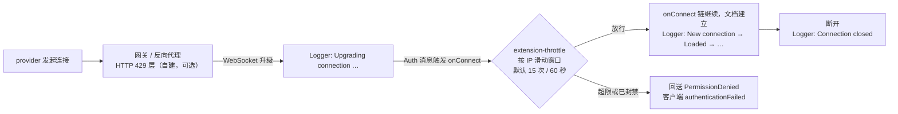

import { Meta } from '@storybook/addon-docs/blocks';

<Meta id="throttle-and-logger" title="官方扩展/限流与日志" name="Docs" />

# 限流与日志

Hocuspocus 本体不带日志，也不做连接防护：启动横幅之外一片安静，谁在连、连多快、文档发生了什么，都取决于你装了什么扩展。官方给了一对互补的小扩展——`extension-throttle` 负责**保护**，按 IP 给连接尝试限流，超限封禁一段时间；`extension-logger` 负责**观察**，在每个钩子时机打一行运行日志。两个扩展都只有一份极简配置，本课逐项核实 v4 的全部选项与默认值，讲清限流的计数口径、触发后客户端看到什么、日志怎么调音量。读完你应能预测：同一个出口 IP 下第几个接入的人会被拒、被拒的人浏览器控制台出现什么、生产环境该关掉哪几类日志。

版本基线为 Hocuspocus v4（4.7.x，要求 Node 22+）；v3 差异在正文一句话标注。两个扩展都是服务端 Node 组件，Storybook 无法稳定复现，本课证据一律用控制台输出示例（标注示意）。



| 扩展 | 选项 | 默认值 | 说明与何时调整 |
| --- | --- | --- | --- |
| Throttle | `throttle` | `15` | 窗口期内每 IP 允许的连接尝试数，超限的那次被拒并封禁；`null` 或 `false` 关闭限流 |
| Throttle | `consideredSeconds` | `60` | 滑动窗口长度（秒）；官方文档未列出，据 v4.7.x 源码核实 |
| Throttle | `banTime` | `5` | 封禁时长——**单位是分钟**；误封代价高时调小，防御刷新风暴时调大 |
| Throttle | `cleanupInterval` | `90` | 过期记录的清理周期（秒），据 v4.7.x 源码核实 |
| Logger | 九个钩子开关 | `true` | `onLoadDocument` / `onChange` / `onStoreDocument` / `onConnect` / `onDisconnect` / `onUpgrade` / `onRequest` / `onDestroy` / `onConfigure`，逐项 `false` 关闭对应日志 |
| Logger | `log` | `console.log` | 自定义输出函数，接结构化日志时替换 |
| Logger | `prefix` | `null` | 已废弃：改在 Server 配置 `name`，实例名会作为每行日志的前缀 |

Throttle 没有列出的选项一律不存在；Logger 没有「消息流」类别——每条 update 的内容、awareness、stateless 都不在它的打点范围，见「可开关的日志类别」。

## 快速上手

前置：按[安装](?path=/docs/install--docs)课装好 `@hocuspocus/server`（Node 22+），再装本课两个扩展：

```bash
npm install @hocuspocus/extension-throttle @hocuspocus/extension-logger
```

最小服务器只需把它们挂进 `extensions`：

```ts
// server.ts —— 装上限流与日志的最小服务器
import { Server } from '@hocuspocus/server';
import { Throttle } from '@hocuspocus/extension-throttle';
import { Logger } from '@hocuspocus/extension-logger';

const server = new Server({
  port: 1234,
  name: 'hocuspocus-dev-01', // 出现在启动横幅与每行日志前缀里，多实例时区分进程
  extensions: [
    new Throttle(), // 放在第一位：被拒的连接不应再触发后续扩展
    new Logger(),
  ],
});

server.listen();
```

用任意 TS 运行器启动，再拿[第一个协同文档](?path=/docs/first-document--docs)课的 provider 连上来编辑几句：

```bash
npx tsx server.ts
```

控制台输出（示意，时间与文档名以实际为准）：

```text
  Hocuspocus v4.7.1 (hocuspocus-dev-01) running at:

  > HTTP: http://0.0.0.0:1234
  > WebSocket: ws://0.0.0.0:1234

  Extensions:
  - Throttle
  - Logger

  Ready.
[hocuspocus-dev-01 2026-10-14T09:00:00.012Z] Upgrading connection …
[hocuspocus-dev-01 2026-10-14T09:00:00.101Z] New connection to "example-document".
[hocuspocus-dev-01 2026-10-14T09:00:00.180Z] Loaded document "example-document".
[hocuspocus-dev-01 2026-10-14T09:00:02.310Z] Document "example-document" changed.
[hocuspocus-dev-01 2026-10-14T09:00:04.312Z] Store "example-document".
[hocuspocus-dev-01 2026-10-14T09:00:40.220Z] Connection to "example-document" closed.
```

这一屏已经能看出分工：Throttle 全程沉默——它只在有人超限时才介入；Logger 的每一行对应一个钩子时机，格式统一为「实例名 ISO 时间 消息」。注意 `changed.` 与 `Store` 相隔约 2 秒，那是 [Server 配置](?path=/docs/server-config--docs)课的 `debounce` 默认值在起作用，不是 Logger 的问题。

## 限流：Throttle

Throttle 只做一件事：在 `onConnect` 钩子里按 IP 查两张进程内存表——`connectionsByIp` 记录每个 IP 近期的连接尝试时间戳，`bannedIps` 记录封禁中的 IP 与封禁时刻——然后决定放行还是拒绝。v4 的 onConnect 在客户端发出 Auth 消息时执行（provider 连上后立即发送 token，实践中等价于每次建连触发一次），因此计数口径是**每 IP 的文档接入尝试**：共享 WebSocket 一条连接挂多个文档时，每个文档的接入各计一次；而鉴权前刷来的消息洪流**不归它管**——那是 `maxUnauthenticated*` 限制与 `timeout` 绝对期限的职责（见 [Server 配置](?path=/docs/server-config--docs)课）。

### 按 IP 的滑动窗口计数

IP 从请求头提取：`x-real-ip` → `x-forwarded-for` → 空字符串。v4 钩子里是 web 标准 Request，没有 socket 可回退（源码注释明说）；v3 差异一句话：v3 还会回退 `request.socket.remoteAddress`，直连时每个客户端按真实远端地址各自计数。

判定逻辑按源码顺序三步：

- 未封禁的 IP：把本次时间戳推进窗口，统计最近 `consideredSeconds` 秒内的次数，**超过** `throttle`（严格大于，源码注释：设 15 意味着第 16 次被拒）就封禁并拒绝本次；
- 已封禁的 IP：直接拒绝，且**不再累计时间戳**——封禁期内反复重连不会延长封禁；
- 到期自动解封：下一次尝试正常参与计数；`cleanupInterval` 周期性清掉窗口外的时间戳与过期封禁，`onDestroy` 清理定时器。

`throttle: null` 或 `false` 整体关闭限流，判断直接放行。

把阈值调小即可复现封禁全程。设 `throttle: 3, banTime: 5`，同一 IP 连续快速重连（示意时间线）：

```text
09:00:00.000  连接尝试 1 → 放行
09:00:02.000  连接尝试 2 → 放行
09:00:04.000  连接尝试 3 → 放行
09:00:06.000  连接尝试 4 → 拒绝，并封禁该 IP 5 分钟   ← 窗口内第 4 次，超过 throttle: 3
09:00:08.000  连接尝试 5 → 拒绝（封禁期内，不累计）
09:05:06.001  连接尝试 6 → 放行                       ← banTime 到期自动解封
```

服务器控制台在这段时间**一行都不会多**：Throttle 用空参数 reject，钩子执行器对无消息的错误不打印任何内容；排在它后面的 Logger 也被中断，不会留下 New connection 日志。「网关请求在涨、应用日志安静」本身就是被限流的证据。

### 被限流后客户端看到什么

拒绝不走 WebSocket close，而是一条协议消息：onConnect 被空参数拒绝时，服务器把空拒绝落为 `Forbidden` 常量（code 4403），向客户端回送一条 PermissionDenied 消息，reason 为字符串 `"Forbidden"`。provider 收到后发出 `authenticationFailed` 事件并把 `isAuthenticated` 置回 false——与鉴权失败的路径完全相同，[鉴权与上下文](?path=/docs/auth--docs)课的判断口诀在这里同样成立：**被拒不是断线**。

```ts
provider.on('authenticationFailed', ({ reason }) => {
  console.log(reason); // "Forbidden" —— 被限流时也是它，与鉴权失败共用一条消息路径
});
```

客户端侧的两条边界：

- **不会触发自动重连。** 没有 close 事件，`status` 保持 connected，socket 一直开着；provider 收到 PermissionDenied 后也没有重试动作，[断线与重连](?path=/docs/reconnection--docs)课的重连机制根本不会被启动。文档没同步上（`unsyncedChanges` 停在 1）但界面显示已连接，就是被限流的典型样子。
- **恢复要等一个超时周期。** 服务器对未认证连接有绝对期限（`timeout`，默认 60 秒）：挂着不动的连接到期被按 4408 关闭，provider 这时才会自动重连——重连产生的新尝试在封禁期内再次被拒，如此循环；banTime 到期后的下一次重连自然恢复。默认 5 分钟封禁约对应 5 轮「拒绝 → 60 秒 → 4408 重连」。

### 与网关 429 层的分工

Throttle 生效在 WebSocket 升级**之后**的应用层；自建的 HTTP 429 层（网关、反代的限流模块）拦在升级请求**之前**，连接根本建立不起来。分工不是二选一：

- **挡洪峰靠网关。** 升级请求风暴、超大连接数这类流量问题，别让 Node 进程接——网关 429 拒掉最便宜。
- **挡应用层滥用靠 Throttle。** 升级成功后反复重连、共享连接反复挂文档这类行为，网关按请求看是正常的，只有进入 onConnect 才看得见。
- **头可信是前提。** Throttle 无条件相信 `x-real-ip` / `x-forwarded-for`，直连暴露时客户端可以随便伪造这两个头换身份绕过限流。只有放在会用真实远端地址覆写这两个头的可信代理后面，限流才有意义。
- **计数是进程内存态。** 多实例部署时每个进程各数各的，负载均衡还把同一 IP 摊到不同实例，实际限额≈单机限额乘实例数；进程重启清零。需要全局一致就上移到网关，或走 Redis（[水平扩展](?path=/docs/scaling--docs)课）。

## 日志：Logger

Logger 在九个钩子时机各打一行固定文案，输出格式统一为 `[实例名 ISO 时间] 消息`（实例名来自 Server 配置 `name`，未设置则省略），默认经 `console.log` 输出。它不解析、不聚合、不落盘——日志去哪里、怎么处理，是 `log` 函数的事。

### 可开关的日志类别

| 开关（默认全为 `true`） | 打印时机 | 文案示例 |
| --- | --- | --- |
| `onConfigure` | 配置装配完成时 | 不产出日志行（仅读取实例名） |
| `onRequest` | 每个普通 HTTP 请求 | `Incoming HTTP Request to …` |
| `onUpgrade` | WebSocket 升级时 | `Upgrading connection …` |
| `onConnect` | 文档接入尝试**通过后** | `New connection to "example-document".` |
| `onLoadDocument` | 文档加载时 | `Loaded document "example-document".` |
| `onChange` | 文档每收到一次更新 | `Document "example-document" changed.` |
| `onStoreDocument` | 落库时 | `Store "example-document".` |
| `onDisconnect` | 连接断开时 | `Connection to "example-document" closed.` |
| `onDestroy` | 服务器关闭时 | `Shut down.` |

三个边界值得贴着表格记住：

- **没有消息流类别。** 协同编辑下每条 update 只换来一行 `changed.`，内容不打；awareness、stateless 消息也不打。需要消息级观测要在 `beforeHandleMessage` / `onStateless` 钩子里自己打（入口见[自定义扩展](?path=/docs/custom-extensions--docs)课）。
- **`onChange` 是音量冠军。** 高频编辑的服务器上它每秒可能产出几十行；`onRequest` 次之。
- **官方文档示例里的 `onListen` 开关并不存在。** v4.7.x 源码（v3.4.4 同）没有这个配置项，传了会被静默忽略；`onListen` 钩子本身存在，但 Logger 不为它打日志。以本文参考表为准，排查见常见问题。

### 生产取舍：name、quiet 与 log

- **`name` 是日志的身份证。** Server 配置的 `name` 进入每行前缀，多实例日志混在一起时靠它分辨来源；Logger 自带的 `prefix` 已废弃，配置了会在启动时打弃用警告（v3 老写法迁移时挪到 Server `name` 即可）。
- **`quiet` 与 Logger 互不相干。** Server 配置 `quiet: true` 只关启动横幅，Logger 照打。想让进程整屏安静需要两件事一起做：`quiet: true` 加按需关闭 Logger 类别。
- **`log` 决定去向。** 换成结构化日志只需替换一个函数：

```ts
new Logger({
  // 生产配置：保留连接与存储轨迹，关掉高频类别
  onChange: false,
  onRequest: false,
  log: (message) => myStructuredLogger.info(message),
})
```

开发环境默认全开；生产环境至少关 `onChange` 与 `onRequest`，保留连接、加载、存储、断开四类，正好够回放一个文档的完整生命周期。

## 排查滥用的最小工作流

怀疑有人刷连接时，两个扩展加网关日志组成一条最短排查链：

1. **Logger 看频率。** `New connection` 行的密度异常（某文档被高频接入）就是信号。注意 Logger 不打 IP——它只能告诉你「哪个文档在被高频连接」，回答不了「谁在连」。
2. **网关日志看源头。** 在反向代理的访问日志里按 IP 聚合升级请求，拿到真实来源与频率。
3. **调 Throttle 参数。** 按正常业务峰值定 `throttle` 与 `consideredSeconds`，`banTime` 给足冷却时间。
4. **对照验证。** 限流生效的样子是「网关请求还在涨、Logger 安静」——被拒的尝试不经过后续钩子；客户端侧 `authenticationFailed` 消失的时刻即 banTime 到期。

## 最佳实践

- **Throttle 永远放 `extensions` 第一位。** 钩子按注册顺序执行、一个拒绝即中断后续扩展：先限流，被拒连接不会浪费后续扩展的执行，Logger 也不会为滥用流量留下误导性的日志行。官方文档同样强调先注册它。
- **把限流当减速带，不是安全边界。** IP 头可伪造（需可信代理覆写）、计数随进程重启清零、多实例各自为政——这三个前提决定 Throttle 只能提高滥用成本，真正的准入控制是鉴权（见[鉴权与上下文](?path=/docs/auth--docs)课）。
- **日志按环境分层。** 开发全开，生产关高频类别；需要更高分辨率（IP、消息体、耗时）时不要扩 Logger——它没有这些槽位，在对应钩子里自己打点。
- **本地开发直接关限流。** `throttle: false` 比调大阈值更省心：取不到代理头时全服务器共享一份预算，开发期的热重载就是最频繁的「攻击者」。

## 常见问题

- 本地开发什么都没干，所有连接陆续报 authenticationFailed
  先查是否直连（没走反代）：取不到 `x-real-ip` / `x-forwarded-for` 时所有客户端共享同一个空 IP，全服务器只有一份 15 次 / 60 秒的预算，Vite 热重载、多开标签页很快烧完。开发环境传 `throttle: false`，或本地挂反代注入真实头。
- 办公网、校园网的一批用户同时被拒
  他们共享同一个出口 IP，`throttle: 15` 是整个 NAT 出口的预算；一个页面挂多个文档（共享连接下每文档各计一次）会成倍消耗。调大 `throttle` 或 `consideredSeconds`；`banTime` 不宜过长——误封的代价是整网用户一起冷却。
- 客户端报 authenticationFailed，但网络面板里连接是通的
  这是指定行为：限流拒绝走 PermissionDenied 消息，没有 close 事件，`status` 保持 connected，自动重连不会被触发。别按断线排查——先到网关日志确认封禁，60 秒后能看到一次 4408 重连再次被拒即坐实。
- 明明配了限流，压测却完全没被拦
  按序排查三个原因：直连暴露时请求自带伪造的 `x-forwarded-for`，每个假 IP 各自计数；多实例部署，每个进程各数各的；进程刚重启过，计数已清零。要全局一致就上移到网关或 Redis。
- 装了 Logger 却看不到某类日志
  先对照「可开关的日志类别」表确认对应开关没被传成 `false`——尤其别照官方文档示例传 `onListen`，这个开关在 v4.7.x 源码中不存在，传了被静默忽略；再确认连接确实经过了挂 Logger 的那个实例（自定义服务器接了两套 Hocuspocus 时容易挂错，见[接入现有服务器](?path=/docs/custom-server--docs)课）。

## 总结回顾

摘要：

两个官方扩展补上 Hocuspocus 缺失的保护与观察。Throttle 在 onConnect 钩子里按 IP 做滑动窗口计数：默认 60 秒 15 次，第 16 次触发封禁，`banTime`（分钟）内直接拒绝且不累计、到期自动解封；IP 取自 `x-real-ip` / `x-forwarded-for`（v3 还有 socket 回退），计数的是文档接入尝试而非消息量。被拒的客户端收到 PermissionDenied 消息、触发 `authenticationFailed`，连接不断、不自动重连，等 60 秒超时重连再撞一次，直到封禁到期。Logger 在九个钩子时机打固定文案，前缀是 Server `name` 加 ISO 时间，默认走 `console.log`；`onChange` 音量最大，没有消息流类别，文档示例的 `onListen` 开关不存在。两者的局限同源：进程内存态、粗粒度——全局限流上移网关或 Redis，消息级观测在钩子里自己打。

一句话：

> Throttle 是进程内的减速带，Logger 是钩子级的观察窗——IP 可信靠代理保证，全局一致靠网关，更细的观测都得自己打点。

知识要点：

- Throttle 的计数维度与默认值是什么？封禁期内反复重连会延长封禁吗？
- v4 从哪里取 IP？与 v3 的差别是什么？为什么直连开发时所有客户端共享一份预算？
- 计数口径是消息量还是连接尝试？鉴权前的消息洪流由什么机制防护？
- 被限流的客户端看到什么事件？为什么自动重连不会立刻触发？恢复要等多久？
- Logger 有哪九个日志类别？输出格式与默认去向是什么？哪个类别生产环境必关？
- `quiet` 关掉的是什么？与 Logger 的日志有什么关系？
- 多实例部署与进程重启对限流计数有什么影响？需要全局一致时在哪一层做？

## 参考资料

- [Throttle（官方文档：示例与注册顺序要求）](https://tiptap.dev/docs/hocuspocus/server/extensions/throttle)
- [Logger（官方文档：开关与自定义 log 示例；其中 onListen 项与 v4.7.x 源码不符，本课已核实）](https://tiptap.dev/docs/hocuspocus/server/extensions/logger)
- [extension-throttle 源码 index.ts（v4：四项配置默认值、滑动窗口与封禁实现、IP 提取）](https://github.com/ueberdosis/hocuspocus/blob/main/packages/extension-throttle/src/index.ts)
- [extension-throttle v3.4.4 源码（IP 提取的 socket 回退差异）](https://github.com/ueberdosis/hocuspocus/blob/v3.4.4/packages/extension-throttle/src/index.ts)
- [extension-logger 源码 Logger.ts（v4：九类开关默认值、输出格式、废弃 prefix 警告）](https://github.com/ueberdosis/hocuspocus/blob/main/packages/extension-logger/src/Logger.ts)
- [ClientConnection.ts（v4 源码：onConnect 在 Auth 消息时执行、空拒绝落为 Forbidden、PermissionDenied 回送路径）](https://github.com/ueberdosis/hocuspocus/blob/main/packages/server/src/ClientConnection.ts)
- [Hocuspocus.ts（v4 源码：hooks 按扩展注册顺序执行、拒绝即中断、无消息错误不打印）](https://github.com/ueberdosis/hocuspocus/blob/main/packages/server/src/Hocuspocus.ts)
- [HocuspocusProvider.ts（v4 源码：PermissionDenied 到 authenticationFailed 事件的转换）](https://github.com/ueberdosis/hocuspocus/blob/main/packages/provider/src/HocuspocusProvider.ts)
- [CloseEvents.ts（@hocuspocus/common：Forbidden 4403 等关闭码常量）](https://github.com/ueberdosis/hocuspocus/blob/main/packages/common/src/CloseEvents.ts)
- [Server.ts（v4 源码：启动横幅格式与 Extensions 列表）](https://github.com/ueberdosis/hocuspocus/blob/main/packages/server/src/Server.ts)
