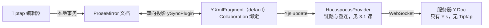

import { Canvas, Controls, Meta } from '@storybook/addon-docs/blocks';
import * as TiptapSetup from './tiptap-setup.stories';

<Meta of={TiptapSetup} name="Docs" />

# Tiptap 协同接入

本课进入编辑器协同阶段：把 Tiptap 编辑器接到 Hocuspocus 的协同文档上。核心判断只有一句：Collaboration 扩展不负责传输，它只把编辑器的文档源从「本地 ProseMirror 文档」换成「Y.Doc 中某个 Y.XmlFragment 的双向投影」；把 update 搬到服务器的是挂在同一份 Y.Doc 上的 HocuspocusProvider（配置与事件见 [HocuspocusProvider](?path=/docs/provider--docs) 课），服务器自始至终只见 Yjs 文档，不需要 Tiptap。读完本课你应能预测：A 端键入一段文字后会经过哪些对象到达服务器与第二个客户端、初始内容写在哪里才生效、两端扩展集不一致时编辑器会怎样自保。

版本基线：Hocuspocus v4（4.7.x，仅约束服务端）+ Tiptap 3.x（工作区为 3.32 系）。Tiptap 2 的差异在涉及处一句话标注；示例为原生 TS + DOM，React 的 useEditor 写法只在文末一句话带过（有独立课）。官方 Collaboration 文档同时宣传托管的 Tiptap Collab Cloud（TiptapCollabProvider），本手册以自托管 Hocuspocus 为准——两者共用同一套 Collaboration 扩展与投影路径，换 provider 不需要改编辑器接线。Tiptap 自身的基础（schema、marks、nodes、自定义扩展开发）不属于本课边界。



Collaboration 的配置面很小，`document` 与 `fragment` 至少给一个（都不给时扩展在取 fragment 时直接抛错）：

| 配置项 | 默认值 | 用途与调整时机 |
| --- | --- | --- |
| `document` | `null` | 绑定的 Y.Doc；接服务器文档时传 `provider.document` |
| `field` | `'default'` | Y.XmlFragment 名；一份 Y.Doc 承载多个字段时用它区分 |
| `fragment` | `null` | 直接传 Y.XmlFragment，替代 document + field |
| `provider` | `null` | 遗留参数：当前版本不参与绑定，传不传都不影响同步 |
| `onFirstRender` | 无 | Yjs 内容首次渲染进编辑器时回调 |
| `ySyncOptions` / `yUndoOptions` | 无 | 透传 y-tiptap 同步/撤销插件的选项 |

## 数据链路

编辑内容在三层对象之间流动，每层各管一件事：

- **编辑器层（ProseMirror 文档）**：schema 化的富文本状态，键入、选区、命令都发生在这一层。
- **协同层（Y.Doc 与 Y.XmlFragment）**：Collaboration 挂载的 ySyncPlugin 维护「fragment 与文档」的双向投影——本地事务写进 fragment 产生 Yjs update；远端 update 重渲染成新的编辑器文档。
- **传输层（provider 与服务器）**：Y.Doc 上的 update 监听就是 provider 的搬运职责，服务器把更新汇入同名房间文档再广播给其他端。

两个方向的关键差异：本地编辑产生的 update 会上行；从网络收到的更新以 provider 为 origin 应用、不再上行（origin 循环抑制，[第一个协同文档](?path=/docs/first-document--docs) 课的实例演示过这条规则）。

撤销历史不在 StarterKit 里：Collaboration 自带 yUndoPlugin，并接管 undo / redo 命令与 Mod-z 快捷键——这正是接线时要关 UndoRedo 的原因；协同撤销的作用域与本地历史语义见 [编辑器撤销与历史](?path=/docs/editor-undo--docs) 课。多人光标与选区高亮同样不是 Collaboration 的职责，由 Collaboration Caret 扩展基于 provider 的 awareness 实现，见 [协同光标](?path=/docs/collaboration-caret--docs) 课。

### 服务端不需要 Tiptap

服务器只处理 Yjs update：缓存同名 Y.Doc、广播、debounce 落库。编辑器的 schema、扩展、样式都不上服务器。Tiptap 代码只在两处出现：客户端编辑器的扩展集，以及服务端把历史 JSON / HTML 转成 Y.Doc 的 `TiptapTransformer`（转换细节见 [数据转换](?path=/docs/transformer--docs) 课）。

由此得到本课最重要的约定：**schema 是协同契约**。所有协同客户端必须挂同一套扩展，服务端转换用的扩展清单也要与客户端 schema 兼容——某端写入了自己 schema 里不存在的节点类型后，缺扩展的一端投影失败、编辑器冻结自保（现象与处理见常见问题）。运行中的服务器对内容零感知，持久化只存 update 序列（见 [自定义持久化](?path=/docs/custom-persistence--docs) 课）。

## 编辑器接线

### 客户端：provider 与 Collaboration

```ts
import { Editor } from '@tiptap/core';
import StarterKit from '@tiptap/starter-kit';
import Collaboration from '@tiptap/extension-collaboration';
import { HocuspocusProvider } from '@hocuspocus/provider';

// provider 管「链路」：连接、鉴权、重连（配置与事件见 3.1 课）
const provider = new HocuspocusProvider({
  url: 'ws://127.0.0.1:1234',
  name: 'example-document',
});

const editor = new Editor({
  element: document.querySelector('#editor'),
  extensions: [
    StarterKit.configure({
      // Collaboration 自带撤销历史（yUndoPlugin），StarterKit 的 UndoRedo 必须关闭；
      // Tiptap 2 中这个开关叫 history
      undoRedo: false,
    }),
    // 编辑器文档 = provider.document 中名为 default 的 Y.XmlFragment 的投影
    Collaboration.configure({
      document: provider.document,
    }),
  ],
});
```

三处要点：

- `document: provider.document`：provider 不传 `document` 时内部自建 Y.Doc 并挂在 `provider.document` 上；归属与多端共享写法见 3.1 课「document 的归属」。
- `undoRedo: false`：yUndoPlugin 与 ProseMirror 内建历史互斥，Collaboration 创建时会检测并输出控制台警告。
- 不传 provider 也能创建：Collaboration 只认 Y.Doc，断网编辑、多字段等用法都因此成立（长期离线的持久化见 [离线编辑与恢复](?path=/docs/editor-offline--docs) 课）。

### 服务器：标准配置

```ts
import { Server } from '@hocuspocus/server';

const server = Server.configure({
  port: 1234,
  // 可选：校验 token（见 2.3 课）
  async onAuthenticate({ token }) {
    if (token !== 'super-secret-token') {
      throw new Error('Not authorized!');
    }
  },
  // 文档首次被打开时调用：从存储恢复，或预填初始内容（见下一节）
  async onLoadDocument({ documentName, document }) {
    // 留空 = 空文档按需创建，客户端拿到空编辑器
  },
  // 增量 update 到达时触发（高频，只做轻量工作，见 2.2 课）
  async onChange({ documentName }) {},
  // debounce 后的全量落库时机（存储对接见 2.4 课）
  async onStoreDocument({ documentName, document }) {},
});

server.listen();
```

这就是协同服务器的全部接线：文档按 name 首次被打开时创建（或从存储恢复），之后服务器一直在 update 流上工作。钩子的触发顺序、文档缓存与自动卸载见 [文档生命周期](?path=/docs/document-lifecycle--docs) 课。

下面的实例用两个真实 Tiptap 编辑器复现这条链路（模拟语义：文档页内没有真实 WebSocket 服务器，MiniRelay 用内存扮演服务器与 provider 的搬运职责，绑定、投影与转发的代码路径与真实链路一致）：客户端 A 可编辑，客户端 B 是只读投影。

<Canvas of={TiptapSetup.DataFlow} />
<Controls of={TiptapSetup.DataFlow} />

| 读者操作 | 可观察证据 |
| --- | --- |
| 在 A 端编辑器里直接键入 | B 端投影同帧出现相同内容，「转发的 update」递增 |
| Controls「A 端插入文本」 | 同上：`insertContent` 命令与手工键入走同一条编辑路径 |
| 「服务器可达」切到离线后继续键入 | A 端仍可编辑，「离线积压」递增，B 端停止更新 |
| 切回在线 | 一次补传后 B 端追平，「离线积压」归零 |

「离线仍可编辑」是「Collaboration 只认 Y.Doc」的直接证据：编辑器始终投影本地 fragment，断网只是 provider 搬不动 update，补传由重连后的初始同步完成。浏览器刷新后的长期离线要靠 y-indexeddb，见 [离线编辑与恢复](?path=/docs/editor-offline--docs) 课。

## 初始内容

协作文档的初始内容只有两个正确时机，共同点是：**先写 Y.Doc，再让编辑器投影**。

1. **服务器预填（官方推荐）。** 文档第一次被打开、还是空文档时，在 `onLoadDocument` 写入。官方路径用 `TiptapTransformer.toYdoc` 把 Tiptap JSON 转成 Y.Doc 再并入房间文档；v4 起 `onLoadDocument` 也可以直接返回一份 Y.Doc 或 Uint8Array 更新。转换用的扩展清单必须与客户端 schema 一致。
2. **客户端本地（无服务器或纯离线场景）。** 在编辑器创建之前把初始 update 应用进 Y.Doc，编辑器创建时的首次投影就会带上内容。

服务端预填的写法：

```ts
import { Server } from '@hocuspocus/server';
import { TiptapTransformer } from '@hocuspocus/transformer';
import StarterKit from '@tiptap/starter-kit';
import * as Y from 'yjs';

const server = Server.configure({
  async onLoadDocument({ documentName, document }) {
    const stored = await loadFromStorage(documentName); // 自有存储中的 Tiptap JSON
    if (!stored) {
      return; // 没有存储内容：保持空文档
    }
    // 扩展清单须与客户端 schema 一致；field 与编辑器的 Collaboration 配置对应
    const converted = TiptapTransformer.toYdoc(stored, 'default', [StarterKit]);
    Y.applyUpdate(document, Y.encodeStateAsUpdate(converted));
    converted.destroy();
  },
});

server.listen();
```

客户端本地等价写法（离线场景）：

```ts
const ydoc = new Y.Doc();
// 编辑器创建之前应用初始内容
Y.applyUpdate(ydoc, initialUpdate);
const editor = new Editor({
  extensions: [
    StarterKit.configure({ undoRedo: false }),
    Collaboration.configure({ document: ydoc }),
  ],
});
```

错误时机是给 Editor 传 `content` 选项：编辑器创建时 Collaboration 会把 fragment 的当前状态投影进来，`content` 被直接覆盖；fragment 为空时编辑器显示空文档，而且空占位不会被写回 Yjs（y-tiptap 源码明确避免把 schema 占位文档写入共享内容）——`content` 静默丢失，两端都看不到。「创建后再 `insertContent`」能让内容显示，但性质已经变成一次普通编辑：它作为 update 同步给所有端，第二个客户端打开同一文档再执行一遍就重复注入。

下面的实例把三种时机做成对照（模拟语义同上：MiniRelay 扮演服务器与 provider，`onLoadDocument` 的预填用 `TiptapTransformer` 在房间文档上完成）：

<Canvas of={TiptapSetup.InitialContent} />
<Controls of={TiptapSetup.InitialContent} />

| 读者操作 | 可观察证据 |
| --- | --- |
| 选「服务器预填（推荐）」 | 两端都显示预填段落，「转发的 update」为 0 条（内容来自初始同步） |
| 选「editor content 选项」 | 两端皆为空、update 为 0 条：`content` 被投影覆盖且不写回 Yjs |
| 选「创建后 insertContent」 | 两端都有内容，但 update 为 1 条：它是一次编辑，多端打开会重复注入 |

## 最佳实践

- **把 schema 当协同契约管理。** 客户端扩展集在一处定义、多处 import；服务端 `TiptapTransformer` 用同一份清单。新增扩展时所有端同步升级，避免某端写入他人无法投影的节点。
- **一份 Y.Doc 承载多个字段。** 用 `field: 'title'` 与默认正文并列，多个 Collaboration 实例绑同一份 `document`、各自绑定不同 field；服务器与存储仍是同一份文档。
- **依赖文档内容的初始化逻辑等 synced。** provider 同步完成前编辑器可能先显示空文档（服务器还在加载与传输），基于内容做初始化的扩展（如 UniqueID）应在 provider synced 之后再挂载；信号语义见 3.1 课。
- **编辑器与 provider 的生命周期绑定。** 路由卸载时先 `provider.destroy()` 再 `ydoc.destroy()`，并 `editor.destroy()` 释放投影监听（销毁顺序的依据见 3.1 课）。React 项目交给 hooks 托管，写法一句话：`useEditor` 传入同一组 extensions，provider 由 `@hocuspocus/provider-react` 创建与销毁，见 [React 集成](?path=/docs/react-integration--docs) 课。

## 常见问题

- 编辑器打开是空的，或给 Editor 传的 `content` 不见了
  协作文档的内容源是 Yjs 投影，`content` 选项会被覆盖、不写回 Yjs。把初始内容挪到 `onLoadDocument`（服务器预填）或编辑器创建前的 `Y.applyUpdate`，对照见「初始内容」的实例。
- 某个客户端缺扩展（或版本不同），打开文档后编辑器「卡死」不再接受输入
  Yjs 内容投影进本地 schema 失败，y-tiptap 会置 projectionError 并冻结本地文档变更（这是自保，防止把无法映射的内容再次写出）。统一所有端的扩展集与版本后重开即可；开发期可开启 editor 的 `enableContentCheck` 接收 `contentError` 事件定位出错的节点。
- 控制台警告 "collaboration comes with its own history support and is not compatible with undo-redo"
  StarterKit 的 UndoRedo 没关：写成 `StarterKit.configure({ undoRedo: false })`；Tiptap 2 的等价写法是 `history: false`。保留两套撤销系统会互相覆盖历史与选区。
- 每次打开文档，初始内容越来越多（重复段落）
  `onLoadDocument` 或本地初始化没有判断空文档，每次打开都插入一遍。只在文档为空时写入——服务端判断 `document.getXmlFragment('default').length === 0` 再注入，或改为直接返回存储的 update。

## 总结回顾

摘要：

Tiptap 接入协同的本质是一次文档源替换：Collaboration 扩展用 ySyncPlugin 把编辑器文档与 Y.Doc 中名为 `field`（默认 `'default'`）的 Y.XmlFragment 双向投影，配置面只有 `document`、`field`、`fragment` 等少数选项；把 update 搬到服务器的是挂在同一份 Y.Doc 上的 HocuspocusProvider，origin 循环抑制保证远端更新不会回传。服务器只见 Yjs update，不需要 Tiptap，`TiptapTransformer` 只在服务端做 JSON 到 Y.Doc 的转换。接线时必须关闭 StarterKit 的 UndoRedo（Tiptap 2 为 history），撤销由 Collaboration 自带的 yUndoPlugin 接管。初始内容只有两个正确时机——服务器在空文档时的 `onLoadDocument` 预填、客户端在编辑器创建前写 Y.Doc；`content` 选项会被投影覆盖而静默丢失，创建后再插入则变成会同步、会重复的普通编辑。schema 是协同契约：两端扩展集不一致时，缺扩展的一端投影失败、编辑器冻结自保。

一句话：

> Collaboration 只把编辑器绑到 Y.XmlFragment 的投影上，内容流动靠挂在 Y.Doc 上的 provider；初始内容要么由服务器在空文档时预填、要么在编辑器创建前写入——`content` 选项在协作文档里不生效。

知识要点：

- 编辑内容从编辑器到服务器要经过哪些对象？每一层的职责是什么？
- `Collaboration.configure` 至少要给什么？`provider` 选项参与绑定吗？
- 为什么 StarterKit 必须关 UndoRedo？Tiptap 2 的等价写法是什么？
- 服务器为什么不需要 Tiptap？schema 不一致时缺扩展的一端会发生什么？
- 协作文档的初始内容有哪些正确时机？`content` 选项为什么不生效？
- 断网时编辑器还能编辑吗？靠什么机制补传？

## 参考资料

- [Collaborative editing（Hocuspocus 官方指南：provider 与 Collaboration 的接线）](https://tiptap.dev/docs/hocuspocus/guides/collaborative-editing)
- [Collaboration 扩展（Tiptap 编辑器文档：配置项与默认值）](https://tiptap.dev/docs/editor/extensions/functionality/collaboration)
- [Tiptap Collaboration 总览（官方：自托管 Hocuspocus 与 Collab Cloud 的边界）](https://tiptap.dev/docs/collaboration/getting-started/overview)
- [Hocuspocus Server 钩子（onLoadDocument 预填与 TiptapTransformer）](https://tiptap.dev/docs/hocuspocus/server/hooks)
- [extension-collaboration 源码（选项定义、undoRedo 检测、provider 为遗留参数）](https://github.com/ueberdosis/tiptap/tree/main/packages/extension-collaboration)
- [y-tiptap 源码（ySyncPlugin 投影、空占位不写回、projectionError 冻结）](https://github.com/ueberdosis/tiptap/tree/main/packages/y-tiptap)
- [ueberdosis/hocuspocus 仓库（协作指南与 playground 示例）](https://github.com/ueberdosis/hocuspocus)
