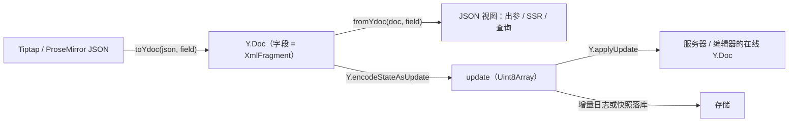

import { Canvas, Controls, Meta } from '@storybook/addon-docs/blocks';
import * as Transformer from './transformer.stories';

<Meta of={Transformer} name="Docs" />

# 数据转换

Y.Doc 是一份二进制 CRDT：协同与合并都发生在它的 update 流里，但业务系统拿到手里要的是 JSON——落库时给查询用的视图副本、API 出参、SSR 渲染、把存量内容导入协同文档，全都绕不开「JSON ↔ Y.Doc」这道坎。`@hocuspocus/transformer` 就是这层桥。包里只有两个 transformer：`TiptapTransformer` 与 `ProsemirrorTransformer`，都以「字段名 + schema/extensions」为轴，把 ProseMirror 兼容的文档 JSON 转成可同步的 Y.Doc，或把 Y.Doc 读回 JSON。读完你应能预测：给一段 Tiptap JSON 能得到一份可直接 `Y.applyUpdate` 的 Y.Doc；给一份协作文档能读回 JSON；但转换是一次性的导入/导出——产物自带一份新历史，把它重放进已有内容的文档会得到重复内容，而不是与原文档合并。

版本基线为 `@hocuspocus/transformer` 4.7.1（与 server 同版本组），peer 依赖 `@tiptap/core` ^3、`y-prosemirror` ^1.2.1、`yjs` ^13.6.8。transformer 的 API 自 v1 起保持不变，v3 → v4 没有迁移点；变化在配套侧——v4 的 `onLoadDocument` 可以直接 return 一份 Yjs update（`Uint8Array`），与本课转出的二进制直接对接。transformer 是同构库：下面的实例在浏览器里真实运行已安装的 `@hocuspocus/transformer` 与 `yjs`，不需要网络与服务器。



两个 transformer 的全部公开 API 如下（对照 4.7.1 源码逐一核实）：

| Transformer | 成员 | 签名要点 | 默认值 |
| --- | --- | --- | --- |
| `TiptapTransformer` | `toYdoc(json, fieldName?, extensions?)` | 返回 `Y.Doc`；extensions 经 `getSchema` 生成 schema | `fieldName = 'default'`，extensions 默认 `[StarterKit]` |
| `TiptapTransformer` | `fromYdoc(doc, fieldName?)` | 返回文档 JSON；不传字段名时返回「字段名 → JSON」对象 | 内部委托 `ProsemirrorTransformer` |
| `TiptapTransformer` | `.extensions(list)` | 预设默认 extensions，返回自身 | `[StarterKit]` |
| `ProsemirrorTransformer` | `toYdoc(json, fieldName?, schema?)` | 返回 `Y.Doc`；JSON 为空直接抛错 | `fieldName = 'prosemirror'`，默认 schema 只有纯文本 |
| `ProsemirrorTransformer` | `fromYdoc(doc, fieldName?)` | 传单个字段名返回该字段 JSON；传 `undefined` 或空数组返回全部字段 | 全部字段 = `doc.share` 的所有键 |
| `ProsemirrorTransformer` | `.schema(schema)` | 预设默认 Schema，返回自身 | `doc: { content: 'text*' }` 加 `text` 节点 |

对照 npm 全部已发布版本（1.0.0-alpha.10 到 4.7.1）与源码历史核实：这个包**从来没有第三个「JSON transformer」**，也没有 `toUint8Array` / `fromUint8Array` 导出。JSON 与二进制之间的编解码属于 yjs 核心（`Y.encodeStateAsUpdate` / `Y.applyUpdate`），下一节就是把两者接成闭环；已被这个记忆坑过的读者，直接跳到文末常见问题第一条。

## 两个 transformer

两个 transformer 共享同一套模型，理解三个词就够了：

- **字段名（fieldName）**：转换落点在 Y.Doc 顶层的一个共享字段——一个 `Y.XmlFragment`。Tiptap 编辑器的 Collaboration 扩展默认读写 `'default'` 字段，所以服务端底稿要转进 `'default'`，在线编辑器才能直接接上；`ProsemirrorTransformer` 自己的默认字段名是 `'prosemirror'`。跨端对接时永远显式传字段名，不赌默认值。
- **schema/extensions**：决定 JSON 能转什么、转出什么，是双向的过滤器（细节见「schema 决定能转什么」一节）。
- **引擎**：两个 transformer 是 y-prosemirror 的 `prosemirrorJSONToYDoc` / `yDocToProsemirrorJSON` 之上的两层皮——Tiptap 层收 extensions 用 `getSchema` 造 schema，ProseMirror 层直接收 `Schema`。行为完全一致，差别只在输入形态。

选型一句话：内容源头是 Tiptap 编辑器（JSON 就是编辑器 `getJSON()` 的产物）用 `TiptapTransformer`；没有 Tiptap 依赖、手上有 PM JSON 或自建 `Schema` 用 `ProsemirrorTransformer`。

### Tiptap transformer

```ts
import { TiptapTransformer } from '@hocuspocus/transformer';
import Document from '@tiptap/extension-document';
import Paragraph from '@tiptap/extension-paragraph';
import Text from '@tiptap/extension-text';

// Tiptap JSON → Y.Doc：字段名与编辑器 Collaboration 的 field 对齐（默认 'default'）
const ydoc = TiptapTransformer.toYdoc(tiptapJson, 'default', [
  Document,
  Paragraph,
  Text,
]);

// Y.Doc → JSON：传字段名，直接返回该字段的文档 JSON
const json = TiptapTransformer.fromYdoc(ydoc, 'default');

// 不传字段名：返回全部字段的对象，如 { default: {...}, title: {...} }
const allFields = TiptapTransformer.fromYdoc(ydoc);
```

三个行为细节（均出自源码）：

- 默认 extensions 是 `[StarterKit]`，schema 可能比你的编辑器大、也可能小。生产上建议显式传入与编辑器一致的 extensions 列表，两端 schema 不一致时，转出的 JSON 形状会各不相同。
- 多字段时不要用数组字段名：`toYdoc(json, ['default', 'title'])` 会把**同一份 JSON** 铺进每个字段（源码对数组逐字段各转一次再合并进同一个 Y.Doc）。不同字段放不同内容，应分别 `toYdoc` 后用 `document.merge(field)` 合并，官方 Multi subdocuments 指南就是这个写法。
- `fromYdoc(doc)` 不传字段名时返回 `doc.share` 里的所有字段；字段集合由文档实际有什么决定，业务自建的 `Y.Map` 等非 XML 字段不在转换范围内。

### ProseMirror transformer

```ts
import { ProsemirrorTransformer } from '@hocuspocus/transformer';
import { Schema } from '@tiptap/pm/model';

// 默认 schema 只有纯文本（doc: text*），转富文本 JSON 会直接抛错，
// 先用 .schema() 换成与文档匹配的 Schema
const schema = new Schema({
  nodes: {
    text: {},
    paragraph: { group: 'block', content: 'text*' },
    doc: { content: 'block+' },
  },
});

const ydoc = ProsemirrorTransformer.schema(schema).toYdoc(pmJson, 'content');
```

边界与报错：

- `toYdoc` 收到空值或非法输入时抛 `You've passed an empty or invalid document to the Transformer...`——上游 JSON 加载失败传了 `undefined` 时就是这个错。
- 转纯文本以外的内容必须换 schema；`Unknown node type: paragraph` 这类报错就是默认 schema 不认识段落导致的（下一节实例可以复现）。
- 包 README 写着「Tiptap / ProseMirror JSON and HTML」，但 4.7.1 里没有任何 HTML 转换导出：HTML 导入要先转成 Tiptap JSON（官方 Hooks 页明确此点），HTML 输出交给 Tiptap 自身的渲染工具或 prosemirror-model 的序列化器，都不在本包职责内。

## JSON 与二进制的往返

`toYdoc` / `fromYdoc` 只站在 JSON 一端；JSON 变二进制、二进制变回 JSON 的闭环要靠 yjs 的两个核心 API 接起来：

```ts
import { TiptapTransformer } from '@hocuspocus/transformer';
import * as Y from 'yjs';

// ① JSON → Y.Doc
const ydoc = TiptapTransformer.toYdoc(seedJson, 'default');

// ② Y.Doc → 二进制：整份状态编码成一条 update，按任意存储方式落库
const update = Y.encodeStateAsUpdate(ydoc);

// ③ 二进制 → Y.Doc：恢复真源永远是二进制
const restored = new Y.Doc();
Y.applyUpdate(restored, update);

// ④ Y.Doc → JSON：读回视图
const json = TiptapTransformer.fromYdoc(restored, 'default');
```

这一条链就是 transformer 与落库的分界线：transformer 管 JSON 与 Y.Doc 互转，二进制侧的增量日志、快照、压缩是 [自定义持久化](?path=/docs/custom-persistence--docs) 课的内容——`update` 形态的产物两种落库模型都能直接吃。反过来，[自定义持久化](?path=/docs/custom-persistence--docs) 课的官方警告在这里再次生效：JSON 只能当视图副本，恢复真源必须是二进制，只存 JSON 重建的文档会丢协同历史。

下面的实例真实运行这条链：修改 JSON，看 `toYdoc` 转出的字段与 `Y.encodeStateAsUpdate` 的字节数，再核对回读结果。

<Canvas of={Transformer.Roundtrip} />
<Controls of={Transformer.Roundtrip} />

| 读者操作 | 可观察证据 |
| --- | --- |
| 在「Tiptap JSON」里改文字、增删段落 | 「Y.Doc 字段」的顶层块数与「二进制 update」字节数同步变化 |
| 对照「回读 JSON」读数 | 与输入在 schema 语义层保持一致——link 等默认属性由 schema 补齐属预期 |
| 把 JSON 改成 schema 不认识的写法（如把 `heading` 改成 `callout`） | 「toYdoc 转换失败」读数出现，错误消息显示具体原因 |
| 打开 Show code | 看到该 Canvas 实际执行的 `transformer-model.ts`：`toYdoc` → `encodeStateAsUpdate` → `applyUpdate` → `fromYdoc` 的真实调用 |

## schema 决定能转什么

schema（或 extensions 生成的 schema）是双向过滤器，两个方向的行为不对称：

- **JSON → Y.Doc 方向会校验**：JSON 先经 prosemirror-model 的 `Node.fromJSON` 过一遍——schema 不认识的节点类型抛 `RangeError: Unknown node type: …`，不认识的 mark 类型抛 `SyntaxError`；schema 里没声明的**属性**则被静默丢弃，不报错。
- **Y.Doc → JSON 方向按 schema 序列化**：输出永远是 schema 能表达的形状，输出里有哪些属性由 schema 声明决定。

所以「转换保真」本质是「schema 覆盖」：两端 extensions 至少要兼容，否则同一份文档在两端读出的 JSON 形状不同。也因为这个，官方口径与实现都只覆盖 **ProseMirror 兼容 schema**（Tiptap / ProseMirror JSON）——引擎 y-prosemirror 只理解 PM schema，Slate、Quill 等其他编辑器的文档模型不在支持范围，Slate 文档要先转成 PM/Tiptap JSON 才能进 transformer。

实例把三种输入放在一起对照：标准内容、带未声明属性的 link mark、带未声明节点类型的文档。

<Canvas of={Transformer.SchemaFilter} />
<Controls of={Transformer.SchemaFilter} />

| 读者操作 | 可观察证据 |
| --- | --- |
| 把「转换样本」切到「未知属性」 | 转换成功，但回读 attrs 里没有 `data-note`——未声明的属性被静默丢弃 |
| 切到「未知节点」 | `toYdoc` 抛 `RangeError: Unknown node type: callout`，读数显示错误消息 |
| 切回「标准内容」 | 转换成功，`href` 原样保留，target / rel 等缺省属性由 schema 默认值补齐 |
| 打开 Show code | 看到三种样本的 JSON 与 `toYdocSafe` 的捕获逻辑 |

## 服务端使用模式

服务端在两个时机用 transformer，正好对应 JSON 进、JSON 出两个方向（钩子触发时机见 [文档生命周期](?path=/docs/document-lifecycle--docs) 课）：

```ts
// server.ts —— JSON 底稿导入 + JSON 视图输出
import { Server } from '@hocuspocus/server';
import { TiptapTransformer } from '@hocuspocus/transformer';
import Document from '@tiptap/extension-document';
import Paragraph from '@tiptap/extension-paragraph';
import Text from '@tiptap/extension-text';
import * as Y from 'yjs';
import { db } from './store'; // loadSeedJson / saveJsonView

const server = new Server({
  async onLoadDocument({ documentName, document }) {
    // ① 底稿导入：只在文档为空时注入（官方 Multi subdocuments 指南的守卫写法）
    if (document.isEmpty('default')) {
      const seedJson = await db.loadSeedJson(documentName);
      if (seedJson) {
        const ydoc = TiptapTransformer.toYdoc(seedJson, 'default', [
          Document,
          Paragraph,
          Text,
        ]);
        Y.applyUpdate(document, Y.encodeStateAsUpdate(ydoc));
        // v4 起也可以直接 return ydoc，或 return Y.encodeStateAsUpdate(ydoc)
      }
    }
  },

  async onChange({ documentName, document }) {
    // ② JSON 视图输出：防抖后的只读副本，供查询、渲染、下游系统使用
    const view = TiptapTransformer.fromYdoc(document, 'default');
    await db.saveJsonView(documentName, view);
  },
});

server.listen();
```

三个必须知道的边界：

- **底稿只能进空文档。** 官方 Hooks 页把 `toYdoc` 用在 `onLoadDocument` 里时明确标注「仅用于数据迁移，不是常规存储方式」；y-prosemirror 源码注释同样警告「协同开始后不要用转换重建文档，历史会全部丢失」。重放会发生什么，见下一节的实例。
- **JSON 视图是滞后的只读副本。** `onChange` 由服务器按 `debounce` / `maxDebounce` 节流，视图落后于实时文档；别把它当强一致读模型。Webhook 扩展的 change 事件同理——它的 payload 里 `document` 字段默认就是 `TiptapTransformer.fromYdoc` 的产物，配置见 [Webhook 事件](?path=/docs/webhooks--docs) 课。
- **转换是全量同步操作。** `toYdoc` / `fromYdoc` 的开销随文档大小线性增长，没有流式或增量 API。大底稿放在离线脚本或部署阶段导入一次，结果按二进制落库（[自定义持久化](?path=/docs/custom-persistence--docs) 课）；运行时的 `onLoadDocument` 直接应用二进制，不再走 JSON 转换。

## 转换的保真度边界

三个判断，决定转换产物能拿去做什么：

1. **转换是导入/导出，不是合并。** `toYdoc` 的产物自带一份新插入历史（全新的 clientID 与 item 身份）。把它 `applyUpdate` 到已有同样内容的在线文档，得到的是两份内容——CRDT 只按 item 身份合并，不认识「这是同一句话」。
2. **历史不在 JSON 里。** `fromYdoc` 的输出只有文档内容：编辑历史、光标与在线状态（awareness）、业务自建字段都不在输出中；从 JSON 重建的 Y.Doc 历史从零开始。
3. **schema 外的形状不保留。** 上一节实例已经证明：未声明的属性被丢弃，未声明的节点直接报错。

实例演示第 1 条：同一段底稿文字，空文档导入与重放到已有内容的文档，结果完全不同。

<Canvas of={Transformer.SeedReplay} />
<Controls of={Transformer.SeedReplay} />

| 读者操作 | 可观察证据 |
| --- | --- |
| 关闭「重放到已有内容」（空文档导入） | 在线文档只有一份底稿文字，「底稿出现次数」读数为 1 |
| 打开「重放到已有内容」 | 底稿 update 应用到已含同样内容的文档，内容重复，「底稿出现次数」读数为 2 |
| 修改「底稿文字」 | 重复行为与字节数随新输入复现，结论不变 |
| 打开 Show code | 看到底稿 update 与在线文档是两份互不相识的插入历史 |

## 常见问题

- `import { JSONTransformer } from '@hocuspocus/transformer'` 报错，或找不到 `toUint8Array` / `fromUint8Array`
  这个包从 v1 到 4.7.1 都只有 `TiptapTransformer` 与 `ProsemirrorTransformer`（已对照全部已发布版本核实）。「JSON 转换」就是 `toYdoc` / `fromYdoc` 这对方法；JSON 与二进制 update 之间的编解码用 yjs 的 `Y.encodeStateAsUpdate` / `Y.applyUpdate`，完整链路见 JSON 与二进制的往返一节。
- 重启后把 JSON 底稿转回 Y.Doc 再应用，用户看到内容重复
  底稿只允许在文档为空时注入：先判 `document.isEmpty('default')`（或只对空文档转换）。已有内容的文档需要更新时走真实 Yjs update，不要重放转换产物——它是新历史，不是增量补丁（原理见转换的保真度边界）。
- `ProsemirrorTransformer.toYdoc` 报 `Unknown node type: paragraph`
  默认 schema 只有纯文本，不认识段落等块级节点。用 `.schema()` 或第三个参数传入与文档匹配的 `Schema`；项目里有 Tiptap 时直接改用 `TiptapTransformer`。
- `fromYdoc(ydoc)` 返回 `{ default: {…} }` 而不是文档 JSON
  不传字段名时按「字段名 → JSON」对象返回全部字段；要单字段就显式传字段名：`fromYdoc(ydoc, 'default')`。
- 大 JSON 在 `onLoadDocument` 里转换，首个连接明显变慢
  转换是同步的全量操作。把大底稿导入移到离线脚本或部署阶段做一次，结果以二进制落库；运行时只应用二进制，不再走 JSON 转换（落库方式见 [自定义持久化](?path=/docs/custom-persistence--docs) 课）。

## 总结回顾

摘要：

Hocuspocus 的文档在协同层是二进制 CRDT，业务层要 JSON，`@hocuspocus/transformer` 就是中间的桥。包里只有 `TiptapTransformer` 与 `ProsemirrorTransformer`：前者收 extensions（默认 `[StarterKit]`），后者直接收 `Schema`（默认纯文本），引擎都是 y-prosemirror，转换落点是 Y.Doc 里由字段名指定的 `Y.XmlFragment`。JSON 与二进制的闭环由 `Y.encodeStateAsUpdate` / `Y.applyUpdate` 接通，二进制才是存储与同步的真源，JSON 只做视图。schema 是双向过滤器：不认识的节点让 `toYdoc` 抛 `RangeError`，未声明的属性被静默丢弃，输出形状由 schema 决定；ProseMirror 兼容 schema 之外（如 Slate）不在支持范围。服务端在 `onLoadDocument` 里转底稿（先判 `isEmpty`，只在空文档注入），在 `onChange` 或 webhook 出参里读 JSON 视图。转换是一次性的导入/导出：产物自带新历史，重放进已有内容的文档会产生重复，历史与 schema 外的形状都不会保留。

一句话：

> transformer 是 JSON 与 Y.Doc 之间的一次性导入/导出桥——字段名与 schema 决定转什么，二进制才是协同与存储的真源。

知识要点：

- 包里有哪两个 transformer？各自的默认字段名、默认 schema / extensions 是什么？
- JSON 变二进制、二进制变回 JSON 的完整调用链经过哪些 API？
- `toYdoc` 对 schema 不认识的节点、未声明的属性分别怎么处理？回读 JSON 里的属性由谁决定？
- 底稿导入为什么必须先判空文档？把转换产物重放到已有内容的文档会发生什么？
- 服务端在哪两个时机用 transformer？输出 JSON 视图要注意什么（时机、滞后、性能）？

## 参考资料

- [Hocuspocus Server Hooks（官方文档：onLoadDocument 数据迁移警告、onChange JSON 视图、v4 返回 update）](https://tiptap.dev/docs/hocuspocus/server/hooks)
- [Multi subdocuments（官方指南：toYdoc 字段名、isEmpty 守卫与 merge 合并）](https://tiptap.dev/docs/hocuspocus/guides/multi-subdocuments)
- [Webhook 扩展（官方文档：payload 的 document 默认由 TiptapTransformer 生成）](https://tiptap.dev/docs/hocuspocus/server/extensions/webhook)
- [@hocuspocus/transformer 包说明（Tiptap / ProseMirror JSON 互转的定位）](https://github.com/ueberdosis/hocuspocus/tree/main/packages/transformer)
- [transformer 源码 Tiptap.ts / Prosemirror.ts（默认值、多字段合并与空文档报错行为核实）](https://github.com/ueberdosis/hocuspocus/blob/main/packages/transformer/src/Prosemirror.ts)
- [y-prosemirror lib.js（prosemirrorJSONToYDoc / yDocToProsemirrorJSON 引擎与「不要重建已协同文档」的警告）](https://github.com/yjs/y-prosemirror/blob/master/src/lib.js)
- [Yjs Document Updates（update 的编码、可交换与幂等语义）](https://github.com/yjs/yjs#document-updates)
